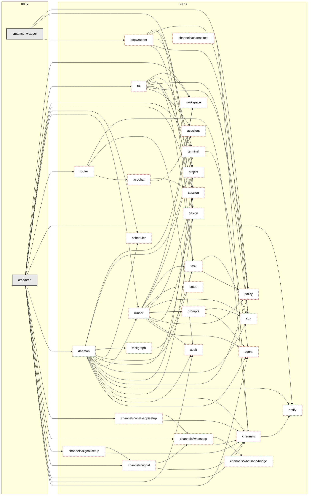

<!-- Code generated by internal/tools/pkgdoc; DO NOT EDIT. -->

# Package index

Generated from the package comments (doc.go) of every package under
`internal/` and from `go list -json ./...`. Do not edit by hand: change
the package's doc.go and run `task docs` (or `go run ./internal/tools/pkgdoc`).
`task docs:check` fails if this file is out of date. The conventions are in
[package-docs.md](package-docs.md).

Roles: **daemon** — the orch daemon process; **tui** — the TUI; **shared** —
used by both; **wrapper** — the acp-wrapper host. **TODO** means the package has
no doc.go or no valid `Role:` line yet.

## Packages

| Package | Role | Synopsis | Interfaces | Key types |
|---|---|---|---|---|
| `internal/acpchat` | TODO | Package acpchat is the reusable "tune in" primitive: it lets the daemon join the ACP conversation of an agent that is ALREADY RUNNING — the wolf, or the workingman agent — send it text as a prompt, collect the reply, and watch what the agent says to other clients, all while a TUI stays attached to the same session. (TODO: move package comment to doc.go) | — | `AskOption`, `Conversation`, `Event`, `EventKind`, `Options`, `PermissionDecision`, `PermissionOption`, `PermissionRequest`, `ProgressFunc` |
| `internal/acpclient` | TODO | Package acpclient is the workingman TUI's side of an ACP session: it dials a session's agent.sock (the unix-domain socket the acp-wrapper bridge exposes at ~/.workingman/sessions/<id>/agent.sock), speaks the Agent Client Protocol over it, sends prompts to the sandboxed Claude agent, and decodes the streamed assistant output for incremental display. (TODO: move package comment to doc.go) | — | `Client`, `ConfigOption`, `ConfigValue`, `Event`, `EventKind`, `Options`, `PlanEntry`, `RequestHandler`, `State` |
| `internal/acpwrapper` | TODO | Package acpwrapper implements the `acp-wrapper` binary's core: it creates an sbx claude sandbox with the acp-kit ACP bridge layered on, execs acp-kit's `claude-acp-client` entrypoint inside that sandbox (which speaks the Agent Client Protocol over the child process's stdio), and exposes a per-session unix-domain socket (`agent.sock`) that the workingman TUI connects to. (TODO: move package comment to doc.go) | — | `Config` |
| `internal/agent` | TODO | Package agent owns the process model for the orchestrator's claude-code sessions: an Agent has a Kind, a Spec describes how to launch one, and a Session is the live handle the daemon holds until the work finishes. (TODO: move package comment to doc.go) | `Launcher`, `Session` | `Kind`, `ProcessLauncher`, `Spec` |
| `internal/audit` | TODO | TODO | — | `Event`, `Logger` |
| `internal/channels` | TODO | Package channels is the messaging-channel foundation for the workingman daemon: a Channel interface that concrete transports (WhatsApp, …) implement, a Registry that owns the configured channels and fans messages out to them, a YAML config loader with topic routes, and a notify adapter so the daemon can notify channels through its existing notify.Sender plumbing. (TODO: move package comment to doc.go) | `Channel`, `Chunker`, `ConversationIndex`, `Typer` | `ChannelConfig`, `Config`, `ConversationTarget`, `CredentialRef`, `Credentials`, `Factory`, `FileConversationIndex`, `InboundHandler`, `InboundMessage`, `Notifier`, `NotifyConfig`, `OutboundMessage`, `Registry`, `Route`, `RouterConfig`, `Secret`, `SendResult` |
| `internal/channels/channeltest` | TODO | Package channeltest provides an in-memory fake channels.Channel for tests of code that sends to, or receives from, a channel. (TODO: move package comment to doc.go) | — | `Fake` |
| `internal/channels/signal` | TODO | Package signal is the Signal channel: a channels.Channel that talks to a signal-cli daemon running in HTTP mode (`signal-cli -a +15551234567 daemon --http 127.0.0.1:8080`). | — | `AccessConfig`, `AccessPolicy`, `Channel`, `Config`, `Decision`, `Inbound`, `Info`, `Options`, `Reason` |
| `internal/channels/signal/setup` | TODO | Package setup reads and writes the Signal channel's section of channels.yaml for `orch signal setup`, `status` and `test`. (TODO: move package comment to doc.go) | — | `Current`, `SaveResult`, `Store`, `Update` |
| `internal/channels/whatsapp` | TODO | Package whatsapp holds the WhatsApp-specific pieces of the messaging channels: today, the identity helpers and the AccessPolicy that decides which inbound messages may reach the daemon's agents. | `Resolver` | `AccessConfig`, `AccessPolicy`, `Backend`, `BridgeChannel`, `BridgeOptions`, `Channel`, `ChannelOption`, `CloudClient`, `CloudConfig`, `CloudOption`, `Decision`, `DirResolver`, `FactoryDeps`, `GraphError`, `Inbound`, `Kind`, `Mode`, `Option`, `PairOptions`, `PhoneNumberInfo`, `Reason`, `RetryPolicy`, `StaticResolver`, `WebhookConfig` |
| `internal/channels/whatsapp/bridge` | TODO | Package bridge runs and talks to the vendored Baileys WhatsApp bridge: the "personal number, QR pairing, no public webhook" WhatsApp backend. | `Process` | `APIError`, `Backoff`, `Client`, `Event`, `Health`, `Launch`, `ReadKey`, `SendResult`, `Starter`, `Supervisor`, `SupervisorStatus` |
| `internal/channels/whatsapp/setup` | TODO | Package setup holds the non-interactive core of `orch whatsapp setup`: the field validators (ported from hermes-agent's hermes_cli/setup_whatsapp_cloud.py), the read/merge/write of the whatsapp section of channels.yaml and its 0600 secrets file, secret masking, and the text that tells the user what to paste into Meta's developer console. | — | `Cred`, `Current`, `Guide`, `SaveResult`, `Store`, `Update`, `WebhookSettings` |
| `internal/daemon` | TODO | TODO | `ChannelSender` | `ACPInfo`, `AuditEvent`, `ChannelOption`, `Daemon`, `DaemonInfo`, `OfflineOptions`, `Option`, `ProjectLive`, `ProjectSnapshot`, `PullRequestSummary`, `ReviewPollInfo`, `RuntimeInfo`, `SessionInfo`, `SessionSnapshot`, `SessionStatus`, `Snapshot`, `TaskSnapshot`, `WolfSession`, `WorkingmanAgentConfig`, `WorkingmanAgentSession` |
| `internal/gitsign` | TODO | Package gitsign is the single source of truth for teaching a sandboxed agent to commit as the host user and to SSH-sign those commits. (TODO: move package comment to doc.go) | — | `Config`, `PushResult`, `RunFunc` |
| `internal/notify` | TODO | Package notify is the user-notification escape hatch for agents that need human attention — currently the wolf agent when a project becomes blocked. (TODO: move package comment to doc.go) | `Sender`, `TopicSender` | `Async`, `Call`, `Multi`, `Noop`, `Osascript`, `Recorder` |
| `internal/policy` | TODO | Package policy defines per-task sandbox policy rules and helpers to apply them via the sbx CLI. (TODO: move package comment to doc.go) | — | `Action`, `Kind`, `Rule` |
| `internal/project` | TODO | TODO | — | `BlockedSession`, `PlannedSnapshot`, `Project`, `PullRequest`, `Repo`, `Status`, `Writer` |
| `internal/prompts` | TODO | Package prompts renders the per-Kind instruction text the orchestrator gives a freshly launched claude session. (TODO: move package comment to doc.go) | — | `Data` |
| `internal/router` | TODO | Package router connects inbound channel messages (WhatsApp, …) to agent conversations and sends the replies back. (TODO: move package comment to doc.go) | `Agent`, `Auditor`, `Outbound`, `Source` | `Attacher`, `Config`, `Router`, `Session` |
| `internal/runner` | TODO | Package runner is the glue between the daemon and the agent process model. (TODO: move package comment to doc.go) | — | `CommandBuilder`, `InteractiveSpec`, `Observe`, `Plan`, `Runner`, `SandboxCreator`, `SandboxSpec` |
| `internal/sbx` | TODO | Package sbx wraps the parts of the sbx sandbox CLI's stable `sbx ls --json` read interface that more than one package needs to query. (TODO: move package comment to doc.go) | — | `Sandbox` |
| `internal/scheduler` | TODO | Package scheduler wraps robfig/cron with a small key/spec model the daemon can use to (re)register a project's cron schedule each time a project.yaml is observed. (TODO: move package comment to doc.go) | — | `Scheduler` |
| `internal/session` | TODO | Package session defines the on-disk layout that lets non-interactive ACP claude sessions survive a TUI restart. (TODO: move package comment to doc.go) | — | `Session`, `Status`, `Store` |
| `internal/setup` | TODO | Package setup prepares a workspace for an agent: writes the structured context file the agent reads at startup, writes the rendered instructions, and installs any task-specific skills into the workspace's .claude/skills/ directory. (TODO: move package comment to doc.go) | — | `Context`, `Skill` |
| `internal/task` | TODO | TODO | — | `Commit`, `Source`, `Status`, `Task` |
| `internal/taskgraph` | TODO | Package taskgraph turns a directory of tasks/*.yaml files into a queryable DAG. (TODO: move package comment to doc.go) | — | `Graph` |
| `internal/terminal` | TODO | Package terminal opens sessions in a new tab of the user's terminal emulator. (TODO: move package comment to doc.go) | `Launcher` | `AlreadyOpenError`, `Ghostty`, `Kitty`, `Runner`, `Settings`, `Tab`, `TabLauncher`, `TabRef`, `TabSession`, `WezTerm` |
| `internal/tui` | TODO | Package tui hosts the orch terminal UI. (TODO: move package comment to doc.go) | `InteractiveLauncher`, `TabFocuser` | `ProjectView`, `SessionView`, `TaskView` |
| `internal/workspace` | TODO | Package workspace owns the multi-repo directory each agent runs in. (TODO: move package comment to doc.go) | `Manager` | `Repo`, `StubManager`, `WspManager` |

## Dependency graph

Direct imports between internal packages; an arrow points from importer to
imported. The `cmd/` binaries are the entry points.

## Dependencies

The same graph as text: each package's internal imports and importers.

| Package | Imports | Imported by |
|---|---|---|
| `cmd/acp-wrapper` | `acpwrapper`, `gitsign`, `policy` | — |
| `cmd/orch` | `agent`, `audit`, `channels`, `channels/signal`, `channels/signal/setup`, `channels/whatsapp`, `channels/whatsapp/setup`, `daemon`, `notify`, `router`, `runner`, `scheduler`, `session`, `terminal`, `tui`, `workspace` | — |
| `internal/acpchat` | `acpclient`, `session` | `router` |
| `internal/acpclient` | — | `acpchat`, `tui` |
| `internal/acpwrapper` | `gitsign`, `policy`, `project`, `sbx`, `session`, `task` | `cmd/acp-wrapper` |
| `internal/agent` | — | `cmd/orch`, `daemon`, `prompts`, `runner`, `terminal` |
| `internal/audit` | — | `cmd/orch`, `daemon`, `router`, `runner` |
| `internal/channels` | `notify` | `cmd/orch`, `channels/channeltest`, `channels/signal`, `channels/signal/setup`, `channels/whatsapp`, `channels/whatsapp/setup`, `daemon`, `router` |
| `internal/channels/channeltest` | `channels` | — |
| `internal/channels/signal` | `channels`, `channels/whatsapp` | `cmd/orch`, `channels/signal/setup` |
| `internal/channels/signal/setup` | `channels`, `channels/signal` | `cmd/orch` |
| `internal/channels/whatsapp` | `channels`, `channels/whatsapp/bridge` | `cmd/orch`, `channels/signal`, `channels/whatsapp/setup` |
| `internal/channels/whatsapp/bridge` | — | `channels/whatsapp` |
| `internal/channels/whatsapp/setup` | `channels`, `channels/whatsapp` | `cmd/orch` |
| `internal/daemon` | `agent`, `audit`, `channels`, `gitsign`, `notify`, `policy`, `project`, `runner`, `sbx`, `scheduler`, `session`, `task`, `taskgraph`, `terminal`, `workspace` | `cmd/orch` |
| `internal/gitsign` | — | `cmd/acp-wrapper`, `acpwrapper`, `daemon`, `runner` |
| `internal/notify` | — | `cmd/orch`, `channels`, `daemon` |
| `internal/policy` | — | `cmd/acp-wrapper`, `acpwrapper`, `daemon`, `runner`, `task`, `tui` |
| `internal/project` | — | `acpwrapper`, `daemon`, `tui` |
| `internal/prompts` | `agent`, `sbx` | `runner` |
| `internal/router` | `acpchat`, `audit`, `channels` | `cmd/orch` |
| `internal/runner` | `agent`, `audit`, `gitsign`, `policy`, `prompts`, `sbx`, `session`, `setup`, `task`, `terminal`, `workspace` | `cmd/orch`, `daemon` |
| `internal/sbx` | — | `acpwrapper`, `daemon`, `prompts`, `runner`, `task`, `tui` |
| `internal/scheduler` | — | `cmd/orch`, `daemon` |
| `internal/session` | — | `cmd/orch`, `acpchat`, `acpwrapper`, `daemon`, `runner`, `tui` |
| `internal/setup` | — | `runner` |
| `internal/task` | `policy`, `sbx` | `acpwrapper`, `daemon`, `runner`, `taskgraph`, `tui` |
| `internal/taskgraph` | `task` | `daemon` |
| `internal/terminal` | `agent` | `cmd/orch`, `daemon`, `runner`, `tui` |
| `internal/tui` | `acpclient`, `policy`, `project`, `sbx`, `session`, `task`, `terminal`, `workspace` | `cmd/orch` |
| `internal/workspace` | — | `cmd/orch`, `daemon`, `runner`, `tui` |
