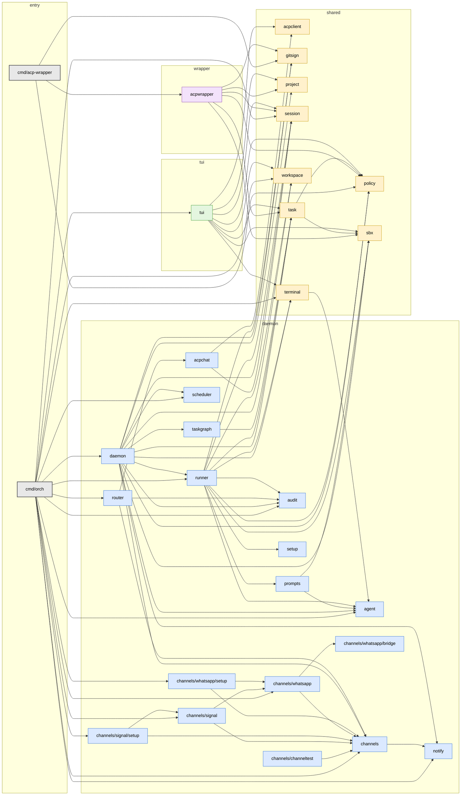

<!-- Code generated by internal/tools/pkgdoc; DO NOT EDIT. -->

# Package index

Generated from the package comments (doc.go) of every package under
`internal/` and from `go list -json ./...`. Do not edit by hand: change
the package's doc.go and run `task docs` (or `go run ./internal/tools/pkgdoc`).
`task docs:check` fails if this file is out of date. The conventions are in
[package-docs.md](package-docs.md).

Roles: **daemon** — the orch daemon process; **tui** — the TUI; **shared** —
used by both; **wrapper** — the acp-wrapper host. **TODO** means the package has
no doc.go or no valid `Role:` line yet.

## Packages

| Package | Role | Synopsis | Interfaces | Key types |
|---|---|---|---|---|
| `internal/acpchat` | daemon | Package acpchat lets the daemon join the ACP conversation of an agent that is already running, send it prompts and watch what it says, while a TUI stays attached to the same session. | — | `AskOption`, `Conversation`, `Event`, `EventKind`, `Options`, `PermissionDecision`, `PermissionOption`, `PermissionRequest`, `ProgressFunc` |
| `internal/acpclient` | shared | Package acpclient is the client side of an ACP session: it dials a session's agent.sock, speaks the Agent Client Protocol over it, and decodes the streamed agent output into Events. | — | `Client`, `ConfigOption`, `ConfigValue`, `Event`, `EventKind`, `Options`, `PlanEntry`, `RequestHandler`, `State` |
| `internal/acpwrapper` | wrapper | Package acpwrapper is the core of the acp-wrapper binary: it runs a Claude ACP agent inside an sbx sandbox and serves it to clients over a per-session unix socket, agent.sock. | — | `Config` |
| `internal/agent` | daemon | Package agent defines the process model for orch's claude-code sessions: agent kinds, the launch spec, and the Launcher and Session interfaces. | `Launcher`, `Session` | `Kind`, `ProcessLauncher`, `Spec` |
| `internal/audit` | daemon | Package audit writes and reads the daemon's append-only audit log of timestamped key=value events, and redacts secrets from text before it is published. | — | `Event`, `Logger` |
| `internal/channels` | daemon | Package channels is the messaging-channel foundation for the workingman daemon: the Channel interface transports implement, the Registry that runs them, and the channels.yaml config they are built from. | `Channel`, `Chunker`, `ConversationIndex`, `Typer` | `ChannelConfig`, `Config`, `ConversationTarget`, `CredentialRef`, `Credentials`, `Factory`, `FileConversationIndex`, `InboundHandler`, `InboundMessage`, `Notifier`, `NotifyConfig`, `OutboundMessage`, `Registry`, `Route`, `RouterConfig`, `Secret`, `SendResult` |
| `internal/channels/channeltest` | daemon | Package channeltest provides an in-memory fake channels.Channel for tests of code that sends to, or receives from, a channel. | — | `Fake` |
| `internal/channels/signal` | daemon | Package signal is the Signal channel: a channels.Channel that talks to a signal-cli daemon running in HTTP mode. | — | `AccessConfig`, `AccessPolicy`, `Channel`, `Config`, `Decision`, `Inbound`, `Info`, `Options`, `Reason` |
| `internal/channels/signal/setup` | daemon | Package setup reads and writes the Signal channel's section of channels.yaml for `orch signal setup`, `status` and `test`. | — | `Current`, `SaveResult`, `Store`, `Update` |
| `internal/channels/whatsapp` | daemon | Package whatsapp is the WhatsApp messaging channel: the Cloud API and Baileys bridge backends, plus the identity helpers and AccessPolicy they share. | `Resolver` | `AccessConfig`, `AccessPolicy`, `Backend`, `BridgeChannel`, `BridgeOptions`, `Channel`, `ChannelOption`, `CloudClient`, `CloudConfig`, `CloudOption`, `Decision`, `DirResolver`, `FactoryDeps`, `GraphError`, `Inbound`, `Kind`, `Mode`, `Option`, `PairOptions`, `PhoneNumberInfo`, `Reason`, `RetryPolicy`, `StaticResolver`, `WebhookConfig` |
| `internal/channels/whatsapp/bridge` | daemon | Package bridge runs and talks to the vendored Baileys WhatsApp bridge: the "personal number, QR pairing, no public webhook" WhatsApp backend. | `Process` | `APIError`, `Backoff`, `Client`, `Event`, `Health`, `Launch`, `ReadKey`, `SendResult`, `Starter`, `Supervisor`, `SupervisorStatus` |
| `internal/channels/whatsapp/setup` | daemon | Package setup holds the non-interactive core of `orch whatsapp setup`, `status` and `test`. | — | `Cred`, `Current`, `Guide`, `SaveResult`, `Store`, `Update`, `WebhookSettings` |
| `internal/daemon` | daemon | Package daemon is the orch control loop: it watches the orch roots, drives each project and task through its state machine, and launches the agent sessions that do the work. | `ChannelSender` | `ACPInfo`, `AuditEvent`, `ChannelOption`, `Daemon`, `DaemonInfo`, `OfflineOptions`, `Option`, `ProjectLive`, `ProjectSnapshot`, `PullRequestSummary`, `ReviewPollInfo`, `RuntimeInfo`, `SessionInfo`, `SessionSnapshot`, `SessionStatus`, `Snapshot`, `TaskSnapshot`, `WolfSession`, `WorkingmanAgentConfig`, `WorkingmanAgentSession` |
| `internal/gitsign` | shared | Package gitsign makes a sandboxed agent commit as the host user, SSH-sign those commits, and check that the SSH agent forwarded into the sandbox can sign and push. | — | `Config`, `PushResult`, `RunFunc` |
| `internal/notify` | daemon | Package notify is the daemon's user-notification interface: how an agent that needs human attention reaches a person. | `Sender`, `TopicSender` | `Async`, `Call`, `Multi`, `Noop`, `Osascript`, `Recorder` |
| `internal/policy` | shared | Package policy defines the per-task sandbox policy rules (allow or deny one network or filesystem resource pattern) and turns them into `sbx policy` commands. | — | `Action`, `Kind`, `Rule` |
| `internal/project` | shared | Package project is the data model and on-disk format of a work stream's project.yaml, plus the two sidecar records the daemon and the wolf agent keep next to it. | — | `BlockedSession`, `PlannedSnapshot`, `Project`, `PullRequest`, `Repo`, `Status`, `Writer` |
| `internal/prompts` | daemon | Package prompts renders the per-kind instruction text that orch writes to .orch/instructions.md for a newly launched agent. | — | `Data` |
| `internal/router` | daemon | Package router connects inbound channel messages (WhatsApp, Signal) to agent conversations and sends the replies back. | `Agent`, `Auditor`, `Outbound`, `Source` | `Attacher`, `Config`, `Router`, `Session` |
| `internal/runner` | daemon | Package runner turns the daemon's request to launch an agent (a Plan) into a running session: it prepares the workspace, writes the .orch handoff, and starts the agent over ACP or in a terminal tab. | — | `CommandBuilder`, `InteractiveSpec`, `Observe`, `Plan`, `Runner`, `SandboxCreator`, `SandboxSpec` |
| `internal/sbx` | shared | Package sbx holds the shared helpers for the sbx sandbox CLI: sandbox-name rules and the `sbx ls --json` existence check. | — | `Sandbox` |
| `internal/scheduler` | daemon | Package scheduler runs the daemon's timed callbacks (project cron schedules and PR review polls) on robfig/cron, keyed by a caller-chosen string. | — | `Scheduler` |
| `internal/session` | shared | Package session defines the on-disk record (session.json and agent.sock under ~/.workingman/sessions/<id>/) that lets ACP agent sessions outlive the TUI and the daemon that started them. | — | `Session`, `Status`, `Store` |
| `internal/setup` | daemon | Package setup writes the .orch handoff files and installs skills in an agent's working directory before the agent is launched. | — | `Context`, `Skill` |
| `internal/task` | shared | Package task is the data model and on-disk format of one tasks/*.yaml file, including the task-name rules that keep a task's sandbox name legal. | — | `Commit`, `Source`, `Status`, `Task` |
| `internal/taskgraph` | daemon | Package taskgraph loads a project's tasks/*.yaml files into an immutable, validated dependency graph that the daemon queries to decide what to dispatch next. | — | `Graph` |
| `internal/terminal` | shared | Package terminal opens sessions in new tabs of the user's terminal emulator (Ghostty, WezTerm or kitty) and tracks those tabs across orch restarts. | `Launcher` | `AlreadyOpenError`, `Ghostty`, `Kitty`, `Runner`, `Settings`, `Tab`, `TabLauncher`, `TabRef`, `TabSession`, `WezTerm` |
| `internal/tui` | tui | Package tui is the orch terminal UI: a bubbletea program that shows live agent sessions, the work-stream (project) gallery and its tasks, and lets the user steer work streams by writing their project.yaml files. | `InteractiveLauncher`, `TabFocuser` | `ProjectView`, `SessionView`, `TaskView` |
| `internal/workspace` | shared | Package workspace provisions and tears down the multi-repo directory each agent runs in, with the wsp CLI behind a small Manager interface. | `Manager` | `Repo`, `StubManager`, `WspManager` |

## Dependency graph

Direct imports between internal packages; an arrow points from importer to
imported. The `cmd/` binaries are the entry points.

## Dependencies

The same graph as text: each package's internal imports and importers.

| Package | Imports | Imported by |
|---|---|---|
| `cmd/acp-wrapper` | `acpwrapper`, `gitsign`, `policy` | — |
| `cmd/orch` | `agent`, `audit`, `channels`, `channels/signal`, `channels/signal/setup`, `channels/whatsapp`, `channels/whatsapp/setup`, `daemon`, `notify`, `router`, `runner`, `scheduler`, `session`, `terminal`, `tui`, `workspace` | — |
| `internal/acpchat` | `acpclient`, `session` | `router` |
| `internal/acpclient` | — | `acpchat`, `tui` |
| `internal/acpwrapper` | `gitsign`, `policy`, `project`, `sbx`, `session`, `task` | `cmd/acp-wrapper` |
| `internal/agent` | — | `cmd/orch`, `daemon`, `prompts`, `runner`, `terminal` |
| `internal/audit` | — | `cmd/orch`, `daemon`, `router`, `runner` |
| `internal/channels` | `notify` | `cmd/orch`, `channels/channeltest`, `channels/signal`, `channels/signal/setup`, `channels/whatsapp`, `channels/whatsapp/setup`, `daemon`, `router` |
| `internal/channels/channeltest` | `channels` | — |
| `internal/channels/signal` | `channels`, `channels/whatsapp` | `cmd/orch`, `channels/signal/setup` |
| `internal/channels/signal/setup` | `channels`, `channels/signal` | `cmd/orch` |
| `internal/channels/whatsapp` | `channels`, `channels/whatsapp/bridge` | `cmd/orch`, `channels/signal`, `channels/whatsapp/setup` |
| `internal/channels/whatsapp/bridge` | — | `channels/whatsapp` |
| `internal/channels/whatsapp/setup` | `channels`, `channels/whatsapp` | `cmd/orch` |
| `internal/daemon` | `agent`, `audit`, `channels`, `gitsign`, `notify`, `policy`, `project`, `runner`, `sbx`, `scheduler`, `session`, `task`, `taskgraph`, `terminal`, `workspace` | `cmd/orch` |
| `internal/gitsign` | — | `cmd/acp-wrapper`, `acpwrapper`, `daemon`, `runner` |
| `internal/notify` | — | `cmd/orch`, `channels`, `daemon` |
| `internal/policy` | — | `cmd/acp-wrapper`, `acpwrapper`, `daemon`, `runner`, `task`, `tui` |
| `internal/project` | — | `acpwrapper`, `daemon`, `tui` |
| `internal/prompts` | `agent`, `sbx` | `runner` |
| `internal/router` | `acpchat`, `audit`, `channels` | `cmd/orch` |
| `internal/runner` | `agent`, `audit`, `gitsign`, `policy`, `prompts`, `sbx`, `session`, `setup`, `task`, `terminal`, `workspace` | `cmd/orch`, `daemon` |
| `internal/sbx` | — | `acpwrapper`, `daemon`, `prompts`, `runner`, `task`, `tui` |
| `internal/scheduler` | — | `cmd/orch`, `daemon` |
| `internal/session` | — | `cmd/orch`, `acpchat`, `acpwrapper`, `daemon`, `runner`, `tui` |
| `internal/setup` | — | `runner` |
| `internal/task` | `policy`, `sbx` | `acpwrapper`, `daemon`, `runner`, `taskgraph`, `tui` |
| `internal/taskgraph` | `task` | `daemon` |
| `internal/terminal` | `agent` | `cmd/orch`, `daemon`, `runner`, `tui` |
| `internal/tui` | `acpclient`, `policy`, `project`, `sbx`, `session`, `task`, `terminal`, `workspace` | `cmd/orch` |
| `internal/workspace` | — | `cmd/orch`, `daemon`, `runner`, `tui` |
