# Parallel tasks via per-task worktrees

**Status:** plan (no code changes yet).

## Goal

Today a project's tasks run strictly one at a time, and every task agent works
— and its commit agent commits — directly in the single wsp workspace checked
out on the project's shared branch. This plan changes that so that:

- **Every task agent works and commits in its own git worktree on a per-task
  branch**, isolated from every other task in the project.
- **A single-threaded-per-project commit agent integrates** each finished
  task's commits back onto the one branch shared by all agents in the project,
  serializing those integrations through a per-project commit queue.
- With task work isolated and integration serialized, the daemon can **run
  unrelated tasks in parallel** (bounded by a per-project concurrency limit)
  instead of one at a time.

The rest of this document first records how the system behaves today (verified
against the code on this branch), then lays out the design and a phased
rollout.

## Contents

1. [Current behavior](#current-behavior)
2. [Worktrees](#worktrees) — where per-task worktrees are created, named and
   cleaned up
3. [Integration & conflicts](#integration--conflicts) — merge vs rebase vs
   cherry-pick onto the shared branch; block / retry / re-run on conflict
4. [Scheduler & dispatch](#scheduler--dispatch) — parallel task dispatch, the
   per-project concurrency limit, the serialized commit queue
5. [Planning independence hints](#planning-independence-hints) — how the
   planning agent marks tasks as safe to run concurrently
6. [Schema/state changes](#schemastate-changes) — task YAML, `project.yaml`,
   audit events, the state snapshot
7. [Interactions](#interactions) — review agent, PRs, cron, wolf, stop/start,
   daemon restart recovery
8. [Risks & open questions](#risks--open-questions)
9. [Phased rollout](#phased-rollout)

---

## Current behavior

Everything in this section was checked against the code. Where `agents.md`,
`design.md`, `state-machine.md` or `docs/state-snapshot.md` say something
different, the code wins and the difference is noted. References are
`file:function` and are relative to the repo root.

### 1. How work reaches the daemon (watcher and event routing)

- `internal/daemon/daemon.go:Run` installs an fsnotify watch on every directory
  under each `--root` (`internal/daemon/watcher.go:addTree`). Next it runs
  `reconcileSessions` (adopts live ACP sessions left by a previous daemon, §7),
  then `startupScan`, then starts `reapLoop`, then enters the event loop.
- `internal/daemon/daemon.go:dispatchEvent` runs each fsnotify event on its own
  goroutine, **chained per containing directory**. Events for one project's
  directory run strictly in arrival order. Events for different projects run
  in parallel. This is the only cross-project parallelism that exists today. It
  was added so that one project's slow `wsp new` cannot stall another project
  (see `internal/daemon/concurrency_test.go:TestSlowWorkspaceProvisioningDoesNotDelayOtherProject`
  and `TestSameProjectEventsStillProcessInOrder`).
- `internal/daemon/watcher.go:handlerFor` routes by filename:
  `project.yaml` → `handleProject`, `project.md` → `handleProjectSeed`,
  `intake/*.md` → `handleIntakeFile`, `tasks/*.yaml` → `handleTask`.
  **Task files are observation-only.** `internal/daemon/dispatch.go:handleTask`
  only writes a `task_file_updated` audit line. Every task-lifecycle decision is
  made in session-end callbacks (§3), because an agent can write
  `status: success` and exit before the daemon would have noticed the file
  change.
- `internal/daemon/dispatch.go:handleProject` drops events whose
  `updated_by` is `daemon`, which breaks write→event loops.
  `revisitProject` re-reads the file and skips that filter. Session-end
  callbacks, cron and the startup scan use it.
- `internal/daemon/watcher.go:startupScan` walks every `project.yaml` with a
  fan-out of `startupScanConcurrency = 8` projects. For each one it calls
  `releaseOrphanedTasks` (§7) and then `revisitProject`.

### 2. How the daemon picks the next task — one at a time

`internal/daemon/dispatch.go:dispatchProject` is the single router. It handles,
in order:

1. a power deferral;
2. `stopped` → `enforceStopped`;
3. an unpopulated project → the project agent;
4. the `created_at` stamp;
5. cron registration;
6. `cleanup: true` → the archive agent;
7. the seed/intake re-arm;
8. the `status` switch.

For `status: working` it can launch planning for unoffered intake. It then
always calls `dispatchNextTask`. For `idle` it calls `dispatchPendingTasks`
for manually added tasks.

`internal/daemon/dispatch.go:dispatchNextTask`:

1. Loads the graph with `loadTaskGraph`. That calls `taskgraph.Load` on
   `<control-dir>/tasks/`. A structural error blocks the project, unless a
   planner is in flight (`deferToPlanner`).
2. If `g.AllCommitted()`, it calls `transitionProjectComplete` (in
   `internal/daemon/review.go`). That writes `idle`, or idle-and-watching
   when a PR is involved.
3. Otherwise it calls `dispatchReadyOrPending`:
   - **Commit recovery first.** `firstUncommittedSuccess` returns the first
     task, by name, still at `success`, and `launchCommitAgent` is called for
     it. This resumes a task→commit handoff that a restart interrupted.
   - Otherwise it takes `g.Ready()` and dispatches **only `ready[0]`** via
     `dispatchReadyTask`.

`internal/taskgraph/graph.go:Ready` returns every task with
`status: ready` whose `depends_on` are all `committed` (`depsCommitted`),
sorted by name. The graph can already list several runnable tasks, but the
daemon takes the first and ignores the rest. `depends_on` is the only ordering
or independence signal in the schema (`internal/task/task.go:Task`). There is
no notion of file or area hints.

`internal/daemon/dispatch_lifecycle.go:dispatchReadyTask` sends a push task
(`t.IsPushTask()`) straight to `launchCommitAgent`. It has no code work of its
own. Every other task goes to `launchTaskAgent`.

**Strict serialization comes from the session map, not from the scheduler.**

- `Daemon.sessions` (`internal/daemon/daemon.go`) is a
  `map[string]sessionEntry` keyed by project path.
- `trackConfiguredSession` refuses a second entry under an existing key.
- `hasSession(key)` is checked before every main-slot launch.
- Project, task, commit and review agents all share the **bare project path**
  as their key, the project's "main slot". So at most one of them runs per
  project at any moment.
- Only the planner (`#planning`), wolf (`#wolf`) and archive (`#archive`)
  agents have suffixed keys and can run alongside the main slot.
  See `planningSessionKey`, `wolfSessionKey`, `archiveSessionKey` and
  `runsAlongsidePlanning` (task/commit only).

`internal/scheduler/scheduler.go` is not a task scheduler. It is a thin keyed
wrapper over `robfig/cron`. It drives:

- project cron schedules (`dispatch.go:registerCronIfAny` → `onCronFired` →
  `runCron`);
- the PR poll (`reviewPollKey`, `review.go:onReviewPoll`).

A cron firing on a `working` project only re-enters `revisitProject`
(`requestCronReplan` deliberately refuses to re-plan mid-flight). That works
as a recovery poll for `dispatchNextTask`.

### 3. The task → commit → next-task chain

The chain is built entirely from session-end callbacks. `trackConfiguredSession`
removes the map entry **before** it calls `onEnd`, so each callback is free to
launch the next agent under the same key.

- `internal/daemon/dispatch.go:launchTaskAgent`:
  1. Returns early (`session_skip_duplicate`) if the main slot is busy.
  2. Builds a `runner.Plan{Kind: TaskAgent, Branch: p.Branch, Repos:
     workspaceReposFor(p), TaskPath, TaskName, StaticMCPs, Policies,
     SaveSandbox, Model, Harness}` with **no `WorkingDir`**.
  3. Persists `ready → running` (`dispatch_lifecycle.go:markTaskRunning`,
     which uses `task.Update` and only moves a task that is still `ready`).
  4. Calls `startSessionTracked(projectPath, …)`.
  5. Its callback is `afterTaskSession`. If the launch fails, it calls
     `releaseRunningTask` and then `transitionProjectBlocked`.
- `internal/daemon/dispatch_lifecycle.go:afterTaskSession` re-reads the task:
  - `success` → `launchCommitAgent`;
  - `failed`/`running`/`ready` → `handleTaskFailure`. That bumps `attempts`,
    resets to `ready` and relaunches immediately, up to
    `maxTaskAttempts = 3`; after that it calls `retainSandbox` and blocks.
  - `blocked` → `retainSandbox` and block;
  - `committed` → block, because a task agent must not commit.
  - If the project was stopped meanwhile (`isStopped`), it only calls
    `releaseRunningTask`.
- `internal/daemon/dispatch_lifecycle.go:launchCommitAgent` builds the same
  workspace-shaped plan (`Kind: CommitAgent`, same `Branch`/`Repos`, same
  `TaskName`, so the **same sandbox name**). It sets `PushBranch:
  t.IsPushTask()` and takes the main slot.
- `internal/daemon/dispatch_lifecycle.go:afterCommitSession`:
  1. Requires `status: committed`, otherwise it blocks, using
     `runner.StartFailure` for the reason.
  2. Stamps `completed_at`.
  3. Reloads the graph.
  4. Then, in order:
     - all committed → `transitionProjectComplete`;
     - another `success` task → commit it;
     - nothing ready → block (`"no ready tasks remain but project is not fully
       committed"`), unless a planner is running;
     - otherwise → `dispatchReadyTask(ready[0])`.

So the steady state for one project is a strict pipeline:
task₁ → commit₁ → task₂ → commit₂ → … Each step waits for the previous
session to end.

### 4. How an agent is launched and where it works

`internal/runner/runner.go:StartConfigured` is the single launch path. It is
called by `internal/daemon/dispatch.go:startSessionTracked`.

- **Choosing the checkout.** `resolveWorkingDir` uses `Plan.WorkingDir` if it
  is set. Otherwise it calls `r.Workspaces.Create(ctx, p.Branch, p.Repos)`.
  The rule per agent kind:
  - Control dir (`WorkingDir = filepath.Dir(projectPath)`): project, planning,
    wolf and review agents.
  - The wsp workspace (no `WorkingDir`): task, commit and archive agents.
  - The workspace is keyed **only on the project branch**. Every task and
    commit agent in a project therefore resolves to **the same directory**.
  - Planning and an ACP wolf also mount that same workspace, read-only by
    convention, as a second mount (`resolvePlanningWorktree`,
    `resolveWolfWorktree`).
- **Prompt and context.** `prompts.Render` fills the `.tmpl` for the kind.
  `internal/setup/setup.go:Apply` then writes `.orch/instructions.md` and
  `.orch/context.yaml` into **the root of the working dir**. For task and
  commit agents that is the shared wsp workspace root. Two agents launched
  into the same workspace at once would overwrite each other's `.orch/` files.
  Today this cannot happen only because the main slot is single-occupancy.
- **Task prompt** (`internal/prompts/templates/task.tmpl`): "The workspace
  already contains the repos listed in the project file, all on branch
  `{{.Branch}}` … Do not commit, push, or change `project.yaml`". The agent
  writes `status: success|failed` to its task file.
- **Commit prompt** (`internal/prompts/templates/commit.tmpl`): for every repo
  with modifications, stage everything, make one commit, and capture
  `git rev-parse HEAD`. It does not push, except for a push task. It writes
  `status: committed`, `summary`, `commits: [{repo, hash}]` and
  `created_files`. In other words, the commit agent commits **whatever is in
  the shared working tree** directly onto the project branch. No integration
  step exists, because the task worked on that branch in the first place. Push
  tasks run `git -C <repo> push` for `source.repo`, with no force. A rejection
  sets the task `blocked`.
- **Sandbox and mounts.**
  - `runner.go:sandboxWorkspaces` mounts `[workspace, control-dir]` for
    task/commit/archive. The control-dir mount is how the agent's write to
    `tasks/<name>.yaml` lands.
  - It mounts `[control-dir, workspace]` for planning and the wolf.
  - Sandbox names come from `SandboxNameFor` / `ACPSandboxNameFor`. A task
    gets `<work-stream>-<task-name>`, and its commit agent reuses that
    sandbox. Planning gets `<work-stream>`. The rest get
    `-project`/`-review`/`-archive`/`-wolf`.
  - All names are sanitized and length-fitted by
    `internal/sbx/name.go:SanitizeName`.
  - So sandboxes are already per task. Only the **git checkout** is shared.
- **Launch mechanism.**
  - In production every autonomous kind goes through `runner.go:startACP`. It
    writes `session.json` (with `ProjectPath`, `TaskPath`, `Kind` and
    `Workspaces`) under the sessions root, then starts an `acp-wrapper` host
    process via `r.AcpLauncher`.
  - The wrapper (`internal/acpwrapper/acpwrapper.go:Run`, `ensureSandbox`)
    creates the sandbox and runs the ACP client.
  - On exit `removeSandboxOnExit` runs `sbx rm --force` unless
    `save_sandbox` is set or `keepForTaskStatus` holds (failed, blocked or
    running).
  - Without an ACP launcher, the legacy path runs `sbx exec -it -w
    <workspace> <sandbox> claude …` in a terminal tab via `r.Launcher`
    (`internal/agent/agent.go:Launcher`, `internal/agent/process.go`).
- `internal/agent` only defines `Kind`, `Spec`, `Session{Name, Wait, Close}`
  and `Launcher`. It knows nothing about checkouts.

### 5. How wsp workspaces are created, mounted and removed

- `internal/workspace/manager.go:Manager` has four methods:
  - `Create(ctx, branch, repos)` — "the branch name is also used as the
    workspace name and the per-repo feature branch";
  - `Path(branch)`;
  - `Remove(ctx, branch, force)`;
  - `AddRepos(ctx, branch, repos)`.
- `internal/workspace/wsp.go:WspManager.Create`:
  1. `ensureCreated` creates `new_repos` on GitHub via `gh`.
  2. `ensureRegistered` adds missing repos to the wsp registry.
  3. Runs `wsp new --json <branch> <repo…>`.
  4. On "already exists" it returns `Path(branch)` and does **not** reset
     HEAD. That idempotency is what lets every task/commit launch call
     `Create` again.
  5. Only on first creation, `applyBaseBranches` runs `git fetch origin
     <base>` and `git checkout -B <branch> origin/<base>` per repo.
  - The result is one wsp workspace (by default `~/dev/workspaces/<branch>/`)
    holding one clone or worktree per repo, all on `<branch>`.
- `WspManager.AddRepos` (`wsp repo add`) clones repos added to an existing
  workspace. It is driven from
  `internal/daemon/repo_sync.go:syncPlannedRepos` at planning launch.
- `internal/workspace/stub.go:StubManager` is the test/dev implementation. It
  just does `mkdir <root>/<branch>`.
- **Removal.** The daemon never removes a workspace. The only caller of
  `Remove` is the TUI's `:archive` (`internal/tui/archive.go`). It first
  deletes `<workspace>/.orch` (`removeWorkspaceOrch`), then calls `wsp rm
  --force <branch>`, after the archive agent has set `archive: true`.
- The daemon never runs `git worktree` itself, and there is no per-task
  branch anywhere.

### 6. Existing concurrency guards

Everything below is per project unless stated otherwise.

| Guard | Where | What it prevents |
|---|---|---|
| Per-directory event chain | `daemon.go:dispatchEvent` | Two events for the same project running concurrently. |
| Main-slot single occupancy | `daemon.go:trackConfiguredSession`, `hasSession`, checked in `launchTaskAgent` / `launchCommitAgent` / `launchProjectRootAgent` / `dispatchReviewAgent` | More than one project/task/commit/review agent per project. |
| Planning reservation | `dispatch.go:beginPlanning` / `endPlanning` / `planningInFlight` | Two planners, including during the seconds `runner.Start` spends provisioning. `deferToPlanner` holds off graph-wide decisions (complete/block) while a planner may be mid-write. Review also stands aside for a planner. |
| Cleanup reservation | `dispatch_lifecycle.go:beginCleanup` / `endCleanup` | Two archive agents for one `:cleanup`. |
| `markTaskRunning` / `releaseRunningTask` | `dispatch_lifecycle.go` | Re-picking a task already handed out. Undoes the running write on a failed launch, a stop, or an orphaned task. |
| Stop | `stop.go:enforceStopped`, `killProjectSessions`, `isStopped` | Kills the bare key and every `path#…` key and unregisters cron and the `#review` poll. `afterTaskSession` / `afterCommitSession` check `isStopped` and bail instead of retrying or blocking. |
| Reaper | `reaper.go:reapLoop` / `reapStrandedSessions` / `strandedVerdict` / `stageComplete` | A wrapper that never exits holding the main slot forever. Every 30s it closes a session whose task reached a terminal status for its kind (task: success/failed; commit: committed) for at least 90s (`sessionDoneGrace`), or that has been idle for 20m (`defaultSessionIdleTimeout`). Closing it fires the normal `onEnd`. Interactive (wolf) and workingman sessions are never reaped. |
| Restart reconcile | `reconcile.go:reconcileSessions` | Duplicate agents after a daemon restart. Adopts `running`/`starting` ACP sessions from `session.json` under the same key they had. Re-takes the planning and cleanup reservations. Task and commit sessions are adopted under the bare project path with an `onEnd` that calls `releaseRunningTask` and then `revisitProject`, **not** `afterTaskSession`/`afterCommitSession`. |
| Orphan release | `dispatch_lifecycle.go:releaseOrphanedTasks` (from `startupScan`) | A task left at `running` with no adopted session never being re-dispatched. |
| Startup fan-out bound | `watcher.go:startupScanConcurrency = 8` | A burst of `wsp new` calls on restart. |

All of these guards assume **one main-slot session per project**. Several of
them key their state on the bare project path:

- `taskSessionLive` compares a single `sessions[projectPath].taskName`;
- `reconcileSessions` adopts task/commit sessions under the bare key;
- the reaper loads tasks by `e.taskName` from that key.

A parallel design has to re-key all of them.

### 7. Where the docs differ from the code

- `docs/state-snapshot.md` lists session keys as "the `project.yaml` path,
  plus `#wolf` / `#archive`". The code also uses `#planning`
  (`planningSessionKey`), and planning is tracked outside the main slot.
- `agents.md`, task agent: "`dispatchNextTask` … has a task in `Ready()`" is
  accurate, but note that only `Ready()[0]` is ever dispatched.
- The comment on `internal/daemon/dispatch.go:dispatchPendingTasks` still
  mentions `reviewing`/`done` statuses. The code now routes from `idle`
  (with `WatchingPR`) and `merged` (`internal/project/status.go`).
- `internal/runner/runner.go:StartConfigured` comments say planning mounts
  "the same wsp worktree the task/commit agents will later use". That is
  accurate, and it is a reason the planner currently sees in-progress,
  uncommitted task edits in its source mount.

### Summary of the starting point

- Exactly one wsp workspace per project. It is keyed on `project.branch` and
  shared by every task, commit and archive agent, and also mounted by
  planning and the wolf.
- Task agents edit the shared tree. The commit agent then commits that tree
  directly on the shared branch. No per-task branch or integration step
  exists.
- The daemon dispatches only `Ready()[0]`. The single main session slot per
  project, not the scheduler, enforces one task-or-commit agent at a time.
- Sandboxes are already per task (`<work-stream>-<task>`), with the commit
  agent reusing its task's sandbox. That part of the isolation is already in
  place.

---

## Worktrees

This section says where each task's isolated checkout lives, how it is named,
which commit it starts from, how it reaches the sandbox, and when it goes away.
It builds on the [current behavior](#current-behavior) above: one wsp workspace
per project (§5), task sandboxes already separate (§4), and only the git
checkout shared.

### W1. Terms

- **Shared workspace.** The project's existing wsp workspace, from
  `workspace.Manager.Create(branch, repos)`. By default this is
  `~/dev/workspaces/<project-branch>/`. It has one directory per repo
  (`workspace.Repo.DirName`), and each repo's main working tree is checked out
  on the **shared branch**, `project.branch`. Nothing in this design changes
  how it is created, mounted for planning and the wolf, or removed by
  `:archive`.
- **Task worktree.** A per-task directory holding one `git worktree` per
  project repo. Each is checked out on that task's **task branch**.
- **Shared tip.** `git -C <shared>/<repo> rev-parse refs/heads/<project-branch>`
  for a repo. It is the local ref, not `origin/…`, because integrated commits
  stay local until a push task or the archive agent publishes them.

### W2. Path layout

```
~/dev/workspaces/<project-branch>/          # shared workspace (wsp-managed)
├── .wsp.yaml
├── .orch/                                  # commit/archive agent handoff (today's location)
├── <repo-a>/                               # main working tree, on <project-branch>
│   └── .git/                               # common git dir for all worktrees of repo-a
│       └── worktrees/<task-name>/          # git's per-worktree admin dir
├── <repo-b>/
└── .worktrees/
    └── <task-name>/                        # task worktree root = task agent cwd
        ├── .orch/                          # task agent's instructions.md / context.yaml
        ├── <repo-a>/                       # git worktree of repo-a on the task branch
        └── <repo-b>/                       # git worktree of repo-b on the task branch
```

Why this layout:

- **The task worktree root has the same shape as a wsp workspace:** one
  `DirName()` directory per repo. The task prompt's "the workspace contains the
  repos …", `task.Commit.Repo` ("workspace-relative directory name") and the
  `.gomodcache` probe in `acpwrapper` (`goModCacheDir`, which looks at every
  workspace mount) all keep working without changes.
- **`.orch/` moves to a per-task directory.** `setup.Apply` writes into the
  root of the working dir. Giving each task agent its own root fixes the
  `.orch/` overwrite hazard that §4 notes would appear as soon as two agents
  share the workspace root.
- **Inside the shared workspace, not next to it.** `wsp rm --force` on
  `:archive` deletes `.worktrees/` along with the repos whose `.git` holds the
  worktree metadata. Nothing is left behind outside the directory wsp
  manages, and no new root needs configuring. The workspace root already holds
  orch-owned content (`.orch/`, which `removeWorkspaceOrch` handles), so
  `.worktrees/` follows that precedent. The daemon owns `.worktrees/`; wsp
  never reads it.
- **Multi-repo projects get a worktree for every repo in
  `workspaceReposFor(p)`,** not just the repos the task is expected to touch.
  No reliable per-task repo list exists before the task runs (the
  file/area hints in [Planning independence hints](#planning-independence-hints)
  are advisory). A `git worktree add` costs only a checkout, and integration
  skips repos with no new commits (I3). Repos added later through
  `AddRepos` / `syncPlannedRepos` show up in the next task worktree created
  after them. An existing task worktree is never extended mid-flight.
- Today's repo is a full clone (`.git/` is a directory). If wsp ever makes
  the per-repo directory itself a worktree, `git worktree add` still works,
  because git resolves the common dir. The mount rule in W5 uses
  `git rev-parse --git-common-dir` rather than assuming `<repo>/.git`.

`<task-name>` is the task's `name:`. That is already a valid sandbox-name
suffix (`sbx.NameBudget`), so it is filesystem-safe and unique within the
project.

### W3. Branch naming

The obvious name, `<project-branch>/task/<task-name>`, **does not work**. Git
stores branches as files under `refs/heads/`, so a ref
`refs/heads/<project-branch>` and a directory
`refs/heads/<project-branch>/…` cannot both exist. I verified this:
`git branch feat/task/a` fails with `'refs/heads/feat' exists; cannot create
'refs/heads/feat/task/a'`. Task branches therefore live in their own
namespace:

```
wm/<project-branch>/<task-name>
```

- The `wm/` prefix keeps task branches apart from user and PR branches. It
  makes the reaper's GC (W7) a simple prefix scan (`git for-each-ref
  refs/heads/wm/<project-branch>/`), and it says plainly that workingman owns
  these branches and may delete them.
- `<project-branch>` may itself contain `/` (for example `feat/x`), which is
  fine. Two projects whose branches nest (`a` and `a/b`) could in theory
  collide (`wm/a/b` as task `b` of project `a`, versus the `wm/a/b/` directory
  of project `a/b`). This needs two projects with nested branch names that
  share a repo, which is unlikely. The daemon checks for it when it creates a
  worktree: if `git worktree add -b` fails on a ref-lock error, the task is
  blocked with a clear reason, rather than escaping branch names up front.
- Task branches are **never pushed**. Push tasks and the archive agent push
  only the shared branch (`commit.tmpl`: "push ONLY that repo … do NOT push a
  different branch"). That property is what makes rebasing them safe (I2).
- A retry or re-run reuses the same branch name (see W6). The branch is
  recreated, not appended to, so the name always means "the current attempt".
  The previous attempt's tip is kept under
  `refs/wm/<project-branch>/<task-name>/attempt-<n>` when it carried commits.
  That is a non-branch ref, so it never shows in `git branch` or gets pushed.
  The re-run agent and the wolf can still diff against it.

### W4. Base commit

A task worktree is created **when the task is dispatched**, by the daemon, on
the host, right before `launchTaskAgent` starts the session. This is the point
where `markTaskRunning` flips `ready → running` today. It is cut, per repo,
from the **shared tip at that moment**:

```
git -C <shared>/<repo> worktree add -b wm/<pb>/<task> \
    <shared>/.worktrees/<task>/<repo> refs/heads/<pb>
```

- **Dependencies are already in.** `taskgraph.Ready` only returns a task once
  every `depends_on` entry is `committed`. Under this design `committed` means
  "integrated onto the shared branch" (see I5). So the shared tip at dispatch
  already contains the work of everything the task depends on. Independent
  tasks dispatched at the same time all start from the same tip.
- **Not `origin/<base_branch>`.** `applyBaseBranches` uses that only when a
  workspace is first created. After that the local shared branch is the truth,
  and may be ahead of any remote.
- **Record the base.** The daemon writes the per-repo base SHAs into the task
  file (`base: [{repo, hash}]`, the same shape as `commits:`; the schema work
  belongs to [Schema/state changes](#schemastate-changes)). Integration (I3)
  uses it to tell a fast-forward from a rebase. The wolf uses it to see how
  stale a blocked task was.
- **Push tasks get no worktree.** A push task (`t.IsPushTask()`) has no code
  work of its own (`dispatchReadyTask` sends it straight to
  `launchCommitAgent`). It publishes the shared branch, so it runs in the
  shared workspace, through the commit queue (I1), exactly as it does today.
- **Failure creating the worktree** (a git error, disk full, the branch
  already exists and could not be cleared) is handled like a failed launch:
  `releaseRunningTask` and then `transitionProjectBlocked`. The wsp workspace
  provisioning failures that `startSessionTracked` reports today are handled
  the same way.

Creation is idempotent, which matters for restart recovery. If
`.worktrees/<task>/<repo>` already exists **and** is registered in
`git worktree list --porcelain` on `wm/<pb>/<task>`, the daemon reuses it.
Anything else (a stray directory, a branch on the wrong commit, a worktree
whose directory vanished) is removed and recreated (W6). `git worktree add`
refuses to check out a branch that is checked out elsewhere, which gives a
second guard against two sessions sharing one task worktree.

### W5. Mounts into the sandbox

sbx bind-mounts each workspace at its **host path** (inside this sandbox,
`/Users/…` paths resolve exactly as on the host). That matters because a
worktree's `.git` is a file holding an absolute `gitdir:` pointer into the
main repo's `.git/worktrees/<name>`, and the commits a task makes land as
objects in the **common** git dir. A task sandbox therefore needs:

| Agent | Mounts (first = cwd) | Mode |
|---|---|---|
| task | `<shared>/.worktrees/<task>/` | rw |
|  | `<shared>/<repo>/.git` for each repo (`git rev-parse --git-common-dir`) | rw (objects, refs and the worktree's admin dir are written there) |
|  | control dir (`filepath.Dir(projectPath)`) | rw (as today, for `tasks/<name>.yaml`) |
| commit (non-push) | `<shared>` (cwd, as today) | rw |
|  | control dir | rw |
| commit (push task) | unchanged: `<shared>`, control dir | rw |
| planning, wolf | unchanged: control dir, `<shared>` | rw by convention, see below |

- **The task agent never mounts the shared working trees.** Only the repos'
  `.git` dirs are mounted. It cannot see or edit other tasks' in-progress
  files, or the shared tree. Git itself refuses `git checkout <project-branch>`
  inside the worktree, because that branch is checked out in the main working
  tree. The common-dir mount is still rw, so a misbehaving agent *could* run
  `git update-ref refs/heads/<pb> …`. The task prompt forbids touching any ref
  other than its own branch, and integration verifies the shared tip
  compare-and-swap style (I3 step 1), so such a move is caught and blocks
  rather than corrupting history.
- **The commit agent's cwd stays the shared workspace.** That is where the
  shared branch is checked out and where the fast-forward has to happen. The
  task worktree lives under it at `.worktrees/<task>/`, so no extra mount is
  needed. The commit agent keeps reusing the task's sandbox name
  (`SandboxNameFor(CommitAgent, …, taskName)`). Its mounts now differ from the
  task's, so the acp-wrapper's `ensureSandbox` must recreate the sandbox
  rather than reuse it when the mount set has changed. The alternative is a
  distinct `-commit` sandbox suffix. Both are listed in the rollout, and a
  distinct suffix is simpler and recommended.
- **Planning and the wolf are unchanged.** The planner's second mount is now
  better than it was: it shows only *integrated* work, not some task's
  half-finished edits (the caveat in §7). The wolf additionally gets each
  blocked or failed task's worktree, already visible under
  `<shared>/.worktrees/`, so it can inspect a conflicted or failed attempt
  directly.
- **Runner plumbing.** `runner.Plan` gains `TaskWorktree string`. For a
  `TaskAgent` with it set, `resolveWorkingDir` returns it, and
  `sandboxWorkspaces` returns `[taskWorktree, gitCommonDirs…, orchDir]`. The
  `Plan.WorkingDir` contract ("set → no wsp workspace") stays as it is. The
  shared workspace is still provisioned first, through `Workspaces.Create`,
  because the task worktree is cut from it.
- **Signing and identity** need no change. `gitsign.IdentityEnvArgs` and
  `SigningEnvArgs` are environment variables, not `.git/config`, so they apply
  to worktrees exactly as they do to the main checkout.

### W6. Cleanup

Removal is always done by the **daemon on the host**, never by an agent:

```
git -C <shared>/<repo> worktree remove --force <shared>/.worktrees/<task>/<repo>
git -C <shared>/<repo> branch -D wm/<pb>/<task>
rmdir/rm -rf <shared>/.worktrees/<task>      # the root, incl. its .orch/
```

It runs per repo and is best-effort. A failure is logged to the audit log
(`task_worktree_remove_error`) and left for the reaper (W7). It is never
fatal to the pipeline.

| When | What happens | Hook |
|---|---|---|
| **Successful integration** (task reaches `committed`) | First verify, for each repo with commits, `git merge-base --is-ancestor wm/<pb>/<task> refs/heads/<pb>`. Then remove the worktree, delete the branch and drop any `refs/wm/…/attempt-*`. The shared branch and the task file's `commits:` are the permanent record. If the ancestor check fails, nothing is removed; the integration did not really land, so this is treated like I4's "commit agent lied" case (block). | `afterCommitSession`, before the graph reload that dispatches the next task |
| **Failure with automatic retry** (`handleTaskFailure`, `attempts < maxTaskAttempts`) | If the failed attempt's branch has commits, save its tip as `refs/wm/<pb>/<task>/attempt-<n>`, keep the working tree diff as a commit on that ref (`git stash create`-style) when it is dirty, then remove the worktree and branch. The retry cuts a **fresh** worktree from the **current** shared tip at its dispatch. That differs from today, where a retry inherits the failed attempt's uncommitted edits in the shared tree, mixed with whatever else is there. A clean start is the more predictable behavior. The previous attempt stays diff-able through the saved ref. | `handleTaskFailure`, before `launchTaskAgent` |
| **Re-run after an integration conflict** (I4) | Same as a retry: save the attempt ref, remove, and re-cut from the new tip. | conflict path in `afterCommitSession` |
| **Terminal failure / blocked** (retries exhausted, agent wrote `blocked`, integration blocked) | **Keep** the worktree and branch, mirroring `retainSandbox`, so the wolf (and a human) can inspect them. The task file records `worktree: <path>`. When the wolf (or `:start` after a manual fix) resets the task to `ready`, the next dispatch replaces the worktree with a fresh one (W4 idempotency), after saving its ref. | `retainSandbox` call sites |
| **Stop** (`enforceStopped`) | Keep everything. A stopped task is released back to `ready` (`releaseRunningTask`), and `:start` re-dispatches it into a fresh worktree. A task stopped at `success` keeps its worktree, because that branch is exactly what the commit queue will integrate on `:start`. | — |
| **Archive** (`cleanup: true` → archive agent → `archive: true` → TUI `:archive`) | Before the archive agent launches, the daemon removes worktrees whose tasks are `committed` and runs `git worktree prune`. Any task worktree still holding **unintegrated** commits (a task at `success`/`failed`/`blocked`) is listed in the archive agent's context, so its report names the work that would be lost. `wsp rm --force` then deletes whatever is left with the workspace. | `launchArchiveAgent`; `internal/tui/archive.go` unchanged |
| **Project file deleted / project gone** | Nothing new. The workspace was never removed by the daemon, and it still is not. | — |

### W7. Orphan GC in the reaper

`reapLoop` gains a slower second duty: a worktree sweep, run every few
minutes rather than every 30s `reapInterval`, and also once from
`startupScan`, after `releaseOrphanedTasks`. For each project with a resolvable
shared workspace, the sweep works through four steps:

1. Run `git worktree prune` in each repo. This drops git admin entries whose
   directory is gone (for example, a user deleted `.worktrees/`).
2. For each `.worktrees/<task>/`, decide its fate from the task file and the
   session map:
   - **Task file missing:** the planner deleted or renamed the task. Save the
     attempt ref if the branch has commits, then remove.
   - **`committed`:** cleanup after a successful integration was interrupted
     (crash or restart). Remove.
   - **`ready` with no live session:** an orphaned dispatch that
     `releaseOrphanedTasks` reset. Remove. The next dispatch re-cuts anyway,
     and removing early frees disk and avoids a stale base.
   - **`running` with a live session** (`taskSessionLive`, re-keyed per task
     by [Scheduler & dispatch](#scheduler--dispatch)) and **`success`**
     (waiting in the commit queue): keep.
   - **`failed` / `blocked`, or `save_sandbox: true`:** keep (retained for
     the wolf).
3. For each `refs/heads/wm/<pb>/*` branch with no worktree, apply the same
   decision on the task's status. That covers a crash between `worktree
   remove` and `branch -D`.
4. Delete `refs/wm/<pb>/<task>/attempt-*` refs once their task is
   `committed`.

The sweep never touches a worktree whose task has a live session, and it
never deletes the only copy of uncommitted work without first saving an
attempt ref, unless the task is `committed`, whose leftovers are by
definition `created_files`. Each removal is audited
(`task_worktree_gc`, with `task`, `reason`).

## Integration & conflicts

Once a task agent writes `status: success`, its work sits on
`wm/<pb>/<task>` in its task worktree. Some of it may be committed by the task
agent, and some may still be uncommitted edits (see I3 step 0). **Integration**
is the commit agent's job of getting that work onto `refs/heads/<pb>`. This
section picks the git mechanism and defines what happens when it fails.
Integrations for one project are serialized through the commit queue
(specified in [Scheduler & dispatch](#scheduler--dispatch)). Everything below
assumes **at most one integration per project at a time**. Without that
assumption the shared tip could move mid-integration and none of this would
be safe.

### I1. Options compared

| | **Merge** (`git merge --no-ff <task-branch>` on the shared branch) | **Rebase + fast-forward** (rebase the task branch onto the shared tip in the task worktree, then `git merge --ff-only` on the shared branch) | **Cherry-pick** (`git cherry-pick base..task-branch` onto the shared branch in the shared tree) |
|---|---|---|---|
| History | One merge commit per task. A 10-task project produces 10 merge bubbles on the PR, mostly against trees where nothing else changed. | Linear. Each task's commits sit on top of the previous task's, just as today's sequential pipeline produces. | Linear, same result as rebase. |
| Signed commits (`gitsign`) | The task's commits keep their original signatures, and the merge commit is a new commit that must be signed too. | Rebased commits are **new** commits and must be re-signed. A fast-forward creates no commits, so it preserves the signatures already made. | Every picked commit is new and must be re-signed. |
| Where conflicts land | In the **shared** working tree. A half-merged shared tree blocks every later integration until it is cleaned up, and planning and the wolf would see the markers. | In the **task worktree**. The shared branch and its tree are not touched until the fast-forward, which cannot conflict. | In the **shared** working tree, the same problem as merge. |
| Multi-repo | Each repo merges independently. No natural two-phase shape. | Two-phase by construction: rebase every repo (prepare), then fast-forward every repo (publish). A conflict in any repo aborts before anything is published. | Each repo picks independently. A conflict in repo B after repo A was picked leaves A published. |
| Matches the `commits:` record | Yes, but `commits[].hash` would have to be the merge commit or the task's tip, which is ambiguous. | Yes: the post-rebase tip is the hash on the shared branch. | Yes, same as rebase. |
| Branch bookkeeping | Task branch tip stays an ancestor, so the "is it integrated?" check (W6) is trivial. | After the fast-forward the task branch tip **is** the shared tip, so the same check is trivial. | The task branch is never an ancestor, so the "is it integrated?" check needs patch-id comparison. |
| PR review | Reviewers see merge commits nobody asked for. Squash-merge PRs hide them, but rebase-merge PRs do not. | Reads like a hand-written series: one commit per task, in landing order. | Same as rebase. |

Squash (one commit per task) is not a separate option. Today's commit prompt
already makes one commit per repo per task, so rebase over a one-commit
branch is a squash in effect. Rebase also keeps working if task agents start
making several commits.

### I2. Recommendation: rebase onto the shared tip, then fast-forward only

Rebase the task branch in its own worktree, then `merge --ff-only` the shared
branch to it.

- **Conflicts never touch the shared tree.** That property alone decides it.
  Merge and cherry-pick both resolve on the shared branch's working tree,
  which is the one checkout every later integration, the planner and the wolf
  depend on.
- **Linear history** keeps the PR identical in shape to what the sequential
  pipeline produces today. Nothing about the review agent, push tasks or
  rebase-merge PRs has to change.
- **Rewriting is safe** because task branches are private and never pushed
  (W3). Only the shared branch is ever published, and it only fast-forwards,
  so push tasks keep their "no force" rule.
- **Signing works without host involvement.** Integration runs **inside the
  commit agent's sandbox**, where `gitsign.SigningEnvArgs` sets
  `commit.gpgsign=true` and `gpg.ssh.program=ssh-keygen` against the
  forwarded agent. `git rebase` honours `commit.gpgsign` for every commit it
  recreates, so rebased commits are signed with the same key, and the
  committer identity comes from `IdentityEnvArgs`. The fast-forward creates
  nothing to sign. Running the rebase **on the host** from the daemon was
  considered and rejected. The host's signer may be `op-ssh-sign`, as the
  `SigningEnvArgs` comment notes, which can prompt interactively and would
  stall an unattended daemon. Re-signing also needs the sandbox's ssh-agent,
  which `Preflight` already verifies for commit agents. If the preflight
  disables signing (`SigningKey` cleared), rebased commits come out unsigned,
  exactly as commits do today in that situation. That is no regression.
- **Fast path.** If the shared tip still equals the task's recorded `base`
  (W4), as with a sequential project or the first of several parallel
  finishers, the rebase is a no-op and is skipped. The fast-forward lands the
  task's commits with their original hashes and signatures.

### I3. The commit agent's integration procedure

`commit.tmpl` gains a worktree branch, chosen when `Plan.TaskWorktree` is set.
Push tasks keep today's template unchanged. For a project with repos `R`, the
steps run in order:

0. **Commit leftovers.** In each `.worktrees/<task>/<repo>` with
   modifications, stage and make one commit, as today. This keeps the current
   division of labour: the task agent may commit, and the commit agent
   guarantees nothing is left uncommitted. Repos where
   `git rev-list refs/heads/<pb>..wm/<pb>/<task>` is empty are skipped for
   the remaining steps.
1. **Snapshot the tip.** Record `onto[repo] = git rev-parse refs/heads/<pb>`
   for every remaining repo.
2. **Prepare (all repos before any publish).** In each task worktree, run
   `git rebase onto[repo]`, skipped when `onto == base`. On a conflict, run
   `git rebase --abort` in **that** repo and in every repo already rebased in
   this step. Reset each one to the pre-rebase tip recorded at the start of
   step 2 (`git reset --hard <saved-tip>`). Then report the conflict (I4)
   and stop.
3. **Publish.** In each shared repo, run
   `git -C <shared>/<repo> merge --ff-only wm/<pb>/<task>`. Because of the
   queue, the tip cannot have moved since step 1 unless something outside the
   queue moved it (a human, or the wolf committing on the shared branch). In
   that case `--ff-only` fails cleanly. The agent then re-runs steps 1–3 for
   the repos not yet published, at most twice, before reporting an
   integration failure (I4, "transient").
4. **Record.** Write `status: committed`, `summary`, `commits:` with the
   **post-integration** hash of each repo's shared tip (the same field as
   today), and `created_files`.

The daemon then verifies the result in `afterCommitSession`:
`git merge-base --is-ancestor <commits[i].hash> refs/heads/<pb>` for every
entry, plus the W6 ancestor check on the task branch. The agent's word alone
is not enough. That check is what makes `committed` mean "integrated".

The shared working tree must be clean for `merge --ff-only` to update it.
Nothing edits it in the target design: task agents have their own worktrees,
and planning and the wolf are rw by convention only. A dirty shared tree
therefore means someone broke a rule, and integration blocks with
`shared workspace <repo> has uncommitted changes` rather than guessing.

### I4. Conflict and failure handling

The commit agent classifies how it ended by writing the task file. The
daemon's `afterCommitSession` routes on that classification. `status` stays
within the existing enum. The new structured `integration:` block is defined
in [Schema/state changes](#schemastate-changes). The fields this section
relies on are `result`, `repo`, `files`, `onto`, and `landed` (the tasks
whose commits appear in `base..onto`, derived by the daemon from the
`commits:` of tasks committed since dispatch).

| Outcome | Commit agent writes | Daemon action | Counts against |
|---|---|---|---|
| **Integrated** | `status: committed`, `commits:` | Verify (I3). Clean up (W6). Stamp `completed_at`. Dispatch dependents. | — |
| **Textual conflict** during rebase | `status: failed`, `integration: {result: conflict, repo, files, onto}`, `failure_reason: "integration conflict in <repo>: <files>"` | **Re-run the task on the updated branch.** Save `attempt-<n>`. Remove the worktree (W6). Set `attempts++` and `status: ready`. Keep `integration:` for the next run. The scheduler re-cuts a worktree from the **current** tip. The re-run's task prompt tells the agent that a previous attempt exists at `refs/wm/<pb>/<task>/attempt-<n>`, which files conflicted, and which tasks landed in between. The usual cheap fix is `git cherry-pick` of its own attempt, resolving against code it can now read. | `attempts` (shared `maxTaskAttempts = 3` budget) |
| **Transient** failure: shared tip moved outside the queue, git `index.lock`, sandbox or wrapper start failure (`runner.StartFailure`), or the session ended with the task still `success` | nothing, or `integration: {result: error, …}` | **Auto-retry the commit agent only.** The task's work is fine, so it is not re-run. Relaunch `launchCommitAgent` for the same task, up to `maxIntegrationAttempts = 2`, tracked in `integration.attempts`. After that, block. | `integration.attempts` (not `attempts`) |
| **Dirty shared tree**, daemon verification failed (`commits:` not ancestors of the tip), or the agent wrote `committed` with nothing on the shared branch | anything | **Block** immediately. These mean an invariant broke. Re-running would just repeat it, and continuing would integrate on top of something unknown. | — |
| **Partial publish** (repo A fast-forwarded, then repo B conflicted on a re-snapshot) | `status: failed`, `integration: {result: partial, published: [A], repo: B, …}` | **Block.** A has landed, so re-running the whole task would double-apply A. The wolf finishes B by hand, from B's worktree, which is kept. This is only reachable when something outside the queue moved the tip mid-integration. | — |
| **Re-runs exhausted** (`attempts == maxTaskAttempts` when a conflict arrives) | as for conflict | **Block** with `task "<t>" conflicted with <landed tasks> in <files> after <n> attempts`. Keep the worktree and attempt refs (`retainSandbox`-style). | — |
| **Push task** rejected | `status: blocked` (unchanged) | **Block** (unchanged). | — |

Why re-run is the default for conflicts, and not commit-agent resolution:

- **The commit agent has the wrong context.** It sees two diffs, not the
  intent behind either. The task agent re-running on the new tip has the task
  description, the code as it now is, and its own previous attempt to crib
  from. That is the same position a human rebasing a stale PR is in.
- **A re-run is retry-shaped,** so it reuses the existing `handleTaskFailure`
  machinery (`attempts`, the `maxTaskAttempts` cap, `retainSandbox` on
  exhaustion, `task_retry` audit). The only difference is that the worktree is
  re-cut from a newer base. No new state-machine edge is needed.
- **Conflicts should be rare** if the planner's independence hints are any
  good. A conflict is evidence the hints were wrong. The scheduler can react
  by not co-scheduling the re-run with the tasks it conflicted with (the
  `landed` list); see [Scheduler & dispatch](#scheduler--dispatch).
  Repeated conflicts end at the wolf instead of looping.

A later, opt-in improvement is a per-project `conflict_resolution: agent`
setting that lets the commit agent attempt the resolution itself before
falling back to re-run. It belongs in the open questions, not in v1.

**Semantic conflicts** (a rebase that applies cleanly but breaks the build)
are **not** detected by integration, just as a sequential pipeline would not
detect them either. They surface in later tasks, in the review agent's CI
checks, or in an optional per-project `verify:` command run in the task
worktree after step 2 and before step 3. That command is deferred to
[Risks & open questions](#risks--open-questions).

### I5. `attempts` and `failure_reason` semantics

- **`attempts`** keeps meaning "how many times this task's agent has been
  re-launched". A conflict re-run is a re-launch, so it increments
  `attempts`. Integration retries do not, because the task agent did not run
  again. They have their own `integration.attempts`, which is reset to 0 each
  time the task re-runs.
- **`failure_reason`** stays agent-written and free-text. Today
  `handleTaskFailure` clears it on reset to `ready`. That behavior stays for
  ordinary failures. For a conflict re-run, the conflict details survive the
  reset in the structured `integration:` block, which is cleared only when the
  task reaches `committed`. The re-run agent therefore sees why it is running
  again, and `failure_reason` keeps its current meaning: the reason for the
  **latest** attempt's failure.
- **`committed`** now means "integrated onto the shared branch and verified"
  rather than "committed in the shared tree". `taskgraph.Ready` (`depsCommitted`)
  is unchanged, and that redefinition is exactly what makes W4's base rule hold.

### I6. What the wolf sees

When integration blocks the project, `transitionProjectBlocked` runs as
today, and the wolf is dispatched with the task in `FailedTasks`. The wolf
gets:

- **The `blocked_reason` on the project,** naming the task, the repo, the
  conflicting files, the tasks that landed since its base, and the attempt
  count. For example: `task "api-pagination" conflicted with ["api-auth"] in
  workingman: internal/api/handler.go after 3 attempts`.
- **The task file:** `attempts`, `failure_reason`, the `integration:` block
  (`result`, `repo`, `files`, `onto`, `landed`, `published` for partials),
  `base:`, and `worktree:`.
- **The retained task worktree,** visible inside its existing `<shared>`
  mount at `.worktrees/<task>/`, plus the `refs/wm/<pb>/<task>/attempt-*`
  refs. It can run `git -C .worktrees/<task>/<repo> diff <base>..attempt-<n>`
  to see what the task wanted, and `git log <base>..<pb>` to see what landed
  in between.
- **`wolf.tmpl`** gains a short "integration conflicts" paragraph with three
  ways out:
  1. Reset the task to `ready` (with `attempts: 0`) to re-run it on the
     current tip, optionally editing its description or `depends_on` so it
     waits for the task it conflicted with.
  2. Resolve by hand in the retained worktree (rebase onto `<pb>`, resolve,
     `git rebase --continue`), then set the task to `success`. The commit
     queue then integrates it, normally by the fast path.
  3. For a partial publish, finish the remaining repos and set `committed`
     with the right `commits:`. The daemon's ancestor check validates it.

The TUI shows the same block reason it shows today, with no new UI
required. A conflict re-run that eventually succeeds never reaches the wolf.
It is visible only in the audit log (`integration_conflicted`,
`task_retry` with `cause: conflict`) and in the task's `attempts`.

## Scheduler & dispatch

This section changes the daemon so that a project can run several ready tasks
at once. Two limits apply: a per-project concurrency limit and an optional
global cap. Integration is still serialized through **one commit queue per
project**. It builds on [Worktrees](#worktrees) (each task gets an isolated
checkout cut from the shared tip when it is dispatched) and on
[Integration & conflicts](#integration--conflicts) (one integration per
project at a time; `committed` means "integrated and verified").

`internal/scheduler` keeps its current job: it stays the keyed cron wrapper
(§2 of current behavior). Parallel dispatch is a daemon concern. The new
policy code goes in `internal/taskgraph` (which tasks *may* run) and
`internal/daemon` (which tasks *do* run, and when). No change to
`internal/scheduler` is needed.

### S1. Invariants

1. **A dependent starts only after its dependencies are integrated.**
   `taskgraph.Ready` keeps its `depsCommitted` rule unchanged. A dependency at
   `success` (finished, waiting in the commit queue) does **not** satisfy
   `depends_on`. A dependent therefore never starts from a tip that lacks the
   work it depends on (W4).
2. **At most one integration per project.** There is one commit agent per
   project, and push tasks share that same queue.
3. **At most `limit` tasks in flight per project.** "In flight" means a task
   at `running` or at `success` (see S3).
4. **No two in-flight tasks overlap,** going by their independence hints
   ([Planning independence hints](#planning-independence-hints)). A task
   without hints overlaps everything.
5. **State lives on disk.** Every scheduling decision is derived from the
   task files plus the live session map, as today. The queue and the slots
   can be rebuilt after a restart without any persisted scheduler state.

With `limit: 1` (the default), invariants 3 and 4 collapse to today's strict
task₁ → commit₁ → task₂ → … pipeline. The only difference is that each task
now works in its own worktree.

### S2. Session slots

The single main slot (bare project path) is split into separate slots. Each
slot keeps the existing `path + "#marker"` convention, so `filepath.Dir(key)`
still returns the control dir. The reaper's `stageComplete` and
`killProjectSessions` (prefix match on `path#`) keep working without changes.

| Slot key | Holder | Cardinality |
|---|---|---|
| `<path>` (bare) | project agent, review agent | 1 (unchanged) |
| `<path>#task:<task-name>` | task agent for that task | one per in-flight task |
| `<path>#commit` | commit agent (including push tasks) | 1: **the commit queue's head** |
| `#planning`, `#wolf`, `#archive` | unchanged | unchanged |

Call sites that asked "is the main slot busy?" now ask one of two narrower
questions:

- **`d.projectBusy(path)`** is true if any of the bare slot, a `#task:*`
  slot or `#commit` is live. The review agent and the review poll use it
  (`review.go:onReviewPoll`, `dispatchReviewAgent`), because the review agent
  must still never overlap task or commit work. So does
  `launchProjectRootAgent`.
- **`launchPlanningAgent`** keeps its current rule. It waits for the bare
  slot (project or review agent). It runs alongside task and commit slots,
  which is `runsAlongsidePlanning` generalized to key prefixes. A cron re-plan
  (`p.Replan`) waits for `projectBusy`.
- **`taskSessionLive(path, name)`** checks `#task:<name>` for a task agent,
  and `#commit` with `taskName == name` for a commit agent. It no longer reads
  `sessions[path].taskName`.
- **`launchTaskAgent`** dedups on its own `#task:<name>` key. A second
  dispatch of the same task is impossible twice over: `markTaskRunning`
  only moves a task that is still at `ready`, and `git worktree add` refuses a
  branch that is already checked out (W4).

### S3. Concurrency limits

**Per project.** There is a new optional `project.yaml` field
`max_parallel_tasks` (the schema belongs to
[Schema/state changes](#schemastate-changes)):

- Absent, `0` or `1` means **1**, so existing project files behave exactly as
  they do today.
- It is written by a human (or the TUI/workingman agent on request). The
  planner may *recommend* a value in its summary but does not set it (H4).
  Concurrency costs sandboxes and money, and that is the user's call.
- It is read fresh on every scheduling pass (`project.Load`), so an edit
  takes effect at the next session end or project event. Lowering it never
  kills anything; the project simply stops admitting work until it is under
  the new limit.

**What counts against it.** Tasks at `running` plus tasks at `success`
(queued or integrating). Counting `success` is deliberate:

- At `limit: 1` it reproduces today's pipeline exactly. The next task cannot
  start until the previous one is integrated, so it always starts from a tip
  that holds everything before it, and conflicts are impossible.
- It bounds how far work can run ahead of integration. Every queued task is
  a rebase that has not happened yet. Letting a slow commit queue pile up
  queued tasks raises the conflict rate (I4) for no throughput gain.
- A ready push task counts as one in-flight entry from dispatch to
  `committed`, as it does today (it is marked `running` when its commit agent
  launches).

`failed` and `blocked` tasks don't count. A retry moves the task back to
`ready` and it competes for a slot again. In practice `handleTaskFailure`
relaunches it straight away, because its own slot has just been freed.

**Global cap.** There is a new daemon flag `--max-parallel-tasks N` (the
`orch` flag set in `cmd/orch/main.go`, plumbed as
`daemon.WithMaxParallelTasks`), defaulting to `0`, which means no cap.

- It bounds **task agents across all projects**, because each one is a
  sandbox plus a model session.
- Today cross-project task concurrency is already unbounded (one per
  project), so a default of 0 changes nothing. `orch service install` may set
  a finite default later.
- Commit agents, planners, the wolf and review agents do **not** take global
  tokens. Commit agents are short. Starving them would hold back the very
  integrations that free task slots. The other kinds aren't task work.
- Tokens are an in-memory counter in `Daemon` (`taskTokens`, guarded by its
  own mutex). A token is taken inside the scheduling lock (S4), before
  `markTaskRunning`. It is released when the task's session ends
  (`afterTaskSession`, before routing), on a failed launch, or when an
  adopted session ends.
- When a project wants a slot but no token is free, the project is recorded
  in `capDeferred` (the same shape as `powerDeferred`) and logs
  `task_deferred_cap`. Every token release revisits the deferred projects
  (`go d.revisitProject(p)`), oldest deferral first, so projects take turns
  in arrival order rather than by luck.

The effective number of new task agents a pass may start is
`min(limit − inflight(project), free global tokens)`.

### S4. One scheduling pass

`dispatchReadyOrPending` becomes `schedule(path, p)`, and `ready[0]` stops
being special. Every entry point that today picks "the next thing" calls it:

- `dispatchNextTask` (`working`);
- `dispatchPendingTasks` (`idle` manual tasks);
- `afterTaskSession`, for the success path and after `handleTaskFailure`;
- `afterCommitSession`;
- the startup scan;
- power and cap resume.

```
schedule(path, p):
  lock d.schedMu[path]                          // per-project
  if deferForPower(path): return                // S6
  if p.Status not in {working, idle}: return    // blocked/stopped: nothing new
  g := loadTaskGraph(path)                      // fresh from disk, as today
  if g.AllCommitted(): unlock; transitionProjectComplete (unless deferToPlanner); return

  // 1. Commit queue: at most one integration.
  if !commitBusy[path]:
      if head := commitQueueHead(g); head != nil:
          commitBusy[path] = true               // reservation (like beginCleanup)
          launch commit agent for head (after unlock)

  // 2. Task slots.
  inflight := g.InFlight()                      // running ∪ success, from disk
  free := limit(p) - len(inflight)
  for t in g.Runnable(inflight):                // Ready() ∩ no-overlap, priority order (H3)
      if free == 0: break
      if !takeToken(): capDeferred[path]; break
      if markTaskRunning(t): free--; launch task agent for t (after unlock)
      else: releaseToken()

  // 3. Nothing doing?
  if nothing launched && len(inflight) == 0 && !commitBusy[path] && no live #task:* session:
      stuck-graph handling (below)
  unlock; perform the launches
```

Notes:

- **Why a lock is needed now.** Session-end callbacks run on each session's
  own `trackConfiguredSession` goroutine, **outside** the per-directory
  fsnotify chain (`dispatchEvent`). With N task agents ending at about the
  same time, two passes could both count `inflight = limit − 1` and each
  admit a task. `markTaskRunning`'s compare-and-set prevents the *same* task
  from being dispatched twice, but not over-admission. `d.schedMu` is a
  `map[string]*sync.Mutex`, held only for the decide-and-reserve step. The
  slow part, `StartConfigured` (wsp, `git worktree add`, sandbox create), runs
  after unlocking. The on-disk `running` mark (task) and `commitBusy` (commit)
  are the reservations that stop the next pass from re-picking.
- **`commitBusy` reservation.** It spans from before `StartConfigured` to the
  end of `afterCommitSession`, which is wider than the session's tracked
  lifetime, exactly like `beginPlanning` / `beginCleanup`. Without it, a pass
  running while a commit agent's sandbox is still provisioning would see no
  `#commit` session and launch a second integration.
- **Launch failures** keep today's handling, per task:
  `releaseRunningTask(…, "launch_failed")`, then release the token, then
  `transitionProjectBlocked`. A failed commit launch releases `commitBusy`
  and blocks, as today.
- **Stuck-graph block.** Today this lives only in `afterCommitSession` ("no
  ready tasks remain but project is not fully committed"). It moves into
  `schedule` with a stricter guard: nothing is in flight, no commit is
  reserved, and no planner is running (`deferToPlanner`). Otherwise a task
  still running would make "nothing ready right now" look like a dead end.
  `dispatchNextTask`'s `no_ready_tasks` audit line stays for passes that find
  nothing to start but still have work in flight. That pass is
  `scheduler_idle`, with counts of in-flight, queued and deferred tasks.
- **Blocked projects.** `transitionProjectBlocked` does **not** kill sibling
  task agents. Each runs to the end of its session, and its `afterTaskSession`
  records the outcome:
  - `success` stays queued;
  - `failed` is retried if it has budget left (the relaunch goes through
    `schedule`, which declines while the project is `blocked`, so the task
    waits at `ready` for the unblock).

  No commit agent starts while the project is blocked. Work the siblings
  finished is not thrown away, and the wolf's fix integrates on top of a
  queue that is intact. Interactions with the wolf, stop, and restart are
  covered in [Interactions](#interactions).

### S5. The commit queue

**Membership is derived, not stored.** A task is queued when its file says
either:

- `status: success` and not a push task. Its task agent finished, and its
  work is on `wm/<pb>/<task>`.
- A push task at `ready` with all `depends_on` committed. A push task has no
  task-agent phase (`dispatchReadyTask`). It joins the queue directly, and its
  in-flight count starts at dispatch.

Because membership comes from disk, a daemon restart rebuilds the queue for
free. Today's `firstUncommittedSuccess` "commit recovery" becomes the queue's
normal path, not a special case.

**Ordering: FIFO by success time.** `commitQueueHead` picks the queued task
with the earliest `succeeded_at`, with name as the tiebreak. `succeeded_at` is
a new daemon-stamped task field, written in `afterTaskSession` when it first
observes `success`, the same way `completed_at` is stamped after commit
(field spec in [Schema/state changes](#schemastate-changes)). A push task
uses the time it became eligible. A task with no `succeeded_at` (legacy
files, or a human set `success` by hand) sorts first, by name, so it keeps
today's `firstUncommittedSuccess` behavior.

Alternatives considered:

- **Plan order (name, or topological):** this makes early finishers wait for
  slower siblings that happen to sort earlier. Their rebase base gets older
  for nothing.
- **"Most dependents first"**: integrating the task that unblocks the most
  `ready` tasks raises parallelism. It is a reasonable later refinement. It
  is listed in [Risks & open questions](#risks--open-questions) rather than
  in v1, because FIFO is easy to predict and test, and tasks with dependents
  already get scheduling priority (H3).

**Head-of-line behavior.** Each outcome from I4 maps to a queue move:

| Integration outcome (I4) | Queue effect |
|---|---|
| Integrated | Head is removed (task → `committed`). `afterCommitSession` verifies (I3), cleans up the worktree (W6), stamps `completed_at`, releases `commitBusy`, then calls `schedule`. That one pass both starts the next integration and fills the task slots the newly committed task freed. Its dependents are now `Ready()`. |
| Conflict → re-run | Head leaves the queue (task → `ready`, `attempts++`). The next queued task integrates right away. The re-run competes for a task slot like any ready task, with the conflicting files added to its hints (H3). |
| Transient | Head stays at the head. The commit agent is relaunched for the **same** task (`integration.attempts`, max 2), and nothing overtakes it. Integrating a later task first would move the tip under the retry, and the retry would then fail for a different reason. |
| Block (invariant, partial, exhausted) | Queue is frozen with the project `blocked` (S4). Entries keep their `succeeded_at` order, and the queue resumes from the same head after the wolf unblocks. |

**What dependents do while a dependency waits for integration: nothing.**
A task whose dependency is at `success` is not `Ready()`, does not take a
slot, and is not dispatched. Speculatively starting it on top of the
dependency's task branch (a stacked branch) was considered and rejected:

- Its base is a commit that integration is about to **rebase**. Integrating
  the dependent then means rebasing a stack. A conflict in the dependency's
  rebase invalidates the dependent's work too, and the cascade
  (re-run A, and so B, and so B's dependents) grows with the depth of the
  graph.
- It breaks W4's simple rule (every worktree is cut from the shared tip), and
  `committed` would no longer be the only thing a base can contain.
- What it buys is small. The gap between "dependency succeeded" and
  "dependency integrated" is one commit-agent run, usually a fast-forward
  (I2). Other independent tasks fill the slots meanwhile.

The waiting is visible: `schedule` logs `task_waiting_integration`
(`task`, `waiting_on`) once per task per dependency, and the snapshot/TUI can
show "waiting on integration of X" ([Schema/state changes](#schemastate-changes)).

### S6. Power gate, watcher, startup

- **Power gate (`power_gate.go`).** `deferForPower` is checked today only at
  the top of `dispatchProject`. The session-end chains bypass it:
  `afterTaskSession` → `launchCommitAgent` and `afterCommitSession` →
  `dispatchReadyTask` start new agents on battery. With every launch moving
  into `schedule`, the check moves there too. On battery, a pass starts no
  task agent and no commit agent. Sessions already running are left alone, as
  the gate's doc comment already promises. `checkPower`'s resume path
  (`revisitProject` for each deferred project) refills every slot at once,
  bounded by the limits. This tightens the gate to what its comment says,
  which is a small, intended behavior change worth a test.
- **Watcher (`watcher.go`).**
  - `handlerFor` and `handleTask` stay observation-only. Task-file events
    still don't drive the lifecycle, for the same race reason as today, and
    that reason matters more with N agents writing `success` at about the
    same time.
  - Per-task worktrees live under the shared workspace
    (`~/dev/workspaces/…`). That is outside every `--root`, so they add no
    fsnotify watches or events. `maybeWatchNewDir` would add watches if a
    user configured a root above the workspaces dir. The daemon should skip
    `.worktrees` in `addTree` and `maybeWatchNewDir` as a guard.
- **Startup (`startupScan`).** The order is unchanged: `reconcileSessions`
  adopts sessions, then per project `releaseOrphanedTasks`, then
  `revisitProject` → `schedule`.
  - `reconcileSessions` adopts a task session under `#task:<name>` (the name
    comes from `rec.TaskPath`), a commit session under `#commit` (re-taking
    `commitBusy`), and re-takes one global token per adopted task session.
  - `releaseOrphanedTasks` uses the per-task `taskSessionLive`.
  - `startupScanConcurrency = 8` still bounds projects, not tasks. With
    `max_parallel_tasks > 1` a restart can try to start up to `8 × limit`
    task agents (each with a `git worktree add` and a sandbox create).
    `--max-parallel-tasks` is the bound for that burst.
  - The worktree sweep (W7) runs after `releaseOrphanedTasks` and before
    `schedule`, so a re-dispatch never trips over a stale worktree.

### S7. State diagram

The task status enum does not change (`internal/task/task.go`). What changes
is when edges fire, and that `success` now means "queued for integration".
The diagram below is the task machine from `state-machine.md` §2. It keeps
every existing edge and adds the guard on `ready → running` and the two new
`success` edges.

```mermaid
stateDiagram-v2
    [*] --> ready: planning agent creates task

    ready --> running: schedule() dispatches task agent\n(deps all committed ∧ project slot free\n∧ global token ∧ no hint overlap\nwith in-flight tasks)\n— worktree cut from shared tip
    ready --> running: push task: deps committed ∧ queue head\n→ commit agent (push mode)

    running --> success: task agent reports success\n(daemon stamps succeeded_at;\njoins commit queue)
    running --> failed: task agent reports failure,\ncrashes, or is reaped
    running --> blocked: task agent reports blocked
    running --> ready: launch failed, project stopped,\nor agent lost across a daemon restart
    running --> committed: push task's commit agent\npublishes the shared branch

    failed --> ready: attempts < 3, retried\n(fresh worktree from current tip)
    failed --> [*]: attempts >= 3,\nproject → blocked (wolf)

    state success {
        [*] --> queued
        queued --> integrating: head of commit queue\n∧ #commit slot free
        integrating --> integrating: transient failure,\nintegration.attempts < 2
    }
    success --> committed: commit agent integrates\n(rebase + ff-only), daemon verifies
    success --> ready: integration conflict,\nattempts < 3 → re-run on new tip
    success --> [*]: conflict with attempts >= 3,\npartial publish, or invariant broken\n→ project blocked (wolf)

    committed --> [*]: worktree removed;\nschedule() admits dependents / next task,\nor project completes

    blocked --> [*]: project → blocked (wolf),\nno automatic retry

    note right of success
      queued / integrating are not new
      status values: queued = status success,
      integrating = the #commit slot is
      held for this task. Both count
      against max_parallel_tasks.
    end note
```



Two notes on how this lines up with `state-machine.md`:

- **Project status is unchanged.** `working` still covers "tasks are being
  dispatched". The `working → working` "task dispatch loop" edge now stands
  for N task slots plus one commit slot, not a single chain. `working → idle`
  still fires only when `AllCommitted()`, which implies nothing is in flight.
- **`running → ready` keeps its three causes** (launch failed, stop,
  orphaned after restart), and none of them costs an attempt. The new
  `success → ready` edge **does** cost an attempt (I5), so it is a separate
  edge.

An example with `max_parallel_tasks: 2`, where A and B are independent, C
depends on A, and D overlaps B:

```
t0  schedule: A running, B running            (D skipped: overlaps B; C: dep A not committed)
t1  B success → queue [B]; #commit ← B         (in-flight 2: A running, B integrating)
t2  B committed; schedule: D running           (D no longer overlaps an in-flight task)
t3  A success → queue [A]; #commit ← A
t4  A committed (rebased onto B); schedule: C running
t5  D success → queue [D] … C success → queue [D, C] → D, then C
```

### S8. Files touched

| Package / file | Change |
|---|---|
| `internal/taskgraph/graph.go` | `InFlight()`, `CommitQueue()` / `QueueHead()` (FIFO by `succeeded_at`), `Runnable(inflight)` (Ready ∩ no-overlap, priority order; H3), overlap helpers. `Ready()` and `depsCommitted` unchanged. |
| `internal/daemon/dispatch.go` | `dispatchReadyOrPending` → `schedule`. Per-task `launchTaskAgent` key. `projectBusy`. `launchPlanningAgent` / `launchProjectRootAgent` slot checks. `schedMu`. Stuck-graph block moved here. |
| `internal/daemon/dispatch_lifecycle.go` | `afterTaskSession` stamps `succeeded_at`, releases the token, then calls `schedule` instead of `launchCommitAgent`. `afterCommitSession` releases `commitBusy` and calls `schedule` instead of picking `ready[0]` itself. `launchCommitAgent` on `#commit` with `beginCommit`/`endCommit`. `taskSessionLive` re-keyed. `releaseOrphanedTasks` per-task. `firstUncommittedSuccess` removed (subsumed by the queue). |
| `internal/daemon/power_gate.go` | `deferForPower` consulted in `schedule`. Resume unchanged. |
| `internal/daemon/watcher.go` | `startupScan` order (sweep before revisit); skip `.worktrees` in `addTree` / `maybeWatchNewDir`. |
| `internal/daemon/daemon.go` | `taskTokens`, `capDeferred`, `commitBusy`, `schedMu`; `WithMaxParallelTasks`. |
| `internal/daemon/reconcile.go`, `reaper.go`, `stop.go`, `review.go` | Re-keyed adoption, per-key `stageComplete` (unchanged logic), `projectBusy` in review. `killProjectSessions` already matches `path#*`. |
| `cmd/orch/main.go` | `--max-parallel-tasks`. |
| `internal/project/project.go` | `max_parallel_tasks` (see [Schema/state changes](#schemastate-changes)). |
| `internal/scheduler` | none |

Tests to add, beside `concurrency_test.go`:

- two independent ready tasks with `limit: 2` both start; with `limit: 1`
  only one starts, and the second starts only after the first is `committed`;
- a dependent does not start while its dependency is at `success`;
- simultaneous session ends never exceed the limit (run under `-race`);
- the global cap defers and resumes across two projects;
- on battery, a session end starts nothing;
- a restart with two adopted task sessions and one queued `success` rebuilds
  the slots, the queue and the tokens.

## Planning independence hints

`depends_on` is the only ordering signal today (§2 of current behavior). It
says "B needs A's result". It cannot say "A and B are unrelated, so run them
together", or "A and B both edit `go.mod`, so don't". This section adds that
second signal. The planner declares it, `taskgraph` checks it, and `schedule`
uses it.

### H1. Two hints, both optional

```yaml
name: add-healthz-handler
depends_on: []
touches:            # files/dirs this task expects to change, per repo
  - workingman/internal/api/healthz*.go
  - workingman/internal/api/router.go
  - workingman/docs/api.md
areas:              # coarse, named shared resources
  - go-deps
```

- **`touches:`** is a list of globs. The first path segment is the repo's
  workspace directory name (`workspace.Repo.DirName`, the same convention as
  `commits[].repo`), and the rest is repo-relative. `**` matches any number of
  segments, and `*`, `?` and `[…]` match within one segment
  (doublestar/`path.Match` syntax). The repo segment may be `*` to mean every
  repo. Globs describe the files the task will **create, edit or delete**,
  not the files it reads.
- **`areas:`** is a list of free-form kebab-case tags for shared hotspots
  that globs describe badly or that cut across repos. Examples: `go-deps`
  (`go.mod`/`go.sum`), `npm-deps`, `db-schema`, `ci`, `generated-docs`
  (`docs/packages.md`), `changelog`, `release-version`. Two tasks with a tag
  in common conflict, whatever their globs say. Tags are compared as exact
  strings. There is no registry, and the planning prompt suggests a short
  standard list (H4) so that independent planning runs (intake, re-plan)
  reuse the same words.
- **No hints means exclusive.** A task with neither field overlaps **every**
  task. Existing task files, hand-written tasks and planner output written
  before this change therefore never run beside anything, even with
  `max_parallel_tasks > 1`. Parallelism has to be opted into one task at a
  time by declaring what it touches. An explicit empty list (`touches: []`
  with no areas) means "touches nothing", for a task that only produces
  `created_files` or calls external APIs. That is distinct from omitting the
  field.
- **Validation in `taskgraph.Load`.** An invalid glob or tag is repaired, in
  the same spirit as invalid names: the task is treated as exclusive and a
  `Warnings()` entry is logged (`taskgraph_repair`). It is never fatal,
  because one bad hint must not abort the graph.
- Field definitions and YAML compatibility (`omitempty`, and why a nil and an
  empty slice must stay distinct) are owned by
  [Schema/state changes](#schemastate-changes).

### H2. Overlap

Two tasks **overlap** if any of the following holds:

1. either is exclusive (no hints);
2. they share an `areas` tag;
3. some glob in one's `touches` and some glob in the other's could match a
   common path.

Check 3 is computed **conservatively**. False positives (serializing two
tasks that would not really have conflicted) cost throughput. False negatives
cost a conflict and a re-run (I4). The asymmetry favors over-reporting.

- Split each glob into path segments and compare pairwise from the left.
  The repo segments must be equal, or one of them `*`.
- Two literal segments must be equal.
- A segment containing `*`, `?` or `[` matches a literal segment if
  `path.Match` accepts it. Two wildcard segments are assumed to match.
- `**` on either side matches the rest. Running out of segments on one side
  counts as overlap when that glob names a directory prefix (a glob with no
  wildcard in its last segment and no file extension is treated as
  `dir/**`).

This is a few dozen lines in `internal/taskgraph/overlap.go` with
table-driven tests. It needs no filesystem access, because hints are compared
with each other, not with the tree.

Overlap is only checked between tasks that could run at the same time. Tasks
linked by `depends_on`, directly or transitively, never do (S1.1), so their
hints are irrelevant to each other.

### H3. How the scheduler uses it

`Graph.Runnable(inflight)` returns the tasks `schedule` may start in this
pass, in priority order.

**Priority.** The candidates are `Ready()`, ordered by:

1. **Re-runs first.** A task with `attempts > 0` already lost work once, and
   making it wait again raises the chance it conflicts again.
2. **Most transitive dependents first.** Ready tasks on the critical path
   unblock the most work once integrated.
3. **Name.**

`Ready()` itself stays name-sorted. The ordering lives in `Runnable`, so
existing callers and tests are unaffected.

**Greedy admission with barriers.** Walk the candidates in order:

- start a candidate if it overlaps **no** task in `inflight` (running *or*
  queued: a queued task's changes have not landed yet, so overlapping it
  would conflict at its rebase) and no candidate already admitted in this
  pass;
- otherwise skip it (`task_deferred_overlap`, with `task` and
  `overlaps: [names]`), and **add it to the barrier set**: later candidates
  that overlap a skipped one are skipped too.

The barrier prevents starvation. Without it, a task that overlaps a running
one could be overtaken forever by a stream of later-sorted tasks touching the
same files. Each of those would land first and make its rebase steadily
worse. With it, an exclusive task acts as a full barrier: once it reaches
the front of the queue, nothing new is admitted until in-flight work drains
and it can start alone. That gives exactly the "serial unless declared
independent" behavior H1 promises.

**Conflict feedback.** When a task re-runs after an integration conflict
(I4), its effective `touches` for overlap purposes becomes its declared
globs **plus** the conflicting `integration.files`, recorded literally. The
re-run therefore cannot be co-scheduled with another task declaring those
files, even if the planner's hints missed them. The task file is not
rewritten; the union is computed in `Runnable`.

**Hint accuracy is audited, not enforced.**

- After a successful integration, `afterCommitSession` compares
  `git diff --name-only <base>..<tip>` per repo against the task's `touches`
  and `areas` (the area tags map to known files only for the standard list).
  Changed paths outside the declared hints are logged as `touches_exceeded`
  (`task`, `paths`), and the task file gains an informational
  `touches_actual:` list.
- Nothing blocks on it. The task agent may legitimately need a file the
  planner did not foresee. These events, together with `integration_conflicted`
  counts, show whether hints are good enough to raise `max_parallel_tasks`.
- A later phase could auto-serialize a project whose hints keep missing
  ([Risks & open questions](#risks--open-questions)).

**What hints do not do.** They never order tasks the way `depends_on` does,
never make a task `Ready()` that otherwise wouldn't be, and have no effect at
`max_parallel_tasks: 1`. At that limit there is never a second in-flight task
to overlap with, so a project that ignores hints behaves exactly as it does
today.

### H4. Planning prompt changes (`internal/prompts/templates`)

**`planning.tmpl`** gains one block, placed after the `name` rules and
before `static_mcps`. In substance:

> **Parallelism hints.** The daemon may run several of this project's tasks
> at the same time (up to `{{.MaxParallelTasks}}` for this project). Each task
> works in its own git worktree, and the work is integrated onto the shared
> branch one task at a time. Two tasks run together only when the daemon can
> tell they don't touch the same code, so for each task declare:
>
> - `depends_on`: a task whose code or output this task needs. This is the
>   ordering edge, as before. If B builds on A's changes, B depends on A. Do
>   not use hints for that.
> - `touches`: globs for every file the task will create, edit or delete.
>   Each starts with the repo directory name (`{{range .Repos}}{{.DirName}}
>   {{end}}`). Be complete rather than tight: a missed file risks an
>   integration conflict and a re-run, and an extra file only costs some
>   parallelism. Use a directory (`repo/internal/api/`) when you can't name
>   the files.
> - `areas`: tags for shared hotspots the task changes. Use these names when
>   they fit: `go-deps`, `npm-deps`, `db-schema`, `ci`, `generated-docs`,
>   `changelog`, `release-version`. Any task that adds a dependency,
>   regenerates a generated file, or bumps a version must list the matching
>   area.
> - If you can't predict what a task will touch (exploratory work, broad
>   refactors, "fix whatever is failing"), **leave both fields out**. The task
>   then runs alone, which is always safe.
> - `touches: []` means the task changes no files in any repo (for example it
>   only calls an external API).
>
> Do not split or merge tasks just to make them parallel. Plan the work the
> way it should be done, then describe it accurately. Where two tasks would
> edit the same file, prefer `depends_on` between them, so the second builds
> on the first instead of conflicting with it. Do not change
> `max_parallel_tasks` in `project.yaml`. If the plan has a lot of
> independent work, say so in your final message.

Other planning-template changes:

- **Incremental intake and re-plan branches.** One extra sentence: tasks
  added while others are `running` are scheduled against them by the same
  hints, so declare hints on new tasks with the running tasks' hints in mind.
  When re-planning a cron cycle and resetting a task to run again, keep or
  refresh its hints, and delete `touches_actual:` along with the other
  result fields.
- **`prompts.Data`** gains `MaxParallelTasks int` (the effective per-project
  limit) and exposes `Repos` (already on the plan) with `DirName` to the
  template. `setup.Context` writes `max_parallel_tasks` into
  `.orch/context.yaml` for the planner.
- **The block is rendered only when `MaxParallelTasks > 1`.** At the default
  limit, hints have no effect (H3), so the planning prompt stays as it is
  today, and existing tests on the template output (`internal/prompts`) keep
  passing for the default case. A planner that writes hints anyway is
  harmless.

**`task.tmpl`** (worktree wording, owned by
[Worktrees](#worktrees) / [Integration & conflicts](#integration--conflicts))
gains one hint-related line: "Your task declares `touches:`/`areas:` (listed
below). Stay within them where you reasonably can. If you must change other
files, do so, and say which ones in `failure_reason`/your summary. Other
tasks may be running beside you on the assumption that you won't." The
rendered task data (`.orch/context.yaml`) carries the task's hints.

**`wolf.tmpl`** gains a sentence in the integration-conflict paragraph
(I6): when resetting a conflicted task, the wolf may also tighten its
`touches`/`areas`, or add a `depends_on` on the task it collided with, so
the two never run together again.

**`review.tmpl`** needs no change. Review-fix tasks and push tasks are
inserted by the review agent and carry no hints, so they are exclusive. A
batch of review fixes therefore runs serially. That is the right default for
small edits concentrated on the same PR, and it can be revisited if review
batches get large.

## Schema/state changes

This section turns the fields, events and views named in the earlier sections
into a concrete spec. It covers the task file, `project.yaml`, the audit log,
the state snapshot, the TUI, and the daemon's own `session.json` records. Two
rules apply throughout:

- **Additive and optional.** Every new field has `omitempty` (or is a
  pointer), and a file without it behaves exactly as it does today.
  `internal/task` and `internal/project` decode with plain `yaml.Unmarshal`,
  not `KnownFields(true)`, so a file that carries new fields also still loads
  under an older daemon. That older daemon ignores the fields, and the next
  `task.Save` it does drops them. That loss is harmless for the hints, but it
  loses the worktree bookkeeping, which the sweep (W7) rebuilds from git. See
  D7.
- **No new status values.** `task.Status` and `project.Status` keep their
  enums. A new status value would make every older reader (`Status.Valid`,
  `UnmarshalYAML`) reject the file outright, which is the one change here that
  could not be rolled back. "Queued" and "integrating" are therefore
  *derived* views of `success`, not values on disk (S7).

### D1. Task YAML (`internal/task/task.go`)

New fields on `task.Task`, grouped by who writes them. "Daemon" fields are
stamped from the session-end callbacks after the agent has exited, through
`task.Update`, the same way `completed_at` is stamped today. An agent
rewriting the task file therefore cannot clobber them for long.

| Field | Type | Writer | Meaning | Section |
|---|---|---|---|---|
| `touches` | `*[]string` (see below) | planner, wolf | Globs the task expects to change, each starting with the repo dir name. | H1 |
| `areas` | `[]string` | planner, wolf | Shared-hotspot tags. | H1 |
| `worktree` | `string` | daemon | Absolute path of the task worktree root (`<shared>/.worktrees/<task>`). Set when the worktree is cut, cleared after cleanup. A non-empty value on a `failed`/`blocked` task points the wolf at the retained checkout. | W4, W6 |
| `task_branch` | `string` | daemon | `wm/<project-branch>/<task>`. Stored, not recomputed, so a later rename of `project.branch` cannot orphan it silently. | W3 |
| `base` | `[]Commit` | daemon | Per-repo shared tip the worktree was cut from. Same `{repo, hash}` shape as `commits:`. | W4 |
| `succeeded_at` | `*time.Time` | daemon | First time `afterTaskSession` observed `success`. Orders the commit queue. Cleared when the task goes back to `ready`. | S5 |
| `integration` | `*Integration` | commit agent (`result`, `repo`, `files`, `onto`, `published`), daemon (`attempts`, `landed`) | Outcome of the latest integration attempt. Cleared on `committed`. | I4, I5 |
| `attempt_refs` | `[]string` | daemon | `refs/wm/<pb>/<task>/attempt-<n>` refs saved from earlier attempts, newest last. Lets the wolf and the re-run prompt list them without running `git for-each-ref`. | W3, W6 |
| `touches_actual` | `[]string` | daemon | Changed paths outside the declared hints, recorded after a successful integration. Informational only. | H3 |

```go
// Integration is the commit agent's report of its latest attempt to land
// this task on the shared branch (see docs/parallel-task-worktrees.md I4).
type Integration struct {
	Result    string   `yaml:"result"`              // conflict | error | partial
	Repo      string   `yaml:"repo,omitempty"`      // repo that failed
	Files     []string `yaml:"files,omitempty"`     // conflicting paths, repo-relative
	Onto      []Commit `yaml:"onto,omitempty"`      // shared tips it tried to rebase onto
	Published []string `yaml:"published,omitempty"` // repos already fast-forwarded (partial only)
	Landed    []string `yaml:"landed,omitempty"`    // tasks integrated between base and onto (daemon)
	Attempts  int      `yaml:"attempts,omitempty"`  // commit-agent retries for this task run (daemon)
}
```

Notes on individual fields:

- **`touches` must tell absent from empty.** H1 gives `touches: []` a
  meaning ("touches nothing") that is different from leaving the field out
  ("exclusive"). yaml.v3 decodes the two differently (nil vs. empty slice),
  but with `[]string` and `omitempty` an empty list is dropped on marshal, so
  the first daemon `task.Save` would turn "touches nothing" into
  "exclusive". The field is therefore a pointer (`*[]string`,
  `yaml:"touches,omitempty"`). Nil means absent, and a non-nil empty slice
  round-trips as `touches: []`. (I checked this against yaml.v3.) `areas`
  doesn't need that distinction: a task is exclusive only when **both** are
  absent, and an `areas` list with no `touches` is "touches only these
  hotspots". A helper `t.Exclusive()` holds the rule so `taskgraph` and the
  TUI agree on it.
- **`status` is unchanged.** `committed` is redefined (I5) but not renamed.
  `Status.Valid` and every switch on it stay as they are.
- **`attempts`** keeps its type and meaning (I5). `maxTaskAttempts = 3`
  counts task runs, and integration retries live in `integration.attempts`.
- **`commits:`** keeps its shape. For a worktree task, each `hash` is the
  **post-integration** shared tip for that repo (I3 step 4). That matches what
  the review agent and push tasks already read, so `review.tmpl` Step 4's
  "Addressed in `<sha>`" stays correct.
- **`save_sandbox`** keeps its meaning (sandbox retention). Worktree
  retention is keyed off the task status plus `worktree:`, not off this flag,
  because a task can be retained for its worktree after its sandbox is gone.
  `retainSandbox` sets both.
- **Planner-owned result fields.** The planning template's replan branch
  already lists the result fields to clear when it resets a task: `summary`,
  `commits`, `created_files`, `completed_at`. `succeeded_at`, `integration`,
  `touches_actual`, `base`, `worktree`, `task_branch` and `attempt_refs` join
  that list (H4). The daemon also clears the worktree fields itself when it
  re-cuts a worktree (W6), so a planner that forgets is harmless.
- **`Load` backfill.** Nothing new to backfill. A missing `worktree` simply
  means "no worktree yet", which is the same state as a task that has never
  been dispatched.

`internal/taskgraph` gains the derived views that S5 and H3 use. None of
them are persisted:

- `Queued()`: `success` tasks, plus push tasks at `ready` with deps
  committed, ordered by `succeeded_at` and then name;
- `InFlight()`: `running` ∪ `success`;
- `WaitingOnIntegration(t)`: the deps of `t` that are at `success`.

### D2. `project.yaml` (`internal/project/project.go`)

| Field | Type | Writer | Meaning | Section |
|---|---|---|---|---|
| `max_parallel_tasks` | `int`, `omitempty` | human / TUI / workingman agent | Per-project concurrency limit. `0`/absent/`1` → 1. Never written by the daemon or the planner. | S3 |
| `conflict_resolution` | `string`, `omitempty` | human | Reserved. Empty or `rerun` is the v1 behavior. `agent` is the opt-in later mode from I4. An unknown value loads with a warning and falls back to `rerun`. | I4 |

What is deliberately **not** added to `project.yaml`:

- **Commit-queue state.** The queue's membership and order come from the
  task files (S5), and `commitBusy` is in memory and rebuilt by
  `reconcileSessions` (S6). Persisting a queue would add a second source of
  truth that a crash could leave out of step with the task files. It would
  also add another daemon-written `project.yaml` field. Today every one of
  those is a potential write→fsnotify→`handleProject` loop, held off only by
  `updated_by: daemon`.
- **An `integrating:` pointer.** The task holding `#commit` is visible in the
  live snapshot (D4). Recovery derives it from the adopted commit session's
  `TaskPath` (X7).

`project.Project` gets a method `p.MaxParallel() int` that returns the
effective limit (the clamp in S3). The snapshot, the TUI, `prompts.Data` and
`schedule` all call it, so the "0 means 1" rule lives in one place.

The other project-control files are unchanged in shape:

- **`blocked-session.yaml`** (`project/blocked_session.go`) needs no change.
  The wolf already writes free text (`summary`, `attempted`), and integration
  details go on the task file (`integration:`), where the wolf can already
  read them.
- **`last-planned.yaml`** (`project/planned_snapshot.go`) gains
  `max_parallel_tasks`, so a change to the limit between planning cycles shows
  up in the `ProjectChanges` diff that `Describe` hands the planner. The
  planner's hint block (H4) depends on the limit.

### D3. Audit events (`internal/audit`)

`audit.Logger.Log` takes a free-form event name, so no change is needed in
`internal/audit` itself. The events below are a naming contract, written down
here and in `docs/state-snapshot.md`. All of them carry `path` (the
`project.yaml`) and `task` (the task name), matching how `task_running` and
`task_retry` identify a task today.

**Worktree lifecycle** (`internal/daemon`, a new `worktree.go`):

| Event | Extra fields | When |
|---|---|---|
| `worktree_created` | `worktree`, `branch`, `base` (`repo=sha,…`) | After `git worktree add` succeeds for every repo, before the session starts. |
| `worktree_reused` | `worktree` | W4 idempotency hit (restart, re-dispatch onto a valid worktree). |
| `worktree_create_error` | `repo`, `err` | Any `worktree add` failure. Followed by `task_released why=worktree_failed` and `project_blocked`. |
| `worktree_removed` | `worktree`, `reason` (`integrated`/`retry`/`rerun`/`archive`) | W6 cleanup. |
| `task_worktree_remove_error` | `repo`, `err` | Best-effort cleanup failed and was left for the sweep (W6). |
| `task_worktree_gc` | `worktree`, `reason` | Reaper sweep removal (W7). |
| `attempt_ref_saved` | `ref`, `sha` | Before a retry or re-run discards a worktree that held commits or edits. |

**Integration** (`afterCommitSession`, `schedule`):

| Event | Extra fields | When |
|---|---|---|
| `integration_started` | `queue_depth`, `base`, `onto` | `schedule` launches the commit agent for the queue head. |
| `integration_succeeded` | `commits` (`repo=sha,…`), `fast_forward` (`true` when no rebase was needed) | Verification (I3) passed. Logged just before the existing `task_completed_stamped`. |
| `integration_conflicted` | `repo`, `files`, `landed`, `attempts` | Commit agent reported `result: conflict`. Followed by `task_retry cause=conflict` or `project_blocked`. |
| `integration_retry` | `integration_attempts`, `err` | Transient failure (I4); the same head relaunches. |
| `integration_verify_failed` | `repo`, `hash`, `why` | The daemon's ancestor check failed. Always followed by `project_blocked`. |
| `integration_partial` | `published`, `repo` | Partial publish. Always followed by `project_blocked`. |
| `touches_exceeded` | `paths` | Hint audit (H3). |

**Scheduling** (`schedule`):

| Event | Extra fields | When |
|---|---|---|
| `task_deferred_overlap` | `overlaps` | A ready task was skipped for overlap. Logged once per task per blocking set, not on every pass. |
| `task_deferred_cap` | `tokens_in_use` | Global cap reached. |
| `task_waiting_integration` | `waiting_on` | A task's dep is at `success`, once per (task, dep). |
| `scheduler_idle` | `in_flight`, `queued`, `deferred` | A pass started nothing but work is in flight. Replaces repeated `no_ready_tasks` lines when a pass is not a dead end. |

**Changed existing events:**

- `task_retry` gains `cause` (`failure` | `conflict`). An absent `cause` keeps
  meaning "failure", so log readers that ignore it are unaffected.
- `session_started` / `session_ended` / `session_skip_duplicate` already log
  the session `key`. That key now carries the new `#task:<name>` / `#commit`
  markers (S2), and no other change is needed.
- `task_released` gains `why=worktree_failed` alongside `launch_failed`,
  `stopped`, `orphaned` and `adopted_session_ended`.

The **channel notifier** (`channels_notify.go`) watches no audit events.
It is driven by `transitionProjectBlocked`/wolf calls, so it needs no change.
An integration block reaches it through the ordinary block path, with the
`blocked_reason` from I6.

### D4. State snapshot (`internal/daemon/snapshot*.go`, `docs/state-snapshot.md`)

Everything here is additive, so per the schema's own rule (`version` bumps
only for breaking changes) **`version` stays `1`**. One existing value changes
shape: `sessions[].key` gains new markers. That is covered below.

**`projects[]`** gains:

| field | notes |
|---|---|
| `max_parallel_tasks` | effective limit (`p.MaxParallel()`), always present (1 for legacy projects) |
| `commit_queue` | task names in integration order (S5), head first, derived from disk via `taskgraph.Queued`. Present in offline snapshots too. |

**`projects[].tasks[]`** gains:

| field | notes |
|---|---|
| `touches`, `areas` | as on disk. `touches` is omitted when absent and `[]` when empty, keeping the H1 distinction. |
| `exclusive` | `t.Exclusive()`; lets a reader see why tasks didn't run together |
| `worktree`, `task_branch` | when set |
| `base` | `[{repo, hash}]` when set |
| `succeeded_at`, `completed_at` | RFC3339. `completed_at` is already on disk but missing from the snapshot today. |
| `queue_position` | 1-based position in `commit_queue`; omitted when not queued |
| `waiting_on` | deps at `success` (S5). Omitted when empty. |
| `integration` | `{result, repo, files, attempts, landed}` when set |

**`projects[].live`** gains:

| field | notes |
|---|---|
| `running_tasks` | names of tasks holding a `#task:<name>` slot, sorted |
| `integrating` | name of the task holding `#commit`, or absent |
| `commit_reserved` | `commitBusy[path]`: true from commit launch until `afterCommitSession` finishes, wider than the session (S4) |
| `deferred` | `{overlap: [names], cap: bool, power: bool}`: why ready tasks were not started on the last pass. Kept in memory by `schedule`. |

`live.sessions` stays a list of kind strings, so it now repeats a kind:
`["task","task","commit"]` for two running tasks and an integration. That is
a value change, not a type change. The doc should say that readers who want
to know *which* tasks are running should use `running_tasks`.

**`sessions[]`**:

- `key` is now `<path>#task:<name>` or `<path>#commit` for task and commit
  agents (S2). Today's doc already says keys are "the `project.yaml` path,
  plus `#wolf` / `#archive`". The table is updated to list every marker:
  `#planning` (already missing from the doc, §7 of current behavior),
  `#task:<name>`, `#commit`, `#wolf`, `#archive`. A reader that matched the
  bare path exactly to find "the" task session must now match the prefix. This
  is the only reader-visible break, and it is why the doc must change in the
  same release as S2.
- `splitSessionKey` (`snapshot_live.go`) splits on the **last** `#`, which
  still works because task names cannot contain `#` (`task.ValidName`). It
  returns the marker `task:<name>`. `projectLive` should switch on the kind
  from the session entry, not on the marker, as it already does.
- New optional `worktree` (task sessions) holding the agent's cwd, so a reader
  can open the right checkout.

**`task_counts`** stays a count per status. `running` can now exceed 1, and
`success` counts the queue.

**`snapshot_text.go`** (`orch status`): the per-project block prints
`tasks: 2 running (a, b), 1 integrating (c), 1 queued` instead of only status
counts, plus a `queue:` line when the queue is non-empty, and the
`integration.result` of any blocked task.

### D5. TUI views (`internal/tui`)

The TUI reads task files and the daemon's `SessionInfo` list, not the
snapshot (`ProjectView`/`TaskView` in `projects.go`). It needs these changes:

- **`TaskView`** gains `SucceededAt`, `Worktree`, `QueuePos`, `WaitingOn`,
  `Integration` (result + files) and `Exclusive`, filled in the same scan pass
  that computes `TaskCounts`.
- **Status glyph and colour** (`taskStatusGlyph`, `taskStatusStyle`):
  - `success` stops sharing `✓` with `committed`. It becomes `⧗` (queued) or
    `⇡` (integrating, when the project's `#commit` session's `TaskName`
    matches), in the "running" colour, because it isn't done yet.
  - `committed` keeps `✓`.
  - A `ready` task with a non-empty `integration` (a conflict re-run waiting
    for a slot) shows `↻`.
- **Task breakdown** (`renderTaskBreakdown`, `R:… W:… B:… D:… F:…`): `D`
  stops counting `success`, and a `Q:` (queued) count is added. Today's
  comment ("Done counts both committed and success …") was right for a
  pipeline where `success` lasted a few seconds. With a queue, `success` can
  last minutes, and calling it done hides the backlog.
- **Tasks pane rows** get a trailing dim hint: `queue #2`,
  `waiting on X (integrating)`, `deferred: overlaps Y`, or
  `conflict in <files> (attempt 2/3)`. `pendingDeps` already counts
  non-committed deps; it stays, and `waiting_on` is shown separately to make
  the difference visible.
- **Project detail pane** (`project_detail.go`) gets a `parallel: 2 (running
  a, b · integrating c · queued d)` line when `MaxParallel() > 1` or anything
  is queued, and lists `worktree:` for a selected failed or blocked task.
- **Sessions pane**: no structural change. Each task session is already its
  own row, keyed by `SessionInfo.ID`, which is the session-map key and so
  becomes `…#task:<name>`, unique per task. `AgentName` stays `task`/`commit`,
  and `TaskName` is already shown (`tui.go` session box). The row label
  `filepath.Base(filepath.Dir(key))` is unchanged by a suffix on the
  filename. Two tasks of the same project now appear as two rows. That is the
  visible sign parallelism is on, and no grouping is needed in v1.
- **ACP tabs**: titled by session id (`acpTabTitle`), which already includes
  the task name, so several task tabs are distinguishable. No change.
- **`:workspace`** (`OpenWorkspaceDirTab`) keeps opening the shared
  workspace. When the selected task has a `worktree:`, the Tasks-pane action
  opens that directory instead. That is a small addition to the existing task
  focus actions.

### D6. Daemon-internal records

- **`session.json`** (`internal/session`) gains nothing. `Kind` and
  `TaskPath` are already recorded, and they are enough to rebuild the
  `#task:<name>` / `#commit` key on adoption (X7). `Workspaces` already lists
  the mounts, so the task worktree is recorded as the first entry for free.
- **In-memory maps** (`daemon.go`): `commitBusy`, `schedMu`, `taskTokens`
  and `capDeferred` (S3, S4). None are persisted. Each is rebuilt on restart
  from adopted sessions plus disk (X7).

### D7. Backward and forward compatibility

| Situation | Behavior |
|---|---|
| Existing task files (no hints, no worktree fields) | Load unchanged. Exclusive by H1. Dispatch creates a worktree on their next run. A task already at `committed` is never touched. |
| Existing `project.yaml` (no `max_parallel_tasks`) | Limit 1, so the pipeline behaves as today (S1). Worktree isolation still applies. |
| A project **mid-run** when the new daemon first starts | A task at `running` with no `worktree:` was started by the old daemon in the shared tree. Reconcile adopts its session as today (`#task:<name>`, X7), and it finishes in the shared tree. Its commit then goes through the **legacy commit path**: `commit.tmpl` without the worktree branch, committing the shared tree directly, which is exactly today's behavior. `afterCommitSession` skips the worktree cleanup and ancestor check for a task with no `task_branch`. A task at `success` with no `task_branch` integrates the same way. One code path, keyed on "does this task have a `task_branch`?", keeps every in-flight project on the old daemon finishing correctly. |
| Shared tree dirty when the first worktree task is dispatched (left over from a legacy task) | `schedule` refuses to cut a worktree while any legacy task (no `task_branch`) is `running` or `success`. Those must drain first, which is automatic at `limit: 1`. Otherwise the integration's clean-tree check (I3) would block on files that belong to the legacy task. |
| Downgrade: old daemon reads new files | Every new field is ignored. The old daemon commits the shared tree, which no longer holds the task's work, because that is in the worktree. **A downgrade with tasks at `running`/`success` loses track of their work.** The commits are still on `wm/…` branches and nothing is deleted, but the old daemon won't integrate them. The rollout ([Phased rollout](#phased-rollout)) should ship the reader side (fields parsed, legacy path kept) before the writer side, and document "drain to idle before downgrading". |
| Snapshot readers | `version: 1`, additive fields. The only value change is `sessions[].key` markers, which is documented. |
| Audit readers (`audit.ParseLine`, snapshot `audit_events`) | New event names and fields. The parser is generic. |

## Interactions

This section goes through each subsystem that is not task dispatch itself
and says what changes for it under per-task worktrees, the serialized commit
queue and parallel task slots. The recurring theme is that every one of
these subsystems was written against the single main slot. Each needs one of
two fixes:

- its busy check widened to "anything in flight" (`projectBusy` plus
  `commitBusy`); or
- its session-end handling made correct when several sessions end in an
  arbitrary order.

### X1. Review agent and PRs (`review.go`, `review_gateway.go`, `review_mcp.go`)

**When the review agent runs.**

- `transitionProjectComplete` is reached only when `g.AllCommitted()`. Under
  this design that means the queue is empty and no task is `running`. It is
  now called from `schedule` under `schedMu`, so two near-simultaneous last
  integrations can't both run it. `ensureReviewPoll` is already idempotent.
- `onReviewPoll` and `dispatchReviewAgent` check `hasSession(bare) ||
  planningInFlight` today. Task and commit agents move off the bare key
  (S2), so that check would stop seeing them. Both switch to `projectBusy(path)
  || commitBusy[path] || planningInFlight(path)`.
- In the steady state the review poll only runs on an `idle` project, where
  nothing is in flight anyway. The widened check matters in the windows
  between `working → idle` and a review-created task landing. It also covers
  a `:review` kick (`forceReviewNow`) arriving while a review-fix batch is
  still integrating. The review agent itself stays on the bare slot.

**Review-created tasks.**

- **Fix tasks** (`source.kind: pr-comment|pr-check`) are ordinary tasks. The
  review agent writes no `touches`/`areas`, so each is exclusive (H4) and a
  fix batch runs one at a time. Each fix gets its own worktree, is integrated
  through the queue, and reaches `committed` with `commits:` holding the
  **post-integration** shared-branch hash (D1). That hash is what Step 4 of
  `review.tmpl` quotes ("Addressed in `<sha>`"), and it is a commit that will
  exist on the PR once pushed. A pre-rebase task-branch hash would not be, so
  the D1 rule on `commits:` is load-bearing for thread replies.
- **Push tasks** (`source.kind: pr-push`) have no worktree (W4). They join the
  commit queue directly (S5) and run on `#commit` in the shared workspace,
  pushing `refs/heads/<pb>` for `source.repo` only, as today. A push task
  `depends_on` the fixes it publishes, so `Ready()` only offers it once every
  one of them is integrated. The commits it pushes are therefore exactly the
  integrated ones.
  - Today's rule "never push one repo's in-progress work" (`review.tmpl`) is
    now enforced by structure: in-progress work lives on `wm/…` branches in
    task worktrees, and the shared branch holds only integrated commits.
  - Because the push shares the queue with integrations, it can never push a
    shared tip that is halfway through a multi-repo publish (I3 step 3).
- **Fix-cycle and error counters** (`reviewFixCycles`, `reviewErrors`) are
  unchanged. They count review-agent runs, not tasks.

**PR shape and merge detection.**

- Task branches are never pushed (W3), so the PR shows one branch, `<pb>`,
  with linear history (I2). Squash-merge and rebase-merge PRs behave as
  today, and no `wm/*` branch ever appears on the remote.
- `maybeTransitionMerged` counts `git rev-list base..HEAD` in
  `Workspaces.Path(p.Branch)`. That is the shared repo's main working tree,
  whose `HEAD` is `<pb>`. Integration fast-forwards that ref, so the count is
  still exactly the integrated commits. Commits still sitting on task
  branches are correctly ignored.
- `review_mcp.go` (`fingerprintPR`) and `review_gateway.go` are read-only
  GitHub probes. They are unaffected.

**Files:** `review.go` (busy checks), `review.tmpl` (none; see H4).

### X2. Cron (`dispatch.go` cron paths, `cron_missed.go`, `sleepy_head.go`)

- **Firing on a `working` project.** `requestCronReplan` already refuses to
  re-plan mid-flight, and the firing degrades to `revisitProject`. That now
  lands in `schedule`, so a cron tick doubles as a recovery poll that also
  refills free task slots and restarts a stalled queue. No change is needed.
- **Re-plan gate.** `launchPlanningAgent` with `p.Replan` waits today while
  `sessionKind(bare)` is live. It must wait for `!projectBusy(path) &&
  !commitBusy[path]`. A re-plan resets and deletes task files, so it must not
  overlap any task or commit session, or an integration that is still holding
  `#commit`. Re-plans only start from `idle`/`ready`, so in practice this is
  only reached when a cycle's last integration and the next tick race.
- **New cycle on reset tasks.** The re-plan planner resets tasks to `ready`
  and clears their result fields. The D1 list adds the worktree fields. Those
  tasks' worktrees were already removed when they reached `committed` (W6), so
  the next dispatch cuts fresh worktrees from the shared tip that now holds
  the previous cycle's work. Attempt refs from the previous cycle were deleted
  at `committed` (W7 step 4). A task the planner **deletes** has its leftovers
  removed by the sweep ("task file missing", W7).
- **Missed runs** (`cron_missed.go`: `detectMissedAtStartup`, `sleepWatchLoop`,
  `evaluateMissed`) and sleepy-head catch-up (`catchUpProject` →
  `runCron`) are unaffected. They decide *whether* to start a cycle, and a
  cycle starts with planning, before any task exists. `CronRuns` counting is
  per cycle, not per task, so parallel tasks don't change it.
- **Battery.** `onCronFired` already records a missed tick on battery. With
  the power check also inside `schedule` (S6), a cron poke on battery starts
  no task or commit agents either.
- **Scheduler keys.** Cron uses the bare path, and the PR poll uses
  `path#review`, as scheduler keys. Scheduler keys and session keys are
  separate namespaces, so the new `#task:`/`#commit` session keys don't
  collide with them.

**Files:** `dispatch.go` (`launchPlanningAgent` re-plan gate),
`planning.tmpl` (result-field list).

### X3. Wolf and blocked sessions (`dispatch_lifecycle.go`, `project/blocked_session.go`, `wolf.tmpl`)

**Blocking with siblings in flight.** `transitionProjectBlocked` does not
kill running siblings (S4), so the wolf can start while other task agents are
still working and their outcomes are still arriving. Five consequences
follow:

1. **The wolf is told what is in flight.** `launchWolfAgent` already fills
   `FailedTasks` (failed/blocked). It also fills `InFlightTasks`: tasks at
   `running`, plus `success` tasks with their queue position. `wolf.tmpl`
   says: don't edit those, they will finish on their own; the queue is frozen
   while the project is blocked; and unblocking resumes it from the same
   head. `prompts.Data`/`setup.Context` carry the list into
   `.orch/context.yaml`.
2. **Second block while blocked.** A sibling can exhaust its retries, or hit
   an invariant, while the project is already `blocked` and the wolf is
   running. Today `transitionProjectBlocked` would overwrite `blocked_reason`,
   and `launchWolfAgent` would dedupe on `#wolf`, so the running wolf never
   hears about it. Instead, on an already-blocked project the daemon
   **appends** the new reason (`…; also: task "b" failed after 3 attempts`)
   and logs `project_block_additional`, so the wolf and the TUI both see it.
   It does not relaunch the wolf. `wolf.tmpl` says to re-read
   `project.yaml` and `tasks/` before handing back, because both may have
   changed while it worked. The wolf's own record
   (`blocked-session.yaml`: `blocked_reason`, `summary`, `attempted`) needs no
   schema change.
3. **The unblock resumes everything at once.** The wolf sets `working` (or
   `ready`/`idle`), its `onEnd` calls `revisitProject` → `schedule`, and that
   one pass starts the queue head and fills free slots, bounded by the
   limits. If another task is still `failed` with no budget, the graph is
   stuck, and `schedule`'s stuck-graph block re-blocks with a reason that
   names it. That reason is no worse than today's.
4. **What the wolf can touch.** The wolf's mounts are the control dir and
   the shared workspace (W5). That already includes `.worktrees/<task>/` for
   every retained task, and the absolute `gitdir:` pointers resolve because
   sbx mounts at host paths. I6 gives the three ways out of an integration
   block.
   - A wolf that commits directly on the shared branch moves the tip outside
     the queue. If an integration is running, its `--ff-only` fails cleanly
     and it retries (I3 step 3, transient). It never corrupts anything.
   - A wolf that leaves the **shared tree dirty** makes the next integration
     block (I3). `wolf.tmpl` therefore says: never leave uncommitted changes
     in the shared workspace; work in the task's worktree, or commit.
5. **Retention.** `retainSandbox` call sites also keep the worktree and
   branch, and `worktree:` stays set (W6). When the wolf resets a task to
   `ready`, the next dispatch saves an attempt ref and re-cuts (X4 explains
   why a dispatch from `ready` always re-cuts).

**Tandem.** `wolf_tandem_test.go` asserts that the wolf runs alongside the main
slot. With slots split, the same test runs with two `#task:*` sessions plus
`#commit` live. `schedule` declining while the project is blocked means no
*new* task or commit sessions start alongside the wolf.

**`:session` / `:workspace`** (`interactive.go`): `OpenInteractiveSession`
mounts the shared workspace, so a human editing there has the same dirty-tree
effect as the wolf. The session's banner (its `instructions.md`) gains the
same warning. When it is opened with a selected task that has a `worktree:`,
it mounts that worktree as cwd instead (D5), which is the useful place to
poke at a failed task.

**Files:** `dispatch_lifecycle.go` (`transitionProjectBlocked` append,
`launchWolfAgent` `InFlightTasks`), `prompts` (`Data.InFlightTasks`),
`wolf.tmpl`, `interactive.go`, `wolf_tandem_test.go`.

### X4. Stop / start (`stop.go`, `tui/stop.go`)

- **Kill.** `killProjectSessions` already matches `path` and every
  `path#…` key, so it kills all `#task:*` sessions and `#commit` with no
  change. Each session's `onEnd` still fires.
- **Session ends on a stopped project.** `afterTaskSession` already checks
  `isStopped` and only calls `releaseRunningTask`. It now also releases its
  global token. `afterCommitSession` already returns early when stopped. It
  now also releases `commitBusy`; otherwise the reservation would outlive
  the stop and `:start` could never integrate. `capDeferred` drops the
  project. All three releases sit in `defer`s at the top of the callbacks so
  that no early return can skip them.
- **Task worktrees on stop.** They are kept (W6). On `:start`, a task
  released to `ready` is dispatched through the normal `ready → running`
  path, and **a dispatch from `ready` always re-cuts the worktree.** The old
  one is saved first as an attempt ref (committed plus dirty edits, W6) if it
  holds anything, and then removed. The W4 "reuse if valid" rule applies
  **only** to a task that is still `running` with a live, adopted session
  (X7). That resolves an ambiguity between W4 and W6: a stopped task always
  starts again from the *current* shared tip. Stops cost no attempt. The
  re-run prompt names the saved ref, like a conflict re-run does, so the
  agent can pick up where it was interrupted.
- **`success` tasks on stop** keep their worktree and branch. They are the
  queue. `:start` (`StoppedFrom` → `working`) → `schedule` resumes the queue
  from the earliest `succeeded_at`. That replaces today's
  `firstUncommittedSuccess` "commit recovery" (S5).
- **A commit agent killed mid-integration** leaves the same states a crash
  leaves: a rebase in progress in the task worktree, or some repos
  fast-forwarded and others not. `:start` goes through the same
  integration-recovery path as a restart (X7). That path is idempotent, so a
  stop in the middle of an integration is safe.
- **Stopping during a block** (`StoppedFrom: blocked`) behaves as today:
  `:start` restores `blocked`, and the queue stays frozen.

**Files:** `dispatch_lifecycle.go` (deferred releases), `stop_test.go`
(two task sessions plus `#commit` killed; start resumes the queue and
re-cuts worktrees).

### X5. Intake and re-planning (`intake.go`, `repo_sync.go`, `project/planned_snapshot.go`)

- **Planning while working** keeps its rule: a planner may run alongside
  task and commit agents (`runsAlongsidePlanning`, generalized to the
  `#task:`/`#commit` prefixes, S2), but not alongside the project or review
  agent on the bare slot. `handleIntakeFile` and `intake_queued` are
  unchanged.
- **The planner sees integrated work only.** Its second mount is the shared
  workspace, which no longer contains half-finished task edits (§7 caveat,
  W5). It plans new tasks against code that has actually landed.
- **New tasks run beside in-flight tasks.** A task the planner writes while
  others are running is admitted on the next `schedule` pass if its hints
  don't overlap them (H3). `planning.tmpl` already says to "never touch a task
  that is `running` or `success`". It gains: and don't edit the
  `touches`/`areas` of in-flight tasks. Those hints were the basis of an
  admission decision that has already been made, and changing them afterwards
  would hide a real overlap.
- **`deferToPlanner`** keeps guarding graph-wide decisions (complete,
  stuck-graph block, `taskgraph_error`). These now live in `schedule`, so
  the guard moves with them (S4).
- **Atomic task writes.** The planner already writes each task file
  complete, in one go. With `schedule` passes running on several goroutines,
  a half-written file is still only a `taskgraph.Load` parse error. That
  error is deferred to the planner while one is in flight, as today.
- **Repos added mid-run** (`syncPlannedRepos` → `Workspaces.AddRepos`)
  land in the shared workspace. Task worktrees cut after that include them
  (W2). Worktrees already in flight don't, and integration skips repos a
  task worktree lacks. A task that needs the new repo was planned by the run
  that added it, so it is new and gets a new worktree.
- **`last-planned.yaml`** gains `max_parallel_tasks` (D2), so a limit change
  appears in the `ProjectChanges` diff and the planner can refresh its hints
  (H4 only renders the hint block when the limit is over 1).
- **Re-plan** (cron or human `replan: true`): see X2. The gate widens to all
  task and commit slots.

**Files:** `dispatch.go` (`runsAlongsidePlanning` prefix form, re-plan gate),
`planning.tmpl`, `project/planned_snapshot.go`, `repo_sync.go` (none).

### X6. Archive (`launchArchiveAgent`, `tui/archive.go`, `tui/cleanup.go`)

Today `cleanup: true` outranks status routing. `dispatchProject` returns
before dispatching any task, but a task or commit agent already running is
not stopped. With parallel tasks there can be several of them, plus a queue.
The rule becomes **drain, then archive**:

1. **No new task agents.** `schedule` returns without admitting tasks while
   `p.Cleanup` is set. That includes retries and conflict re-runs, which go
   through `schedule` (S4).
2. **The queue keeps integrating.** `schedule` still starts the commit agent
   for the queue head, so finished work (`success`) lands on the shared
   branch before the archive agent pushes it. Throwing it away would be
   worse.
3. **The archive agent waits.** `launchArchiveAgent` (after `beginCleanup`)
   defers while `projectBusy(path) || commitBusy[path]`, logging
   `archive_waiting_in_flight` with the counts. Every `afterTaskSession` /
   `afterCommitSession` calls `schedule`, and that ends with a revisit when
   the project is draining for cleanup. The last one to finish therefore
   triggers the archive agent. This wait is new: today the archive agent can
   run concurrently with a task agent in the same shared tree.
4. **Before launch** (W6): remove the worktrees of `committed` tasks, run
   `git worktree prune`, and put every task still holding **unintegrated**
   work (`failed`/`blocked`/a stuck `success`) into the archive agent's
   context, with its `task_branch` and `attempt_refs`. `archive.tmpl` gains
   a line: report those as work not carried into the branch. Its existing
   "final commit if needed" step should now find the shared tree clean. A
   dirty shared tree means a rule was broken, and the report should say so.
5. **`:archive`** (`tui/archive.go:archiveProject`), after `archive: true`:
   - The TUI runs the same worktree removal, then deletes the project's
     **refs**: `refs/heads/wm/<pb>/*` and `refs/wm/<pb>/*` in each repo. Only
     then do `removeWorkspaceOrch` and `wsp rm --force` run.
   - Deleting the refs explicitly matters if a repo directory is ever a
     worktree of a shared wsp mirror rather than a full clone. The refs would
     then live in the mirror and survive `wsp rm`. W2 notes this case for
     mounts too.
   - The removal is a shared helper in a new `internal/worktree` package,
     used by the daemon (W6/W7) and the TUI, so the two never disagree about
     paths or ref names.

`:cleanup` (`tui/cleanup.go:requestCleanup`) is unchanged. The reaper's
`stageComplete` for `#archive` is unchanged.

**Files:** `dispatch.go` (`schedule` cleanup gate), `dispatch_lifecycle.go`
(`launchArchiveAgent` drain wait, pre-launch cleanup, context),
`archive.tmpl`, `tui/archive.go`, `archive_dispatch_test.go`,
`tui/archive_test.go`.

### X7. Daemon restart recovery (`reconcile.go`, `watcher.go:startupScan`, `restart_*_test.go`)

ACP task and commit sessions are **detached, not killed**, on daemon
shutdown (`TestRestartDoesNotCloseDetachableSession`). Their sandboxes keep
working while the daemon is down, so recovery has to handle two kinds of
state: sessions still alive, and the half-finished results of sessions that
ended while nobody was watching. The startup order (S6) is:

```
detectMissedAtStartup → addTree → reconcileSessions → … → startupScan:
    per project: releaseOrphanedTasks → resumeOrphanedOutcomes → worktree sweep (W7) → schedule
```

**1. Re-keying adopted sessions** (`reconcileSessions`). The key is derived
from `rec.Kind` plus `rec.TaskPath`. Both are already in `session.json`
(D6).

| Kind | Key | Also re-takes |
|---|---|---|
| task | `<path>#task:<taskNameFor(rec.TaskPath)>` | one global token |
| commit | `<path>#commit` | `commitBusy[path]` |
| project, review | `<path>` (bare) | — |
| planning / wolf / archive | unchanged | unchanged |

Today two adopted task sessions for one project both map to the bare key, and
the second is dropped. Re-keying fixes that. A second adopted **commit**
session for the same project would point at an earlier crash bug. It is
logged as `session_reconcile_error` and not adopted, and its task is handled
by integration recovery (part 4).

**2. What an adopted session's end does.** Today an adopted task or commit
session ends with `releaseRunningTask` + `revisitProject`, skipping
`afterTaskSession` / `afterCommitSession`. Under the new design that would:

- skip `succeeded_at`, so a task that finished while adopted sorts first in
  the queue;
- skip retry routing for a `failed` task, which then sits until the
  stuck-graph block;
- skip the verify/cleanup after `committed`;
- leak the token and `commitBusy`.

Adopted sessions therefore get the **same** callbacks as live ones. Both
already route purely on what the task file says, so nothing is lost by
having run under a previous daemon. They keep `releaseRunningTask` as the
first step, which covers the case where the agent died without writing
anything.

**3. Outcomes that landed while the daemon was down** (new
`resumeOrphanedOutcomes`, in `startupScan`, per task with no live session):

| Found on disk | Action (what the missed callback would have done) |
|---|---|
| `running`, no session | `releaseOrphanedTasks` → `ready` (unchanged). The sweep saves an attempt ref and removes the worktree. Re-dispatch re-cuts (X4). No attempt is spent, as today. |
| `success`, no `succeeded_at` (and a `task_branch`) | Stamp `succeeded_at` from the task file's mtime, so the queue order roughly matches finish order. Legacy tasks (no `task_branch`) keep the "sorts first" rule (S5). |
| `failed` with `integration.result: conflict` | Apply the conflict re-run path (I4): save an attempt ref, `attempts++`, `ready`, or block if exhausted. |
| `failed` / `blocked`, otherwise | Apply `handleTaskFailure` / block, the routing `afterTaskSession` would have done. **Behavior change:** today such a task just sits until the graph looks stuck. |
| `committed` with `task_branch` still set (cleanup never ran) | Run the `afterCommitSession` verification (I3) and W6 cleanup, and stamp `completed_at` if missing. A verification failure blocks the project, as it would have live. |

**4. A half-done integration.** A task is at `success` with no live commit
session, and its last integration may have stopped anywhere in I3. Recovery
does **not** try to work out which step was reached. It relies on the
procedure being **resumable**: running the commit agent again from the top
converges. This needs two small amendments to I3:

- **Step 0's skip rule** becomes "skip repos where the task branch equals
  `base`", rather than "where `<pb>..task` is empty". A repo published by
  the interrupted attempt has `<pb>..task` empty but still belongs in
  `commits:`.
- **Step 4 records** the shared tip of every repo whose task branch is an
  ancestor of the shared branch and differs from `base`. That includes repos
  published by a previous attempt.

Before launching the commit agent for the queue head, `schedule` runs a cheap
host-side `prepareIntegration(t)`. It runs on every launch, not only after a
restart, so it is exercised constantly:

1. **Interrupted rebase** in a task worktree (`git -C <wt>/<repo> rev-parse
   --git-path rebase-merge` exists): `git rebase --abort`. The pre-rebase tip
   is restored, and rebasing creates no signed objects worth keeping.
2. **Stale `index.lock`** in the shared repo or the task worktree, with no
   live session holding it (`#commit` is free here by construction): remove
   it and log `integration_lock_cleared`.
3. **Dirty shared tree**: block with `shared workspace <repo> has
   uncommitted changes (interrupted integration?)`. A fast-forward killed
   mid-checkout can cause this. Auto-resetting it would risk discarding a
   human's edits, so the wolf decides (I3, I4).

Then the commit agent runs again, and its pass is mostly no-ops:

| Repo state | What the pass does |
|---|---|
| Already fast-forwarded | Step 2 is a no-op (the task branch is already on the tip), and step 3 is a no-op too. |
| Rebased but not published | Fast-forwarded. |
| Untouched | Rebased and published normally. |

The commit queue is serialized, so nothing else moved the tip in between. A
mid-integration crash is therefore **not** the I4 "partial publish" block.
That block stays reserved for a tip moved *outside* the queue.

A recovery relaunch **does** count against `integration.attempts`. A commit
agent that keeps dying (or keeps taking the host down) therefore ends with the
wolf after `maxIntegrationAttempts`, instead of looping across restarts.

**5. Worktrees after a restart.** The W7 sweep decides keep or remove per
task status and live session, after `releaseOrphanedTasks` and before
`schedule`. An adopted `running` task keeps its worktree untouched. W4's
"reuse a valid worktree" applies **only** here, for a session that is still
live. Anything half-created by a crash during `git worktree add` (some repos
added, task released to `ready`) is removed and re-cut on dispatch.

**6. In-memory state.** None of it is persisted; all of it is rebuilt:

- `commitBusy`: from the adopted `#commit` session;
- tokens: from adopted `#task:*` sessions;
- `capDeferred`: empty, refilled by the first `schedule` pass;
- `schedMu`: fresh.

The queue and the slots come from disk (S1.5). A restart with
`max_parallel_tasks > 1` re-admits up to `limit` tasks per project. The
global cap bounds the burst (S6).

**7. Tests.** These go next to `restart_test.go`, using its
session.json-seeding helpers:

- `TestReconcileAdoptsTwoTaskSessionsUnderTaskKeys`: both adopted, two
  tokens taken, `startupScan` launches no duplicate.
- `TestReconcileAdoptsCommitSessionRetakesCommitBusy`: no second integration
  starts while the adopted one runs.
- `TestAdoptedTaskSessionEndRoutesThroughAfterTaskSession`: a `success`
  written while adopted is stamped and queued, and a `failed` one is retried.
- `TestRestartResumesHalfPublishedIntegration`: repo A fast-forwarded,
  repo B not. After restart B lands and `commits:` lists both.
- `TestRestartAbortsInterruptedRebase`.
- `TestRestartBlocksOnDirtySharedTree`.
- `TestRestartFinalizesCommittedTaskWithLeftoverWorktree`.
- `TestRestartReplaysConflictOutcome`: `failed` + `integration.result:
  conflict` becomes a re-run with `attempts++`.
- `TestRestartOrphanedRunningTaskRecutsWorktree`: an attempt ref is saved
  and the new base is the current tip.
- `TestRestartLegacyInFlightTaskUsesSharedTree`: a task `running` without
  `task_branch` finishes and commits via the legacy path (D7).

`restart_catchup_test.go` (missed cron → sleepy-head) needs no change. Its
projects are idle, with nothing in flight.

**Files:** `reconcile.go` (key derivation, reservations, callbacks),
`watcher.go` (`startupScan` order), `dispatch_lifecycle.go`
(`resumeOrphanedOutcomes`, `prepareIntegration`), `commit.tmpl` (resumable
step 0/4 rules), `restart_test.go`.

### X8. Smaller touch points

- **Reaper** (`reaper.go`). `stageComplete` already works per key, and
  `filepath.Dir(key)` handles suffixed keys (S2). With N task sessions the
  idle timeout (`defaultSessionIdleTimeout`) and done-grace apply per
  session, which is correct. The reaper also runs the worktree sweep (W7).
- **Power gate** (`power_gate.go`). `schedule` checks it (S6). On resume,
  every slot fills at once, bounded by the limits.
- **Workingman agent and the snapshot.** The workingman agent reads the
  snapshot, so D4's `running_tasks`, `commit_queue` and per-task
  `integration` are what let it answer "why isn't X running?". Its prompt
  gains a line pointing at those fields.
- **Channels / notifications.** Unchanged. Blocks still go through
  `transitionProjectBlocked`. The appended-reason rule (X3) means a second
  block on an already-blocked project does **not** send a second
  notification. The daemon rate-limits wolf messages per work stream anyway.

## Risks & open questions

_To be written (task `write-rollout-and-risks`)._

## Phased rollout

_To be written (task `write-rollout-and-risks`)._
