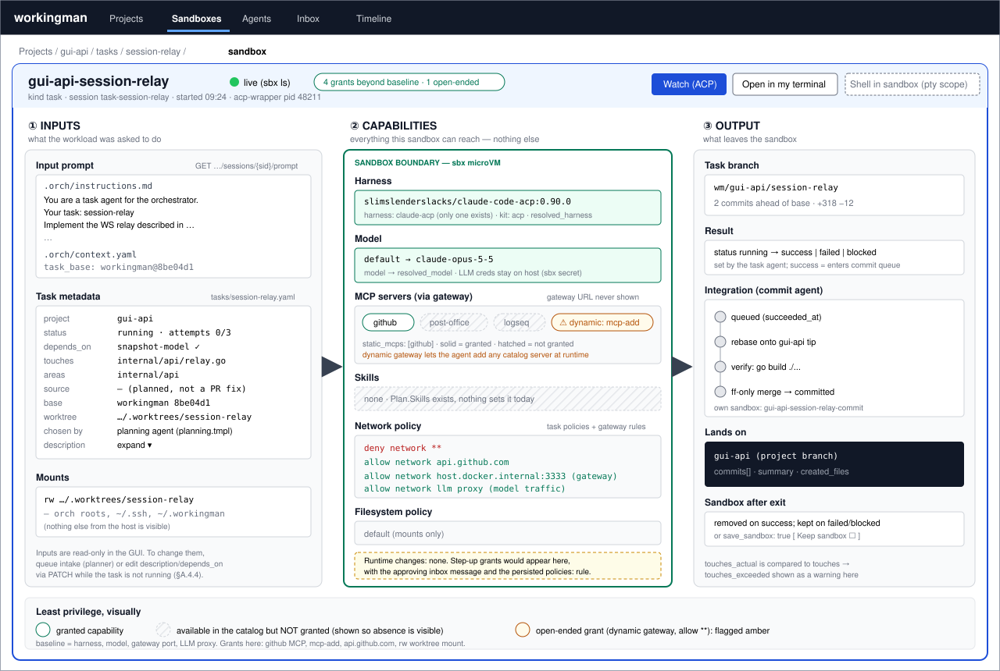
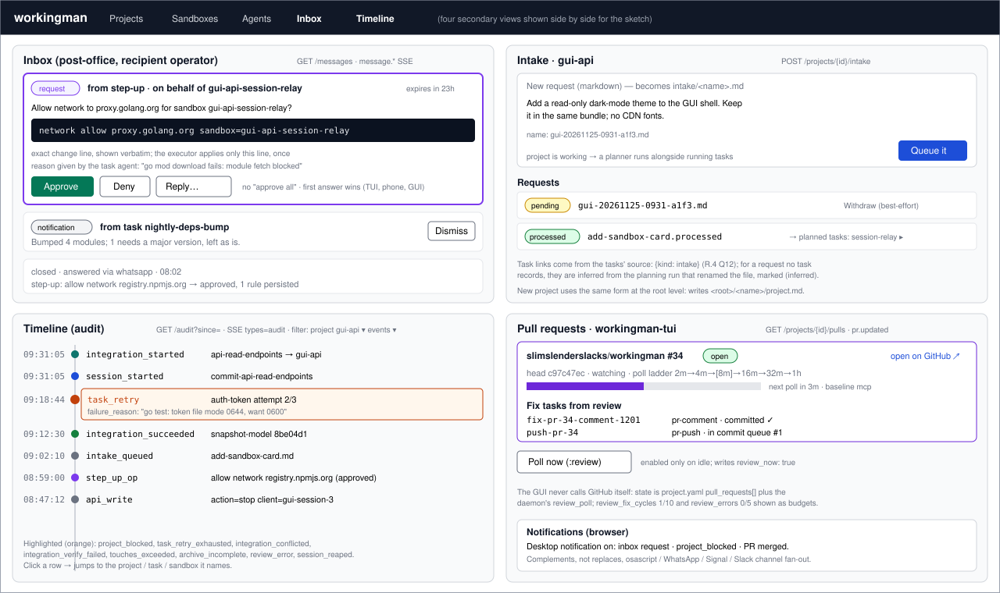

# workingman GUI: a local web app driving the daemon through an API

Status: **draft proposal**. Nothing here is implemented.

> _Intro and summary: to be written (see the `finalize-gui-proposal` task)._
> _It will state the goal (a local GUI as an alternative or companion to the
> TUI), the guiding constraint (files stay the source of truth; the API is a
> thin reader/writer over them) and a one-paragraph summary of each section._

Grounding: every claim about current behaviour cites
[the grounding survey](research/workingman-gui-survey.md) (`survey §N`) or the
code directly. Code references were checked against `193a052`.

<!-- Sections to be added by later tasks:
  - TUI vs GUI
  - Pros, cons, risks and open questions
  - Suggested incremental path
-->

---

## API for driving a GUI

### A.0 Design principles

1. **Files remain the source of truth.** Today every human action that changes
   daemon behaviour is a file write: a `project.yaml` field written with
   `updated_by: agent`, or a new `project.md` / `intake/*.md` /
   `catchup-request` file (survey §3, §17.1). The API keeps that. Each write
   endpoint performs **exactly the write the TUI or a human performs today**,
   through the same helpers (`project.SaveAs(..., WriterAgent)`, atomic
   temp+rename), and then lets the fsnotify-driven daemon react as it already
   does. The API adds no new control path into the scheduler.
2. **Reads come from the same sources as `snapshot.json`.** The snapshot builder
   (`internal/daemon/snapshot.go`) already merges on-disk project/task state
   with live in-memory state (session map, in-flight flags, counters, poll
   state) and redacts it. The API serves that model, in memory and without the
   2 s tick, and adds the fields the snapshot leaves out (task capabilities,
   descriptions, commits; survey §6.2, §17.4) straight from the task files.
3. **The API is in the daemon process.** It is an optional HTTP listener inside
   `orch` (off by default, e.g. `--api=unix|loopback|off`). Putting it in the
   daemon process matters for two reasons: the live state (`projects[].live`,
   `sessions[]`) exists only in daemon memory, and the in-process daemon
   methods that the TUI calls today (`OpenInteractiveSession`,
   `OpenTaskSession`, …; survey §12.3) can be exposed without a new IPC
   mechanism. A standalone `orch api` (no daemon) could serve the offline
   subset, as `orch status --root` does (`BuildOfflineSnapshot`), but that is a
   later option.
4. **Small surface, versioned.** Everything lives under `/api/v1`. JSON field
   names match the YAML keys and the snapshot's JSON keys (`docs/state-snapshot.md`),
   so a reader who knows one knows the others. Unknown fields must be ignored
   (same rule as the snapshot schema).
5. **No new capability.** The API must not let a browser do anything the local
   user could not already do by editing files under the roots or using the
   TUI. It also must not be a way to escalate a sandbox's capabilities. Changes
   to `static_mcps` / `policies` keep going through planning or step-up (§A.4.4).

### A.1 Resources

Identifiers. A project is addressed by `{root_index, work_stream}`, flattened
into a single URL-safe id `p_<n>.<work-stream>` (for example `p_0.workingman-tui`).
The work-stream name is the project's directory name (`dispatch.go:94-95`) and
is unique within a root; the root index disambiguates two roots that hold the
same name. Tasks are addressed by name within a project (names are kebab-case
and unique per graph; `taskgraph.Load` fails on duplicates, survey §4.4).
Sessions are addressed by their **session id** (the `~/.workingman/sessions/<id>`
directory name, `<kind>-<task|branch|hash>`, survey §8.2) when they are ACP
sessions, and otherwise by the daemon session-map key (URL-encoded).
Absolute paths are still included in every body (`path`, `project_path`)
because the GUI shows them and copies them, as the TUI does with `y`.

#### A.1.1 Project

Derived from `project.yaml` (`Project`, `project/project.go:96-301`) and the
snapshot's `ProjectSnapshot`. The summary form (in lists) is the snapshot
object without `tasks[]`. The detail form adds `repos`, `new_repos`, the full
`description`, the cron stop conditions and a `blocked_session` read from
`blocked-session.yaml`.

```json
{
  "id": "p_0.workingman-tui",
  "work_stream": "workingman-tui",
  "root": "/Users/me/orch",
  "path": "/Users/me/orch/workingman-tui/project.yaml",
  "etag": "\"pj-9f1c2e7a\"",
  "status": "working",
  "stopped_from": "",
  "blocked_reason": "",
  "branch": "workingman-tui",
  "description": "Design proposal: an alternative (or companion) to the workingman TUI …",
  "repos": [{"org": "slimslenderslacks", "name": "workingman", "base_branch": ""}],
  "new_repos": [],
  "load_error": "",
  "flags": {
    "review": false, "review_now": false, "cleanup": false, "archive": false,
    "replan": false, "hidden": false, "watching_pr": false
  },
  "cron": "", "cron_active": false, "cron_until": null, "cron_max_runs": 0, "cron_runs": 0,
  "max_parallel_tasks": 1,
  "verify": "",
  "pull_requests": [],
  "task_counts": {"ready": 2, "running": 1, "success": 0, "failed": 0, "blocked": 0, "committed": 1},
  "task_total": 4,
  "commit_queue": [],
  "verify_checks": null,
  "created_at": "2026-11-24T23:12:05-05:00",
  "updated_at": "2026-11-25T04:29:10-05:00",
  "updated_by": "agent",
  "live": {
    "sessions": ["task"],
    "running_tasks": ["draft-api-design"],
    "integrating": "",
    "commit_reserved": false,
    "wolf_in_flight": false,
    "cleanup_in_flight": false,
    "review_agent_in_flight": false,
    "planning_failures": 0, "project_failures": 0,
    "review_fix_cycles": 0, "review_errors": 0,
    "review_poll": null,
    "cron_schedule": "",
    "deferred": null
  },
  "blocked_session": null,
  "pending_intake": [],
  "links": {
    "tasks": "/api/v1/projects/p_0.workingman-tui/tasks",
    "sessions": "/api/v1/sessions?project=p_0.workingman-tui",
    "events": "/api/v1/events?project=p_0.workingman-tui"
  }
}
```

Notes:
- `flags` groups the snapshot's top-level booleans (`review`, `review_now`,
  `cleanup`, `archive`, `replan`, `hidden`, `watching_pr`). In YAML, `hidden`
  is `hide`. Grouping them gives the GUI one place to render badges.
- `live` is exactly the snapshot's `projects[].live` (`snapshot.go`, "daemon
  snapshots only"), or `null` when the server runs without a daemon.
- `blocked_session` is `{blocked_reason, summary, attempted[]}` from
  `blocked-session.yaml` (`project/blocked_session.go:28-35`), the wolf's
  durable diagnosis. It is `null` when that file is absent.
- `pending_intake` lists the non-blank `intake/*.md` names, using the same scan
  as `pendingIntakeFiles` (`intake.go:113-132`).
- `pull_requests[]` carries `{repo, number, url, head_sha, state}`. The
  `fingerprint` is left out of the summary: it is internal poll state, and it
  is available in the detail form under `?include=fingerprint`.

#### A.1.2 Task

Derived from `tasks/<name>.yaml` (`Task`, `task/task.go:170-321`) merged with
the snapshot's `TaskSnapshot` (derived fields `exclusive`, `queue_position`,
`waiting_on`). This resource is the main reason the API exists alongside the
snapshot file: it carries the **workload** fields that a sandbox card needs
and the snapshot omits (survey §6.2, §17.4).

```json
{
  "project": "p_0.workingman-tui",
  "name": "draft-api-design",
  "path": "/Users/me/orch/workingman-tui/tasks/draft-api-design.yaml",
  "etag": "\"tk-41ab09d3\"",
  "status": "running",
  "attempts": 0,
  "failure_reason": "",
  "blocked_reason": "",
  "description": "Repo: slimslenderslacks/workingman … Documents only — do NOT implement anything. …",
  "depends_on": ["survey-current-architecture"],
  "touches": null,
  "areas": [],
  "exclusive": true,
  "capabilities": {
    "model": "default",
    "resolved_model": "claude-opus-5-5",
    "harness": "claude-acp",
    "resolved_harness": "slimslenderslacks/claude-code-acp:0.90.0",
    "static_mcps": [],
    "policies": [
      {"action": "allow", "type": "network", "resource": "api.github.com"}
    ],
    "save_sandbox": false
  },
  "source": null,
  "worktree": "/Users/me/dev/workspaces/workingman-tui/.worktrees/draft-api-design",
  "task_branch": "wm/workingman-tui/draft-api-design",
  "base": [{"repo": "workingman", "hash": "193a052b121205fefa4c84624db8f162a40687a1"}],
  "succeeded_at": null,
  "completed_at": null,
  "queue_position": 0,
  "waiting_on": [],
  "integration": null,
  "output": {
    "summary": "",
    "commits": [],
    "created_files": [],
    "touches_actual": []
  },
  "session": "task-draft-api-design",
  "sandbox": "workingman-tui-draft-api-design"
}
```

Notes:
- `capabilities` groups `model`, `resolved_model`, `harness`,
  `resolved_harness`, `static_mcps`, `policies`, `save_sandbox`. YAML keeps
  them flat; the grouping is presentation only. `policies[]` uses the YAML
  keys of `policy.Rule` (`action: allow|deny`, `type: network|filesystem`,
  `resource`; `policy/policy.go:39-43`).
- `output` groups the commit agent's results: `summary`, `commits[{repo,hash}]`,
  `created_files`, and the daemon's `touches_actual`.
- `integration` is the full YAML block (`result`, `repo`, `files`, `onto`,
  `output`, `published`, `landed`, `attempts`). The snapshot omits `onto`,
  `output` and `published`. `output` is the tail of a failed `verify` run, so
  it is passed through `audit.Redact` like everything else.
- `session` and `sandbox` are back-links, filled when a live session's
  `task_path` matches this file. When there is no session, `sandbox` is the
  deterministic name `SandboxNameFor` would choose (`<ws>-<task>`, survey §8.3),
  so the GUI can show a retained sandbox (`save_sandbox`, or a task that ended
  `failed`/`blocked`).
- A planning seed (blank name) appears under its filename stem with
  `"seed": true`, as the snapshot does.

#### A.1.3 Session (and its sandbox)

One resource covers a running agent session together with its sandbox, since
today they correspond one to one (one `acp-wrapper` per session, one sandbox
per wrapper; survey §8.1). The fields come from the snapshot's
`SessionSnapshot` plus the files a sandbox card needs:
`sessions/<id>/session.json` (`session/session.go:44-140`), the gateway record
`gateways/<sandbox>.json` (`mcpgateway/store.go:19-36`) and the harness record
`sandboxes/<sandbox>.json` (`acpwrapper/harness.go:26-40`). Survey §17.7 notes
that this data is spread across those four places today. The session resource
puts it in one place.

```json
{
  "id": "task-draft-api-design",
  "key": "/Users/me/orch/workingman-tui/project.yaml#task:draft-api-design",
  "kind": "task",
  "project": "p_0.workingman-tui",
  "project_path": "/Users/me/orch/workingman-tui/project.yaml",
  "task": "draft-api-design",
  "task_path": "/Users/me/orch/workingman-tui/tasks/draft-api-design.yaml",
  "worktree": "/Users/me/dev/workspaces/workingman-tui/.worktrees/draft-api-design",
  "started_at": "2026-11-25T04:29:12-05:00",
  "interactive": false,
  "persistent": false,
  "source": "daemon",
  "status": "running",
  "prompt_count": 1,
  "error": "",
  "sandbox": {
    "name": "workingman-tui-draft-api-design",
    "live": true,
    "kit": "/Users/me/kits/acp",
    "image": "slimslenderslacks/claude-code-acp:0.90.0",
    "workspaces": ["/Users/me/dev/workspaces/workingman-tui/.worktrees/draft-api-design"],
    "signing_broken": false,
    "push_broken": false,
    "created_at": "2026-11-25T04:29:11-05:00"
  },
  "gateway": {
    "requested": ["github"],
    "servers": ["github"],
    "dynamic": true
  },
  "acp": {
    "session_id": "4f6c…",
    "attachable": true,
    "observers": 1
  },
  "tab_name": "",
  "links": {
    "attach": "/api/v1/sessions/task-draft-api-design/acp",
    "transcript": "/api/v1/sessions/task-draft-api-design/transcript",
    "prompt_files": "/api/v1/sessions/task-draft-api-design/prompt"
  }
}
```

Notes:
- The gateway's `url`/`sandbox_url`/`id` are **never** returned. The
  sub-gateway UUID path is the sandbox's only MCP credential (survey §10), so
  exposing it would let a browser call that sandbox's MCP servers.
- `socket_path` and `session_dir` are omitted from the public shape as well. The
  GUI reaches the socket only through the API's attach endpoint (§A.5). This
  keeps one choke point for auth and for the one-shot lifetime rules.
- `sandbox.live` comes from `sbx ls` (`sbx/sbx.go:63-74`), cached for a few
  seconds; the TUI already shells out to it.
- `prompt_files` returns the rendered `.orch/instructions.md` and
  `.orch/context.yaml` from the session's working directory: the workload's
  **input prompt** (survey §8.5).
- `GET /api/v1/sandboxes` (below) additionally lists **retained** sandboxes with
  no session: harness records whose sandbox still exists in `sbx ls`, such as
  tasks kept after a terminal failure or `:session` sandboxes, which nothing
  removes (survey §9.3).

#### A.1.4 Intake request

`intake/<x>.md` files. Today the files on disk are the only record (survey §3,
§4.5).

```json
{
  "project": "p_0.workingman-tui",
  "name": "add-svg-wireframes",
  "file": "add-svg-wireframes.md",
  "state": "pending",
  "created_at": "2026-11-25T05:02:00-05:00",
  "body": "Please add SVG wireframes for the project graph …",
  "etag": "\"in-77c0\""
}
```

`state` is `pending` (`*.md`, non-blank), `empty` (blank `*.md`; the daemon
logs `intake_empty` and ignores it) or `processed` (renamed to `*.processed`
by the planner, `planning.tmpl:143-147`). `created_at` is the file's mtime.

#### A.1.5 Audit event

The snapshot's `AuditEvent` (`{time, event, fields}`) plus a monotonically
increasing `seq`, which the event stream uses as its cursor (§A.3.4).

```json
{"seq": 18234, "time": "2026-11-25T09:29:12Z", "event": "task_running",
 "fields": {"path": "/Users/me/orch/workingman-tui/tasks/draft-api-design.yaml", "task": "draft-api-design"}}
```

Values are redacted (`audit.Redact`), as in the snapshot. `seq` is assigned
by the audit logger in the daemon process. The logger already holds the last
500 lines (`Recent`), and a seq counter goes next to that buffer. `seq` is not
written to `audit.log`; the line format is unchanged.

#### A.1.6 Pull request

`project.yaml` `pull_requests[]` (`project.go:349-356`) plus the project's
review-loop state from `live`. The API does not call GitHub. The GUI links out
to `url`.

```json
{
  "project": "p_0.workingman",
  "repo": "slimslenderslacks/workingman",
  "number": 34,
  "url": "https://github.com/slimslenderslacks/workingman/pull/34",
  "head_sha": "c97c47ec…",
  "state": "open",
  "watching": true,
  "review_poll": {"schedule": "@every 8m", "backoff_index": 2, "has_baseline": true, "baseline_source": "mcp"},
  "fix_tasks": ["fix-pr-34-comment-1201"]
}
```

`fix_tasks` are the project's tasks whose `source.pr` equals `number`
(`task.Source`, kinds `pr-comment|pr-check|pr-push`).

#### A.1.7 Messages (post-office) and agents

The GUI should show the operator inbox, since step-up approvals arrive there
(survey §7.3, §11).

```json
{
  "id": "msg_01J…",
  "kind": "request",
  "from": {"agent": "step-up", "sandbox": "step-up", "project": "", "task": "", "session_id": "…"},
  "recipient": "operator",
  "subject": "Allow network to registry.npmjs.org for workingman-tui-build?",
  "body": "…exact change line…",
  "options": ["approve", "deny"],
  "created_at": "2026-11-25T09:40:00Z",
  "expires_at": "2026-11-26T09:40:00Z",
  "state": "open",
  "resolution": null
}
```

These are the post-office `Message` fields (`postoffice/model.go:124-135`).
`state` is `open` or `closed`, and `resolution` is the `Resolution`
(`outcome`, `response`, `option`, `responder`, `at`).

`agents` is a small, read-only resource for the three non-project agents and
their enablement, so the GUI can place them (survey §7.3):

```json
[
  {"kind": "workingman", "enabled": true, "mode": "auto", "session": "workingman-agent", "sandbox": "workingman-agent", "mcp": {"dynamic": true}},
  {"kind": "sleepy-head", "enabled": true, "session": null, "pending_catchups": ["nightly-deps"]},
  {"kind": "step-up", "enabled": true, "session": "step-up", "static_mcps": ["post-office"], "requests_today": 3}
]
```

### A.2 Read endpoints

All endpoints are `GET` and return `application/json`, with
`ETag`/`If-None-Match` support (§A.4.1). Lists return
`{"items": [...], "generated_at": "...", "cursor": <seq>}`. The `cursor` is the
event-stream position the list is consistent with, so a client can do
`GET` then `events?since=cursor` without a gap (§A.3.4).

| Path | Query params | Returns |
|---|---|---|
| `/api/v1/status` | | `{version, daemon{state, pid, started_at, headless, roots, acp_kit, acp_image, workspace_manager}, api{version, binding}, cursor}`. This is the snapshot's `daemon` block. The API never returns a `stopped` daemon state, because it is in-process. |
| `/api/v1/snapshot` | `audit_events=N` | The exact `snapshot.json` document (version 1), built on demand. It is a compatibility escape hatch for tools that already parse it, such as `orch status --json` readers. |
| `/api/v1/projects` | `status=a,b`, `hidden=true\|false\|any` (default `false`, which matches the TUI gallery), `root=<n>`, `q=<substring of name/description>` | project summaries |
| `/api/v1/projects/{id}` | `include=fingerprint` | project detail (§A.1.1) |
| `/api/v1/projects/{id}/tasks` | `status=…` | tasks (§A.1.2), ordered by name |
| `/api/v1/projects/{id}/tasks/{name}` | | one task |
| `/api/v1/projects/{id}/graph` | | `{nodes:[{name,status,exclusive,queue_position}], edges:[{from,to}], ready:[…], runnable:[…], deferred:{overlap:[…],cap,power}, commit_queue:[…], errors:[…]}`. The output of `taskgraph.Load` / `Ready()` / `Runnable()` / `Queued()` (survey §4.4, §5), so the GUI draws the same graph the scheduler uses, and does not re-derive it. `errors` carries `taskgraph_error` / repair warnings. |
| `/api/v1/projects/{id}/intake` | `state=pending\|processed\|all` | intake requests |
| `/api/v1/projects/{id}/intake/{name}` | | one request with `body` |
| `/api/v1/projects/{id}/pulls` | | PRs (§A.1.6) |
| `/api/v1/projects/{id}/audit` | `since=<seq>`, `limit` (≤ 500), `event=a,b` | audit events whose `path`/`key` field is under this project |
| `/api/v1/sessions` | `project={id}`, `kind=task,commit`, `live=true` | sessions (§A.1.3) |
| `/api/v1/sessions/{sid}` | | one session |
| `/api/v1/sessions/{sid}/transcript` | `after=<byte offset>`, `limit` | `stream.log` frames as NDJSON (`application/x-ndjson`), redacted. This is the same data the TUI replays. It is only available while the session dir exists, because the wrapper deletes the dir on exit (survey §8.2). |
| `/api/v1/sessions/{sid}/prompt` | | `{instructions_md, context_yaml}` |
| `/api/v1/sandboxes` | `retained=true` | live and retained sandboxes, each with harness and gateway info (without gateway URLs) |
| `/api/v1/audit` | `since=<seq>`, `limit`, `event=…`, `project={id}` | the global audit tail. The source is the in-memory ring (500 lines); beyond that the server tails `--audit-log` with `audit.TailFile`. |
| `/api/v1/messages` | `state=open\|closed`, `since=<time>` | post-office messages for `operator` (`Store.ListOpen`, `ListDone`) |
| `/api/v1/agents` | | §A.1.7 |

Example: list working and blocked projects.

```http
GET /api/v1/projects?status=working,blocked HTTP/1.1
Host: localhost
Authorization: Bearer 3q2+7w…

HTTP/1.1 200 OK
ETag: "pl-18234"
Content-Type: application/json

{
  "generated_at": "2026-11-25T09:31:02Z",
  "cursor": 18234,
  "items": [
    {"id": "p_0.workingman-tui", "work_stream": "workingman-tui", "status": "working",
     "branch": "workingman-tui", "task_counts": {"ready": 2, "running": 1, "success": 0,
     "failed": 0, "blocked": 0, "committed": 1}, "task_total": 4, "commit_queue": [],
     "flags": {"review": false, "watching_pr": false, "cleanup": false, "archive": false,
     "review_now": false, "replan": false, "hidden": false},
     "live": {"running_tasks": ["draft-api-design"], "integrating": "", "wolf_in_flight": false},
     "etag": "\"pj-9f1c2e7a\""}
  ]
}
```

Example: the graph for the project-view dependency diagram.

```json
{
  "nodes": [
    {"name": "survey-current-architecture", "status": "committed"},
    {"name": "draft-api-design", "status": "running", "exclusive": true},
    {"name": "draft-gui-design-wireframes", "status": "ready"},
    {"name": "finalize-gui-proposal", "status": "ready"}
  ],
  "edges": [
    {"from": "survey-current-architecture", "to": "draft-api-design"},
    {"from": "draft-api-design", "to": "draft-gui-design-wireframes"},
    {"from": "draft-gui-design-wireframes", "to": "finalize-gui-proposal"}
  ],
  "ready": [],
  "runnable": [],
  "deferred": null,
  "commit_queue": [],
  "errors": []
}
```

The project's `tasks/*.yaml` hold more than the snapshot. That is why
`/tasks` reads the files and caches each one on mtime and size, the same way
the snapshot builder caches per-project parsing.

### A.3 Live event stream

#### A.3.1 SSE or WebSocket

| | Server-Sent Events | WebSocket |
|---|---|---|
| Direction | server → client only | both |
| Resume | built in: `Last-Event-ID` on reconnect, automatic retry in `EventSource` | hand-rolled |
| Proxies, devtools, curl | plain HTTP; `curl -N` works; visible in the browser network tab | needs a WS client |
| Auth | `EventSource` cannot set headers, so it needs a cookie or a query token. `fetch()` streaming can set headers. | the token goes in the first message, or a cookie or subprotocol |
| Go server | `http.Flusher`, no dependency | needs a library (`nhooyr.io/websocket` or `gorilla/websocket`) |
| Fit for state changes | very good: state changes flow one way, and writes go through REST | works, but adds framing for no benefit |
| Fit for ACP sessions | poor: ACP is bidirectional JSON-RPC | **required** |

**Recommendation: SSE for the state stream, WebSocket only for session
attach (§A.5).** State changes flow one way, writes are ordinary REST calls
that are idempotent and carry an etag (§A.4.1), and SSE's
`Last-Event-ID` gives replay semantics for free. ACP passthrough is
bidirectional and needs a WebSocket. Neither stream depends on the other: a
read-only GUI needs only SSE.

Endpoint: `GET /api/v1/events` with
`Accept: text/event-stream`. Query params: `project={id}` (repeatable),
`types=project.*,task.*,audit` (glob list; default all except `audit`),
`since=<seq>` (alternative to `Last-Event-ID`).

#### A.3.2 Where events come from

There is no new event source. The daemon already marks the snapshot dirty on
every audit line, session start/end, and project/task/intake file event
(`markSnapshotDirty`, survey §6.3). The API publisher hooks the same points.
On each kick (no 150 ms debounce here, or a much shorter one, e.g. 25 ms, to
coalesce bursts) it:

1. rebuilds the in-memory snapshot model for the **affected projects only**.
   The per-project cache on mtime/size already makes this cheap.
2. **diffs** it against the previous model per resource (project summary,
   each task, each session, each intake file, each PR). The diff is
   field-level, so `task.updated` can say which fields changed.
3. emits one typed event per changed resource, plus one `audit` event per new
   audit line.

Diffing the model, rather than translating audit lines into state events, is
deliberate. Every write to the files produces an event, including those made
outside the daemon: by the human, a wolf, the workingman agent, or a task
agent editing its own task file. Those writes often have no audit line that
carries the new value (`task_file_updated` only names the path). Audit events
are delivered as well, as context for the timeline, but **state is always taken
from the diff**.

#### A.3.3 Event types and payloads

Every event's `data` is a JSON object with a common envelope:

```json
{"seq": 18240, "time": "2026-11-25T09:31:05.112Z", "type": "task.updated",
 "project": "p_0.workingman-tui", "cause": "file", "data": { … }}
```

`cause` is `file` (a watched file changed), `session` (a session started or
ended), `live` (only in-memory state changed: counters, poll rung, in-flight
flags), `audit`, or `daemon`.

| `type` | Emitted when | `data` |
|---|---|---|
| `hello` | on connect, first frame | `{cursor, api_version, daemon{state,pid,started_at}, replay: "full"\|"delta"\|"reset"}` |
| `project.created` | a new `project.yaml` appears (seed or hand-made) | project summary |
| `project.updated` | any summary field changes | `{id, etag, changed: ["status","blocked_reason"], project: <summary>}` |
| `project.status` | `status` changes (also folded into `project.updated`; a separate type because it is the most common subscription) | `{id, from, to, blocked_reason, stopped_from}` |
| `project.removed` | the project dir leaves the roots (`:archive`, manual delete); detected by rescan, because fsnotify `Remove` is ignored by dispatch (`dispatch.go:37-39`) | `{id, path}` |
| `project.live` | only `live` changed | `{id, live}` |
| `task.created` | a new `tasks/*.yaml` | task |
| `task.updated` | any task field changes | `{project, name, etag, changed: [...], task: <task>}` |
| `task.status` | task `status` changes | `{project, name, from, to, attempts, failure_reason, blocked_reason}` |
| `task.removed` | a task file disappears | `{project, name}` |
| `queue.updated` | `commit_queue` order or `live.integrating` changes | `{project, commit_queue: [...], integrating, commit_reserved}` |
| `session.started` | a session enters the daemon map, or a disk session appears | session |
| `session.updated` | `status` / `prompt_count` / `sandbox.live` changes | `{id, changed, session}` |
| `session.ended` | a session leaves the map (`session_ended`/`session_reaped`/`session_stopped`) | `{id, kind, project, task, outcome: "ended"\|"reaped"\|"stopped"\|"detached", err}` |
| `intake.created` / `intake.processed` / `intake.removed` | an `intake/*.md` appears, is renamed to `.processed`, or vanishes | intake request (without `body`) |
| `pr.updated` | `pull_requests[]` entry or `review_poll` changes | PR |
| `message.created` / `message.closed` | a post-office message appears or is resolved | message |
| `audit` | every audit line (only if `types` includes `audit`) | audit event (§A.1.5) |
| `heartbeat` | every 15 s with no other traffic | `{cursor}`; mirrors the snapshot's heartbeat |
| `reset` | the server cannot replay from the requested cursor | `{cursor}`; the client must refetch lists |

Audit events that the GUI should **highlight** are not separate event types.
The GUI keys off `audit.event` names: `project_blocked`, `task_retry_exhausted`,
`integration_conflicted`, `integration_verify_failed`, `touches_exceeded`,
`archive_incomplete`, `review_error`, `step_up_op`, `session_reaped`
(survey §13).

Example SSE frames:

```
id: 18240
event: task.status
data: {"seq":18240,"time":"2026-11-25T09:31:05.112Z","type":"task.status","project":"p_0.workingman-tui","cause":"file","data":{"project":"p_0.workingman-tui","name":"draft-api-design","from":"running","to":"success","attempts":0,"failure_reason":"","blocked_reason":""}}

id: 18241
event: queue.updated
data: {"seq":18241,"time":"2026-11-25T09:31:05.140Z","type":"queue.updated","project":"p_0.workingman-tui","cause":"file","data":{"project":"p_0.workingman-tui","commit_queue":["draft-api-design"],"integrating":"","commit_reserved":false}}

id: 18242
event: session.started
data: {"seq":18242,…,"type":"session.started","cause":"session","data":{"id":"commit-draft-api-design","kind":"commit","task":"draft-api-design",…}}
```

#### A.3.4 Resume and replay

- `seq` is a single, per-daemon-process, monotonically increasing integer that
  covers every event (state and audit). It goes in the SSE `id:` field.
- The server keeps a ring of the last N events (e.g. 5 000, or 15 minutes).
  On reconnect with `Last-Event-ID: k` (or `?since=k`):
  - if `k` is in the ring, the server sends `hello{replay:"delta"}` and then every
    event after `k`, filtered by the subscription;
  - if `k` is older than the ring, or from a previous daemon process (detected
    by an epoch prefix: `id: <epoch>.<seq>`, where `epoch` is the daemon start
    time), the server sends `hello{replay:"reset"}` and `reset{cursor}`. The
    client then refetches its lists, which carry a `cursor` (§A.2), and
    continues from that cursor;
  - with no cursor, the server sends `hello{replay:"full"}`, then a synthetic
    `project.created` / `task.created` / `session.started` for current state, then
    live events. This makes "connect and render" a single request.
- Events describe **state after the change** (the full resource, or the
  resource plus `changed`). They are not patches. A missed or duplicated event
  is therefore harmless, and applying them is idempotent: the client overwrites
  by id. Strict replay matters only for the `audit` timeline.
- The audit log on disk is the durable history. For a timeline older than the
  ring, the GUI pages `GET /audit?since=`, whose source is `audit.TailFile`.
  Task and project history before the ring is not reconstructed. The files hold
  only current state, which is how workingman works today.

### A.4 Write actions

#### A.4.1 Rules that apply to every write

- **One endpoint, one file write.** This is the same write the TUI makes,
  through the same function. The TUI helpers (`requestStop`, `requestStart`,
  `summonWolf`, `requestReview`, `requestCleanup` in `internal/tui/*.go`) are
  small `Load → mutate → SaveAs(WriterAgent)` functions, and most also check a
  precondition. They should move into a shared package (e.g.
  `internal/control`) that both the TUI and the API call. Then the API
  cannot drift from the TUI, and the TUI's own code path is unchanged.
- **The response is the file state after the write, not the outcome.** Writes
  return `202 Accepted` with the new resource and its new etag. The daemon's
  reaction (a wolf launches, sessions close) is reported later through the
  event stream. The API never waits for or fakes the reaction.
- **Optimistic concurrency.** Every mutable resource has an `ETag`, a hash of
  the file's bytes. Write endpoints accept `If-Match`. On a mismatch they
  return `412 Precondition Failed` with the current resource, so the GUI can
  show what changed. `If-Match` is **required** for actions that read and then
  write a field the daemon or an agent may also write (`stop`, `start`, `wolf`,
  `review`, task edits). Without it, a create-only action such as intake or
  a new project works as is.
- **The read-modify-write is serialized** with the daemon's own writers by a
  per-path lock in the daemon process. The daemon's writes go through
  `project.Save`, and the lock would be taken in that one helper. A
  temp+rename write is atomic, but two writers that each load, mutate and
  rename lose one change. The lock closes that window **for writers inside the
  orch process**, which are the daemon and the API. Agents in sandboxes and
  humans in editors are outside it. For those, the etag check is the guard,
  and it is re-run under the lock just before the rename. A window remains
  between that check and the rename, and an outside writer can land in it.
  That risk exists today between the TUI and agents. The API does not widen
  it. §A.6.3 covers what to do about it.
- **Idempotency.** Every `POST` accepts `Idempotency-Key: <uuid>`. The server
  remembers `(key → response)` for 24 h in memory, so a retried click does not
  send a second intake or a second project. Beyond that, the actions are
  idempotent by construction where possible. For example, `cleanup` on a
  project that already has `cleanup: true` returns `200` with
  `"noop": true`; it does not rewrite the file. A rewrite would trigger the
  watcher, and daemon dedup makes it harmless anyway, but it adds noise to
  the audit log.
- **`updated_by: agent`** is how the daemon tells an external request from its
  own write (survey §2). The API writes as `agent` for everything the daemon
  should react to, and as `daemon` only where the TUI does so on purpose
  (`hide`/`show`, so that the write does not cause dispatch). A separate
  `updated_via: api` marker would help audit, but it would be a schema
  addition. Instead, the API writes an audit line for every write:
  `api_write action=stop path=… etag_before=… etag_after=… client=<token-id>`.
- **Errors** use one shape:
  `{"error": {"code": "precondition_failed" | "conflict" | "invalid_state" | "not_found" | "forbidden" | "unavailable", "message": "...", "current": <resource?>}}`.
  `invalid_state` (409) carries the TUI's own refusal text, for example
  `workingman-tui is already stopped` or
  `review starts on an idle work stream or kicks one already watching a PR (this one is "working")`.

#### A.4.2 Project actions

All of these are `POST /api/v1/projects/{id}/actions/{action}` with
`If-Match: <project etag>`.

| Action | Body | Precondition (same as today) | File write | Daemon reaction (unchanged) |
|---|---|---|---|---|
| `stop` | `{}` | populated and not already `stopped` (`tui/stop.go:23-44`) | `project.yaml`: `stopped_from: <status>`, `status: stopped`, `updated_by: agent` | `enforceStopped`: closes every `<path>` / `<path>#*` session and unregisters cron and `#review`; running tasks go back to `ready` without spending an attempt |
| `start` | `{}` | `status: stopped` (`tui/stop.go:55-80`) | `status: <stopped_from, or idle if empty>`, `stopped_from: ""`, as agent | normal routing |
| `wolf` | `{"reason": "optional text"}` | none | `status: blocked`. `blocked_reason` is set **only if empty**: to `reason`, or to the TUI's `summonReason` with "via the GUI" in place of "via the TUI (:wolf)". As agent (`tui/wolf.go:27-43`). | `launchWolfAgent` under `#wolf`, deduped |
| `review` | `{}` | `status: idle` (`tui/review.go:37-60`) | not watching → `review: true`; watching → `review_now: true`; as agent. The response says which: `{"mode": "start"\|"kick"}`. | `ensureReviewPoll` / `forceReviewNow` |
| `cleanup` | `{}` | not `archive: true` (`tui/cleanup.go:38-55`) | `cleanup: true`, as agent | archive agent once nothing is in flight; the daemon clears `cleanup` |
| `hide` / `show` | `{}` | none | `hide: true/false`, **as daemon** (`tui/hide.go`) | none |
| `catchup` | `{}` | the project has a `cron` | create `<project>/catchup-request` (the same marker `orch catchup` writes, `sleepy_head.go:55-63`) | `handleCatchup` claims it, then fires `runCron` once if the project is behind |
| `archive` | `{"confirm": "<work_stream>"}` | `archive: true` (`tui/archive.go:73-110`) | **not a single write; see below** | none; the project leaves the tree |

Example: stop a project, with optimistic concurrency.

```http
POST /api/v1/projects/p_0.workingman-tui/actions/stop HTTP/1.1
Authorization: Bearer 3q2+7w…
If-Match: "pj-9f1c2e7a"
Idempotency-Key: 6f1e0a7c-1b8e-4c25-9b0e-3a7d5d0e8b11
Content-Type: application/json

{}

HTTP/1.1 202 Accepted
ETag: "pj-0c44d1b9"

{"project": {"id": "p_0.workingman-tui", "status": "stopped", "stopped_from": "working", "etag": "\"pj-0c44d1b9\"", …},
 "write": {"path": "/Users/me/orch/workingman-tui/project.yaml",
           "fields": {"status": "stopped", "stopped_from": "working", "updated_by": "agent"}},
 "expect": ["project.status", "session.ended"]}
```

`expect` is a hint for the GUI ("watch for these events"). It is not a promise.

The same call with a stale etag (for example, the daemon blocked the project in
the meantime):

```http
HTTP/1.1 412 Precondition Failed

{"error": {"code": "precondition_failed",
  "message": "project.yaml changed since you loaded it (now status=blocked, updated_by=daemon)",
  "current": {"id": "p_0.workingman-tui", "status": "blocked",
              "blocked_reason": "task draft-api-design: retry budget exhausted", "etag": "\"pj-51aa02f0\"", …}}}
```

**`archive` is the exception.** Today it is not a file write that the daemon
reacts to: the TUI process itself removes task worktrees and `wm/` refs and the
workspace `.orch`, runs `wsp rm --force`, and moves the directory to
`<root>.backup/<name>` (survey §3, §17.2). The API calls the same
`archiveProject` function (moved into the shared control package), runs it
synchronously, and returns `200` with the backup path. It requires
`{"confirm": "<work_stream>"}` in the body, the GUI's equivalent of the y/n
modal. This is the only destructive endpoint. It should be left out of the
first write phase.

#### A.4.3 New project and intake

**New project.** `POST /api/v1/projects`

```json
{"root": 0, "name": "gui-wireframes", "description": "Draw SVG wireframes for …"}
```

- Validates `name` as a single path segment, kebab-case, not existing under the
  root, and not `.worktrees`. The name becomes the branch-derived sandbox
  prefix, so the server also applies the sandbox-name budget check
  (`sbx.SanitizeName` limits, survey §8.3) and warns if the name would be
  truncated.
- **Write:** `mkdir <root>/<name>`, then write `<root>/<name>/project.md` with
  the description, using temp+rename in that directory. That is all. The daemon
  does the rest exactly as for a hand-made seed: `maybeWatchNewDir` picks
  up the new directory and the file already in it, `handleProjectSeed` writes
  `project.yaml` with `description:` only as agent, and the project agent
  fills it in and sets `ready` (survey §3).
- Returns `202` with `{"id": "p_0.gui-wireframes", "path": ".../project.md", "state": "seeded"}`.
  The GUI then waits for `project.created` (from `project.yaml`), which shows
  `status: ""` (unpopulated) until the project agent finishes.
- Not supported: writing a populated `project.yaml` directly. A writer that
  does so skips the project agent. That is possible by hand today, but the
  GUI should not encourage it. An "advanced" form could allow it later.
- Conflict: `409 conflict` if `<root>/<name>` exists. Idempotency key
  recommended.

**Queue intake.** `POST /api/v1/projects/{id}/intake`

```json
{"name": "add-sandbox-card", "body": "Add a sandbox card view that shows …"}
```

- `name` is optional; the default is `gui-<UTC timestamp>-<4 hex>`. It is
  validated as a single segment ending in `.md`. Body must be non-blank
  (blank → `400`: the daemon would only log `intake_empty`).
- **Write:** `<project>/intake/<name>.md`, using temp+rename **inside
  `intake/`**. `mkdir -p intake/` comes first. A rename **into** the watched
  directory is a `Create` event for the final name, so the daemon sees
  `*.md` once and complete. This needs care: the temp file must not end in
  `.md` (use `.<name>.md.tmp`). Otherwise `handleIntakeFile` could fire on
  the temp file. Today's `writeFileAtomic` creates `<base>.tmp*`, which is
  safe for this.
- The daemon then reacts as it does today, and the response cannot predict
  which reaction (`intake_queued deferred=planning_in_flight`, plan alongside
  a `working` project, or flip the project to `ready`). The GUI watches for
  `intake.processed`.
- `409` if a file with that name exists, pending or `.processed`.
  An intake on a `stopped` project is accepted and stays pending, because the
  daemon routes `stopped` first (survey §3, routing order).
- `DELETE /api/v1/projects/{id}/intake/{name}` withdraws a **pending**
  request (renames it to `<name>.withdrawn`). There is no daemon reaction.
  This races the planner, so it is best-effort: `409` if already processed.

#### A.4.4 Task actions

There is **no task-level control today** (survey §3 "Retry a task", §17.3).
Retries are automatic, and anything else is done by the wolf editing files. A
hand-edit of a task to `ready` does nothing until the next project dispatch.
So a "retry" endpoint needs two writes, and there are two options:

**Option R1: retry through the existing file contract (recommended for v1).**
`POST /api/v1/projects/{id}/tasks/{name}/actions/retry`
with `If-Match: <task etag>` and body `{"reset_attempts": true, "note": "optional"}`.

- Precondition: task status is `failed` or `blocked`. Also allowed: `ready`
  with `integration` set, which is a conflict re-run that is stuck. The project
  must not be `stopped`, and its commit agent must not be integrating this
  task (`live.integrating`).
- **Write 1:** `tasks/<name>.yaml`: `status: ready`, `failure_reason: ""`,
  `blocked_reason: ""`, and `attempts: 0` if `reset_attempts`. This mirrors the
  wolf's documented "Re-run it" path (`wolf.tmpl:180-184`). The task file has no
  `updated_by`; task-file events are audit-only.
- **Write 2:** `project.yaml`, as agent. Without it a GUI retry would
  appear to do nothing, because a hand-edited task waits for the next project
  dispatch (survey §3). Which write depends on the project status:
  - `working`: a re-save with no field change except `updated_by: agent`.
    This is the same nudge a human makes by touching the file. It routes to
    `schedule`, which picks the task up.
  - `blocked`: the common case. A task that exhausts its 3 attempts blocks the
    project. The endpoint sets `status: working` and `blocked_reason: ""`
    **only if** `blocked_reason` names this task and nothing else (no
    `; also: …` suffix, which `project_block_additional` appends). Otherwise
    it returns `409` and suggests `wolf`. A reason that covers more than one
    failure is the wolf's to untangle, and the API should not clear it
    quietly. A wolf that is already running ends by itself once the project
    has been unblocked for its 2 m grace (survey §7.2).
  - any other status: no project write. The task waits for the next dispatch,
    and the response says so (`"dispatch": "deferred"`).
- The worktree is reused as is (`Ensure` reattaches it). The GUI shows a
  checkbox for the wolf's other option, "reset worktree to the project branch"
  (`git reset --hard <branch>`). That runs a command, not a file write, so it is
  deferred to a later phase.

**Option R2: a daemon-side retry.** The API calls an exported
`Daemon.RetryTask(path)`. That function does `resetForRetry` (with an optional
attempt reset) and `revisitProject`, which bypasses the self-write filter
without a fake project write. This is cleaner, but it is a new daemon
behaviour rather than a mapping of an existing one. It is listed as an open
question for the next section.

Other task endpoints:

| Endpoint | Body | Write | Notes |
|---|---|---|---|
| `PATCH /api/v1/projects/{id}/tasks/{name}` | JSON merge-patch of **`description`, `depends_on`, `touches`, `areas`** only | `tasks/<name>.yaml` via `task.Save` | `If-Match` required. Only allowed on `ready`/`failed`/`blocked`, never on `running`. The server runs `taskgraph.Load` on the result and refuses (`422`) if the edit would create a cycle or an unknown dependency. A file that does that would otherwise block the project with `taskgraph_error`. |
| `POST …/tasks/{name}/actions/save-sandbox` | `{"save": true}` | `save_sandbox: true/false` | keep the sandbox for inspection |
| `POST …/tasks` | `{"description": "…"}` | `tasks/<stem>.yaml` with blank `name` (a **seed**), then the project dispatch nudge | the planner names and fits it, the same as a human-added seed (survey §4.4). Prefer intake for anything non-trivial. |

**Not writable through the API:** `status: success|committed`, `commits`,
`integration`, `static_mcps`, `policies`, `model`, `harness`, the `resolved_*`
fields, `worktree`, `task_branch`, `base`, and `attempts`, except through
retry. Each of these is owned by an agent or by the daemon (survey §4.3
"Written by"). Writing them from a GUI would bypass the commit queue or the
least-privilege process (principle 5, §A.0). Capability changes go through planning (an
intake request) or step-up (a post-office request answered by the operator).

#### A.4.5 Inbox answers

`POST /api/v1/messages/{id}/answer` with `{"option": "approve"}` or
`{"response": "free text"}`, or `POST /api/v1/messages/{id}/dismiss`
(notifications only).

- **Write:** `postoffice.Store.Claim(Resolution{ID, Outcome: answered|dismissed,
  Option|Response, Responder: {kind: operator, via: "gui"}})`. This is the same
  call the TUI inbox makes (`tui/inbox.go:407-414`, `via: "tui"`). A new
  `ViaGUI = "gui"` constant is the only schema addition.
- First answer wins (`link(2)`). If a phone or the TUI answered first, the
  response is `409` with the winning resolution, which the GUI shows, as the TUI
  does on its reply line.
- Step-up approvals are honoured only "with the exact change line" by the
  executor (survey §7.3). The GUI must show `body` verbatim and must not offer a
  "approve all" bulk action. The executor has no auto-approve list on purpose.

#### A.4.6 Interactive helpers (host tabs)

`:session`, `:orch` and `:workspace` are not file writes. They are in-process
daemon calls that open a host terminal tab (survey §9.3, §12.3). They have
equivalents:

| Endpoint | Calls |
|---|---|
| `POST /api/v1/projects/{id}/actions/open-session` | `Daemon.OpenInteractiveSession` |
| `POST /api/v1/projects/{id}/tasks/{name}/actions/open-session` | `Daemon.OpenTaskSession` |
| `POST /api/v1/projects/{id}/actions/open-shell` `{"where": "orch"\|"workspace"}` | `OpenOrchDirTab` / `OpenWorkspaceDirTab` |
| `POST …/tasks/{name}/actions/open-shell` | `OpenTaskWorktreeDirTab` |

These open a tab in the user's terminal on the same machine. That is useful
when the GUI runs in a browser on that machine. The GUI should label them
"opens in your terminal". In-browser terminals are §A.5.3.

#### A.4.7 Summary: action → endpoint → file

| Today (TUI / manual) | Endpoint | File write | Writer |
|---|---|---|---|
| `:stop` | `POST /projects/{id}/actions/stop` | `project.yaml` `status`, `stopped_from` | agent |
| `:start` | `POST /projects/{id}/actions/start` | `project.yaml` `status`, `stopped_from` | agent |
| `:wolf` | `POST /projects/{id}/actions/wolf` | `project.yaml` `status: blocked` (+`blocked_reason` if empty) | agent |
| `:review` | `POST /projects/{id}/actions/review` | `project.yaml` `review` or `review_now` | agent |
| `:cleanup` | `POST /projects/{id}/actions/cleanup` | `project.yaml` `cleanup: true` | agent |
| `:hide` / `:show` | `POST /projects/{id}/actions/hide\|show` | `project.yaml` `hide` | daemon |
| `orch catchup` | `POST /projects/{id}/actions/catchup` | `<project>/catchup-request` | n/a |
| `:archive` | `POST /projects/{id}/actions/archive` | none in the roots: worktrees, refs, `wsp rm`, move to `<root>.backup/` | n/a |
| drop `project.md` | `POST /projects` | `<root>/<name>/project.md` | n/a (daemon writes `project.yaml` as agent) |
| drop `intake/*.md` | `POST /projects/{id}/intake` | `<project>/intake/<name>.md` | n/a |
| wolf "re-run it" | `POST /projects/{id}/tasks/{name}/actions/retry` | `tasks/<name>.yaml` + `project.yaml` nudge | agent |
| inbox answer | `POST /messages/{id}/answer` | `post-office/…` claim (`Store.Claim`) | n/a |
| `:session` / `:orch` / `:workspace` | `POST …/actions/open-session\|open-shell` | none (in-process daemon call) | n/a |

### A.5 Joining a live sandbox session

#### A.5.1 What exists today

Each ACP session is an `acp-wrapper` that serves the agent's ACP stdio as
newline-delimited JSON-RPC on `~/.workingman/sessions/<id>/agent.sock`. Its
hub fans every agent frame out to all connected clients, serializes client
frames into the agent's stdin, and tees agent frames to `stream.log`
(`acpwrapper/bridge.go`; survey §8.1). The TUI dials the socket, replays the
log, and **sends the opening prompt** of every session whose
`prompt_count == 0` (survey §9.1, §17.5). A second client can join an existing
conversation with `acpclient.Adopt`, which binds to the session id and uses
its own request-id range (`nextID` is randomized per client,
`acpclient.go:272`). The channel router and the step-up driver already do this.

Two hub behaviours shape any new observer:

1. **One-shot lifetime is tied to client count.** With `--exit-when-empty`
   (every non-persistent kind), the hub closes the agent's stdin when the
   **last** client disconnects, after at least one has connected
   (`bridge.go:75-86, 252-264`). A GUI client changes that count:
   - A GUI that connects **before** the TUI has primed the session, and then
     leaves, **ends the session before its first prompt.**
   - A GUI that stays connected after the TUI disconnects at end-of-turn
     **keeps a finished one-shot session alive.** The daemon routes a task's
     outcome only when its session ends, so this delays that outcome.
2. **Slow clients are dropped.** A client whose 256-frame queue fills is
   disconnected (`clientQueue`, `bridge.go:45`). A browser on a slow
   connection would be dropped this way, so the server needs its own buffer.

#### A.5.2 Proposal: one upstream connection per session, fanned out by the API server

The browser never touches `agent.sock`. The API server holds **at most one
upstream socket connection per session**, reference-counts browser
subscribers on top of it, and fans frames out over WebSockets:

```
browser ─WS─┐
browser ─WS─┼─▶ orch API (session relay) ──unix──▶ agent.sock ─▶ acp-wrapper hub ─▶ claude-acp-client
TUI ────────┼───────────────────────────────unix──▶ agent.sock          (unchanged)
router ─────┘ (acpchat.Attach)          ──unix──▶ agent.sock
```

Endpoint: `GET /api/v1/sessions/{sid}/acp` → `101 Switching Protocols`,
subprotocol `workingman.acp.v1`. Query: `mode=observe|interactive`,
`replay=all|none|after:<offset>`.

Rules for the relay:

- **Lifetime parity with the TUI.** For one-shot kinds, the relay connects only
  while a browser watches, and it **disconnects at the end of each turn**. End
  of turn is the agent's response to the session's `session/prompt`, carrying
  a `stopReason`. This is what the TUI does. The relay never connects to a
  one-shot session whose `prompt_count == 0` unless it is the component that
  primes it (§A.5.4). Between turns, browsers keep their WebSocket, and the
  relay serves them from its own buffer. For persistent kinds (wolf,
  workingman, sleepy-head, step-up) client count does not affect lifetime, so
  the relay stays connected while anyone watches.
- **Replay.** On WS open, the server sends `stream.log` from the requested
  offset (redacted) as `{"t":"replay","frame":…}` messages, then
  `{"t":"live"}`, then live frames as `{"t":"frame","frame":…}`. The TUI does
  the same against the socket. The relay keeps a per-session ring, so a slow
  browser is dropped by the relay, not by the hub, and the TUI and router are
  unaffected.
- **Observe (default).** Server → browser only. Browser frames are rejected.
  Available for every kind.
- **Interactive.** The browser sends
  `{"t":"prompt","text":"…"}`; it does not send raw JSON-RPC. The relay turns
  that into a `session/prompt` on the adopted session id with the relay's own
  id range (`acpchat`), and that one prompt is all it writes. The browser
  cannot send `initialize`, `session/new`, `session/set_mode` or
  `session/cancel` by accident. The interactive rules match the TUI's:
  typing is allowed only into persistent sessions (wolf, workingman,
  sleepy-head; `acpwatch.go:162-204`). A **cancel** control
  (`{"t":"cancel"}` → `session/cancel`) is offered in interactive mode only.
- **Frames pass through as is.** The relay does not parse or reshape
  `session/update` notifications. The GUI renders ACP itself (agent message
  chunks, tool calls, plans), so new ACP update kinds work without server
  changes. The relay inspects frames only to find end of turn and to redact.
- **Permission prompts do not occur.** Sessions run in `bypassPermissions`
  (survey §7.1), so there is no `session/request_permission` to forward. If
  that ever changes, the relay should answer them only from an interactive
  browser, and never automatically.
- **Session end.** When the hub closes, the relay sends `{"t":"ended"}` and
  closes the WS. `session.ended` arrives on the SSE stream at the same time.
  The wrapper deletes the session dir on exit (survey §8.2), so the transcript
  is gone after that. The GUI keeps what it rendered in memory and offers
  "save transcript". Retaining transcripts on the server is an open question.

WS message summary:

| Direction | `t` | Payload |
|---|---|---|
| s→c | `hello` | `{session, kind, persistent, interactive_allowed, mode, prompt_count}` |
| s→c | `replay` / `frame` | `{offset, frame: <ACP JSON-RPC object>}` |
| s→c | `live` | `{}`: replay finished |
| s→c | `turn` | `{state: "running"\|"idle", stop_reason?}`: derived end-of-turn |
| s→c | `ended` | `{reason}` |
| s→c | `error` | `{code, message}` |
| c→s | `prompt` | `{text}` (interactive only) |
| c→s | `cancel` | `{}` (interactive only) |
| c→s | `ping` | `{}` |

#### A.5.3 Terminal attach

There are two kinds of "terminal" access, and they are kept apart:

1. **Open in my terminal.** This is the existing `:session` / `:orch` /
   `:workspace` behaviour (§A.4.6), which needs no new security surface.
2. **In-browser terminal** (`GET /api/v1/sandboxes/{name}/pty`, WS,
   subprotocol `workingman.pty.v1`). This is the equivalent of
   `sbx exec -it <sandbox> bash` (survey §9.4), relayed over a PTY. It gives a
   shell next to the agent, and it does not join the conversation. It is
   a real capability increase over the read-only GUI: it is arbitrary code
   execution inside the sandbox, with the sandbox's mounts and network policy.
   It should be (a) off unless `--api-pty` is set, (b) available only on the
   unix-socket or loopback binding with a token scoped `pty`, (c) logged as
   `api_pty_open sandbox=… client=…`, and (d) never offered for the
   `workingman-agent` or `step-up` sandboxes. The workingman sandbox has the
   orch roots writable, and step-up is the escalation path.
   `sbx run … --resume <uuid>` (the sandbox's own interactive claude,
   `:session`) can be served the same way later.

#### A.5.4 Who primes sessions

Today the integrated TUI sends each session's opening prompt. Without a TUI
watching (`--headless`), planning, task, commit and wolf sessions launch and
then sit idle (survey §17.5). A GUI cannot take over that job reliably: a
browser tab may be closed, and two browser tabs would race each other.
**Priming should move into the daemon** before the GUI is used without a TUI.
It would sit next to `driveStepUpSession`, which already attaches with
`acpchat` and prompts. The daemon would send the prompt when `prompt_count == 0`,
bump `prompt_count`, and disconnect at end of turn for one-shot kinds. The TUI
already checks `prompt_count` before it sends (`acpwatch.go:494`), so the two
would coexist, provided the bump is atomic on `session.json` (a compare-and-set
on `prompt_count`). This is a behaviour change for headless mode, which is
broken in this respect today. It is listed here because the relay design
depends on it. It belongs in the incremental-path section.

#### A.5.5 Relation to the TUI's path

| | TUI today | GUI via API |
|---|---|---|
| Discovery | polls `sessions/*/session.json` every 500 ms | `GET /sessions` + `session.*` SSE events |
| Transport | dials `agent.sock` directly | WS to the API, which dials `agent.sock` once per session |
| Replay | reads `stream.log` | the same, via the relay |
| Opening prompt | sends it | never (daemon or TUI does) |
| Typing | persistent kinds only | the same rule, enforced server-side |
| One-shot lifetime | disconnects after the turn | the relay disconnects after the turn |
| Auth | filesystem permissions on the socket | API token + Origin (§A.6) |

The TUI could switch to the relay later (§A.7), but it does not have to.

### A.6 Binding, auth and security

#### A.6.1 Binding

- **Default: a unix socket**, `~/.workingman/api.sock`, in a 0700 directory,
  socket mode 0600. Filesystem permissions are the first auth layer, the same
  model as `agent.sock` but stricter (session dirs are 0755,
  `acpwrapper.go:1070`). Browsers cannot dial unix sockets, so a GUI on this
  binding is either (a) served by a tiny loopback shim (below), (b) a native
  wrapper (Tauri/Electron/WebView) that dials the socket, or (c) a CLI such as
  `curl --unix-socket`.
- **Optional: loopback TCP**, `--api-listen 127.0.0.1:7078` (and `[::1]`).
  The server refuses non-loopback addresses unless `--api-listen-unsafe` is
  passed, and logs a warning even then. The WhatsApp webhook warns in the
  same way when not on loopback (survey §15). `0.0.0.0` is never the default.
  The port is fixed by default, so bookmarks work. `--api-listen 127.0.0.1:0`
  picks a random port and writes it to `~/.workingman/api.json`.
- The GUI's static assets are served by the same listener at `/`, so the
  browser talks to a single origin. No CORS is needed or allowed.
- **Sandboxes must not reach it.** Sandboxes reach host services as
  `host.docker.internal` under `sbx` network policy (survey §15). The API port
  must never appear in a sandbox allow rule, and the server should reject
  requests whose `Host` is `host.docker.internal` as a second guard. The
  workingman agent already has file-level control of the roots, so it does not
  need the API, and giving it API access would widen its capabilities.

#### A.6.2 Authentication

- **Token file.** On first start the daemon creates
  `~/.workingman/api/token` (0600, 32 random bytes, base64url), the same
  pattern as post-office's `token` (`mcpserver/token.go`, constant-time
  compare). `orch api token [--rotate] [--print]` mirrors `post-office setup`.
  Every request needs `Authorization: Bearer <token>`. The only exception is the
  static bootstrap page, which needs nothing. On the unix socket, the token is
  still required by default (`--api-unix-trust` turns that off), so a
  socket in the wrong directory is not an open door.
- **Browser login without pasting a token.** `orch gui` (or a TUI `:gui`
  command) opens `http://127.0.0.1:7078/login#t=<one-time code>`. The one-time
  code is minted on demand, lives 60 s and is single use, so the long-lived
  token never lands in shell history or a URL. It is passed in the fragment,
  which never reaches the server or the logs. The page `POST`s it to
  `/api/v1/session`, which sets a `wm_session` cookie (`HttpOnly`,
  `SameSite=Strict`, `Path=/`; not `Secure`, because the origin is plain-http
  loopback). The cookie holds a session secret that is distinct from the token
  and expires after 12 h idle. Native wrappers and scripts use the bearer
  token directly.
- **Scopes.** Tokens and sessions carry scopes: `read`, `write` (project and
  task actions, intake, new project), `answer` (post-office), `attach`
  (observe), `interact` (prompt into persistent sessions), `pty`, `archive`.
  The default browser session gets `read write answer attach interact`. `pty`
  and `archive` must be granted explicitly (`orch gui --allow pty,archive`).
  Read-only tokens (`orch api token --scope read`) suit dashboards.

#### A.6.3 Browser-specific threats

| Threat | Mitigation |
|---|---|
| **CSRF**: another site's page `POST`s to `127.0.0.1:7078` | Every state-changing request needs (a) the bearer token **or** the cookie **plus** an `X-WM-CSRF` header equal to a value only same-origin JS can read (double-submit from `/api/v1/session`), and (b) `Origin` equal to the server's own origin. Requests with a missing or foreign `Origin` on non-GET methods are rejected. `Content-Type` must be `application/json`, so a cross-site form cannot be a "simple request". |
| **DNS rebinding**: `evil.example` resolves to 127.0.0.1 | Strict `Host` allowlist: `127.0.0.1:<port>`, `[::1]:<port>`, `localhost:<port>`. Anything else gets `421`. This matters even with a token, because a rebinding page could otherwise reach the static login page and the bootstrap flow. |
| **Cross-site WebSocket hijacking** | WS upgrades check `Origin` the same way and need the cookie plus a `?csrf=` value, or a bearer token in `Sec-WebSocket-Protocol` (`workingman.acp.v1, bearer.<token>`). |
| **Other local users** | A unix socket in a 0700 directory. On TCP, the token is the guard, because any local user can connect to loopback. |
| **Leaking secrets into the browser** | Every string passes through `audit.Redact`, as the snapshot does. This is best-effort (`docs/state-snapshot.md`). The API never returns gateway URLs or ids, sbx secrets, post-office or API tokens, or `channels.yaml`/`secrets.yaml` contents. `stream.log` frames are redacted before relay. |
| **Clickjacking** of destructive buttons | `X-Frame-Options: DENY` / `frame-ancestors 'none'`; a strict CSP (`default-src 'self'`); no third-party scripts or CDN fonts. The GUI is bundled. |
| **Request smuggling through paths** | Ids are parsed and checked against the in-memory project/task index. User input is never joined into a filesystem path, except new project and intake names, which are validated as single segments and then `filepath.Rel`-checked against the root. |
| **Turning the API into an escalation path** | Capability fields are not writable (§A.4.4). Step-up answers need `answer` scope and the exact-line UI. PTY is opt-in and excluded for the workingman and step-up sandboxes. |
| **Concurrent writers outside orch** (agents, editors) | `If-Match` on every read-modify-write. The residual race is the same one the TUI has today (§A.4.1). A stronger fix, a `rev:` counter in `project.yaml` that the daemon and the API bump, would let agents check it too. It is an open question, because agents write the file with plain text tools. |
| **Audit** | Every write and attach is logged with the token or session id: `api_write`, `api_attach mode=…`, `api_prompt session=…` (prompt text is not logged), `api_pty_open`, `api_login`. |

#### A.6.4 Failure modes

- The API is an in-process listener. If it fails to bind, it logs
  `api_listen_error` and the daemon keeps running. The daemon never depends
  on the API.
- During daemon shutdown the server sends `{"t":"ended","reason":"daemon_stopping"}`
  on WebSockets and closes SSE streams. Clients reconnect and get
  `hello{replay:"reset"}` from the new process. ACP sessions survive a daemon
  restart (survey §2), so a reconnecting GUI can re-attach to the same
  session ids.
- A standalone, read-only mode (`orch api --root …`, no daemon) is possible.
  It would serve `BuildOfflineSnapshot`-backed reads, with `live: null` and
  `source: "offline"` in `/status`, and refuse writes with `503 unavailable`.
  Writes would work as file writes, but nothing would react to them, which is
  confusing in a GUI.

### A.7 Coexistence: the TUI on the same API

The TUI does not need to change for the GUI to exist. Both write the same
files through the same helpers, and the daemon cannot tell them apart. Some
TUI changes become cheap once the API exists, and each is optional:

1. **Shared control package first.** Moving `requestStop` and the other
   helpers into `internal/control` (§A.4.1) is a refactor with no behaviour
   change for the TUI, and it is what keeps the two front ends in step.
2. **Replace the TUI's polling with the event stream.** The TUI polls the roots
   every 1 s, the session dir every 500 ms and the post-office store every 1 s
   (survey §6.5). In integrated mode it already shares a process with the
   daemon, so it could subscribe to the API's in-process event bus directly
   (no HTTP) and get the same events the GUI gets. This would remove three
   polling loops and give the TUI `live` state, such as `deferred` and
   `review_poll`, that it does not show today.
3. **`orch tui --api <socket>`.** The standalone TUI (`orch tui`) has no
   daemon, so today it has no ACP tabs, no `:session` and no live state
   (survey §16, §18). Pointed at a running daemon's `api.sock`, it would get
   all three: reads and events over the socket, session attach over the relay,
   and `:session` through the open-session endpoints. That would make
   "daemon as a launchd service (`orch service install`) + TUI or GUI on
   demand" a first-class setup.
4. **`:gui` command.** It mints a one-time login code and opens the browser on
   the selected project (`/projects/{id}`).
5. **Same rules, one enforcement point.** Preconditions (`review` only on
   idle), typing rules (persistent sessions only) and refusal messages live
   in the shared package and the relay, so both front ends refuse the same
   actions with the same words.

What the TUI should keep doing itself: keyboard flow, rendering, OSC 52
copy, terminal-tab focus (`tab_attach.go`) and, until §A.5.4 lands, priming
sessions.

---

## GUI design

This section describes the screens of a local web GUI built on the API above.
It is a design sketch: wireframes and the data behind each screen. It does not
specify an implementation. Each screen names the endpoints and events it reads
(§A.2, §A.3) and the actions it can take (§A.4), so a reader can check that it
needs nothing the API does not already offer.

### G.0 Principles

1. **The project is the unit of attention, and the sandbox is the unit of
   work.** Every screen is anchored on one of these. A task is shown as the
   link between them: a node in its project's graph, and the workload that
   runs in exactly one sandbox at a time (survey §5, §8.3).
2. **Show the workload, not only the status.** The TUI already shows a task's
   model, MCPs and rule count in its Tasks list (survey §12.1). The GUI goes
   further: each sandbox gets a card with its inputs, its capabilities and its
   output, and the card is one click from everywhere (§G.3).
3. **Make absence visible.** Least privilege is about what a sandbox *cannot*
   do. A list of grants alone does not show that, so the GUI also draws what
   was left out: catalog MCP servers that were not granted, host paths that
   are not mounted, and a `deny **` network baseline. Open-ended grants, such
   as a dynamic gateway (`mcp-add`) or a writable orch root, are marked amber.
4. **Same verbs as the TUI.** Buttons map one-to-one onto §A.4.7. A disabled
   button shows the TUI's own refusal text, which the API returns as
   `invalid_state` (§A.4.1). The GUI adds no action the TUI cannot express,
   except task retry (§A.4.4), which closes a known gap (survey §17.3).
5. **Live by default.** One SSE connection (`GET /api/v1/events`, §A.3)
   drives every screen. Lists are fetched once with their `cursor` and then
   patched by id from events. A status pill in the header shows daemon state,
   stream health and the current `seq`.

Global layout: a top bar with **Projects · Sandboxes · Agents · Inbox ·
Timeline**, an inbox badge (open operator requests), and the daemon/stream
status pill. The Projects screen has a left rail of work streams, like the
TUI's gallery, with the same `hidden` filter.

### G.1 Project view: task graph, status and commit queue


*Wireframe: [`workingman-gui/project-graph.svg`](workingman-gui/project-graph.svg)*

**Purpose.** Answers "how is this project doing, what is running, and in
what order will the work land?". This is the screen the user cares about
most for tracking how tasks relate to their project.

**Layout.**

- **Work-stream rail (left).** One card per project, with a status pill, a
  stacked progress bar from `task_counts`, and the badges the TUI draws as
  border colours: cron, PR watch, archive-ready, load error (survey §12.1).
  A blocked project shows "wolf in flight · join ▸" when
  `live.wolf_in_flight` is set. The rail is fed by `GET /projects` and
  `project.*` events.
- **Header.** Name, status, branch, repos, `max_parallel_tasks`, `verify`,
  then the project actions: Stop/Start, Wolf…, Review, Queue intake, Open
  shell (§A.4.2, §A.4.6). A greyed button explains itself. For example,
  Review is enabled only on `idle`.
- **Task graph (centre).** It is drawn from `GET /projects/{id}/graph`, which
  is the scheduler's own `taskgraph.Load` / `Ready()` / `Runnable()` /
  `Queued()` output (§A.2), so the GUI never re-derives dependency or
  readiness rules. Nodes are laid out left to right by dependency depth.
  Edges are `depends_on`. Node colour is task status. **`success` is drawn as
  "queued for integration", not as done**, because the survey points out
  that people misread it (survey §4.3). Each node shows a second line with
  the most useful derived fact: `queue_position`, `waiting_on`, attempt
  `n/3`, "sandbox retained", or a conflict re-run badge from `integration`.
  An edge out of a failed dependency is drawn dashed red, so a stuck
  subgraph can be seen at a glance. `deferred{overlap,cap,power}` from
  `live` appears as a dashed outline with a tooltip ("deferred: overlaps
  `snapshot-model` on `internal/api`"). Graph errors (`taskgraph_error`,
  repairs) appear as a banner above the graph.
- **Commit queue lane (right).** A vertical line for the project branch.
  Above it, the queue in `Queued()` order (by `succeeded_at`). The head
  shows the commit agent's progress (rebase → verify → ff-only) while
  `live.integrating` names it. Below the line, the landed commits, newest
  first, from each committed task's `commits[]`, down to the project's base.
  Integration failures show here with `integration.result`, `files` and the
  redacted `output` tail, and the task they send back to `ready`. The lane
  is fed by `queue.updated`, `task.status` and `session.*` events.
- **Selected-task strip (bottom).** Clicking a node shows a mini sandbox card
  (image, model, MCPs, network rules, output branch) and a live transcript
  preview. Buttons: **Watch (ACP)**, **Open in my terminal**, **Full sandbox
  card ▸**, and **Retry** for `failed`/`blocked` tasks (§A.4.4, option R1).
  For one-shot kinds the prompt box is disabled with the reason ("persistent
  sessions only"), the same rule as the TUI (survey §9.1).

**Why a graph plus a lane.** The graph answers *what can run*; the lane
answers *what lands, and in what order*. These are different orderings: the
scheduler runs tasks in `Runnable()` order (re-runs first, then most
transitive dependents), but they land in `succeeded_at` order (survey §4.4,
§5). The TUI draws a dependency tree above its task list (`taskDepTree`) and
a one-line "running … · integrating … · queued …" summary in the project
detail (`tui/project_detail.go:182-215`), but it does not show the landed
commits or the integration steps. Seeing the graph and the lane side by side
explains, for example, why a finished task is not yet on the branch.

### G.2 Task → sandbox mapping: watch, join, interact

Every task node, every sandbox card and every session row has the same three
ways in, ordered from least to most capability:

| Control | What it does | API | Available for |
|---|---|---|---|
| **Watch** | Live ACP transcript, replayed from `stream.log`, observe only | `GET /sessions/{sid}/acp?mode=observe` (§A.5.2) | every live ACP session |
| **Prompt** | Send a message into the conversation; cancel a turn | `mode=interactive`, `{"t":"prompt"}` | persistent kinds only: wolf, workingman, sleepy-head (survey §9.1) |
| **Open in my terminal** | `:session` / `:workspace` equivalent: a host tab running the sandbox's interactive claude, or a shell in the worktree | `POST …/actions/open-session`, `open-shell` (§A.4.6) | integrated daemon mode |
| **Shell in sandbox** | In-browser PTY, `sbx exec -it` equivalent | `GET /sandboxes/{name}/pty` (§A.5.3) | only with `--api-pty` and the `pty` scope; never for `workingman-agent` or `step-up` |

The mapping itself has to be visible both ways. From a task you reach its
sandbox through the task's `session` and `sandbox` back-links (§A.1.2). From a
sandbox you reach its task through the session's `task_path`. The
**Sandboxes** screen is a flat list of `GET /sandboxes`: live sessions and
retained sandboxes. Each row shows kind, project, task, liveness (`sbx ls`),
age and grant count. It answers questions the project view cannot, such as
"which sandboxes are still around after failures?" and "which `:session`
sandboxes did nothing remove?" (survey §9.3).

A transcript is lost when its session ends, because the wrapper deletes the
session directory (survey §8.2). The GUI therefore labels a live transcript
"live — not kept after the session ends" and offers **Save transcript**,
which saves what the browser has rendered. Whether the server should keep
transcripts is an open question (§A.5.2).

### G.3 Sandbox card: inputs → capabilities → output



*Wireframe: [`workingman-gui/sandbox-card.svg`](workingman-gui/sandbox-card.svg)*

**Purpose.** Makes it obvious that each sandbox is a distinct workload with
its own capability set and one intended output. The card reads left to
right, like a function signature: what went in, what it was allowed to use,
and what came out. The data is today split across the task file,
`session.json`, the gateway record and the harness record (survey §17.7).
The card is where it comes together, through `GET /projects/{id}/tasks/{name}`
(`capabilities`, `output`), `GET /sessions/{sid}` (`sandbox`, `gateway`)
and `GET /sessions/{sid}/prompt`.

**① Inputs** (read-only on the card):

- **Input prompt.** The rendered `.orch/instructions.md` and
  `.orch/context.yaml`. The opening prompt is always "Read
  .orch/instructions.md and .orch/context.yaml…" (survey §7.1), so these two
  files *are* the workload's input.
- **Task metadata.** Project, status and attempts, `depends_on` (with each
  dependency's state), `touches`, `areas`, `source` (for PR fix tasks: which
  comment or check), `base`, worktree, and the full description. The card
  also says **who chose these values**. For a task that is the planning
  agent. For review fix tasks it is the review agent.
- **Mounts.** What the sandbox sees of the host: the task worktree,
  read-write. It also lists the sensitive paths that are *not* mounted (orch
  roots, `~/.ssh`, `~/.workingman`), so their absence is visible.
- A note on how to change inputs: queue an intake (the planner re-plans), or
  `PATCH` `description`/`depends_on`/`touches`/`areas` while the task is not
  running (§A.4.4).

**② Capabilities** (inside a green "sandbox boundary" frame):

| Row | Source | Notes |
|---|---|---|
| Harness | `harness` → `resolved_harness`, kit | only `claude-acp` exists today (survey §7.1) |
| Model | `model` → `resolved_model` | LLM credentials stay on the host (survey §8.5) |
| MCP servers | `gateway.servers`, `gateway.dynamic` | granted servers as solid chips; well-known catalog servers that were *not* granted (`post-office`, `logseq`, …) as hatched chips; a **dynamic** gateway as an amber "mcp-add" chip, because task gateways are dynamic by default and `static_mcps` is then a floor, not a ceiling (`MCPGatewayDynamic`, `runner.go`; survey §10) |
| Skills | `Plan.Skills` | shows "none". The field exists, but nothing sets it today (survey §8.5). |
| Network policy | `policies[]` + gateway rules | rules in application order. `deny` in red, `allow` in green, a broad `allow **` in amber. |
| Filesystem policy | `policies[]` of type `filesystem` | |
| Runtime changes | `step_up_op` audit events for this sandbox, plus the inbox message that approved each one | a step-up grant persisted into `policies:` is tagged "added at runtime by step-up, approved 08:59 via whatsapp" |

The card header has a **grant count**: the number of grants beyond the
baseline (harness, model, gateway port, LLM proxy), and how many of them are
open-ended. It is not a score. It exists so that two cards can be compared
quickly, and so that a task with `deny **` + one allow looks different from a
task on the default "balanced" policy (`planning.tmpl`).

**③ Output:**

- **Task branch** `wm/<project-branch>/<task>`, with commits ahead of `base`.
- **Result.** The task agent's status (`success` means "enters the commit
  queue").
- **Integration.** The commit agent's steps (queued → rebase → verify →
  ff-only), shown as a small stepper with any `integration` failure. The
  commit agent runs in a separate sandbox (`<ws>-<task>-commit`) that
  inherits this task's capabilities (survey §7.2). The card links to it.
- **Lands on.** The project branch, with `commits[]`, `summary` and
  `created_files` once `committed`.
- **Sandbox after exit.** Removed on success, kept on `failed`/`blocked`, or
  kept by `save_sandbox` (a checkbox, §A.4.4).
- `touches_actual` against `touches`: a `touches_exceeded` warning appears
  here, because it means the workload wrote outside its declared area.

The arrows between the columns are deliberate. The user's mental model
should be "a prompt and metadata go in, a commit comes out, and the green box
is everything it could touch in between".

### G.4 Agents view: who builds least-privilege workloads


*Wireframe: [`workingman-gui/agents-map.svg`](workingman-gui/agents-map.svg)*

**Purpose.** Shows all ten agent kinds (survey §7.1) as one system. It
separates the agents that *do project work* from the three that *shape and
police the workloads*, and shows where each capability decision is made.
Data: `GET /agents` (§A.1.7) and `GET /sessions?kind=…`, plus each kind's
capability facts from the survey, which are static and shipped with the GUI.

**Top lane: workload helpers** (purple, project-less):

- **workingman agent.** The front door. It turns a request from the TUI tab or
  a channel (WhatsApp, Signal, Slack) into `project.md` or `intake/*.md`, or
  edits `project.yaml` / `tasks/*.yaml` after it confirms with the human. Its
  own chips show the truth: **orch roots read-write** (amber), state, audit
  and sessions read-only, and a dynamic gateway (survey §7.3).
- **sleepy-head.** Detects missed cron ticks and, with an explicit OK, writes
  one `catchup-request` per project. Its writable mounts are only the
  projects that are behind.
- **step-up.** Runtime escalation. A task or commit agent asks for more
  network or filesystem access through post-office. Step-up judges the
  request and asks the operator. A daemon-side executor applies the change
  after it validates it, after the operator approves the exact change line,
  and within rate limits. Step-up's own sandbox holds only `requests/`
  (writable) and a static `post-office` gateway (survey §7.3). It is drawn
  green because it is the one helper that *grants* capability and cannot
  apply the grant itself.

**Middle lane: project workflow agents.** project → planning → task ×N →
commit → project branch, with review and archive after the branch, and the
wolf below, reachable from any block. Review feeds fix and push tasks back
into the task column. Each box shows its sandbox name (`<ws>-…`) and where
its capabilities come from. Planning is the box that **chooses each task's
`static_mcps`, `policies`, `model` and `harness`**, so it is highlighted as
the place where least privilege is decided first (survey §7.4). Review and
archive are tagged "hard-coded" (github + two hosts; the push host only).

**Edges from helpers to the workflow** (purple dashed) are file writes:
`project.md` → project agent, `intake/*.md` → planning, `catchup-request` →
cron replan, and step-up's `sbx policy` + persisted `policies:` → a live task
or commit sandbox. The same file contract the GUI uses (§A.4) is drawn as the
helpers' interface, which makes the point that the GUI is one more client of
it.

**Gaps.** The brief asks to present workingman, sleepy-head and step-up as
agents that help *create* good, minimal task workloads. The survey found that
this is only partly true today, and the GUI should say so on this screen,
not hide it:

- None of the three shapes a task's *initial* capabilities. The planning
  agent does that, by prompt, and no step reviews its choices (survey §7.4).
  The workingman agent only edits files on request. Sleepy-head is a
  scheduling helper: it shapes *when* workloads run, not what they may do.
- Step-up is the only real least-privilege component. It lets tasks start
  narrow and escalate on demand. But it reaches only sandboxes that were
  granted `post-office` at planning time (survey §11).
- Task and wolf gateways are dynamic by default, so a task can `mcp-add` any
  catalog server unless `--mcp-gateway-static` is set (survey §10). On the
  card this is the amber chip.
- `Plan.Skills` exists, but nothing sets it, and only one harness exists.
  Skills and harness choice are therefore placeholders in the workload model.

The wireframe sketches one possible future in a red note: a **capability
review gate** between planning and task. There, the workingman agent or a
step-up-style check would compare the planner's grants with the task
description before launch, and the operator would see a diff on the sandbox
card. That is a new behaviour and an open question for the next section, not
part of this design.

### G.5 Secondary views: inbox, intake, timeline, PRs, notifications



*Wireframe: [`workingman-gui/secondary-views.svg`](workingman-gui/secondary-views.svg)*

- **Inbox.** Operator messages from post-office (`GET /messages`,
  `message.*` events), in the same order as the TUI inbox (`I`). Step-up
  requests show the **exact change line verbatim** in a monospace block,
  the requesting sandbox (linked to its card) and the expiry. They offer
  Approve / Deny / Reply. There is no "approve all", because the executor has
  no auto-approve list on purpose (§A.4.5). If another channel answered
  first, the GUI shows that answer (`409` with the winning resolution).
  Closed items show who answered and through which channel.
- **Intake.** A markdown box per project that writes `intake/<name>.md`
  (`POST /projects/{id}/intake`, §A.4.3). It shows a hint about what the
  daemon will do with it given the project's current status (plan alongside a
  `working` project, flip an `idle` one to `ready`, stay pending while
  `stopped`). Below it, pending requests (with a best-effort Withdraw) and
  processed ones. The link from a processed request to the tasks it produced
  is *inferred* from the planning run that renamed the file, because intake
  files carry no back-reference today. The same form at root level creates
  a new project by writing `project.md` (`POST /projects`).
- **Timeline.** The audit stream (`GET /audit?since=`, SSE `types=audit`),
  filterable by project and event family (survey §13). The events that
  §A.3.3 lists as highlight-worthy (`project_blocked`,
  `task_retry_exhausted`, `integration_conflicted`, …) are drawn orange. Each
  row links to the project, task or sandbox named in its fields. `api_write`
  lines appear here too, so GUI actions are as auditable as agent ones.
  Before the SSE ring, history is paged from `audit.TailFile`. Task history
  that is older is not reconstructed (§A.3.4).
- **Pull requests.** Per project, from `pull_requests[]` and
  `live.review_poll` (`GET /projects/{id}/pulls`). It shows the PR, its
  state, the poll ladder with the current rung and the next poll time, the
  fix tasks sourced from it (`source.pr`), and the budgets
  `review_fix_cycles` (of 10) and `review_errors` (of 5) that block the
  project when exceeded (survey §14). "Poll now" is `:review`. The GUI never
  calls GitHub itself; it links out.
- **Notifications.** Optional browser notifications for an operator request,
  `project_blocked`, and PR merged. They add to the existing channel fan-out
  (osascript, WhatsApp, Signal, Slack) and do not replace it. The GUI is a
  tab that may be closed, so it must not become the only place a request
  shows up.

### G.6 Screen inventory

| Screen | Main question | Reads | Writes |
|---|---|---|---|
| Projects / project view (§G.1) | how is this project doing; what lands next? | `/projects`, `/projects/{id}`, `/graph`, `/tasks`, `project.* task.* queue.*` | stop, start, wolf, review, cleanup, hide/show, catchup, task retry, intake |
| Sandbox card (§G.3) | what is this workload allowed to do, and what will it produce? | `/tasks/{name}`, `/sessions/{sid}`, `/prompt`, `step_up_op` audit | save-sandbox, PATCH task (not running) |
| Session watch (§G.2) | what is the agent doing right now? | `/sessions/{sid}/acp` (WS), `/transcript` | prompt / cancel (persistent kinds only) |
| Sandboxes (§G.2) | what is running or left over? | `/sandboxes`, `session.*` | open-session, open-shell, pty (opt-in) |
| Agents (§G.4) | who decides capabilities, and where? | `/agents`, `/sessions?kind=…` | none (links to inbox and cards) |
| Inbox (§G.5) | what is waiting for me? | `/messages`, `message.*` | answer, dismiss |
| Intake / new project (§G.5) | ask for work | `/intake` | `POST /projects`, `POST …/intake`, withdraw |
| Timeline (§G.5) | what happened, and why? | `/audit`, SSE `audit` | none |
| Pull requests (§G.5) | where is the PR loop? | `/pulls`, `pr.updated` | review (poll now) |

Archive (§A.4.2) is left out of the first GUI on purpose. It is the only
destructive action, and the TUI's y/n flow is adequate for it.
