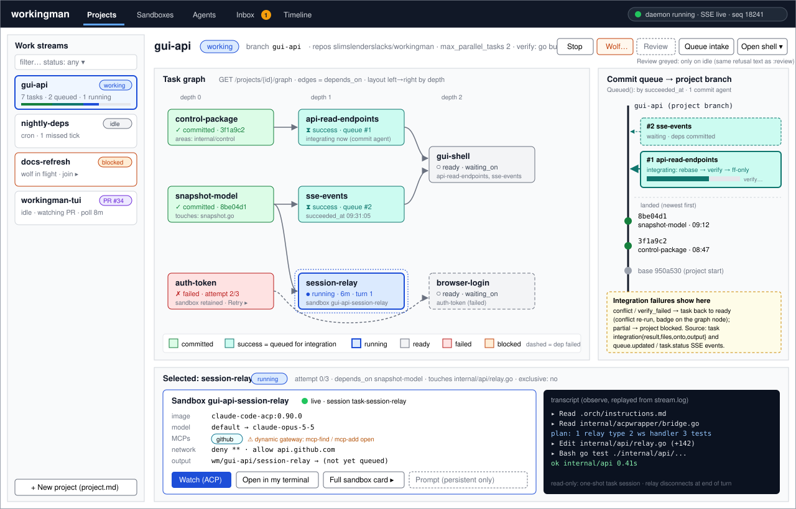
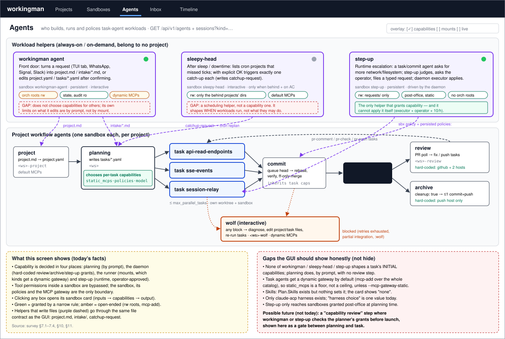

# workingman GUI: a local web app driving the daemon through an API

Status: **draft proposal**. Phases P.0 (groundwork, no user-visible change),
P.1 (daemon-side priming) and P.2 (read-only API and event stream) are
implemented, and so is P.3 (the read-only GUI), and the first slice of P.4
(the write rules and the create-only actions: intake, intake withdraw and new
project); see [P.0](#p0-groundwork-no-user-visible-change),
[P.1](#p1-daemon-side-priming), [P.2](#p2-read-only-api-and-event-stream),
[P.3](#p3-read-only-gui) and [P.4](#p4-write-actions). Nothing after that is.

## Summary

**Goal.** Give workingman (`orch`) a local web GUI as a *companion* to the
TUI, and possibly an alternative to it for some people. Both front ends drive
the same daemon through one small HTTP API that the daemon serves on a unix
socket or on loopback. The TUI stays as it is. It can move onto the API later
if that turns out to be useful.

**Guiding constraint: files remain the source of truth.** Today the control
plane is the filesystem. Every human action that changes daemon behaviour is a
`project.yaml` write stamped `updated_by: agent`, or a new `project.md` /
`intake/*.md` / `catchup-request` file, and the fsnotify-driven daemon reacts
to it (survey §3, §17.1). The API keeps that contract. A read is the same
merged model that `snapshot.json` is built from, plus the task-file fields the
snapshot leaves out. A write is exactly the file write the TUI or a human makes
today, done through the same helpers, after which the daemon reacts as it
always has. The API adds no new control path into the scheduler and no
capability that a local user editing files does not already have.

**What each section covers.**

- **[TUI vs GUI](#tui-vs-gui)** covers what the TUI does well (keyboard flow,
  `:` commands, one process with no listener), what a GUI would add (a
  dependency graph with the commit queue, a "sandbox card" per workload, a
  timeline, mouse-driven intake and retry), and how both coexist on one API.
- **[API for driving a GUI](#api-for-driving-a-gui)** defines the resources
  (projects, tasks, sessions with their sandboxes, intake, audit events, PRs,
  post-office messages, agents), the `GET` endpoints, an SSE event stream
  whose state comes from diffing the model (not from parsing audit lines),
  write actions that map one-to-one onto today's file writes (with etags,
  idempotency keys and a shared control package), a WebSocket relay for
  joining live ACP sessions, and the binding, auth and browser-threat model.
- **[GUI design](#gui-design)** describes the screens: a project view with the
  task graph and the commit-queue lane; the task → sandbox mapping with watch,
  prompt and shell controls; the sandbox card (inputs → capabilities →
  output); an agents map that places workingman, sleepy-head and step-up next
  to the project workflow agents; and the inbox, intake, timeline and PR views.
  It includes four SVG wireframes.
- **[Pros, cons, risks and open questions](#pros-cons-risks-and-open-questions)**
  weighs the cost of a second front end and the first HTTP listener in `orch`,
  and collects every open question raised elsewhere in the document.
- **[Suggested incremental path](#suggested-incremental-path)** orders the
  work in phases: read-only API and event stream, then a read-only GUI, then
  write actions, then session attach (with daemon-side priming). Each phase
  lists its rough scope and the code it touches.

**Grounding.** Every claim about current behaviour cites
[the grounding survey](research/workingman-gui-survey.md) (`survey §N`) or the
code directly. The survey was read against `1b049b3`. The code references in
this document were re-checked against `193a052`, the commit that added the
survey; no code changed between the two. Line numbers drift, and the function
names next to them are the stable anchor.

## Contents

- [Summary](#summary)
- [TUI vs GUI](#tui-vs-gui)
  - [T.1 What the TUI does well](#t1-what-the-tui-does-well)
  - [T.2 What a GUI would add](#t2-what-a-gui-would-add)
  - [T.3 Who would use which](#t3-who-would-use-which)
  - [T.4 Coexistence on one API, with files as the source of truth](#t4-coexistence-on-one-api-with-files-as-the-source-of-truth)
- [API for driving a GUI](#api-for-driving-a-gui)
  - [A.0 Design principles](#a0-design-principles)
  - [A.1 Resources](#a1-resources)
  - [A.2 Read endpoints](#a2-read-endpoints)
  - [A.3 Live event stream](#a3-live-event-stream)
  - [A.4 Write actions](#a4-write-actions)
  - [A.5 Joining a live sandbox session](#a5-joining-a-live-sandbox-session)
  - [A.6 Binding, auth and security](#a6-binding-auth-and-security)
  - [A.7 Coexistence: the TUI on the same API](#a7-coexistence-the-tui-on-the-same-api)
- [GUI design](#gui-design)
  - [G.0 Principles](#g0-principles)
  - [G.1 Project view: task graph, status and commit queue](#g1-project-view-task-graph-status-and-commit-queue)
  - [G.2 Task → sandbox mapping: watch, join, interact](#g2-task--sandbox-mapping-watch-join-interact)
  - [G.3 Sandbox card: inputs → capabilities → output](#g3-sandbox-card-inputs--capabilities--output)
  - [G.4 Agents view: who builds least-privilege workloads](#g4-agents-view-who-builds-least-privilege-workloads)
  - [G.5 Secondary views: inbox, intake, timeline, PRs, notifications](#g5-secondary-views-inbox-intake-timeline-prs-notifications)
  - [G.6 Screen inventory](#g6-screen-inventory)
- [Pros, cons, risks and open questions](#pros-cons-risks-and-open-questions)
  - [R.1 Pros](#r1-pros)
  - [R.2 Cons](#r2-cons)
  - [R.3 Risks and mitigations](#r3-risks-and-mitigations)
  - [R.4 Open questions](#r4-open-questions)
- [Suggested incremental path](#suggested-incremental-path)
  - [P.0 Groundwork (no user-visible change)](#p0-groundwork-no-user-visible-change)
  - [P.1 Daemon-side priming](#p1-daemon-side-priming)
  - [P.2 Read-only API and event stream](#p2-read-only-api-and-event-stream)
  - [P.3 Read-only GUI](#p3-read-only-gui)
  - [P.4 Write actions](#p4-write-actions)
  - [P.5 Session attach](#p5-session-attach)
  - [P.6 Optional follow-ups](#p6-optional-follow-ups)
  - [P.7 Phase summary](#p7-phase-summary)
- [References](#references)

---

## TUI vs GUI

The question is not "replace the TUI". The TUI is a good tool for the person
who wrote it, and the API design below deliberately leaves it unchanged. The
question is which jobs a GUI does better, and how to add one without creating
a second control plane.

### T.1 What the TUI does well

- **Keyboard-driven flow.** Everything is a key or a chord: `h`/`j`/`k`/`l`
  to move, `alt+h`/`alt+l` across columns, `tl`/`tr`/`tp` to toggle the
  left column, the right column and hidden streams, `z` to zoom, `y` to copy
  (OSC 52), `Enter` to attach to a session, `a` for ACP tabs, `I` for the inbox
  (survey §12.2). An operator who knows the keys never leaves the home row.
- **`:` commands that are exactly the control plane.** The picker has eleven
  commands: `:session`, `:wolf`, `:orch`, `:workspace`, `:review`,
  `:cleanup`, `:archive`, `:stop`, `:start`, `:hide`, `:show` (survey §12.3).
  None takes an argument; each acts on the selected work stream or task. Most
  are a `project.Load` → one field → `project.SaveAs` write (survey §12.4).
  The command list is therefore also an honest list of what a human can do,
  and its refusal messages ("review starts on an idle work stream…") state the
  daemon's rules.
- **Low overhead and a small attack surface.** In integrated mode the TUI runs
  in the daemon's process (`orch` without `--headless`, survey §1). It opens
  no listener of its own; `orch` exposes no HTTP port at all apart from the
  optional WhatsApp webhook (survey §15). It reads the files, an in-process
  session channel, the ACP sockets and the post-office store directly
  (survey §6.5). It works over ssh, in tmux and in any terminal, and it
  starts instantly.
- **It sits next to the agents.** ACP tabs render the live transcript, and
  typing goes into persistent sessions (wolf, workingman, sleepy-head; survey
  §9.1). `:session`, `:orch` and `:workspace` open a terminal tab right where
  the user already works (Ghostty, WezTerm, kitty; survey §9.3), and `Enter`
  on a non-ACP row focuses that tab.
- **It does a job, not just a view.** The integrated TUI sends every ACP
  session's opening prompt (survey §17.5). Any replacement has to take over
  that job (§A.5.4).
- **Dense, and dense enough.** The Agent Sessions column already shows
  harness, model, mounts, MCPs and sandbox per session. The Tasks list shows
  model, MCPs and a rule count, with a dependency tree above it. The project
  detail shows a "parallel: N (running … · integrating … · queued …)" line
  (survey §12.1; `tui/project_detail.go:182-215`).

### T.2 What a GUI would add

Each item is something the TUI does not do today, or does only in a cramped
form. The section that designs it is in brackets.

| Need | TUI today | GUI addition |
|---|---|---|
| See how tasks relate to their project | an indented dependency tree and a one-line pipeline summary | a laid-out graph from the scheduler's own `taskgraph` output, with deferral reasons, failed-dependency edges, and `success` drawn as "queued" rather than "done" (§G.1) |
| See the integration order | the `queued …` names | a commit-queue lane: queue in `succeeded_at` order, the commit agent's rebase → verify → ff-only steps, and the landed commits (§G.1) |
| See a task as a workload | model, MCP names and a rule *count* | a sandbox card that brings together the task file, `session.json`, the gateway record and the harness record, which are four places today (survey §17.7): input prompt and metadata → capabilities, including what was *not* granted → output commit (§G.3) |
| See who decides capabilities | not shown | an agents map that places workingman, sleepy-head and step-up next to the project, planning, task, commit, review, archive and wolf agents, and says where each capability decision is made (§G.4) |
| History: why did this happen? | the TUI does not read the audit log (survey §6.5) | a filterable timeline over the audit stream, with links into projects, tasks and sandboxes (§G.5) |
| Ask for work | no TUI command for intake or a new project (survey §4.5): the user writes files by hand or asks the workingman agent | an intake form and a new-project form that write the same files (§A.4.3) |
| Retry one task | no task-level control at all; it goes through the wolf (survey §17.3) | a Retry button that performs the wolf's documented "re-run it" edit (§A.4.4) |
| Several things at once | one terminal, overlays are full-screen | several windows or tabs, e.g. a graph on one screen and two transcripts on another |
| Discoverability | keys and chords must be learned; the footer shows hints | visible buttons, with the TUI's refusal text on disabled ones (§G.0) |
| Use while headless | the launchd service runs `orch --headless`; standalone `orch tui` has no ACP tabs, no `:session` and no live state (survey §16, §18) | a GUI attached to the running service, once priming moves into the daemon (§A.5.4, §P.1) |

### T.3 Who would use which

- The **keyboard operator** who lives in the terminal keeps the TUI. Nothing
  in this proposal takes anything away from it. Phase P.6 offers it live state
  and the timeline through the same event bus if wanted.
- Someone **reviewing or supervising** a project (what is running, what lands
  next, what did this sandbox have access to) is better served by the graph,
  the lane and the sandbox card.
- Someone **new to workingman** learns the system faster from the agents map
  and the sandbox card than from the key list.
- **Scripts and dashboards** get a typed read API and an event stream instead
  of polling `snapshot.json` (survey §6.4). The API pays off even if the GUI
  is never built.

### T.4 Coexistence on one API, with files as the source of truth

```
        human (keys)            human (mouse)             scripts / curl
             │                        │                          │
        ┌────▼─────┐           ┌──────▼──────┐                   │
        │   TUI    │           │  web GUI    │                   │
        └────┬─────┘           └──────┬──────┘                   │
   (today: direct file writes,        │ HTTP + SSE + WS          │
    later optionally the API)         ▼                          │
             │              ┌──────────────────┐                 │
             ├─────────────▶│ orch API (in the │◀────────────────┘
             │              │ daemon process)  │
             │              └────────┬─────────┘
             │      internal/control │ (same Load → mutate → SaveAs helpers)
             ▼                       ▼
   ┌─────────────────────────────────────────────────────────┐
   │ files under the roots: project.yaml, tasks/*.yaml,      │◀── agents, editors,
   │ project.md, intake/*.md, catchup-request; post-office/  │    the workingman agent
   └──────────────────────────┬──────────────────────────────┘
                              │ fsnotify
                        ┌─────▼──────┐
                        │   daemon   │── sessions, sandboxes, commit queue
                        └────────────┘
```

The rules that make this work are set out in §A.0, §A.4.1 and §A.7. In short:

1. **One write path.** The TUI helpers (`requestStop`, `requestStart`,
   `summonWolf`, `requestReview`, `requestCleanup`, `archiveProject` in
   `internal/tui/*.go`) move into a shared `internal/control` package. The TUI
   and the API call the same functions, with the same preconditions and the
   same refusal text, so the two front ends cannot drift.
2. **The daemon cannot tell them apart.** Both produce the same file write
   with the same `updated_by` stamp. The daemon's only signal is the file, as
   today. The API adds an `api_write` audit line so GUI actions show up in the
   timeline.
3. **Reads are views over the same state.** The API serves the model that the
   snapshot is built from (§A.0 principle 2). The TUI keeps polling files
   (survey §6.5) until, optionally, it subscribes to the same in-process event
   bus (§A.7 item 2).
4. **Agents and humans keep editing files.** A wolf, the workingman agent or a
   human in an editor stay first-class writers. The GUI sees their writes as
   events, because events come from diffing the model, not from API calls
   (§A.3.2). Etags guard the GUI against overwriting a change it has not seen
   (§A.4.1).
5. **Nothing depends on the GUI.** The API is optional and off by default.
   If it fails to bind, the daemon keeps running (§A.6.4). A closed browser tab
   changes nothing, because notifications still fan out through osascript and
   the channels (§G.5).

---

## API for driving a GUI

### A.0 Design principles

1. **Files remain the source of truth.** Today every human action that changes
   daemon behaviour is a file write: a `project.yaml` field written with
   `updated_by: agent`, or a new `project.md` / `intake/*.md` /
   `catchup-request` file (survey §3, §17.1). The API keeps that. Each write
   endpoint performs **exactly the write the TUI or a human performs today**,
   through the same helpers (`project.SaveAs(..., WriterAgent)`, atomic
   temp+rename), and then lets the fsnotify-driven daemon react as it already
   does. The API adds no new control path into the scheduler.
2. **Reads come from the same sources as `snapshot.json`.** The snapshot builder
   (`internal/daemon/snapshot.go`) already merges on-disk project/task state
   with live in-memory state (session map, in-flight flags, counters, poll
   state) and redacts it. The API serves that model, in memory and without the
   2 s tick, and adds the fields the snapshot leaves out (task capabilities,
   descriptions, commits; survey §6.2, §17.4) straight from the task files.
3. **The API is in the daemon process.** It is an optional HTTP listener inside
   `orch` (off by default, e.g. `--api=unix|loopback|off`). Putting it in the
   daemon process matters for two reasons: the live state (`projects[].live`,
   `sessions[]`) exists only in daemon memory, and the in-process daemon
   methods that the TUI calls today (`OpenInteractiveSession`,
   `OpenTaskSession`, …; survey §12.3) can be exposed without a new IPC
   mechanism. A standalone `orch api` (no daemon) could serve the offline
   subset, as `orch status --root` does (`BuildOfflineSnapshot`), but that is a
   later option.
4. **Small surface, versioned.** Everything lives under `/api/v1`. JSON field
   names match the YAML keys and the snapshot's JSON keys (`docs/state-snapshot.md`),
   so a reader who knows one knows the others. Unknown fields must be ignored
   (same rule as the snapshot schema).
5. **No new capability.** The API must not let a browser do anything the local
   user could not already do by editing files under the roots or using the
   TUI. It also must not be a way to escalate a sandbox's capabilities. Changes
   to `static_mcps` / `policies` keep going through planning or step-up (§A.4.4).

### A.1 Resources

Identifiers. A project is addressed by `{root_index, work_stream}`, flattened
into a single URL-safe id `p_<n>.<work-stream>` (for example `p_0.workingman-tui`).
The work-stream name is the project's directory name (`dispatch.go:94-95`) and
is unique within a root; the root index disambiguates two roots that hold the
same name. Tasks are addressed by name within a project (names are kebab-case
and unique per graph; `taskgraph.Load` fails on duplicates, survey §4.4).
Sessions are addressed by their **session id** (the `~/.workingman/sessions/<id>`
directory name, `<kind>-<task|branch|hash>`, survey §8.2) when they are ACP
sessions, and otherwise by the daemon session-map key (URL-encoded).
Absolute paths are still included in every body (`path`, `project_path`)
because the GUI shows them and copies them, as the TUI does with `y`.

#### A.1.1 Project

Derived from `project.yaml` (`Project`, `project/project.go:96-301`) and the
snapshot's `ProjectSnapshot`. The summary form (in lists) is the snapshot
object without `tasks[]`. The detail form adds `repos`, `new_repos`, the full
`description`, the cron stop conditions and a `blocked_session` read from
`blocked-session.yaml`.

```json
{
  "id": "p_0.workingman-tui",
  "work_stream": "workingman-tui",
  "root": "/Users/me/orch",
  "path": "/Users/me/orch/workingman-tui/project.yaml",
  "etag": "\"pj-9f1c2e7a\"",
  "status": "working",
  "stopped_from": "",
  "blocked_reason": "",
  "branch": "workingman-tui",
  "description": "Design proposal: an alternative (or companion) to the workingman TUI …",
  "repos": [{"org": "slimslenderslacks", "name": "workingman", "base_branch": ""}],
  "new_repos": [],
  "load_error": "",
  "flags": {
    "review": false, "review_now": false, "cleanup": false, "archive": false,
    "replan": false, "hidden": false, "watching_pr": false
  },
  "cron": "", "cron_active": false, "cron_until": null, "cron_max_runs": 0, "cron_runs": 0,
  "max_parallel_tasks": 1,
  "verify": "",
  "pull_requests": [],
  "task_counts": {"ready": 2, "running": 1, "success": 0, "failed": 0, "blocked": 0, "committed": 1},
  "task_total": 4,
  "commit_queue": [],
  "verify_checks": null,
  "created_at": "2026-11-24T23:12:05-05:00",
  "updated_at": "2026-11-25T04:29:10-05:00",
  "updated_by": "agent",
  "live": {
    "sessions": ["task"],
    "running_tasks": ["draft-api-design"],
    "integrating": "",
    "commit_reserved": false,
    "wolf_in_flight": false,
    "cleanup_in_flight": false,
    "review_agent_in_flight": false,
    "planning_failures": 0, "project_failures": 0,
    "review_fix_cycles": 0, "review_errors": 0,
    "review_poll": null,
    "cron_schedule": "",
    "deferred": null
  },
  "blocked_session": null,
  "pending_intake": [],
  "links": {
    "tasks": "/api/v1/projects/p_0.workingman-tui/tasks",
    "sessions": "/api/v1/sessions?project=p_0.workingman-tui",
    "events": "/api/v1/events?project=p_0.workingman-tui"
  }
}
```

Notes:
- `flags` groups the snapshot's top-level booleans (`review`, `review_now`,
  `cleanup`, `archive`, `replan`, `hidden`, `watching_pr`). In YAML, `hidden`
  is `hide`. Grouping them gives the GUI one place to render badges.
- `live` is exactly the snapshot's `projects[].live` (`snapshot.go`, "daemon
  snapshots only"), or `null` when the server runs without a daemon.
- `blocked_session` is `{blocked_reason, summary, attempted[]}` from
  `blocked-session.yaml` (`project/blocked_session.go:28-35`), the wolf's
  durable diagnosis. It is `null` when that file is absent.
- `pending_intake` lists the non-blank `intake/*.md` names, using the same scan
  as `pendingIntakeFiles` (`intake.go:113-132`).
- `pull_requests[]` carries `{repo, number, url, head_sha, state}`. The
  `fingerprint` is left out of the summary: it is internal poll state, and it
  is available in the detail form under `?include=fingerprint`.

#### A.1.2 Task

Derived from `tasks/<name>.yaml` (`Task`, `task/task.go:170-321`) merged with
the snapshot's `TaskSnapshot` (derived fields `exclusive`, `queue_position`,
`waiting_on`). This resource is the main reason the API exists alongside the
snapshot file: it carries the **workload** fields that a sandbox card needs
and the snapshot omits (survey §6.2, §17.4).

```json
{
  "project": "p_0.workingman-tui",
  "name": "draft-api-design",
  "path": "/Users/me/orch/workingman-tui/tasks/draft-api-design.yaml",
  "etag": "\"tk-41ab09d3\"",
  "status": "running",
  "attempts": 0,
  "failure_reason": "",
  "blocked_reason": "",
  "description": "Repo: slimslenderslacks/workingman … Documents only — do NOT implement anything. …",
  "depends_on": ["survey-current-architecture"],
  "touches": null,
  "areas": [],
  "exclusive": true,
  "capabilities": {
    "model": "default",
    "resolved_model": "claude-opus-5-5",
    "harness": "claude-acp",
    "resolved_harness": "slimslenderslacks/claude-code-acp:0.90.0",
    "static_mcps": [],
    "policies": [
      {"action": "allow", "type": "network", "resource": "api.github.com"}
    ],
    "save_sandbox": false
  },
  "source": null,
  "worktree": "/Users/me/dev/workspaces/workingman-tui/.worktrees/draft-api-design",
  "task_branch": "wm/workingman-tui/draft-api-design",
  "base": [{"repo": "workingman", "hash": "193a052b121205fefa4c84624db8f162a40687a1"}],
  "succeeded_at": null,
  "completed_at": null,
  "queue_position": 0,
  "waiting_on": [],
  "integration": null,
  "output": {
    "summary": "",
    "commits": [],
    "created_files": [],
    "touches_actual": []
  },
  "session": "task-draft-api-design",
  "sandbox": "workingman-tui-draft-api-design"
}
```

Notes:
- `capabilities` groups `model`, `resolved_model`, `harness`,
  `resolved_harness`, `static_mcps`, `policies`, `save_sandbox`. YAML keeps
  them flat; the grouping is presentation only. `policies[]` uses the YAML
  keys of `policy.Rule` (`action: allow|deny`, `type: network|filesystem`,
  `resource`; `policy/policy.go:39-43`).
- `output` groups the commit agent's results: `summary`, `commits[{repo,hash}]`,
  `created_files`, and the daemon's `touches_actual`.
- `integration` is the full YAML block (`result`, `repo`, `files`, `onto`,
  `output`, `published`, `landed`, `attempts`). The snapshot omits `onto`,
  `output` and `published`. `output` is the tail of a failed `verify` run, so
  it is passed through `audit.Redact` like everything else.
- `session` and `sandbox` are back-links, filled when a live session's
  `task_path` matches this file. When there is no session, `sandbox` is the
  deterministic name `SandboxNameFor` would choose (`<ws>-<task>`, survey §8.3),
  so the GUI can show a retained sandbox (`save_sandbox`, or a task that ended
  `failed`/`blocked`).
- A planning seed (blank name) appears under its filename stem with
  `"seed": true`, as the snapshot does.
- `source` is the task file's `source:` block as written: a PR signal
  (`{kind: pr-comment|pr-check|pr-push, ref, repo, pr}`, unchanged) or the
  intake back-reference `{kind: "intake", ref: <request>, pr: 0}` (R.4 Q12).
  A planned task with no `source:` that the planning run which processed a
  request created gets that request's intake source with `"inferred": true`
  (see §A.1.4); `inferred` is absent everywhere else.

#### A.1.3 Session (and its sandbox)

One resource covers a running agent session together with its sandbox, since
today they correspond one to one (one `acp-wrapper` per session, one sandbox
per wrapper; survey §8.1). The fields come from the snapshot's
`SessionSnapshot` plus the files a sandbox card needs:
`sessions/<id>/session.json` (`session/session.go:44-140`), the gateway record
`gateways/<sandbox>.json` (`mcpgateway/store.go:19-36`) and the harness record
`sandboxes/<sandbox>.json` (`acpwrapper/harness.go:26-40`). Survey §17.7 notes
that this data is spread across those four places today. The session resource
puts it in one place.

```json
{
  "id": "task-draft-api-design",
  "key": "/Users/me/orch/workingman-tui/project.yaml#task:draft-api-design",
  "kind": "task",
  "project": "p_0.workingman-tui",
  "project_path": "/Users/me/orch/workingman-tui/project.yaml",
  "task": "draft-api-design",
  "task_path": "/Users/me/orch/workingman-tui/tasks/draft-api-design.yaml",
  "worktree": "/Users/me/dev/workspaces/workingman-tui/.worktrees/draft-api-design",
  "started_at": "2026-11-25T04:29:12-05:00",
  "interactive": false,
  "persistent": false,
  "source": "daemon",
  "status": "running",
  "prompt_count": 1,
  "error": "",
  "sandbox": {
    "name": "workingman-tui-draft-api-design",
    "live": true,
    "kit": "/Users/me/kits/acp",
    "image": "slimslenderslacks/claude-code-acp:0.90.0",
    "workspaces": ["/Users/me/dev/workspaces/workingman-tui/.worktrees/draft-api-design"],
    "signing_broken": false,
    "push_broken": false,
    "created_at": "2026-11-25T04:29:11-05:00"
  },
  "gateway": {
    "requested": ["github"],
    "servers": ["github"],
    "dynamic": true
  },
  "acp": {
    "session_id": "4f6c…",
    "attachable": true,
    "observers": 1
  },
  "tab_name": "",
  "links": {
    "attach": "/api/v1/sessions/task-draft-api-design/acp",
    "transcript": "/api/v1/sessions/task-draft-api-design/transcript",
    "prompt_files": "/api/v1/sessions/task-draft-api-design/prompt"
  }
}
```

Notes:
- The gateway's `url`/`sandbox_url`/`id` are **never** returned. The
  sub-gateway UUID path is the sandbox's only MCP credential (survey §10), so
  exposing it would let a browser call that sandbox's MCP servers.
- `socket_path` and `session_dir` are omitted from the public shape as well. The
  GUI reaches the socket only through the API's attach endpoint (§A.5). This
  keeps one choke point for auth and for the one-shot lifetime rules.
- `sandbox.live` comes from `sbx ls` (`sbx/sbx.go:63-74`), cached for a few
  seconds; the TUI already shells out to it.
- `prompt_files` returns the rendered `.orch/instructions.md` and
  `.orch/context.yaml` from the session's working directory: the workload's
  **input prompt** (survey §8.5).
- `GET /api/v1/sandboxes` (below) additionally lists **retained** sandboxes with
  no session: harness records whose sandbox still exists in `sbx ls`, such as
  tasks kept after a terminal failure or `:session` sandboxes, which nothing
  removes (survey §9.3).

#### A.1.4 Intake request

`intake/<x>.md` files. Today the files on disk are the only record (survey §3,
§4.5).

```json
{
  "project": "p_0.workingman-tui",
  "name": "add-svg-wireframes",
  "file": "add-svg-wireframes.md",
  "state": "pending",
  "created_at": "2026-11-25T05:02:00-05:00",
  "body": "Please add SVG wireframes for the project graph …",
  "etag": "\"in-77c0\"",
  "tasks": [{"name": "svg-card", "mapping": "recorded"}]
}
```

`state` is `pending` (`*.md`, non-blank), `empty` (blank `*.md`; the daemon
logs `intake_empty` and ignores it) or `processed` (renamed to `*.processed`
by the planner, `planning.tmpl:143-147`). `created_at` is the file's mtime.

`tasks` (implemented with R.4 Q12) are the tasks planned from the request,
never `null`. When any task records `source: {kind: intake, ref: <name>}`,
they are exactly those tasks, with `"mapping": "recorded"`. Otherwise the API
falls back to inference: the tasks that appeared in `tasks/` during the
planning run that renamed this file to `.processed`, keeping only tasks with
no `source:` of their own, with `"mapping": "inferred"`. The daemon notes
that run in memory (`endPlanning`), so a request processed before the
current daemon started has no inferred tasks. A run that processed several
requests lists its new tasks under each of them.

#### A.1.5 Audit event

The snapshot's `AuditEvent` (`{time, event, fields}`) plus a monotonically
increasing `seq`, which the event stream uses as its cursor (§A.3.4).

```json
{"seq": 18234, "time": "2026-11-25T09:29:12Z", "event": "task_running",
 "fields": {"path": "/Users/me/orch/workingman-tui/tasks/draft-api-design.yaml", "task": "draft-api-design"}}
```

Values are redacted (`audit.Redact`), as in the snapshot. `seq` is assigned
by the audit logger in the daemon process. The logger already holds the last
500 lines (`Recent`), and a seq counter goes next to that buffer. `seq` is not
written to `audit.log`; the line format is unchanged.

#### A.1.6 Pull request

`project.yaml` `pull_requests[]` (`project.go:349-356`) plus the project's
review-loop state from `live`. The API does not call GitHub. The GUI links out
to `url`.

```json
{
  "project": "p_0.workingman",
  "repo": "slimslenderslacks/workingman",
  "number": 34,
  "url": "https://github.com/slimslenderslacks/workingman/pull/34",
  "head_sha": "c97c47ec…",
  "state": "open",
  "watching": true,
  "review_poll": {"schedule": "@every 8m", "backoff_index": 2, "has_baseline": true, "baseline_source": "mcp"},
  "next_poll_at": "2026-11-25T09:43:00Z",
  "poll_ladder": ["@every 2m", "@every 4m", "@every 8m", "@every 16m", "@every 32m", "@every 1h"],
  "budgets": {"review_fix_cycles": 1, "max_review_fix_cycles": 10, "review_errors": 0, "max_review_errors": 5},
  "fix_tasks": ["fix-pr-34-comment-1201"]
}
```

`fix_tasks` are the project's tasks whose `source.pr` equals `number`
(`task.Source`, kinds `pr-comment|pr-check|pr-push`).

#### A.1.7 Messages (post-office) and agents

The GUI should show the operator inbox, since step-up approvals arrive there
(survey §7.3, §11).

```json
{
  "id": "msg_01J…",
  "kind": "request",
  "from": {"agent": "step-up", "sandbox": "step-up", "project": "", "task": "", "session_id": "…"},
  "recipient": "operator",
  "subject": "Allow network to registry.npmjs.org for workingman-tui-build?",
  "body": "…exact change line…",
  "options": ["approve", "deny"],
  "created_at": "2026-11-25T09:40:00Z",
  "expires_at": "2026-11-26T09:40:00Z",
  "state": "open",
  "resolution": null
}
```

These are the post-office `Message` fields (`postoffice/model.go:124-135`).
`state` is `open` or `closed`, and `resolution` is the `Resolution`
(`outcome`, `response`, `option`, `responder`, `at`).

`agents` is a small, read-only resource for the three non-project agents and
their enablement, so the GUI can place them (survey §7.3):

```json
[
  {"kind": "workingman", "enabled": true, "mode": "auto", "session": "workingman-agent", "sandbox": "workingman-agent", "mcp": {"dynamic": true}},
  {"kind": "sleepy-head", "enabled": true, "session": null, "pending_catchups": ["nightly-deps"]},
  {"kind": "step-up", "enabled": true, "session": "step-up", "static_mcps": ["post-office"], "requests_today": 3}
]
```

### A.2 Read endpoints

Elsewhere in this document paths are often written without the `/api/v1`
prefix (`GET /projects/{id}/graph`); every path lives under `/api/v1`.

All endpoints are `GET` and return `application/json`, with
`ETag`/`If-None-Match` support (§A.4.1). Lists return
`{"items": [...], "generated_at": "...", "cursor": <seq>}`. The `cursor` is the
event-stream position the list is consistent with, so a client can do
`GET` then `events?since=cursor` without a gap (§A.3.4).

| Path | Query params | Returns |
|---|---|---|
| `/api/v1/status` | | `{version, daemon{state, pid, started_at, headless, roots, acp_kit, acp_image, workspace_manager}, api{version, binding}, cursor}`. This is the snapshot's `daemon` block. The API never returns a `stopped` daemon state, because it is in-process. |
| `/api/v1/snapshot` | `audit_events=N` | The exact `snapshot.json` document (version 1), built on demand. It is a compatibility escape hatch for tools that already parse it, such as `orch status --json` readers. |
| `/api/v1/projects` | `status=a,b`, `hidden=true\|false\|any` (default `false`, which matches the TUI gallery), `root=<n>`, `q=<substring of name/description>` | project summaries |
| `/api/v1/projects/{id}` | `include=fingerprint` | project detail (§A.1.1) |
| `/api/v1/projects/{id}/tasks` | `status=…` | tasks (§A.1.2), ordered by name |
| `/api/v1/projects/{id}/tasks/{name}` | | one task |
| `/api/v1/projects/{id}/graph` | | `{nodes:[{name,status,exclusive,queue_position}], edges:[{from,to}], ready:[…], runnable:[…], deferred:{overlap:[…],cap,power}, commit_queue:[…], errors:[…]}`. The output of `taskgraph.Load` / `Ready()` / `Runnable()` / `Queued()` (survey §4.4, §5), so the GUI draws the same graph the scheduler uses, and does not re-derive it. `errors` carries `taskgraph_error` / repair warnings. |
| `/api/v1/projects/{id}/intake` | `state=pending\|processed\|all` | intake requests |
| `/api/v1/projects/{id}/intake/{name}` | | one request with `body` |
| `/api/v1/projects/{id}/pulls` | | PRs (§A.1.6) |
| `/api/v1/projects/{id}/audit` | `since=<seq>`, `limit` (≤ 500), `event=a,b` | audit events whose `path`/`key` field is under this project |
| `/api/v1/sessions` | `project={id}`, `kind=task,commit`, `live=true` | sessions (§A.1.3) |
| `/api/v1/sessions/{sid}` | | one session |
| `/api/v1/sessions/{sid}/transcript` | `after=<byte offset>`, `limit` | `stream.log` frames as NDJSON (`application/x-ndjson`), redacted. This is the same data the TUI replays. It is only available while the session dir exists, because the wrapper deletes the dir on exit (survey §8.2). |
| `/api/v1/sessions/{sid}/prompt` | | `{instructions_md, context_yaml}` |
| `/api/v1/sandboxes` | `retained=true` | live and retained sandboxes, each with harness and gateway info (without gateway URLs) |
| `/api/v1/audit` | `since=<seq>`, `limit`, `event=…`, `project={id}` | the global audit tail. The source is the in-memory ring (500 lines); beyond that the server tails `--audit-log` with `audit.TailFile`. |
| `/api/v1/messages` | `state=open\|closed`, `since=<time>` | post-office messages for `operator` (`Store.ListOpen`, `ListDone`) |
| `/api/v1/agents` | | §A.1.7 |

Example: list working and blocked projects.

```http
GET /api/v1/projects?status=working,blocked HTTP/1.1
Host: localhost
Authorization: Bearer 3q2+7w…

HTTP/1.1 200 OK
ETag: "pl-18234"
Content-Type: application/json

{
  "generated_at": "2026-11-25T09:31:02Z",
  "cursor": 18234,
  "items": [
    {"id": "p_0.workingman-tui", "work_stream": "workingman-tui", "status": "working",
     "branch": "workingman-tui", "task_counts": {"ready": 2, "running": 1, "success": 0,
     "failed": 0, "blocked": 0, "committed": 1}, "task_total": 4, "commit_queue": [],
     "flags": {"review": false, "watching_pr": false, "cleanup": false, "archive": false,
     "review_now": false, "replan": false, "hidden": false},
     "live": {"running_tasks": ["draft-api-design"], "integrating": "", "wolf_in_flight": false},
     "etag": "\"pj-9f1c2e7a\""}
  ]
}
```

Example: the graph for the project-view dependency diagram.

```json
{
  "nodes": [
    {"name": "survey-current-architecture", "status": "committed"},
    {"name": "draft-api-design", "status": "running", "exclusive": true},
    {"name": "draft-gui-design-wireframes", "status": "ready"},
    {"name": "finalize-gui-proposal", "status": "ready"}
  ],
  "edges": [
    {"from": "survey-current-architecture", "to": "draft-api-design"},
    {"from": "draft-api-design", "to": "draft-gui-design-wireframes"},
    {"from": "draft-gui-design-wireframes", "to": "finalize-gui-proposal"}
  ],
  "ready": [],
  "runnable": [],
  "deferred": null,
  "commit_queue": [],
  "errors": []
}
```

The project's `tasks/*.yaml` hold more than the snapshot. That is why
`/tasks` reads the files and caches each one on mtime and size, the same way
the snapshot builder caches per-project parsing.

### A.3 Live event stream

#### A.3.1 SSE or WebSocket

| | Server-Sent Events | WebSocket |
|---|---|---|
| Direction | server → client only | both |
| Resume | built in: `Last-Event-ID` on reconnect, automatic retry in `EventSource` | hand-rolled |
| Proxies, devtools, curl | plain HTTP; `curl -N` works; visible in the browser network tab | needs a WS client |
| Auth | `EventSource` cannot set headers, so it needs a cookie or a query token. `fetch()` streaming can set headers. | the token goes in the first message, or a cookie or subprotocol |
| Go server | `http.Flusher`, no dependency | needs a library (`nhooyr.io/websocket` or `gorilla/websocket`) |
| Fit for state changes | very good: state changes flow one way, and writes go through REST | works, but adds framing for no benefit |
| Fit for ACP sessions | poor: ACP is bidirectional JSON-RPC | **required** |

**Recommendation: SSE for the state stream, WebSocket only for session
attach (§A.5).** State changes flow one way, writes are ordinary REST calls
that are idempotent and carry an etag (§A.4.1), and SSE's
`Last-Event-ID` gives replay semantics for free. ACP passthrough is
bidirectional and needs a WebSocket. Neither stream depends on the other: a
read-only GUI needs only SSE.

Endpoint: `GET /api/v1/events` with
`Accept: text/event-stream`. Query params: `project={id}` (repeatable),
`types=project.*,task.*,audit` (glob list; default all except `audit`),
`since=<seq>` (alternative to `Last-Event-ID`).

#### A.3.2 Where events come from

There is no new event source. The daemon already marks the snapshot dirty on
every audit line, session start/end, and project/task/intake file event
(`markSnapshotDirty`, survey §6.3). The API publisher hooks the same points.
On each kick (no 150 ms debounce here, or a much shorter one, e.g. 25 ms, to
coalesce bursts) it:

1. rebuilds the in-memory snapshot model for the **affected projects only**.
   The per-project cache on mtime/size already makes this cheap.
2. **diffs** it against the previous model per resource (project summary,
   each task, each session, each intake file, each PR). The diff is
   field-level, so `task.updated` can say which fields changed.
3. emits one typed event per changed resource, plus one `audit` event per new
   audit line.

Diffing the model, rather than translating audit lines into state events, is
deliberate. Every write to the files produces an event, including those made
outside the daemon: by the human, a wolf, the workingman agent, or a task
agent editing its own task file. Those writes often have no audit line that
carries the new value (`task_file_updated` only names the path). Audit events
are delivered as well, as context for the timeline, but **state is always taken
from the diff**.

#### A.3.3 Event types and payloads

Every event's `data` is a JSON object with a common envelope:

```json
{"seq": 18240, "time": "2026-11-25T09:31:05.112Z", "type": "task.updated",
 "project": "p_0.workingman-tui", "cause": "file", "data": { … }}
```

`cause` is `file` (a watched file changed), `session` (a session started or
ended), `live` (only in-memory state changed: counters, poll rung, in-flight
flags), `audit`, or `daemon`.

| `type` | Emitted when | `data` |
|---|---|---|
| `hello` | on connect, first frame | `{cursor, api_version, daemon{state,pid,started_at}, replay: "full"\|"delta"\|"reset"}` |
| `project.created` | a new `project.yaml` appears (seed or hand-made) | project summary |
| `project.updated` | any summary field changes | `{id, etag, changed: ["status","blocked_reason"], project: <summary>}` |
| `project.status` | `status` changes (also folded into `project.updated`; a separate type because it is the most common subscription) | `{id, from, to, blocked_reason, stopped_from}` |
| `project.removed` | the project dir leaves the roots (`:archive`, manual delete); detected by rescan, because fsnotify `Remove` is ignored by dispatch (`dispatch.go:37-39`) | `{id, path}` |
| `project.live` | only `live` changed | `{id, live}` |
| `task.created` | a new `tasks/*.yaml` | task |
| `task.updated` | any task field changes | `{project, name, etag, changed: [...], task: <task>}` |
| `task.status` | task `status` changes | `{project, name, from, to, attempts, failure_reason, blocked_reason}` |
| `task.removed` | a task file disappears | `{project, name}` |
| `queue.updated` | `commit_queue` order or `live.integrating` changes | `{project, commit_queue: [...], integrating, commit_reserved}` |
| `session.started` | a session enters the daemon map, or a disk session appears | session |
| `session.updated` | `status` / `prompt_count` / `sandbox.live` changes | `{id, changed, session}` |
| `session.ended` | a session leaves the map (`session_ended`/`session_reaped`/`session_stopped`) | `{id, kind, project, task, outcome: "ended"\|"reaped"\|"stopped"\|"detached", err}` |
| `intake.created` / `intake.processed` / `intake.removed` | an `intake/*.md` appears, is renamed to `.processed`, or vanishes | intake request (without `body`) |
| `pr.updated` | `pull_requests[]` entry or `review_poll` changes | PR |
| `message.created` / `message.closed` | a post-office message appears or is resolved | message |
| `audit` | every audit line (only if `types` includes `audit`) | audit event (§A.1.5) |
| `heartbeat` | every 15 s with no other traffic | `{cursor}`; mirrors the snapshot's heartbeat |
| `reset` | the server cannot replay from the requested cursor | `{cursor}`; the client must refetch lists |

Audit events that the GUI should **highlight** are not separate event types.
The GUI keys off `audit.event` names: `project_blocked`, `task_retry_exhausted`,
`integration_conflicted`, `integration_verify_failed`, `touches_exceeded`,
`archive_incomplete`, `review_error`, `step_up_op`, `session_reaped`
(survey §13).

Example SSE frames:

```
id: 18240
event: task.status
data: {"seq":18240,"time":"2026-11-25T09:31:05.112Z","type":"task.status","project":"p_0.workingman-tui","cause":"file","data":{"project":"p_0.workingman-tui","name":"draft-api-design","from":"running","to":"success","attempts":0,"failure_reason":"","blocked_reason":""}}

id: 18241
event: queue.updated
data: {"seq":18241,"time":"2026-11-25T09:31:05.140Z","type":"queue.updated","project":"p_0.workingman-tui","cause":"file","data":{"project":"p_0.workingman-tui","commit_queue":["draft-api-design"],"integrating":"","commit_reserved":false}}

id: 18242
event: session.started
data: {"seq":18242,…,"type":"session.started","cause":"session","data":{"id":"commit-draft-api-design","kind":"commit","task":"draft-api-design",…}}
```

#### A.3.4 Resume and replay

- `seq` is a single, per-daemon-process, monotonically increasing integer that
  covers every event (state and audit). It goes in the SSE `id:` field.
- The server keeps a ring of the last N events (e.g. 5 000, or 15 minutes).
  On reconnect with `Last-Event-ID: k` (or `?since=k`):
  - if `k` is in the ring, the server sends `hello{replay:"delta"}` and then every
    event after `k`, filtered by the subscription;
  - if `k` is older than the ring, or from a previous daemon process (detected
    by an epoch prefix: `id: <epoch>.<seq>`, where `epoch` is the daemon start
    time), the server sends `hello{replay:"reset"}` and `reset{cursor}`. The
    client then refetches its lists, which carry a `cursor` (§A.2), and
    continues from that cursor;
  - with no cursor, the server sends `hello{replay:"full"}`, then a synthetic
    `project.created` / `task.created` / `session.started` for current state, then
    live events. This makes "connect and render" a single request.
- Events describe **state after the change** (the full resource, or the
  resource plus `changed`). They are not patches. A missed or duplicated event
  is therefore harmless, and applying them is idempotent: the client overwrites
  by id. Strict replay matters only for the `audit` timeline.
- The audit log on disk is the durable history. For a timeline older than the
  ring, the GUI pages `GET /audit?since=`, whose source is `audit.TailFile`.
  Task and project history before the ring is not reconstructed. The files hold
  only current state, which is how workingman works today.

### A.4 Write actions

#### A.4.1 Rules that apply to every write

- **One endpoint, one file write.** This is the same write the TUI makes,
  through the same function. The TUI helpers (`requestStop`, `requestStart`,
  `summonWolf`, `requestReview`, `requestCleanup` in `internal/tui/*.go`) are
  small `Load → mutate → SaveAs(WriterAgent)` functions, and most also check a
  precondition. They now live in a shared package,
  `internal/control` (P.0), that the TUI calls and the API will call. Then the API
  cannot drift from the TUI, and the TUI's own code path is unchanged.
- **The response is the file state after the write, not the outcome.** Writes
  return `202 Accepted` with the new resource and its new etag. The daemon's
  reaction (a wolf launches, sessions close) is reported later through the
  event stream. The API never waits for or fakes the reaction.
- **Optimistic concurrency.** Every mutable resource has an `ETag`, a hash of
  the file's bytes. Write endpoints accept `If-Match`. On a mismatch they
  return `412 Precondition Failed` with the current resource, so the GUI can
  show what changed. `If-Match` is **required** for actions that read and then
  write a field the daemon or an agent may also write (`stop`, `start`, `wolf`,
  `review`, task edits). Without it, a create-only action such as intake or
  a new project works as is.
- **The read-modify-write is serialized** with the daemon's own writers by a
  per-path lock in the daemon process. The daemon's writes go through
  `project.Save`, and the lock would be taken in that one helper. A
  temp+rename write is atomic, but two writers that each load, mutate and
  rename lose one change. The lock closes that window **for writers inside the
  orch process**, which are the daemon and the API. Agents in sandboxes and
  humans in editors are outside it. For those, the etag check is the guard,
  and it is re-run under the lock just before the rename. A window remains
  between that check and the rename, and an outside writer can land in it.
  That risk exists today between the TUI and agents. The API does not widen
  it. §A.6.3 covers what to do about it.
- **Idempotency.** Every `POST` accepts `Idempotency-Key: <uuid>`. The server
  remembers `(key → response)` for 24 h in memory, so a retried click does not
  send a second intake or a second project. Beyond that, the actions are
  idempotent by construction where possible. For example, `cleanup` on a
  project that already has `cleanup: true` returns `200` with
  `"noop": true`; it does not rewrite the file. A rewrite would trigger the
  watcher, and daemon dedup makes it harmless anyway, but it adds noise to
  the audit log.
- **`updated_by: agent`** is how the daemon tells an external request from its
  own write (survey §2). The API writes as `agent` for everything the daemon
  should react to, and as `daemon` only where the TUI does so on purpose
  (`hide`/`show`, so that the write does not cause dispatch). A separate
  `updated_via: api` marker would help audit, but it would be a schema
  addition. Instead, the API writes an audit line for every write:
  `api_write action=stop path=… etag_before=… etag_after=… client=<token-id>`.
- **Errors** use one shape:
  `{"error": {"code": "precondition_failed" | "conflict" | "invalid_state" | "not_found" | "forbidden" | "unavailable", "message": "...", "current": <resource?>}}`.
  `invalid_state` (409) carries the TUI's own refusal text, for example
  `workingman-tui is already stopped` or
  `review starts on an idle work stream or kicks one already watching a PR (this one is "working")`.

#### A.4.2 Project actions

All of these are `POST /api/v1/projects/{id}/actions/{action}` with
`If-Match: <project etag>`.

| Action | Body | Precondition (same as today) | File write | Daemon reaction (unchanged) |
|---|---|---|---|---|
| `stop` | `{}` | populated and not already `stopped` (`tui/stop.go:23-44`) | `project.yaml`: `stopped_from: <status>`, `status: stopped`, `updated_by: agent` | `enforceStopped`: closes every `<path>` / `<path>#*` session and unregisters cron and `#review`; running tasks go back to `ready` without spending an attempt |
| `start` | `{}` | `status: stopped` (`tui/stop.go:55-80`) | `status: <stopped_from, or idle if empty>`, `stopped_from: ""`, as agent | normal routing |
| `wolf` | `{"reason": "optional text"}` | none | `status: blocked`. `blocked_reason` is set **only if empty**: to `reason`, or to the TUI's `summonReason` with "via the GUI" in place of "via the TUI (:wolf)". As agent (`tui/wolf.go:27-43`). | `launchWolfAgent` under `#wolf`, deduped |
| `review` | `{}` | `status: idle` (`tui/review.go:37-60`) | not watching → `review: true`; watching → `review_now: true`; as agent. The response says which: `{"mode": "start"\|"kick"}`. | `ensureReviewPoll` / `forceReviewNow` |
| `cleanup` | `{}` | not `archive: true` (`tui/cleanup.go:38-55`) | `cleanup: true`, as agent | archive agent once nothing is in flight; the daemon clears `cleanup` |
| `hide` / `show` | `{}` | none | `hide: true/false`, **as daemon** (`tui/hide.go`) | none |
| `catchup` | `{}` | the project has a `cron` | create `<project>/catchup-request` (the same marker `orch catchup` writes, `sleepy_head.go:55-63`) | `handleCatchup` claims it, then fires `runCron` once if the project is behind |
| `archive` | `{"confirm": "<work_stream>"}` | `archive: true` (`tui/archive.go:73-110`) | **not a single write; see below** | none; the project leaves the tree |

Example: stop a project, with optimistic concurrency.

```http
POST /api/v1/projects/p_0.workingman-tui/actions/stop HTTP/1.1
Authorization: Bearer 3q2+7w…
If-Match: "pj-9f1c2e7a"
Idempotency-Key: 6f1e0a7c-1b8e-4c25-9b0e-3a7d5d0e8b11
Content-Type: application/json

{}

HTTP/1.1 202 Accepted
ETag: "pj-0c44d1b9"

{"project": {"id": "p_0.workingman-tui", "status": "stopped", "stopped_from": "working", "etag": "\"pj-0c44d1b9\"", …},
 "write": {"path": "/Users/me/orch/workingman-tui/project.yaml",
           "fields": {"status": "stopped", "stopped_from": "working", "updated_by": "agent"}},
 "expect": ["project.status", "session.ended"]}
```

`expect` is a hint for the GUI ("watch for these events"). It is not a promise.

The same call with a stale etag (for example, the daemon blocked the project in
the meantime):

```http
HTTP/1.1 412 Precondition Failed

{"error": {"code": "precondition_failed",
  "message": "project.yaml changed since you loaded it (now status=blocked, updated_by=daemon)",
  "current": {"id": "p_0.workingman-tui", "status": "blocked",
              "blocked_reason": "task \"draft-api-design\" failed after 3 attempts: go test failed", "etag": "\"pj-51aa02f0\"", …}}}
```

**`archive` is the exception.** Today it is not a file write that the daemon
reacts to: the TUI process itself removes task worktrees and `wm/` refs and the
workspace `.orch`, runs `wsp rm --force`, and moves the directory to
`<root>.backup/<name>` (survey §3, §17.2). The API calls the same
`archiveProject` function (moved into the shared control package), runs it
synchronously, and returns `200` with the backup path. It requires
`{"confirm": "<work_stream>"}` in the body, the GUI's equivalent of the y/n
modal. This is the only destructive endpoint. It should be left out of the
first write phase (§P.4; open question R.4 Q11).

#### A.4.3 New project and intake

**New project.** `POST /api/v1/projects`

```json
{"root": 0, "name": "gui-wireframes", "description": "Draw SVG wireframes for …"}
```

- Validates `name` as a single path segment, kebab-case, not existing under the
  root, and not `.worktrees`. The name becomes the branch-derived sandbox
  prefix, so the server also applies the sandbox-name budget check
  (`sbx.SanitizeName` limits, survey §8.3) and warns if the name would be
  truncated.
- **Write:** `mkdir <root>/<name>`, then write `<root>/<name>/project.md` with
  the description, using temp+rename in that directory. That is all. The daemon
  does the rest exactly as for a hand-made seed: `maybeWatchNewDir` picks
  up the new directory and the file already in it, `handleProjectSeed` writes
  `project.yaml` with `description:` only as agent, and the project agent
  fills it in and sets `ready` (survey §3).
- Returns `202` with `{"id": "p_0.gui-wireframes", "path": ".../project.md", "state": "seeded"}`.
  The GUI then waits for `project.created` (from `project.yaml`), which shows
  `status: ""` (unpopulated) until the project agent finishes.
- Not supported: writing a populated `project.yaml` directly. A writer that
  does so skips the project agent. That is possible by hand today, but the
  GUI should not encourage it. An "advanced" form could allow it later.
- Conflict: `409 conflict` if `<root>/<name>` exists. Idempotency key
  recommended.

**Queue intake.** `POST /api/v1/projects/{id}/intake`

```json
{"name": "add-sandbox-card", "body": "Add a sandbox card view that shows …"}
```

- `name` is optional; the default is `gui-<UTC timestamp>-<4 hex>`. It is
  validated as a single kebab-case segment, and the server appends `.md`. Body must be non-blank
  (blank → `400`: the daemon would only log `intake_empty`).
- **Write:** `<project>/intake/<name>.md`, using temp+rename **inside
  `intake/`**. `mkdir -p intake/` comes first. A rename **into** the watched
  directory is a `Create` event for the final name, so the daemon sees
  `*.md` once and complete. This needs care: the temp file must not end in
  `.md` (use `.<name>.md.tmp`). Otherwise `handleIntakeFile` could fire on
  the temp file. Today's `writeFileAtomic` creates `<base>.tmp*`, which is
  safe for this.
- The daemon then reacts as it does today, and the response cannot predict
  which reaction (`intake_queued deferred=planning_in_flight`, plan alongside
  a `working` project, or flip the project to `ready`). The GUI watches for
  `intake.processed`.
- `409` if a file with that name exists, pending or `.processed`.
  An intake on a `stopped` project is accepted and stays pending, because the
  daemon routes `stopped` first (survey §3, routing order). *As built
  (P.4): `409 invalid_state` instead. `handleIntakeFile` flips every
  non-`working` project to `ready`, a stopped one included, so the file
  would un-stop the project; see §P.4.*
- `DELETE /api/v1/projects/{id}/intake/{name}` withdraws a **pending**
  request (renames it to `<name>.withdrawn`). There is no daemon reaction.
  This races the planner, so it is best-effort: `409` if already processed.

#### A.4.4 Task actions

There is **no task-level control today** (survey §3 "Retry a task", §17.3).
Retries are automatic, and anything else is done by the wolf editing files. A
hand-edit of a task to `ready` does nothing until the next project dispatch.
So a "retry" endpoint needs two writes, and there are two options:

**Option R1: retry through the existing file contract (recommended for v1).**
`POST /api/v1/projects/{id}/tasks/{name}/actions/retry`
with `If-Match: <task etag>` and body `{"reset_attempts": true, "note": "optional"}`.

- Precondition: task status is `failed` or `blocked`. Also allowed: `ready`
  with `integration` set, which is a conflict re-run that is stuck. The project
  must not be `stopped`, and its commit agent must not be integrating this
  task (`live.integrating`).
- **Write 1:** `tasks/<name>.yaml`: `status: ready`, `failure_reason: ""`,
  `blocked_reason: ""`, and `attempts: 0` if `reset_attempts`. This mirrors the
  wolf's documented "Re-run it" path (`wolf.tmpl:180-184`). The task file has no
  `updated_by`; task-file events are audit-only.
- **Write 2:** `project.yaml`, as agent. Without it a GUI retry would
  appear to do nothing, because a hand-edited task waits for the next project
  dispatch (survey §3). Which write depends on the project status:
  - `working`: a re-save with no field change except `updated_by: agent`.
    This is the same nudge a human makes by touching the file. It routes to
    `schedule`, which picks the task up.
  - `blocked`: the common case. A task that exhausts its 3 attempts blocks the
    project. The endpoint sets `status: working` and `blocked_reason: ""`
    **only if** `blocked_reason` names this task and nothing else (no
    `; also: …` suffix, which `project_block_additional` appends). Otherwise
    it returns `409` and suggests `wolf`. A reason that covers more than one
    failure is the wolf's to untangle, and the API should not clear it
    quietly. A wolf that is already running ends by itself once the project
    has been unblocked for its 2 m grace (survey §7.2).
  - any other status: no project write. The task waits for the next dispatch,
    and the response says so (`"dispatch": "deferred"`).
- The worktree is reused as is (`Ensure` reattaches it). The GUI shows a
  checkbox for the wolf's other option, "reset worktree to the project branch"
  (`git reset --hard <branch>`). That runs a command, not a file write, so it is
  deferred to a later phase.
- *As built (P.4):* R1, in `control.RetryTask`. The retry is also refused
  while the task has a live session. When the project changes between the
  task write and the project write, the dispatch is deferred rather than
  forced. The reset-worktree checkbox is not shown, because the reset is not
  built. `note` goes to the `api_task_retry` audit line. See §P.4.

**Option R2: a daemon-side retry.** The API calls an exported
`Daemon.RetryTask(path)`. That function does `resetForRetry` (with an optional
attempt reset) and `revisitProject`, which bypasses the self-write filter
without a fake project write. This is cleaner, but it is a new daemon
behaviour rather than a mapping of an existing one. It is listed as open
question R.4 Q2.

Other task endpoints:

| Endpoint | Body | Write | Notes |
|---|---|---|---|
| `PATCH /api/v1/projects/{id}/tasks/{name}` | JSON merge-patch of **`description`, `depends_on`, `touches`, `areas`** only | `tasks/<name>.yaml` via `task.UpdateIf` | `If-Match` required. Only allowed on `ready`/`failed`/`blocked`, never on `running`. The server runs `taskgraph.Load` on the result and refuses (`422`) if the edit would create a cycle or an unknown dependency. A file that does that would otherwise block the project with `taskgraph_error`. *As built:* also `422` for a touches glob or areas tag the scheduler would treat as exclusive. |
| `POST …/tasks/{name}/actions/save-sandbox` | `{"save": true}` | `save_sandbox: true/false` | keep the sandbox for inspection |
| `POST …/tasks` | `{"description": "…"}` | `tasks/<stem>.yaml` with blank `name` (a **seed**), then the project dispatch nudge | the planner names and fits it, the same as a human-added seed (survey §4.4). Prefer intake for anything non-trivial. |

**Not writable through the API:** `status: success|committed`, `commits`,
`integration`, `static_mcps`, `policies`, `model`, `harness`, the `resolved_*`
fields, `worktree`, `task_branch`, `base`, and `attempts`, except through
retry. Each of these is owned by an agent or by the daemon (survey §4.3
"Written by"). Writing them from a GUI would bypass the commit queue or the
least-privilege process (principle 5, §A.0). Capability changes go through planning (an
intake request) or step-up (a post-office request answered by the operator).

#### A.4.5 Inbox answers

`POST /api/v1/messages/{id}/answer` with `{"option": "approve"}` or
`{"response": "free text"}`, or `POST /api/v1/messages/{id}/dismiss`
(notifications only).

- **Write:** `postoffice.Store.Claim(Resolution{ID, Outcome: answered|dismissed,
  Option|Response, Responder: {kind: operator, via: "gui"}})`. This is the same
  call the TUI inbox makes (`tui/inbox.go:407-414`, `via: "tui"`). A new
  `ViaGUI = "gui"` constant is the only schema addition.
- First answer wins (`link(2)`). If a phone or the TUI answered first, the
  response is `409` with the winning resolution, which the GUI shows, as the TUI
  does on its reply line.
- Step-up approvals are honoured only "with the exact change line" by the
  executor (survey §7.3). The GUI must show `body` verbatim and must not offer a
  "approve all" bulk action. The executor has no auto-approve list on purpose.

#### A.4.6 Interactive helpers (host tabs)

`:session`, `:orch` and `:workspace` are not file writes. They are in-process
daemon calls that open a host terminal tab (survey §9.3, §12.3). They have
equivalents:

| Endpoint | Calls |
|---|---|
| `POST /api/v1/projects/{id}/actions/open-session` | `Daemon.OpenInteractiveSession` |
| `POST /api/v1/projects/{id}/tasks/{name}/actions/open-session` | `Daemon.OpenTaskSession` |
| `POST /api/v1/projects/{id}/actions/open-shell` `{"where": "orch"\|"workspace"}` | `OpenOrchDirTab` / `OpenWorkspaceDirTab` |
| `POST …/tasks/{name}/actions/open-shell` | `OpenTaskWorktreeDirTab` |

These open a tab in the user's terminal on the same machine. That is useful
when the GUI runs in a browser on that machine. The GUI should label them
"opens in your terminal". In-browser terminals are §A.5.3.

*As built (P.4):* the endpoints call exactly these functions, so no
host-side change was needed. A tab that is already open is focused and
answers `200 "noop": true`. A task without a worktree has no tabs of its own
(`409`). The project's tabs are the shared tree.

#### A.4.7 Summary: action → endpoint → file

| Today (TUI / manual) | Endpoint | File write | Writer |
|---|---|---|---|
| `:stop` | `POST /projects/{id}/actions/stop` | `project.yaml` `status`, `stopped_from` | agent |
| `:start` | `POST /projects/{id}/actions/start` | `project.yaml` `status`, `stopped_from` | agent |
| `:wolf` | `POST /projects/{id}/actions/wolf` | `project.yaml` `status: blocked` (+`blocked_reason` if empty) | agent |
| `:review` | `POST /projects/{id}/actions/review` | `project.yaml` `review` or `review_now` | agent |
| `:cleanup` | `POST /projects/{id}/actions/cleanup` | `project.yaml` `cleanup: true` | agent |
| `:hide` / `:show` | `POST /projects/{id}/actions/hide\|show` | `project.yaml` `hide` | daemon |
| `orch catchup` | `POST /projects/{id}/actions/catchup` | `<project>/catchup-request` | n/a |
| `:archive` | `POST /projects/{id}/actions/archive` | none in the roots: worktrees, refs, `wsp rm`, move to `<root>.backup/` | n/a |
| drop `project.md` | `POST /projects` | `<root>/<name>/project.md` | n/a (daemon writes `project.yaml` as agent) |
| drop `intake/*.md` | `POST /projects/{id}/intake` | `<project>/intake/<name>.md` | n/a |
| wolf "re-run it" | `POST /projects/{id}/tasks/{name}/actions/retry` | `tasks/<name>.yaml` + `project.yaml` nudge | agent |
| inbox answer | `POST /messages/{id}/answer` | `post-office/…` claim (`Store.Claim`) | n/a |
| `:session` / `:orch` / `:workspace` | `POST …/actions/open-session\|open-shell` | none (in-process daemon call) | n/a |

### A.5 Joining a live sandbox session

#### A.5.1 What exists today

Each ACP session is an `acp-wrapper` that serves the agent's ACP stdio as
newline-delimited JSON-RPC on `~/.workingman/sessions/<id>/agent.sock`. Its
hub fans every agent frame out to all connected clients, serializes client
frames into the agent's stdin, and tees agent frames to `stream.log`
(`acpwrapper/bridge.go`; survey §8.1). The TUI dials the socket, replays the
log, and **sends the opening prompt** of every session whose
`prompt_count == 0` (survey §9.1, §17.5). A second client can join an existing
conversation with `acpclient.Adopt`, which binds to the session id and uses
its own request-id range (`nextID` is randomized per client when
`DistinctIDs` is set, `acpclient.go:268-272`). The channel router and the step-up driver already do this.

Two hub behaviours shape any new observer:

1. **One-shot lifetime is tied to client count.** With `--exit-when-empty`
   (every non-persistent kind), the hub closes the agent's stdin when the
   **last** client disconnects, after at least one has connected
   (`bridge.go:75-86, 252-264`). A GUI client changes that count:
   - A GUI that connects **before** the TUI has primed the session, and then
     leaves, **ends the session before its first prompt.**
   - A GUI that stays connected after the TUI disconnects at end-of-turn
     **keeps a finished one-shot session alive.** The daemon routes a task's
     outcome only when its session ends, so this delays that outcome.
2. **Slow clients are dropped.** A client whose 256-frame queue fills is
   disconnected (`clientQueue`, `bridge.go:45`). A browser on a slow
   connection would be dropped this way, so the server needs its own buffer.

#### A.5.2 Proposal: one upstream connection per session, fanned out by the API server

The browser never touches `agent.sock`. The API server holds **at most one
upstream socket connection per session**, reference-counts browser
subscribers on top of it, and fans frames out over WebSockets:

```
browser ─WS─┐
browser ─WS─┼─▶ orch API (session relay) ──unix──▶ agent.sock ─▶ acp-wrapper hub ─▶ claude-acp-client
TUI ────────┼───────────────────────────────unix──▶ agent.sock          (unchanged)
router ─────┘ (acpchat.Attach)          ──unix──▶ agent.sock
```

Endpoint: `GET /api/v1/sessions/{sid}/acp` → `101 Switching Protocols`,
subprotocol `workingman.acp.v1`. Query: `mode=observe|interactive`,
`replay=all|none|after:<offset>`.

Rules for the relay:

- **Lifetime parity with the TUI.** For one-shot kinds, the relay connects only
  while a browser watches, and it **disconnects at the end of each turn**. End
  of turn is the agent's response to the session's `session/prompt`, carrying
  a `stopReason`. This is what the TUI does. The relay never connects to a
  one-shot session whose `prompt_count == 0` unless it is the component that
  primes it (§A.5.4). Between turns, browsers keep their WebSocket, and the
  relay serves them from its own buffer. For persistent kinds (wolf,
  workingman, sleepy-head, step-up) client count does not affect lifetime, so
  the relay stays connected while anyone watches.
- **Replay.** On WS open, the server sends `stream.log` from the requested
  offset (redacted) as `{"t":"replay","frame":…}` messages, then
  `{"t":"live"}`, then live frames as `{"t":"frame","frame":…}`. The TUI does
  the same against the socket. The relay keeps a per-session ring, so a slow
  browser is dropped by the relay, not by the hub, and the TUI and router are
  unaffected.
- **Observe (default).** Server → browser only. Browser frames are rejected.
  Available for every kind.
- **Interactive.** The browser sends
  `{"t":"prompt","text":"…"}`; it does not send raw JSON-RPC. The relay turns
  that into a `session/prompt` on the adopted session id with the relay's own
  id range (`acpchat`), and that one prompt is all it writes. The browser
  cannot send `initialize`, `session/new`, `session/set_mode` or
  `session/cancel` by accident. The interactive rules match the TUI's:
  typing is allowed only into persistent sessions (wolf, workingman,
  sleepy-head; `acpwatch.go:162-204`). A **cancel** control
  (`{"t":"cancel"}` → `session/cancel`) is offered in interactive mode only.
- **Frames pass through as is.** The relay does not parse or reshape
  `session/update` notifications. The GUI renders ACP itself (agent message
  chunks, tool calls, plans), so new ACP update kinds work without server
  changes. The relay inspects frames only to find end of turn and to redact.
- **Permission prompts do not occur.** Sessions run in `bypassPermissions`
  (survey §7.1), so there is no `session/request_permission` to forward. If
  that ever changes, the relay should answer them only from an interactive
  browser, and never automatically.
- **Session end.** When the hub closes, the relay sends `{"t":"ended"}` and
  closes the WS. `session.ended` arrives on the SSE stream at the same time.
  The wrapper deletes the session dir on exit (survey §8.2), so the transcript
  is gone after that. The GUI keeps what it rendered in memory and offers
  "save transcript". Retaining transcripts on the server is open question
  R.4 Q4.

WS message summary:

| Direction | `t` | Payload |
|---|---|---|
| s→c | `hello` | `{session, kind, persistent, interactive_allowed, mode, prompt_count}` |
| s→c | `replay` / `frame` | `{offset, frame: <ACP JSON-RPC object>}` |
| s→c | `live` | `{}`: replay finished |
| s→c | `turn` | `{state: "running"\|"idle", stop_reason?}`: derived end-of-turn |
| s→c | `ended` | `{reason}` |
| s→c | `error` | `{code, message}` |
| c→s | `prompt` | `{text}` (interactive only) |
| c→s | `cancel` | `{}` (interactive only) |
| c→s | `ping` | `{}` |

#### A.5.3 Terminal attach

There are two kinds of "terminal" access, and they are kept apart:

1. **Open in my terminal.** This is the existing `:session` / `:orch` /
   `:workspace` behaviour (§A.4.6), which needs no new security surface.
2. **In-browser terminal** (`GET /api/v1/sandboxes/{name}/pty`, WS,
   subprotocol `workingman.pty.v1`). This is the equivalent of
   `sbx exec -it <sandbox> bash` (survey §9.4), relayed over a PTY. It gives a
   shell next to the agent, and it does not join the conversation. It is
   a real capability increase over the read-only GUI: it is arbitrary code
   execution inside the sandbox, with the sandbox's mounts and network policy.
   It should be (a) off unless `--api-pty` is set, (b) available only on the
   unix-socket or loopback binding with a token scoped `pty`, (c) logged as
   `api_pty_open sandbox=… client=…`, and (d) never offered for the
   `workingman-agent` or `step-up` sandboxes. The workingman sandbox has the
   orch roots writable, and step-up is the escalation path.
   `sbx run … --resume <uuid>` (the sandbox's own interactive claude,
   `:session`) can be served the same way later.

#### A.5.4 Who primes sessions

Today the integrated TUI sends each session's opening prompt. Without a TUI
watching (`--headless`), planning, task, commit and wolf sessions launch and
then sit idle (survey §17.5). A GUI cannot take over that job reliably: a
browser tab may be closed, and two browser tabs would race each other.
**Priming moves into the daemon**, so it never depends on a TUI being
attached. It sits next to `driveStepUpSession`, which already attaches with
`acpchat` and prompts. The daemon sends the prompt when `prompt_count == 0`,
bumps `prompt_count`, and disconnects at end of turn for one-shot kinds. The
TUI already checks `prompt_count` before it sends (`acpwatch.go:494`), so the
two coexist, provided the bump is atomic on `session.json` (a compare-and-set
on `prompt_count`). This fixes headless mode, which today launches sessions
but never prompts them. It is listed here because the relay design depends on
it. It is phase P.1 (§P.1; resolved in R.4 Q3).

#### A.5.5 Relation to the TUI's path

| | TUI today | GUI via API |
|---|---|---|
| Discovery | polls `sessions/*/session.json` every 500 ms | `GET /sessions` + `session.*` SSE events |
| Transport | dials `agent.sock` directly | WS to the API, which dials `agent.sock` once per session |
| Replay | reads `stream.log` | the same, via the relay |
| Opening prompt | sends it | never (daemon or TUI does) |
| Typing | persistent kinds only | the same rule, enforced server-side |
| One-shot lifetime | disconnects after the turn | the relay disconnects after the turn |
| Auth | filesystem permissions on the socket | API token + Origin (§A.6) |

The TUI could switch to the relay later (§A.7), but it does not have to.

### A.6 Binding, auth and security

#### A.6.1 Binding

- **Default: a unix socket**, `~/.workingman/api.sock`, in a 0700 directory,
  socket mode 0600. Filesystem permissions are the first auth layer, the same
  model as `agent.sock` but stricter (session dirs are 0755,
  `acpwrapper.go:1070`). Browsers cannot dial unix sockets, so this binding
  serves scripts and CLIs such as `curl --unix-socket` and `orch status --api`.
  The browser GUI uses loopback TCP (below; R.4 Q5).
- **Optional: loopback TCP**, `--api-listen 127.0.0.1:7078` (and `[::1]`).
  The server refuses non-loopback addresses unless `--api-listen-unsafe` is
  passed, and logs a warning even then. The WhatsApp webhook warns in the
  same way when not on loopback (survey §15). `0.0.0.0` is never the default.
  The port is fixed by default, so bookmarks work. `--api-listen 127.0.0.1:0`
  picks a random port and writes it to `~/.workingman/api.json`.
- The GUI's static assets are served by the same listener at `/`, so the
  browser talks to a single origin. No CORS is needed or allowed.
- **Sandboxes must not reach it.** Sandboxes reach host services as
  `host.docker.internal` under `sbx` network policy (survey §15). The API port
  must never appear in a sandbox allow rule, and the server should reject
  requests whose `Host` is `host.docker.internal` as a second guard. The
  workingman agent already has file-level control of the roots, so it does not
  need the API, and giving it API access would widen its capabilities.

#### A.6.2 Authentication

- **Token file.** On first start the daemon creates
  `~/.workingman/api/token` (0600, 32 random bytes, base64url), the same
  pattern as post-office's `token` (`mcpserver/token.go`, constant-time
  compare). `orch api token [--rotate] [--print]` mirrors `post-office setup`.
  Every request needs `Authorization: Bearer <token>`. The only exception is the
  static bootstrap page, which needs nothing. On the unix socket, the token is
  still required by default (`--api-unix-trust` turns that off), so a
  socket in the wrong directory is not an open door.
- **Browser login without pasting a token.** `orch gui` (or a TUI `:gui`
  command) opens `http://127.0.0.1:7078/login#t=<one-time code>`. The one-time
  code is minted on demand, lives 60 s and is single use, so the long-lived
  token never lands in shell history or a URL. It is passed in the fragment,
  which never reaches the server or the logs. The page `POST`s it to
  `/api/v1/session`, which sets a `wm_session` cookie (`HttpOnly`,
  `SameSite=Strict`, `Path=/`; not `Secure`, because the origin is plain-http
  loopback). The cookie holds a session secret that is distinct from the token
  and expires after 12 h idle. Scripts use the bearer token
  directly.
- **Scopes.** Tokens and sessions carry scopes: `read`, `write` (project and
  task actions, intake, new project), `answer` (post-office), `attach`
  (observe), `interact` (prompt into persistent sessions), `pty`, `archive`.
  The default browser session gets `read write answer attach interact`. `pty`
  and `archive` must be granted explicitly (`orch gui --allow pty,archive`).
  Read-only tokens (`orch api token --scope read`) suit dashboards.

#### A.6.3 Browser-specific threats

| Threat | Mitigation |
|---|---|
| **CSRF**: another site's page `POST`s to `127.0.0.1:7078` | Every state-changing request needs (a) the bearer token **or** the cookie **plus** an `X-WM-CSRF` header equal to a value only same-origin JS can read (double-submit from `/api/v1/session`), and (b) `Origin` equal to the server's own origin. Requests with a missing or foreign `Origin` on non-GET methods are rejected. `Content-Type` must be `application/json`, so a cross-site form cannot be a "simple request". |
| **DNS rebinding**: `evil.example` resolves to 127.0.0.1 | Strict `Host` allowlist: `127.0.0.1:<port>`, `[::1]:<port>`, `localhost:<port>`. Anything else gets `421`. This matters even with a token, because a rebinding page could otherwise reach the static login page and the bootstrap flow. |
| **Cross-site WebSocket hijacking** | WS upgrades check `Origin` the same way and need the cookie plus a `?csrf=` value, or a bearer token in `Sec-WebSocket-Protocol` (`workingman.acp.v1, bearer.<token>`). |
| **Other local users** | A unix socket in a 0700 directory. On TCP, the token is the guard, because any local user can connect to loopback. |
| **Leaking secrets into the browser** | Every string passes through `audit.Redact`, as the snapshot does. This is best-effort (`docs/state-snapshot.md`). The API never returns gateway URLs or ids, sbx secrets, post-office or API tokens, or `channels.yaml`/`secrets.yaml` contents. `stream.log` frames are redacted before relay. |
| **Clickjacking** of destructive buttons | `X-Frame-Options: DENY` / `frame-ancestors 'none'`; a strict CSP (`default-src 'self'`); no third-party scripts or CDN fonts. The GUI is bundled. |
| **Request smuggling through paths** | Ids are parsed and checked against the in-memory project/task index. User input is never joined into a filesystem path, except new project and intake names, which are validated as single segments and then `filepath.Rel`-checked against the root. |
| **Turning the API into an escalation path** | Capability fields are not writable (§A.4.4). Step-up answers need `answer` scope and the exact-line UI. PTY is opt-in and excluded for the workingman and step-up sandboxes. |
| **Concurrent writers outside orch** (agents, editors) | `If-Match` on every read-modify-write. The residual race is the same one the TUI has today (§A.4.1). A stronger fix, a `rev:` counter in `project.yaml` that the daemon and the API bump, would let agents check it too. It is open question R.4 Q6, because agents write the file with plain text tools. |
| **Audit** | Every write and attach is logged with the token or session id: `api_write`, `api_attach mode=…`, `api_prompt session=…` (prompt text is not logged), `api_pty_open`, `api_login`. |

#### A.6.4 Failure modes

- The API is an in-process listener. If it fails to bind, it logs
  `api_listen_error` and the daemon keeps running. The daemon never depends
  on the API.
- During daemon shutdown the server sends `{"t":"ended","reason":"daemon_stopping"}`
  on WebSockets and closes SSE streams. Clients reconnect and get
  `hello{replay:"reset"}` from the new process. ACP sessions survive a daemon
  restart (survey §2), so a reconnecting GUI can re-attach to the same
  session ids.
- A standalone, read-only mode (`orch api --root …`, no daemon) is possible.
  It would serve `BuildOfflineSnapshot`-backed reads, with `live: null` and
  `source: "offline"` in `/status`, and refuse writes with `503 unavailable`.
  Writes would work as file writes, but nothing would react to them, which is
  confusing in a GUI.

### A.7 Coexistence: the TUI on the same API

The TUI does not need to change for the GUI to exist. Both write the same
files through the same helpers, and the daemon cannot tell them apart. Some
TUI changes become cheap once the API exists, and each is optional:

1. **Shared control package first.** Moving `requestStop` and the other
   helpers into `internal/control` (§A.4.1) is a refactor with no behaviour
   change for the TUI, and it is what keeps the two front ends in step.
2. **Replace the TUI's polling with the event stream.** The TUI polls the roots
   every 1 s, the session dir every 500 ms and the post-office store every 1 s
   (survey §6.5). In integrated mode it already shares a process with the
   daemon, so it could subscribe to the API's in-process event bus directly
   (no HTTP) and get the same events the GUI gets. This would remove three
   polling loops and give the TUI `live` state, such as `deferred` and
   `review_poll`, that it does not show today.
3. **`orch tui --api <socket>`.** The standalone TUI (`orch tui`) has no
   daemon, so today it has no ACP tabs, no `:session` and no live state
   (survey §16, §18). Pointed at a running daemon's `api.sock`, it would get
   all three: reads and events over the socket, session attach over the relay,
   and `:session` through the open-session endpoints. That would make
   "daemon as a launchd service (`orch service install`) + TUI or GUI on
   demand" a first-class setup.
4. **`:gui` command.** It mints a one-time login code and opens the browser on
   the selected project (`/projects/{id}`).
5. **Same rules, one enforcement point.** Preconditions (`review` only on
   idle), typing rules (persistent sessions only) and refusal messages live
   in the shared package and the relay, so both front ends refuse the same
   actions with the same words.

What the TUI should keep doing itself: keyboard flow, rendering, OSC 52
copy, terminal-tab focus (`tab_attach.go`) and, until §A.5.4 lands, priming
sessions.

---

## GUI design

This section describes the screens of a local web GUI built on the API above.
It is a design sketch: wireframes and the data behind each screen. It does not
specify an implementation. Each screen names the endpoints and events it reads
(§A.2, §A.3) and the actions it can take (§A.4), so a reader can check that it
needs nothing the API does not already offer.

### G.0 Principles

1. **The project is the unit of attention, and the sandbox is the unit of
   work.** Every screen is anchored on one of these. A task is shown as the
   link between them: a node in its project's graph, and the workload that
   runs in exactly one sandbox at a time (survey §5, §8.3).
2. **Show the workload, not only the status.** The TUI already shows a task's
   model, MCPs and rule count in its Tasks list (survey §12.1). The GUI goes
   further: each sandbox gets a card with its inputs, its capabilities and its
   output, and the card is one click from everywhere (§G.3).
3. **Make absence visible.** Least privilege is about what a sandbox *cannot*
   do. A list of grants alone does not show that, so the GUI also draws what
   was left out: catalog MCP servers that were not granted, host paths that
   are not mounted, and a `deny **` network baseline. Open-ended grants, such
   as a dynamic gateway (`mcp-add`) or a writable orch root, are marked amber.
4. **Same verbs as the TUI.** Buttons map one-to-one onto §A.4.7. A disabled
   button shows the TUI's own refusal text, which the API returns as
   `invalid_state` (§A.4.1). The GUI adds no action the TUI cannot express,
   except task retry (§A.4.4), which closes a known gap (survey §17.3).
5. **Live by default.** One SSE connection (`GET /api/v1/events`, §A.3)
   drives every screen. Lists are fetched once with their `cursor` and then
   patched by id from events. A status pill in the header shows daemon state,
   stream health and the current `seq`.

Global layout: a top bar with **Projects · Sandboxes · Agents · Inbox ·
Timeline**, an inbox badge (open operator requests), and the daemon/stream
status pill. The Projects screen has a left rail of work streams, like the
TUI's gallery, with the same `hidden` filter.

### G.1 Project view: task graph, status and commit queue



*Wireframe: [`workingman-gui/project-graph.svg`](workingman-gui/project-graph.svg)*

**Purpose.** Answers "how is this project doing, what is running, and in
what order will the work land?". This is the screen the user cares about
most for tracking how tasks relate to their project.

**Layout.**

- **Work-stream rail (left).** One card per project, with a status pill, a
  stacked progress bar from `task_counts`, and the badges the TUI draws as
  border colours: cron, PR watch, archive-ready, load error (survey §12.1).
  A blocked project shows "wolf in flight · join ▸" when
  `live.wolf_in_flight` is set. The rail is fed by `GET /projects` and
  `project.*` events.
- **Header.** Name, status, branch, repos, `max_parallel_tasks`, `verify`,
  then the project actions: Stop/Start, Wolf…, Review, Queue intake, Open
  shell (§A.4.2, §A.4.6). A greyed button explains itself. For example,
  Review is enabled only on `idle`.
- **Task graph (centre).** It is drawn from `GET /projects/{id}/graph`, which
  is the scheduler's own `taskgraph.Load` / `Ready()` / `Runnable()` /
  `Queued()` output (§A.2), so the GUI never re-derives dependency or
  readiness rules. Nodes are laid out left to right by dependency depth.
  Edges are `depends_on`. Node colour is task status. **`success` is drawn as
  "queued for integration", not as done**, because the survey points out
  that people misread it (survey §4.3). Each node shows a second line with
  the most useful derived fact: `queue_position`, `waiting_on`, attempt
  `n/3`, "sandbox retained", or a conflict re-run badge from `integration`.
  An edge out of a failed dependency is drawn dashed red, so a stuck
  subgraph can be seen at a glance. `deferred{overlap,cap,power}` from
  `live` appears as a dashed outline with a tooltip ("deferred: overlaps
  `snapshot-model` on `internal/api`"). Graph errors (`taskgraph_error`,
  repairs) appear as a banner above the graph.
- **Commit queue lane (right).** A vertical line for the project branch.
  Above it, the queue in `Queued()` order (by `succeeded_at`). The head
  shows the commit agent's progress (rebase → verify → ff-only) while
  `live.integrating` names it. Below the line, the landed commits, newest
  first, from each committed task's `commits[]`, down to the project's base.
  Integration failures show here with `integration.result`, `files` and the
  redacted `output` tail, and the task they send back to `ready`. The lane
  is fed by `queue.updated`, `task.status` and `session.*` events.
- **Selected-task strip (bottom).** Clicking a node shows a mini sandbox card
  (image, model, MCPs, network rules, output branch) and a live transcript
  preview. Buttons: **Watch (ACP)**, **Open in my terminal**, **Full sandbox
  card ▸**, and **Retry** for `failed`/`blocked` tasks (§A.4.4, option R1).
  For one-shot kinds the prompt box is disabled with the reason ("persistent
  sessions only"), the same rule as the TUI (survey §9.1).

**Why a graph plus a lane.** The graph answers *what can run*; the lane
answers *what lands, and in what order*. These are different orderings: the
scheduler runs tasks in `Runnable()` order (re-runs first, then most
transitive dependents), but they land in `succeeded_at` order (survey §4.4,
§5). The TUI draws a dependency tree above its task list (`taskDepTree`) and
a one-line "running … · integrating … · queued …" summary in the project
detail (`tui/project_detail.go:182-215`), but it does not show the landed
commits or the integration steps. Seeing the graph and the lane side by side
explains, for example, why a finished task is not yet on the branch.

### G.2 Task → sandbox mapping: watch, join, interact

Every task node, every sandbox card and every session row has the same three
ways in, ordered from least to most capability:

| Control | What it does | API | Available for |
|---|---|---|---|
| **Watch** | Live ACP transcript, replayed from `stream.log`, observe only | `GET /sessions/{sid}/acp?mode=observe` (§A.5.2) | every live ACP session |
| **Prompt** | Send a message into the conversation; cancel a turn | `mode=interactive`, `{"t":"prompt"}` | persistent kinds only: wolf, workingman, sleepy-head (survey §9.1) |
| **Open in my terminal** | `:session` / `:workspace` equivalent: a host tab running the sandbox's interactive claude, or a shell in the worktree | `POST …/actions/open-session`, `open-shell` (§A.4.6) | integrated daemon mode |
| **Shell in sandbox** | In-browser PTY, `sbx exec -it` equivalent | `GET /sandboxes/{name}/pty` (§A.5.3) | only with `--api-pty` and the `pty` scope; never for `workingman-agent` or `step-up` |

The mapping itself has to be visible both ways. From a task you reach its
sandbox through the task's `session` and `sandbox` back-links (§A.1.2). From a
sandbox you reach its task through the session's `task_path`. The
**Sandboxes** screen is a flat list of `GET /sandboxes`: live sessions and
retained sandboxes. Each row shows kind, project, task, liveness (`sbx ls`),
age and grant count. It answers questions the project view cannot, such as
"which sandboxes are still around after failures?" and "which `:session`
sandboxes did nothing remove?" (survey §9.3).

A transcript is lost when its session ends, because the wrapper deletes the
session directory (survey §8.2). The GUI therefore labels a live transcript
"live — not kept after the session ends" and offers **Save transcript**,
which saves what the browser has rendered. Whether the server should keep
transcripts is open question R.4 Q4 (§A.5.2).

### G.3 Sandbox card: inputs → capabilities → output


*Wireframe: [`workingman-gui/sandbox-card.svg`](workingman-gui/sandbox-card.svg)*

**Purpose.** Makes it obvious that each sandbox is a distinct workload with
its own capability set and one intended output. The card reads left to
right, like a function signature: what went in, what it was allowed to use,
and what came out. The data is today split across the task file,
`session.json`, the gateway record and the harness record (survey §17.7).
The card is where it comes together, through `GET /projects/{id}/tasks/{name}`
(`capabilities`, `output`), `GET /sessions/{sid}` (`sandbox`, `gateway`)
and `GET /sessions/{sid}/prompt`.

**① Inputs** (read-only on the card):

- **Input prompt.** The rendered `.orch/instructions.md` and
  `.orch/context.yaml`. The opening prompt is always "Read
  .orch/instructions.md and .orch/context.yaml…" (survey §7.1), so these two
  files *are* the workload's input.
- **Task metadata.** Project, status and attempts, `depends_on` (with each
  dependency's state), `touches`, `areas`, `source` (for PR fix tasks: which
  comment or check), `base`, worktree, and the full description. The card
  also says **who chose these values**. For a task that is the planning
  agent. For review fix tasks it is the review agent.
- **Mounts.** What the sandbox sees of the host: the task worktree,
  read-write. It also lists the sensitive paths that are *not* mounted (orch
  roots, `~/.ssh`, `~/.workingman`), so their absence is visible.
- A note on how to change inputs: queue an intake (the planner re-plans), or
  `PATCH` `description`/`depends_on`/`touches`/`areas` while the task is not
  running (§A.4.4).

**② Capabilities** (inside a green "sandbox boundary" frame):

| Row | Source | Notes |
|---|---|---|
| Harness | `harness` → `resolved_harness`, kit | only `claude-acp` exists today (survey §7.1) |
| Model | `model` → `resolved_model` | LLM credentials stay on the host (survey §8.5) |
| MCP servers | `gateway.servers`, `gateway.dynamic` | granted servers as solid chips; well-known catalog servers that were *not* granted (`post-office`, `logseq`, …) as hatched chips; a **dynamic** gateway as an amber "mcp-add" chip, because task gateways are dynamic by default and `static_mcps` is then a floor, not a ceiling (`MCPGatewayDynamic`, `runner.go`; survey §10) |
| Skills | `Plan.Skills` | shows "none". The field exists, but nothing sets it today (survey §8.5). |
| Network policy | `policies[]` + gateway rules | rules in application order. `deny` in red, `allow` in green, a broad `allow **` in amber. |
| Filesystem policy | `policies[]` of type `filesystem` | |
| Runtime changes | `step_up_op` audit events for this sandbox, plus the inbox message that approved each one | a step-up grant persisted into `policies:` is tagged "added at runtime by step-up, approved 08:59 via whatsapp" |

The card header has a **grant count**: the number of grants beyond the
baseline (harness, model, gateway port, LLM proxy), and how many of them are
open-ended. It is not a score. It exists so that two cards can be compared
quickly, and so that a task with `deny **` + one allow looks different from a
task on the default "balanced" policy (`planning.tmpl`).

**③ Output:**

- **Task branch** `wm/<project-branch>/<task>`, with commits ahead of `base`.
- **Result.** The task agent's status (`success` means "enters the commit
  queue").
- **Integration.** The commit agent's steps (queued → rebase → verify →
  ff-only), shown as a small stepper with any `integration` failure. The
  commit agent runs in a separate sandbox (`<ws>-<task>-commit`) that
  inherits this task's capabilities (survey §7.2). The card links to it.
- **Lands on.** The project branch, with `commits[]`, `summary` and
  `created_files` once `committed`.
- **Sandbox after exit.** Removed on success, kept on `failed`/`blocked`, or
  kept by `save_sandbox` (a checkbox, §A.4.4).
- `touches_actual` against `touches`: a `touches_exceeded` warning appears
  here, because it means the workload wrote outside its declared area.

The arrows between the columns are deliberate. The user's mental model
should be "a prompt and metadata go in, a commit comes out, and the green box
is everything it could touch in between".

### G.4 Agents view: who builds least-privilege workloads



*Wireframe: [`workingman-gui/agents-map.svg`](workingman-gui/agents-map.svg)*

**Purpose.** Shows all ten agent kinds (survey §7.1) as one system. It
separates the agents that *do project work* from the three that *shape and
police the workloads*, and shows where each capability decision is made.
Data: `GET /agents` (§A.1.7) and `GET /sessions?kind=…`, plus each kind's
capability facts from the survey, which are static and shipped with the GUI.

**Top lane: workload helpers** (purple, project-less):

- **workingman agent.** The front door. It turns a request from the TUI tab or
  a channel (WhatsApp, Signal, Slack) into `project.md` or `intake/*.md`, or
  edits `project.yaml` / `tasks/*.yaml` after it confirms with the human. Its
  own chips show the truth: **orch roots read-write** (amber), state, audit
  and sessions read-only, and a dynamic gateway (survey §7.3).
- **sleepy-head.** Detects missed cron ticks and, with an explicit OK, writes
  one `catchup-request` per project. Its writable mounts are only the
  projects that are behind.
- **step-up.** Runtime escalation. A task or commit agent asks for more
  network or filesystem access through post-office. Step-up judges the
  request and asks the operator. A daemon-side executor applies the change
  after it validates it, after the operator approves the exact change line,
  and within rate limits. Step-up's own sandbox holds only `requests/`
  (writable) and a static `post-office` gateway (survey §7.3). It is drawn
  green because it is the one helper that *grants* capability and cannot
  apply the grant itself.

**Middle lane: project workflow agents.** project → planning → task ×N →
commit → project branch, with review and archive after the branch, and the
wolf below, reachable from any block. Review feeds fix and push tasks back
into the task column. Each box shows its sandbox name (`<ws>-…`) and where
its capabilities come from. Planning is the box that **chooses each task's
`static_mcps`, `policies`, `model` and `harness`**, so it is highlighted as
the place where least privilege is decided first (survey §7.4). Review and
archive are tagged "hard-coded" (github + two hosts; the push host only).

**Edges from helpers to the workflow** (purple dashed) are file writes:
`project.md` → project agent, `intake/*.md` → planning, `catchup-request` →
cron replan, and step-up's `sbx policy` + persisted `policies:` → a live task
or commit sandbox. The same file contract the GUI uses (§A.4) is drawn as the
helpers' interface, which makes the point that the GUI is one more client of
it.

**Gaps.** The brief asks to present workingman, sleepy-head and step-up as
agents that help *create* good, minimal task workloads. The survey found that
this is only partly true today, and the GUI should say so on this screen,
not hide it:

- None of the three shapes a task's *initial* capabilities. The planning
  agent does that, by prompt, and no step reviews its choices (survey §7.4).
  The workingman agent only edits files on request. Sleepy-head is a
  scheduling helper: it shapes *when* workloads run, not what they may do.
- Step-up is the only real least-privilege component. It lets tasks start
  narrow and escalate on demand. But it reaches only sandboxes that were
  granted `post-office` at planning time (survey §11).
- Task and wolf gateways are dynamic by default, so a task can `mcp-add` any
  catalog server unless `--mcp-gateway-static` is set (survey §10). On the
  card this is the amber chip.
- `Plan.Skills` exists, but nothing sets it, and only one harness exists.
  Skills and harness choice are therefore placeholders in the workload model.

The wireframe sketches one possible future in a red note: a **capability
review gate** between planning and task. There, the workingman agent or a
step-up-style check would compare the planner's grants with the task
description before launch, and the operator would see a diff on the sandbox
card. That is a new behaviour and open question R.4 Q7, not part of this
design.

### G.5 Secondary views: inbox, intake, timeline, PRs, notifications


*Wireframe: [`workingman-gui/secondary-views.svg`](workingman-gui/secondary-views.svg)*

- **Inbox.** Operator messages from post-office (`GET /messages`,
  `message.*` events), in the same order as the TUI inbox (`I`). Step-up
  requests show the **exact change line verbatim** in a monospace block,
  the requesting sandbox (linked to its card) and the expiry. They offer
  Approve / Deny / Reply. There is no "approve all", because the executor has
  no auto-approve list on purpose (§A.4.5). If another channel answered
  first, the GUI shows that answer (`409` with the winning resolution).
  Closed items show who answered and through which channel.
- **Intake.** A markdown box per project that writes `intake/<name>.md`
  (`POST /projects/{id}/intake`, §A.4.3). It shows a hint about what the
  daemon will do with it given the project's current status (plan alongside a
  `working` project, flip an `idle` one to `ready`, stay pending while
  `stopped`). Below it, pending requests (with a best-effort Withdraw) and
  processed ones. The link from a processed request to the tasks it produced
  is the tasks' `source: {kind: intake, ref: <name>}` (R.4 Q12), `ref`
  being the request's `name` here. The planner records it best-effort, so a
  request with no tagged task falls back to the planning run that renamed
  the file. The pane draws `IntakeRequest.tasks` (§A.1.4) as "→ planned
  tasks: a, b (inferred)", each linked to its sandbox card, and the card's
  "chosen by" and source lines say "(inferred)" too. The same form at root level creates
  a new project by writing `project.md` (`POST /projects`).
- **Timeline.** The audit stream (`GET /audit?since=`, SSE `types=audit`),
  filterable by project and event family (survey §13). The events that
  §A.3.3 lists as highlight-worthy (`project_blocked`,
  `task_retry_exhausted`, `integration_conflicted`, …) are drawn orange. Each
  row links to the project, task or sandbox named in its fields. `api_write`
  lines appear here too, so GUI actions are as auditable as agent ones.
  Before the SSE ring, history is paged from `audit.TailFile`. Task history
  that is older is not reconstructed (§A.3.4).
- **Pull requests.** Per project, from `pull_requests[]` and
  `live.review_poll` (`GET /projects/{id}/pulls`). It shows the PR, its
  state, the poll ladder with the current rung and the next poll time, the
  fix tasks sourced from it (`source.pr`), and the budgets
  `review_fix_cycles` (of 10) and `review_errors` (of 5) that block the
  project when exceeded (survey §14). "Poll now" is `:review`. The GUI never
  calls GitHub itself; it links out.
- **Notifications.** Optional browser notifications for an operator request,
  `project_blocked`, and PR merged. They add to the existing channel fan-out
  (osascript, WhatsApp, Signal, Slack) and do not replace it. The GUI is a
  tab that may be closed, so it must not become the only place a request
  shows up.

### G.6 Screen inventory

| Screen | Main question | Reads | Writes |
|---|---|---|---|
| Projects / project view (§G.1) | how is this project doing; what lands next? | `/projects`, `/projects/{id}`, `/graph`, `/tasks`, `project.* task.* queue.*` | stop, start, wolf, review, cleanup, hide/show, catchup, task retry, intake |
| Sandbox card (§G.3) | what is this workload allowed to do, and what will it produce? | `/tasks/{name}`, `/sessions/{sid}`, `/prompt`, `step_up_op` audit | save-sandbox, PATCH task (not running) |
| Session watch (§G.2) | what is the agent doing right now? | `/sessions/{sid}/acp` (WS), `/transcript` | prompt / cancel (persistent kinds only) |
| Sandboxes (§G.2) | what is running or left over? | `/sandboxes`, `session.*` | open-session, open-shell, pty (opt-in) |
| Agents (§G.4) | who decides capabilities, and where? | `/agents`, `/sessions?kind=…` | none (links to inbox and cards) |
| Inbox (§G.5) | what is waiting for me? | `/messages`, `message.*` | answer, dismiss |
| Intake / new project (§G.5) | ask for work | `/intake` | `POST /projects`, `POST …/intake`, withdraw |
| Timeline (§G.5) | what happened, and why? | `/audit`, SSE `audit` | none |
| Pull requests (§G.5) | where is the PR loop? | `/pulls`, `pr.updated` | review (poll now) |

Archive (§A.4.2) is left out of the first GUI on purpose. It is the only
destructive action, and the TUI's y/n flow is adequate for it.

---

## Pros, cons, risks and open questions

### R.1 Pros

- **It shows what the user cares about most.** The dependency graph next to
  the commit-queue lane (§G.1) and the sandbox card (§G.3) present
  information that exists today but is spread across the snapshot, four
  per-sandbox files and the TUI's one-line summaries (survey §17.4, §17.7).
- **Least privilege becomes visible.** The card shows what a workload was
  *not* given, and marks open-ended grants such as a dynamic gateway in amber
  (§G.0 principle 3). Today a reader has to open the task YAML, the gateway
  record and the planner prompt to work this out. Seeing it may also lead to
  better planning prompts.
- **It closes real gaps.** It adds task retry (survey §17.3), a timeline over
  the audit log that the TUI never reads (survey §6.5), and intake and
  new-project forms, which have no TUI command (survey §4.5).
- **The API is useful without the GUI.** Scripts, dashboards and
  `orch tui --api` (§A.7 item 3) get typed reads and an event stream in place
  of polling `snapshot.json`.
- **It costs the daemon little.** Reads reuse the snapshot builder and its
  per-project cache. Events reuse the existing `markSnapshotDirty` kicks.
  Writes reuse the TUI helpers. There is no new scheduling logic and no new
  file format (§A.0).
- **It strengthens headless use.** Moving priming into the daemon (§A.5.4),
  which a GUI forces, fixes a gap that exists today: a `--headless` daemon,
  which is how the launchd service runs, leaves planning, task, commit and wolf
  sessions unprompted (survey §17.5).

### R.2 Cons

- **A second front end to maintain.** Every new `:` command or schema field
  now has two renderings. The shared control package (§A.4.1) keeps the
  *rules* in one place, but not the *presentation*.
- **A web toolchain in a Go repo.** Bundled static assets (§A.6.1) mean a JS
  build, or a deliberately small vanilla-JS GUI. Either way it is a new kind
  of code to review and keep up to date. P.3 chose the vanilla-JS bundle,
  embedded with no build step (§P.3).
- **`orch` gets its first general HTTP listener.** Today `orch` opens no port
  apart from the optional WhatsApp webhook (survey §15). Even loopback-only
  with tokens, CSRF, DNS-rebinding and Origin checks (§A.6), this is new
  attack surface on a process that holds the orch roots writable.
- **It can duplicate the channels.** The inbox and notifications overlap with
  WhatsApp, Signal, Slack and osascript. The GUI must stay additive (§G.5).
- **The TUI is already good.** For its main user the TUI may simply be
  enough, and the GUI then serves a smaller audience.

### R.3 Risks and mitigations

| Risk | Why it matters | Mitigation |
|---|---|---|
| **The GUI drifts into a second control plane** | A "convenient" endpoint that calls the scheduler directly, or writes a field nobody else writes, would split the source of truth | §A.0 principles 1 and 5; one endpoint, one file write (§A.4.1); capability fields are not writable (§A.4.4); every new daemon behaviour (R2 retry, capability gate) is an explicit open question, not a quiet addition |
| **Lost updates between writers** | Agents and editors write `project.yaml` and task files outside the orch process | `If-Match` etags, rechecked under the per-path lock (§A.4.1). A residual window remains, the same one the TUI has today; a `rev:` counter is open question R.4 Q6 |
| **A browser changes session lifetime** | One-shot sessions end when their last client leaves (`--exit-when-empty`), so an observer can end a session before its first prompt or keep a finished one alive (§A.5.1) | the relay connects only while watched, never to an unprimed one-shot session, and disconnects at end of turn (§A.5.2); priming moves into the daemon first (§A.5.4) |
| **The API becomes an escalation path** | A browser that can edit `policies` or open a shell in `workingman-agent` would bypass planning and step-up | capability fields are read-only; step-up answers need the exact-line UI and `answer` scope; PTY is opt-in, scoped and excluded for `workingman-agent` and `step-up` (§A.5.3, §A.6.3) |
| **Sandboxes reach the API** | Sandboxes reach host services via `host.docker.internal` (survey §15) | never allow the API port in a sandbox policy; reject `Host: host.docker.internal`; unix socket by default (§A.6.1) |
| **Secrets leak into a browser** | Transcripts and verify output can contain tokens | `audit.Redact` on every string, as the snapshot does; gateway URLs and ids are never returned (§A.1.3, §A.6.3). Redaction is best-effort (`docs/state-snapshot.md`) |
| **Event stream gaps or storms** | Diff-based events depend on the snapshot model staying cheap to rebuild | per-project rebuild with the existing mtime/size cache, short coalescing, a bounded ring with `reset` (§A.3.2, §A.3.4) |
| **Misreading status** | `success` means "queued for integration", not done (survey §4.3) | the GUI draws `success` as queued and shows the lane (§G.1) |
| **A closed tab hides a request** | Step-up approvals expire after 24 h (survey §7.3) | browser notifications are additive only; channel fan-out is unchanged (§G.5) |
| **Scope creep** | Archive, PTY, transcript retention and a capability gate all look small and are not | each is a separate, later phase or an open question (§P.6) |

### R.4 Open questions

Every open question raised elsewhere in this document, in one list.
Other sections cite them as `R.4 Qn`.

- **Q1. Should the API exist at all, or is `snapshot.json` plus a static
  viewer enough?** A read-only GUI could poll the snapshot. It would then
  lack task capabilities, descriptions and commits (survey §6.2), would get
  no events, and could not attach to sessions. The recommendation is the API,
  but P.2 is cheap enough to try and abandon.
- **Q2. Task retry: R1 (file contract) or R2 (`Daemon.RetryTask`)?** (§A.4.4)
  R1 maps onto today's files but needs a project-file nudge and a careful
  rule about clearing `blocked_reason`. R2 is cleaner but is a new daemon
  behaviour. Recommendation: R1 in P.4, revisit after use.
- **Q3. Who primes sessions without a TUI?** (§A.5.4) **Resolved: the
  daemon.** Priming must not depend on a TUI being attached. The daemon sends
  the opening prompt next to `driveStepUpSession`, with a compare-and-set on
  `prompt_count` so an attached TUI does not send it a second time. This fixes
  headless mode, where sessions launch today but are never prompted, and it
  lands as phase P.1, before the API.
- **Q4. Should transcripts outlive their sessions?** The wrapper deletes the
  session dir on exit (survey §8.2). Options: keep a redacted copy under
  `~/.workingman/transcripts/` with a retention limit, keep only failed or
  blocked ones, or keep none and rely on "save transcript" in the browser
  (§A.5.2, §G.2).
- **Q5. Native wrapper or browser?** **Resolved: browser.** The GUI is a
  browser client on loopback TCP, served by the daemon's own listener
  (§A.6.1), so the §A.6.3 defences (CSRF, `Host` allowlist, `Origin` checks,
  login code and cookie) are required. A native wrapper is not planned. The
  unix socket stays the default for scripts and `orch status --api`, and
  loopback is only enabled from P.3 on, when the GUI is served.
- **Q6. A `rev:` counter in `project.yaml`?** It would close the residual
  lost-update window for writers outside the orch process, but agents edit
  the file with plain text tools and would have to bump it (§A.4.1, §A.6.3).
- **Q7. A capability review gate between planning and task?** (§G.4) Today no
  step reviews the planner's `static_mcps`/`policies` choices (survey §7.4).
  A gate, run by the workingman agent or a step-up-style check, with a diff on
  the sandbox card, would be a new behaviour. It is the most direct way to make
  the helpers "create good, minimal task workloads", which they only partly do
  today.
- **Q8. Should task gateways stay dynamic by default?** (§G.3, §G.4) A dynamic
  gateway makes `static_mcps` a floor, not a ceiling (survey §10). The GUI
  makes this visible; whether to change the default is a separate decision.
- **Q9. Should the TUI move onto the event bus?** (§A.7 item 2) It would remove
  three polling loops and give the TUI `live` state, at the cost of touching
  working code. It is optional.
- **Q10. Standalone `orch api --root …` without a daemon?** (§A.6.4) Useful for
  browsing, confusing for writes. Recommendation: read-only if built at all.
- **Q11. Where does `archive` belong?** It runs inline in the TUI today (survey
  §17.2). Moving `archiveProject` into the control package lets the API
  call it, but it remains the one destructive, multi-step action. The GUI
  leaves it out at first (§G.6).
- **Q12. Intake back-references.** A processed intake file does not say which
  tasks it produced (§G.5). Should the planner record that, for example as
  a `source: {kind: intake, ref: <file>}` on tasks? That is a schema
  addition and a planning-prompt change. *Decided (P.6):* yes. The planner
  tags each task it creates for a request with `source: {kind: intake, ref:
  <name>}`, where `<name>` is the intake file's base name without extension,
  so the same name is used before and after the `.processed` rename and it
  matches `IntakeRequest.name`. It is best-effort, and no daemon logic depends
  on it. Only `pr-*` kinds count as PR fix tasks (`Source.IsPR`).
  *Implemented (P.6):* the schema field (`task.SourceKindIntake`,
  `Task.IntakeRef`, `task.IntakeRefFor`, a lenient `source:` decoder), the
  planner instruction (`planning.tmpl`, with each pending file's `ref`
  shown), and the API/GUI fallback: `IntakeRequest.tasks` with a
  `recorded`/`inferred` mapping, an inferred intake source on an untagged
  task (`"inferred": true`, PR sources unchanged), and the intake pane and
  sandbox card showing which is which (§A.1.2, §A.1.4, §G.5).

---

## Suggested incremental path

Each phase ships on its own and is useful even if the next one never happens.
The phases are ordered so that read access, which is safe, comes well before
write access and session attach, which are not. Scope estimates are rough
(S ≈ days, M ≈ a week or two, L ≈ several weeks for one person) and cover
code and tests, not the GUI's visual polish.

### P.0 Groundwork (no user-visible change)

**Status: implemented.** What was built:

- **`internal/control`** holds the write actions with their preconditions and
  refusal text: `Stop`, `Start`, `SummonWolf`, `Review`, `Cleanup`, `Hide`,
  `Show`, plus `LoadArchivable` and `Archive` for `:archive`. Each file write
  is one `project.Update` (load, mutate and save under the write lock); a
  refusal leaves the file untouched. `internal/tui/control.go` keeps the TUI's
  old helper names (`requestStop`, `summonWolf`, `archiveProject`, …) as
  one-line wrappers, so the TUI's call sites and tests did not change.
  `internal/control/control_test.go` covers each action's write and refusals.
- **The save lock** is `internal/pathlock` (one in-process mutex per cleaned
  absolute path). `project.Save` / `SaveAs` take it around the write, and the
  new `project.Update` holds it across the whole read-modify-write
  (`internal/project/project.go`); `task.Save` / `task.Update` do the same.
- **The audit `seq`**: each line in the `Recent` ring of
  `internal/audit/audit.go` carries a `Seq`, read through `RecentLines`,
  `Since(seq)` (which reports when the cursor has fallen out of the ring) and
  `LastSeq`. The line format on disk is unchanged.

**Scope: S–M.**

- Move the TUI's write helpers (`requestStop`, `requestStart`, `summonWolf`,
  `requestReview`, `requestCleanup`, `hide`/`show`, and later
  `archiveProject`) from `internal/tui/*.go` into a new `internal/control`
  package, with their preconditions and refusal text. The TUI calls them
  unchanged (§A.4.1, §A.7 item 1).
- Add the per-path write lock inside `project.Save` / `SaveAs`
  (`internal/project/project.go`), so the daemon and later the API serialize
  their read-modify-writes (§A.4.1).
- Add a monotonically increasing `seq` next to the audit logger's 500-line
  `Recent` ring (`internal/audit/audit.go`). The line format is unchanged
  (§A.1.5).

**Touches:** `internal/tui` (call sites only), new `internal/control`,
`internal/project`, `internal/audit`. **Done when:** the TUI's behaviour and
tests are unchanged, and the control package has its own tests.

### P.1 Daemon-side priming

**Status: implemented.** What was built:

- **The claim on the opening prompt** is
  `session.Store.CompareAndSwapPromptCount` and its 0→1 form
  `ClaimOpeningPrompt` (`internal/session/session.go`). The read, compare and
  write of `session.json` run under an exclusive `flock` on a `session.lock`
  file beside it, so the daemon and a TUI, in one process or two, never both
  win. Whoever claims sends; claiming happens before the turn, not after it.
  `internal/session/session_test.go` covers the race (many concurrent
  claimers, exactly one winner), the lock being released, and a missing
  session.
- **The daemon primer** is `internal/daemon/priming.go`. `trackConfiguredSession`
  (`daemon.go`) calls `primeSession` for every ACP-backed lifecycle kind it
  tracks, launched or adopted after a restart (the workingman, Step-Up and
  sleepy-head agents keep their own drivers). The primer waits for the
  wrapper to mark the session `running`, attaches with `acpchat`
  (`CreateIfMissing`, after a short wait for a TUI to create the ACP session),
  claims, sends `runner.OpeningPrompt` (the runner's `initialPrompt`, now
  exported), and disconnects when the turn ends. For a one-shot kind that
  disconnect is what ends the session, through the wrapper's
  `--exit-when-empty`; a persistent wolf stays up for the TUI and channels.
  Audit events: `session_primed`, `session_prime_skipped`,
  `session_prime_turn_ended`, `session_prime_error`, `session_prime_turn_error`.
  `internal/daemon/priming_test.go` covers priming exactly once after the
  session is running, skipping when the TUI holds the claim or the session
  was already prompted, and the end-of-turn disconnect.
- **The TUI watcher** (`internal/tui/acpwatch.go`) claims the same way before
  it prompts (replacing the old after-the-turn `markPrompted`). When the daemon
  wins it adopts the existing ACP session (read from the stream log) instead
  of opening a second one, shows the prompt block, and for a one-shot session
  disconnects once the daemon's turn ends (seen through
  `acpclient.Options.ObserveResponses`), so it is never the last client
  holding a finished session open.
- The channel end-to-end tests (`cmd/orch/channels_e2e_test.go`,
  `channels_signal_e2e_test.go`) now expect the wolf to receive the opening
  prompt before the owner's question.

**Scope: S–M.**

- The daemon sends each session's opening prompt when `prompt_count == 0`,
  next to `driveStepUpSession` in `step_up.go`, bumps `prompt_count` with a
  compare-and-set on `session.json`, and disconnects one-shot kinds at end of
  turn (§A.5.4, R.4 Q3). The TUI's existing `prompt_count` check
  (`acpwatch.go:494`) keeps the two compatible.
- It needs no API and no GUI. It comes first because it fixes headless mode
  on its own, and the session relay (§P.5) depends on it.

**Touches:** `internal/daemon` (priming next to `driveStepUpSession`),
`internal/session` (atomic `prompt_count` bump), `internal/acpchat` (reuse),
`internal/tui/acpwatch.go` (only if its priming path needs to defer to the
daemon). **Done when:** a `--headless` daemon runs a project end to end with
nobody watching, and a TUI attached to the same daemon never sends an opening
prompt a second time.

### P.2 Read-only API and event stream

**Status: implemented.** What was built, in three slices (the listener,
its lifecycle and auth; the read endpoints; the event stream and the first
client):

- **`internal/api`** holds the listener. `orch --api=unix|loopback|off`
  (default `off`) and `--api-listen` choose it: a unix socket,
  `~/.workingman/api.sock` (0600, in a 0700 directory when it creates one),
  or loopback TCP, `127.0.0.1:7078` by default. Non-loopback addresses are
  refused; `--api-listen-unsafe` is not implemented. `--api-listen
  127.0.0.1:0` picks a port and records it in `~/.workingman/api.json`. A
  stale socket from a crashed daemon is replaced; a live one (a second
  daemon) is not.
- **Lifecycle** (`internal/daemon/api.go`): `Run` starts the listener after
  the startup scan and `shutdown` closes it and removes the socket. A failure
  to bind is logged as `api_listen_error` and the daemon runs on. Audit
  events: `api_listen`, `api_listen_error`, `api_stop`, `api_serve_error`.
- **Auth**: every request needs an allowed `Host` (`localhost`, `127.0.0.1`
  or `[::1]`, with the listener's port on TCP; otherwise `421`) and then
  `Authorization: Bearer <token>` (otherwise `401`), on the socket too
  (`--api-unix-trust` is not implemented). The token is
  `~/.workingman/api/token` (0600, 32 random bytes, base64url), created on
  first start and managed with `orch api token [--rotate] [--print]`; a
  rotated token takes effect on the next request. Scopes, the login code and
  the cookie belong to P.3/P.4.
- **Endpoints**: `GET /api/v1/status` (`{version, generated_at, daemon,
  api{version, binding, listen}, cursor}`; `cursor` is the audit `seq` until
  the event stream has its own) and `GET /api/v1/snapshot[?audit_events=N]`
  (the `snapshot.json` document, built on demand). Only `GET`/`HEAD`
  (otherwise `405`). Responses carry an `ETag` (a hash of the body without
  its top-level `generated_at`) and honour `If-None-Match` with `304`. The
  list envelope (`api.List`) and the error shape are in place for the other
  endpoints.

- **The read endpoints** (second slice): every other `GET` of §A.2. The
  routing, query parsing (`400` on a bad parameter), the list envelope and
  the `404`/`503` mapping are in `internal/api/handlers.go`; the server reads
  through the `api.Resources` interface (`internal/api/resources.go`). The
  daemon implements it in `internal/daemon/api_projects.go` (projects,
  tasks, graph, intake, pulls), `api_sessions.go` (sessions, transcript,
  prompt, sandboxes, agents) and `api_audit.go` (audit, messages). Each
  resource is the snapshot model (`buildSnapshotN`) plus the file fields the
  snapshot omits, read through per-file caches keyed on mtime and size
  (`api_files.go`), and is redacted as a whole. Resource etags are hashes of
  the file's bytes (`"pj-…"`, `"tk-…"`, `"in-…"`). The graph comes from
  `taskgraph.Load` (cached on the collector's signature); `runnable` is what
  a pass would admit by the graph and the project's slot limit alone, and the
  global cap and power gate show in `deferred`. Session resources join
  `session.json`, the gateway record (without its URLs or id) and the
  harness record; `sandbox.live` and `/sandboxes` come from
  `sbx.ListCache`, `sbx ls` cached for 5 s (`internal/sbx/listcache.go`;
  `null`, or `503` on `/sandboxes`, when sbx fails). Transcript frames are
  redacted field by field, so they stay valid JSON, and paged by byte offset
  (`X-Transcript-Next`); a partial last line waits for the next read.
  `/audit` pages the in-memory ring by `seq` (`since`, `limit` ≤ 500); the
  file tail beyond the ring is not served, because the file carries no seq.
  `/messages` reads the post-office store without creating it and hides
  claim ids. A list's `cursor` is still the audit `seq` (`Source.Cursor`),
  read before its items are built, so the items are at least as new as it;
  the event stream replaces it with its own seq.

- **The event stream** (third slice), `GET /api/v1/events` (SSE).
  `internal/api/events.go` holds the `api.Hub`: the ring (the last 5 000
  events), the fan-out to each stream, and the `/events` handler. Every event
  gets a seq from the hub, one counter per daemon process, and its SSE id is
  `<epoch>.<seq>`, where the epoch is the daemon's start time in Unix ms
  (§A.3.4). `hello` carries `{cursor, epoch, api_version, daemon, replay}`.
  A `Last-Event-ID` (or `?since=`, which also takes a bare seq, i.e. a list's
  `cursor`) still in the ring gets `replay:"delta"` and every missed event.
  One that is older than the ring, from another epoch, or unreadable gets
  `replay:"reset"` and a `reset{cursor}` frame. No cursor gets `replay:"full"`
  and the current state as `project.created`, `task.created`,
  `session.started`, `intake.created`, `pr.updated` and `message.created`
  frames. These state frames carry no `id`, so a reconnect partway through
  the state asks for all of it again. `?project=` and `?types=` (globs; by
  default every type except `audit`) filter replayed and live events alike. A
  stream that is quiet for 15 s gets a `heartbeat{cursor}`. A stream that
  falls 1 024 events behind is closed and resumes from its last id.
  `Server.Close` ends every stream, so a daemon shutdown is not held up.
- **The publisher** is `internal/daemon/api_events.go`. `markSnapshotDirty`
  wakes it, with a 25 ms debounce, and so does a 2 s tick, which catches
  what changes without a kick (`session.json`, the post-office, `sbx ls`).
  Before the listener opens, `Run` takes the first state synchronously. Each
  pass rebuilds the resource model and diffs it per resource against the
  previous pass. Only changed projects are re-parsed, because the collector
  and the file caches are keyed on mtime and size. The diff compares each
  resource's JSON fields, so `changed` lists exactly the fields that differ.
  A pass then emits the §A.3.3 types:
  - `project.created` / `updated` / `status` / `removed` / `live`. `live` is
    diffed apart from the other fields, so a live-only change is `project.live`
    and never `project.updated`.
  - `task.created` / `updated` / `status` / `removed`.
  - `queue.updated`, when `commit_queue`, `live.integrating` or
    `commit_reserved` changes.
  - `session.started` / `updated` / `ended`. The `ended` outcome (`reaped`,
    `stopped`, `detached`, else `ended`, with `err`) is taken from the audit
    line about that session's key.
  - `intake.created` / `processed` / `removed`, plus `intake.updated` for an
    edited request.
  - `pr.updated` and `message.created` / `closed`.
  - One `audit` event per new audit line, tied to its project.

  Removals come last, with a project's tasks and intake before the project.
  The `cause` field (`file`, `session`, `live`, `audit`, `daemon`) says which
  kind of change produced each event. State is taken only from the diff, so a
  write made outside the daemon produces its events too. `sbx ls` runs only
  while a client is connected.
- **Cursors**: `/status` and every list's `cursor` are now the hub's seq, so
  "list, then `events?since=cursor`" has no gap. `/status` also returns the
  `epoch`. `/audit` still pages the audit ring by the audit seq.
- **`orch status --api`** (`cmd/orch/status.go`) is the first client. It
  reads `/status` and `/snapshot` through `api.Client`
  (`internal/api/client.go`; a unix socket or loopback TCP, found with
  `api.ResolveAddr`) and prints the same text or `--json` as `orch status`.
  `--follow` then streams events from the status cursor, one line per event,
  or one JSON object per line with `--json`; `--types` sets the
  subscription. When the stream ends, `--follow` reconnects with
  `Last-Event-ID`.
- **Tests**: `internal/api/events_test.go` covers the ring and `Since`,
  cursor parsing, filters, full, delta and reset replay over HTTP,
  heartbeats, dropping a slow client, and `Close` ending streams.
  `internal/daemon/api_events_test.go` covers the diff: no events on an idle
  pass; `task.status` / `task.updated` with `changed`; `queue.updated` from a
  file and from a commit session; project create, remove and status; intake
  create, process and remove; session start and end with its reaped outcome;
  audit events; and the full-replay state. `TestDaemonEventStream` runs the
  daemon on a socket, sees `task.status` and `queue.updated` as task files
  change, resumes with `Last-Event-ID` without a gap, and gets a reset for an
  id from another epoch. `cmd/orch/status_test.go` covers `--api` and a
  `--follow` that survives a listener restart without losing an event.
- The done-when check was run by hand against a `--headless --api=unix`
  daemon, with task files edited by hand rather than by agents.
  `curl -N --unix-socket … /api/v1/events` showed `task.created`,
  `task.status` and `queue.updated` as a task went running → success. A
  reconnect with `Last-Event-ID` got `replay:"delta"` and the
  `task.status` (success → committed) and `queue.updated` that happened
  while it was disconnected.

**Scope: M.**

- An optional HTTP listener in the daemon process, off by default
  (`--api=unix|loopback|off`, `--api-listen`), unix socket
  `~/.workingman/api.sock` first (§A.0 principle 3, §A.6.1).
- Token file `~/.workingman/api/token` and `orch api token` (§A.6.2), the
  `Host` allowlist, and the `api_listen_error` failure mode (§A.6.4).
- All `GET` endpoints in §A.2, served from the snapshot builder's model in
  `internal/daemon/snapshot.go`, plus the task-file fields it omits, cached on
  mtime and size. `/api/v1/snapshot` returns the existing document as is.
- `GET /api/v1/events` (SSE): the publisher hooks `markSnapshotDirty`,
  rebuilds affected projects, diffs per resource, and emits the event types of
  §A.3.3, with the ring and the `hello`/`reset` resume rules of §A.3.4.
- `orch status --api` as a first client, useful for testing.

**Touches:** `internal/daemon` (`snapshot.go`, `snapshot_live.go`,
`daemon.go` for the listener's lifecycle), a new `internal/api` package,
`cmd/orch/main.go` (flags, `orch api` subcommand), `internal/audit` (the
`seq` from P.0), `internal/sbx` (cached `sbx ls`). **No writes.** **Done
when:** `curl --unix-socket … /api/v1/events` shows `task.status` and
`queue.updated` events during a real project run, and a reconnect with
`Last-Event-ID` resumes without a gap.

### P.3 Read-only GUI

**Status: implemented.** What was built, in four slices (serving the GUI
and browser security; the projects list and project view of §G.1; the
sandbox card, Sandboxes list and agents map of §G.2–§G.4; the timeline,
pull requests and the read-only transcript view of §G.2 and §G.5). The GUI
is `internal/api/web/` (`app.js` shell; models `graph.js`, `workload.js`,
`transcript.js`, `secondary.js`; screens `projects.js`, `sandboxes.js`,
`agents.js`, `watch.js`, `timeline.js`, `pulls.js`), served by
`internal/api/web.go` with the login of `internal/api/login.go` and
`cmd/orch/gui.go`. The project view, sandbox card and agents map
wireframes, and the timeline and PR panes of the secondary-views
wireframe, are drawn from live data with the `read` scope only; the inbox
and intake panes are P.4 work (their only content beyond a list is the
answer and queue actions), and the inbox stays a placeholder list. What
the first slice built:

- **Toolchain (R.2): a dependency-free vanilla JS/CSS bundle**, checked in
  under `internal/api/web/` (`index.html`, `app.js`, `app.css`) and embedded
  with `embed.FS` (`internal/api/web.go`). There is no npm step: `go build`
  stays the only build. R.2 left the choice open; this is the smaller of its
  two options, and it can be revisited if the screens outgrow it.
- **Serving**: every path outside `/api/` on the same listener is the
  bundle, served without credentials. Real files are served by name;
  `/`, `/login` and every other app route get `index.html` (`no-store`), so a
  reload keeps its page; a missing `.js`/`.css`/... asset is a `404`. The
  `Host` allowlist covers the bundle too, so a rebinding page cannot load the
  login page. `--api=loopback` (`127.0.0.1:7078`, or `--api-listen`) is the
  binding that serves a browser; the bundle is also on the socket, where no
  browser can reach it.
- **`orch gui [--project id] [--print] [--api-listen addr]`**
  (`cmd/orch/gui.go`) finds the loopback listener (flag, else `api.json`,
  else `127.0.0.1:7078`; a socket path is refused), `POST`s
  `/api/v1/login-codes` with the bearer token for a one-time code (60 s,
  single use, at most 32 outstanding; a browser session cannot mint one) and
  opens `/login[?next=/projects/{id}]#t=<code>`. The page `POST`s the code
  to `/api/v1/session`, which needs an `Origin` and a JSON body and sets
  `wm_session` (`HttpOnly`, `SameSite=Strict`, `Path=/`, not `Secure`): a
  session secret distinct from the token, kept in memory (a daemon restart
  logs browsers out), expiring after 12 h idle, at most 64 at a time (the
  least recently used is dropped). `GET /api/v1/session` returns `{auth,
  id, scopes, csrf, created_at, idle_timeout_s}`; `DELETE` logs out. Audit
  events: `api_login_code`, `api_login`, `api_login_refused`, `api_logout`.
- **Scopes and CSRF**: a browser session has the `read` scope only, the only
  one the API has yet. The CSRF token is issued with the session, and every
  browser request other than `GET`/`HEAD` must carry it as `X-WM-CSRF` with
  an `Origin`; today that is only logout. P.4 adds the writes and the
  `write` scope on top of this check.
- **Browser hardening (§A.6.3)**: on `/api/`, a foreign `Origin` (another
  port included) or a `Sec-Fetch-Site` other than `same-origin`/`none` gets
  `403`, for the bearer token and the cookie alike (scripts send neither
  header). An `Authorization` header, when present, is the only credential
  checked, so a wrong token is never rescued by a cookie. GUI pages get
  `Content-Security-Policy: default-src 'self'; script-src 'self';
  style-src 'self'; img-src 'self' data:; connect-src 'self'; object-src
  'none'; base-uri 'none'; form-action 'none'; frame-ancestors 'none'`; API
  responses keep `default-src 'none'; frame-ancestors 'none'`. Every
  response carries `X-Frame-Options: DENY`, `nosniff`,
  `Referrer-Policy: no-referrer` and same-origin COOP/CORP. A test checks
  that the bundle refers to no other origin, has no inline script or style,
  and never uses `innerHTML`, `eval` or the like.
- **App shell** (`app.js`): the top bar of §G.0 (Projects · Sandboxes ·
  Agents · Inbox · Timeline, the inbox badge and the stream status pill), a
  history-API router that screens register with (`wm.screen(pattern,
  render)`), the API client (`wm.api`, cookie plus the CSRF header on
  non-`GET`), one `EventSource` on `/api/v1/events` with listeners by type
  (`wm.stream.on`) and backoff when the server refuses, a DOM builder that
  never parses strings as HTML (`wm.h`), and `wm.disabledAction(label,
  ":command")` for the read-only buttons. The screens are placeholders,
  plain tables over `/projects`, `/projects/{id}/tasks`, `/sessions`,
  `/agents`, `/messages` and the live stream, refetched on their events;
  the next P.3 slices replace them with §G.1–§G.5.
- **Not in this slice**: the §G screens, the transcript view, and the
  optional TUI `:gui` command (§A.7 item 4).
- **Tests**: `internal/api/login_test.go` (the code flow, single use,
  expiry, idle timeout, the code and session limits, Origin and
  `Content-Type` on login, the Origin checks on the API, bearer precedence,
  logout needing CSRF, the headers), `internal/api/web_test.go` (the
  bundle, app routes, missing assets, `Host` on the bundle, the
  self-contained check), and `cmd/orch/gui_test.go` (`orch gui` against a
  port-0 listener, through the browser's exchange to a cookie).

The second slice, **the projects list and project view (§G.1)**:

- **`web/graph.js`** (`wm.pv`) is the view's model, pure functions with no
  DOM: the layout (columns by dependency depth, rows ordered by the mean
  row of a node's dependencies), each node's status line and detail
  (`success` is "queue #n" or "integrating", never done; `attempt n/m`;
  "sandbox retained"; running time and turn; `waiting_on`; a conflict
  re-run; `deferred` as a dashed outline), the commit-queue lane (the queue
  in `Queued()` order with the integrating head, the landed commits newest
  first down to the base, and each failed integration with its result,
  files, redacted output tail and where it sent the task), the action
  lists, the transcript preview, the rail card facts, and `apply`, which
  patches the view's state from a stream event. It also runs under node
  for its tests.
- **`web/projects.js`** draws `/projects` and `/projects/{id}` from
  `GET /projects`, `/projects/{id}`, `/tasks`, `/graph` and
  `/sessions?project=`. It subscribes before loading and applies, after
  the lists arrive, only the events newer than their cursor. Each event
  patches the state and redraws, and a debounced refetch of the graph keeps
  `ready`/`runnable`/`deferred`/`errors` in step. A `reset` reloads
  everything. The graph is an SVG; an edge out of a `failed`/`blocked`
  task is dashed red. Clicking a node (or `?task=`) opens the selected-task
  strip: a mini sandbox card (image, model, MCPs from the gateway with the
  dynamic-gateway warning, `deny **` plus the task's network grants, output
  branch) and a transcript preview that polls `/sessions/{sid}/transcript`
  from near the end of `stream.log`.
- **Every action button is present and disabled**, labelled with the TUI
  command that does it today (`:stop`/`:start`, `:wolf`, `:review`,
  intake by file, `:orch`/`:workspace`, the ACP tabs, `:session`). When the
  command would refuse right now, the tooltip gives the TUI's own refusal
  text (Review on a non-idle project), and the button is drawn dashed.
  Retry appears on `failed`/`blocked` tasks as "`:wolf`, then ask it to
  re-run".
- **Go side**: `/projects/{id}/graph` gained `max_attempts`
  (`task.MaxAttempts`), so "attempt n/m" is not hard-coded in the GUI.
- **Not in this slice**: the sandbox card (§G.3), Sandboxes list (§G.2),
  agents map (§G.4) and §G.5 screens, which are still placeholders.

The third slice, **the sandbox card (§G.3), the Sandboxes list (§G.2) and
the agents map (§G.4)**:

- **`web/workload.js`** (`wm.wl`) is these screens' model, pure functions
  like `graph.js`. `card` turns a task, its project, its session (or
  `/sandboxes` row), its prompt files, the `step_up_op` audit events and the
  daemon's roots into the card's three columns. ① Inputs: the first lines
  of `.orch/instructions.md` and `.orch/context.yaml`; the task metadata
  (status and `attempts n/max`, `depends_on` with each dependency's state,
  `touches`, `areas`, `exclusive`, `source`, `base`, worktree, the
  description) and who chose it (planning agent, review agent for a PR
  source, a human for a seed); the mounts (`rw`/`ro`, from the session or
  `sbx ls`), with the orch roots, `~/.ssh` and `~/.workingman` listed as
  not mounted when they are not, and a writable mount inside one of them
  marked open-ended. ② Capabilities: harness image, kit and
  `resolved_harness`; `model → resolved_model`; MCP chips (granted from the
  gateway record, else the task's `static_mcps`; `github`, `post-office` and
  `logseq` hatched when not granted; an amber `mcp-add` chip for a dynamic
  gateway); skills "none"; the network rules in application order (task
  rules, then the gateway port and LLM proxy as baseline; no task rules is
  sbx's "balanced" default, drawn open-ended), filesystem rules, and the
  runtime changes step-up applied to this sandbox. ③ Output: the task
  branch, the result, the integration stepper (queued → rebase → verify
  with the project's `verify` → ff-only → committed; a failed integration
  marks its step), the commit agent's sandbox, the landed commits, the
  sandbox-after-exit rule with what is true now, and `touches_exceeded`.
  The header has the **grant count** beyond the baseline and how many are
  open-ended. `sandboxRows` joins `/sandboxes` with `/sessions` (a session
  whose sandbox `sbx ls` no longer shows is a row too) and says why a
  retained sandbox is kept. `agentsMap` places `/agents` and `/sessions` on
  the map, and `AGENT_FACTS` holds each kind's static capability facts
  (survey §7.1–§7.4), shipped with the GUI as §G.4 says.
- **`web/sandboxes.js`** draws `/sandboxes`, the list (role and retained
  filters, a row per sandbox with its project/task links both ways, state,
  age, grant count, image), and the card, at
  `/projects/{id}/tasks/{name}` (the task's sandbox, or with `?sandbox=` the
  commit agent's) and at `/sandboxes/{name}` (any sandbox; a task's or
  commit's resolves to its task). The card refetches on `task.*`,
  `session.*`, `queue.updated` and `project.live`. "Full sandbox card ▸" in
  the project view's strip is now a link to it.
- **`web/agents.js`** draws `/agents`: the helpers lane (workingman,
  sleepy-head, step-up, with enablement, live session, MCPs, mounts as
  chips, pending catch-ups, the count of `step_up_op` lines, and each one's
  gap), the helpers' file-write edges, the workflow lane (project →
  planning → task → commit → project branch, then review and archive, and
  the wolf), with planning highlighted as where per-task capabilities are
  chosen, each box's sandbox name (concrete for a chosen project) and its
  live sessions linked to their cards, and the facts and gaps panels with
  the capability-review gate as a possible future (R.4 Q7).
- **Every action button is present and disabled**, labelled with the TUI
  command: Watch (`a`), Prompt (persistent only), Open in my terminal
  (`:session`), Shell in sandbox (`sbx exec -it …`, refused without the
  `pty` scope, and always for `workingman-agent` and `step-up`), Queue
  intake, Edit task… (refused while running) and Keep sandbox
  (`save_sandbox`).
- **Go side**: a task resource gains `commit_sandbox`
  (`runner.SandboxNameFor(CommitAgent)`), so the card links to the commit
  agent's sandbox without re-deriving sbx's name rules. A `/sandboxes` item
  gains `project`, `task`, `role` and `task_status`: from its session, or
  for a sandbox no session uses by matching its name against the names
  workingman gives a project's agents, tasks and `:session` sandboxes, so a
  retained sandbox maps back to its task (§G.2).
- **Not in this slice**: the §G.5 screens (inbox, intake, timeline, PRs),
  which are still placeholders. The card's prompt and transcript need a
  live session, because the wrapper deletes the session directory on exit
  (R.4 Q4). The catalog of MCP servers is not in the API, so the hatched
  "not granted" chips are the three servers `planning.tmpl` names.
- **Tests**: `testdata/workload_test.js` (the card's columns and grant
  count against the wireframe's workload, open-ended grants and absences,
  a card without a session, a helper's card, runtime changes, the stepper,
  the Sandboxes rows, the agents map) and `workload_dom_test.js`, which
  renders the card, the list, a retained sandbox's card, step-up's card and
  the agents map in the fake DOM, checks every button is disabled with its
  TUI command and no write is sent, and feeds `task.updated` and
  `session.ended` to the card. The fake DOM moved to `testdata/fakedom.js`,
  shared with `projects_dom_test.js`. `TestAPITasks` covers
  `commit_sandbox` and `TestAPISandboxes` the owners.
- **Tests**: `internal/api/testdata/graph_test.js` (layout, node labels,
  lane, actions and refusals, `apply`, the transcript preview, rail facts)
  and `projects_dom_test.js`, which loads the real bundle into a fake DOM
  over a fake API and `EventSource`, checks the wireframe's parts render
  with every button disabled and no write sent, then feeds `task.updated`,
  `queue.updated` and `session.ended` and checks the view follows. Both
  run from `TestProjectViewModel` (`internal/api/web_test.go`), which also
  checks that every bundle script parses; it is skipped when node is not
  installed, since `go build` stays the only required build. A Go test
  keeps the copied `:review` refusal text in step with `internal/control`,
  and `TestAPIGraph` covers `max_attempts`.

The fourth slice, **the timeline and pull requests (§G.5) and the
read-only transcript view (§G.2)**:

- **`web/transcript.js`** (`wm.tx`) is the transcript's model:
  `entries` turns `stream.log` frames into the view's entries (the
  opening prompt for a primed session, as the TUI's replay adds it, since
  `stream.log` holds only agent frames; agent text and thoughts with their
  chunks joined; each tool call once, updated by its `tool_call_update`s,
  with its output; plans; permission requests; turn ends), `asText` the
  plain text "Save transcript" writes, and `label` the live / lost label.
- **`web/watch.js`** has `wm.transcriptView`, the one transcript panel the
  project view's selected-task strip, the sandbox card and the session
  watch page (`/sessions/{sid}`, §G.6) all use. It polls
  `GET /sessions/{sid}/transcript` every 2 s from its byte offset
  (`X-Transcript-Next`), reading on while pages come back full; a preview
  starts 200 kB before the end, the watch page at 0. No WebSocket and
  nothing sent to the session (P.5). It is labelled "live — not kept
  after the session ends" while the session runs. On `session.ended` for
  its session (or a `404` once the log is gone) it reads once more, keeps
  what it loaded and says **"session ended — transcript lost"**; a page
  opened after the end says "transcript lost". **Save transcript** saves
  that copy as a text file from the browser; it is the one enabled button,
  marked local because it sends nothing to the daemon (R.4 Q4 is still
  open). The panel outlives the strip's and the card's redraws, so a
  transcript survives the event that ends its session.
- **`web/secondary.js`** (`wm.sv`) is the timeline and PR model. A
  timeline row has its event family (survey §13), the §A.3.3 highlight,
  a one-line summary of the fields, the long fields (`failure_reason`,
  `err`, `detail`, …) as a detail line, and links to the project, task,
  sandbox and session the event names. `Timeline` holds the events by
  seq, so the list and the stream may overlap. `pullCard` is a PR card:
  state, head, watching, the poll ladder with the current rung, the next
  poll time and the baseline source, each fix task with its source kind
  and where it is (committed, queue position, failure), and the budgets.
  An agent-written PR URL becomes a link only when it is `https:`.
- **`web/timeline.js`** draws `/timeline` from `GET /audit?limit=500`,
  then the stream's `audit` events, newest first; filters for project
  (also `?project=`), event family (`?family=`), highlighted only, and
  text. The one `EventSource` in `app.js` now subscribes with
  `?types=…,audit`, since the server's default leaves audit out. The page
  says when older lines have left the ring: the API does not serve the
  audit file's tail, which carries no seq, so history older than the
  daemon's last 500 lines is only in `--audit-log`.
- **`web/pulls.js`** draws `/projects/{id}/pulls`; it refetches on
  `pr.updated`, `project.live` and task events of the project, and every
  30 s for "next poll in …". "Poll now" is disabled as `:review`, with
  the project view's refusal text. The project header links to it and to
  the project's timeline.
- **Go side**: a PR resource gains `next_poll_at` (from the new
  `scheduler.Scheduler.Next`, `internal/scheduler/scheduler.go`),
  `poll_ladder` (`reviewPollSpecs`) and `budgets` (`review_fix_cycles` of
  `maxReviewFixCycles`, `review_errors` of `maxReviewErrors`), so the GUI
  copies none of them (`internal/daemon/api_projects.go`). An audit event,
  from `/audit` and in the stream alike, gains `project`, the project its
  path fields lie under, so a row links to it
  (`internal/daemon/api_audit.go`).
- **Tests**: `testdata/transcript_test.js` (entries, the opening prompt,
  the text form, the labels), `testdata/secondary_test.js` (families,
  rows and their links, the timeline's filters and dedupe, the
  wireframe's PR card, an unsafe URL), and `secondary_dom_test.js`, which
  renders the timeline and feeds it an audit event, the PR page, the
  transcript in the strip, on the card and on the watch page, then ends
  the session and checks the transcript is kept and labelled lost, with
  no write sent. `TestAPIPulls` covers the new PR fields with an armed
  poll, `TestAPIAudit` the `project` field, and `TestNext` the
  scheduler's next run.

**Scope: M–L**, most of it front-end work.

- The static bundle served at `/` on the same listener (§A.6.1), loopback TCP
  binding (`--api-listen 127.0.0.1:7078`), `orch gui` with the one-time login
  code and the session cookie (§A.6.2). Browser hardening: strict CSP,
  `frame-ancestors 'none'`, Origin checks (§A.6.3).
- Screens: project view with graph and commit-queue lane (§G.1), sandbox card
  (§G.3), Sandboxes list (§G.2), agents map (§G.4), timeline and PR view
  (§G.5). Every action button is present but disabled, labelled with the
  `:` command that does it today. That makes the read-only phase useful on its
  own and shows which writes people actually miss.
- Transcript view via `GET /sessions/{sid}/transcript` (NDJSON polling of
  `stream.log`); no WebSocket yet.

**Touches:** new web assets (e.g. `internal/api/web/`, embedded with
`embed.FS`), `internal/api` (login, cookie, CSRF token issue),
`cmd/orch` (`orch gui`), optionally `internal/tui` for a `:gui` command
(§A.7 item 4). **Done when:** the four wireframes can be reproduced from live
data with no write scope granted.

### P.4 Write actions

**Status: implemented.** Every row of §A.4.7 except `archive` works from
the GUI. It shipped in three slices. The first: the write rules of §A.4.1,
the `write`/`answer` scopes, CSRF and `Content-Type` on every non-`GET`, and
the create-only actions of §A.4.3. The second: inbox answers (§A.4.5) and
the project actions of §A.4.2 except `archive`. The third: task retry R1,
`save-sandbox` and `PATCH` task (§A.4.4), and the host-tab helpers
(§A.4.6). A concurrent write is a `412`, not a lost update, for project
actions and for task writes alike, and both are tested end to end.

What the first slice built:

- **Writes go through `internal/control`.** `control.NewProject` makes
  `<root>/<name>/` and writes `project.md`; `control.QueueIntake` writes
  `<project>/intake/<name>.md`; `control.WithdrawIntake` renames a pending
  request to `<name>.withdrawn`, which neither the daemon nor the planner
  reads. A new file is written to a hidden temp name that no handler
  matches (it does not end in `.md`) and **hard-linked** into place, not
  renamed: the watcher sees one complete `Create`, and a name that already
  exists is refused atomically instead of replaced. `os.Mkdir` is the claim
  on a new project's name, so of two concurrent creates one gets `409`.
  The daemon's reaction is unchanged (`handleProjectSeed`,
  `handleIntakeFile`); the API's `Actions` (`internal/daemon/api_writes.go`)
  only resolve ids and map refusals to statuses.
- **Endpoints.** `POST /api/v1/projects` `{"root", "name", "description"}`
  → `202 {"id", "path", "state": "seeded", "warning"?, "write", "expect"}`.
  `POST /api/v1/projects/{id}/intake` `{"name"?, "body"}` → `202
  {"intake", "write", "expect"}` with the request's etag as `ETag`; with no
  name the server picks `gui-<UTC time>-<4 hex>`. `DELETE
  /api/v1/projects/{id}/intake/{name}` → `202`, or `200 "noop": true` when it
  was already withdrawn. Names are one kebab-case segment (a project name at
  most 63 characters, the sandbox-name limit, and not `.worktrees`; the
  response warns when a name will be shortened in sandbox names). Bodies are
  JSON with no unknown fields, so a populated `project.yaml` cannot be sent
  through `POST /projects`.
- **Refusals.** `400` for a bad name, a blank body or description, an
  unknown root or field; `404` for an unknown project or intake request;
  `409 conflict` for a name in use (pending, `.processed` or `.withdrawn`)
  and for withdrawing a request the planner already took; `409
  invalid_state` for intake on a **stopped** project or one the project
  agent has not filled in yet. This deviates from §A.4.3, which says a
  stopped project's intake "stays pending": in the code `handleIntakeFile`
  flips every non-`working` project to `ready`, a stopped one included,
  which would end the stop and leave `stopped_from` behind. Hand-dropped
  files still do that; the API refuses rather than un-stop a project as a
  side effect.
- **§A.4.1 rules.** `If-Match` is checked by the action against the
  resource's etag (the same `"in-…"` etag `GET …/intake/{name}` returns),
  under the per-path lock: a withdraw with a stale etag is `412
  precondition_failed` with the request as it is now in `error.current`.
  `If-Match` on a create is a `412`: there is nothing to match. An
  `Idempotency-Key` keeps the first response for 24 h, per client (the
  bearer token or a browser session), in memory; a retry with the same
  method, path, `If-Match` and body gets it again with
  `Idempotent-Replayed: true`, the same key for a different request is
  `422`, and a `5xx` is not kept. Errors use one shape, now with an optional
  `current`. Every write logs `api_write action=… path=… etag_before=…
  etag_after=… client=<session id | bearer>` (etags bare, `noop=true` when
  nothing was written), and every refusal `api_write_refused action=…
  code=…`.
- **Scopes.** `read`, `write` and `answer` exist. A browser login now gets
  all three; the bearer token carries every scope. A write without `write`
  is `403 forbidden` and audited. `answer` is granted but not used until the
  inbox answers land.
- **CSRF and `Content-Type`** (§A.6.3), in the guard for every non-`GET`
  `/api/` request: a browser session needs `Origin` and `X-WM-CSRF` (as
  before), and any request with a body needs `Content-Type:
  application/json` (`415` otherwise), bearer included. A bodiless request
  (`orch gui` minting a login code, a `DELETE`) needs no header.
- **GUI.** `web/intake.js`: the intake pane at `/projects/{id}/intake` (the
  markdown box with the daemon-routing hint, pending requests with
  Withdraw, processed ones) and the new-project form at `/new-project`. The
  rail's "+ New project", the project header's "Queue intake" and the
  sandbox card's "Queue intake" are enabled for a session with `write`, and
  stay disabled with their TUI command otherwise; every other action is
  still disabled. `wm.api.post`/`del` send an `Idempotency-Key`, kept by a
  form until its write succeeds so a resend is done once, and `If-Match`
  where the action reads first (Withdraw). The model (`intakeHint`, the name
  checks) is in `secondary.js`; `intake_dom_test.js` drives both forms in
  the fake DOM, including a read-only session that sends nothing.

What the second slice built:

- **Inbox answers.** `POST /api/v1/messages/{id}/answer` `{"option"}` or
  `{"response"}` (exactly one) and `POST …/dismiss` → `202 {"message",
  "write", "expect": ["message.closed"]}`. Each is one
  `postoffice.Store.Claim` with `Responder{kind: operator, via: "gui"}`,
  the same call the TUI inbox makes; `postoffice.ViaGUI = "gui"` is the
  only schema addition. An option must be one of the request's own
  (`400` otherwise) and is sent as both `option` and `response`, as the
  TUI's `1`-`9` keys send it, so Step-Up's `option == "approve"` check
  holds. A request is answered and a notification dismissed (`409
  invalid_state` the other way round); a message to an agent, or one
  pruned, is `404`. The first claim wins: a message already closed, here
  or by the TUI or a channel, is `409 conflict` with the message and its
  winning resolution in `error.current`. These need the `answer` scope, not
  `write`.
- **Project actions.** `POST /api/v1/projects/{id}/actions/{action}` for
  `stop`, `start`, `wolf`, `review`, `cleanup`, `hide`, `show` and
  `catchup` → `202 {"project", "write": {"path", "fields"}, "expect"}` with
  the project's new etag as `ETag`, `"mode": "start"|"kick"` for review,
  or `200 "noop": true`. Each calls the TUI's own function in
  `internal/control`, so the preconditions and refusal text are the TUI's
  (`409 invalid_state`, with the project in `error.current`). `archive`
  is a `404` that says to use `:archive` (R.4 Q11).
- **If-Match, under the lock.** `control` actions take options the TUI
  does not pass. `Check` runs on project.yaml's bytes inside
  `project.UpdateIf`, which holds the per-path lock from the read to the
  rename, so the API compares the etag with the bytes the action then
  mutates. `stop`, `start`, `wolf` and `review` read and write fields the
  daemon or an agent also writes: without `If-Match` they are `428
  precondition_required`. `cleanup`, `hide`, `show` and `catchup` check it
  when it is sent. A TUI `:cleanup` (or a hand edit) between the GUI's read
  and its `stop` is a `412` with the project as it is now; this is the
  phase's "concurrent TUI write" criterion, tested end to end.
- **No-ops.** `ReportNoop` makes `cleanup` on a project already asking for
  it, `hide` on a hidden one, `show` on a shown one, and a `review` kick
  whose `review_now` is still pending answer `200 "noop": true` with no
  write (§A.4.1's idempotency by construction). The TUI keeps its
  refusals for those cases.
- **wolf.** `{"reason"}` (at most 500 bytes; only wolf takes one) becomes
  `blocked_reason` when the project has none. With no reason, the default is
  `control.SummonReasonGUI`, the TUI's text with "via the GUI" in it. An
  existing diagnosis is kept, as in the TUI.
- **catchup.** `control.RequestCatchup` creates `<project>/catchup-request`,
  the marker `orch catchup` writes, with the hard-link create the intake
  writer uses. A marker still waiting for the daemon is a `200` no-op, and
  a project without `cron` is `409 invalid_state`. The daemon's
  `handleCatchup` is unchanged; whether anything fires is in the audit log
  (`catchup_fired` or `catchup_skipped`).
- **GUI.** The project header's Stop/Start, Wolf…, Review (Poll PR now),
  Cleanup, Hide/Show and Catch up (cron projects only) are enabled for a
  session with `write`. They send the project's etag as `If-Match`, redraw
  from the response, and show what to watch for. On a `412` they take
  `error.current` and say the project changed. Wolf… opens a confirm row
  with an optional reason, or shows the `blocked_reason` it will keep. The
  pull-request view's Poll now is the same `review`. `web/inbox.js`
  replaces the inbox placeholder. Open messages come first, and each
  message's body is in a monospace block. A step-up request is flagged
  ("approving lets Step-Up apply exactly the CHANGE line below") and
  answered one at a time, with no "approve all". Each request has its option
  buttons and a free-text reply, and each notification has Dismiss. A lost
  race shows the winning answer. Without `answer`, the inbox controls are
  disabled with their TUI keys. Open shell, the task strip's buttons and
  archive stay disabled. `actions_dom_test.js` drives both in the fake DOM.

What the third slice built:

- **Task retry, R1** (§A.4.4, R.4 Q2). `control.RetryTask`
  (`internal/control/task.go`) is the wolf's "re-run it" path. It is
  write 1, `tasks/<name>.yaml`: `status: ready`, `failure_reason` and
  `blocked_reason` cleared, and `attempts: 0` with `reset_attempts`. Then
  comes write 2, `project.yaml` as agent, chosen by the project's status.
  `working` gets a re-save with no field changed (the nudge), so the daemon
  schedules the task. `blocked` gets `status: working` and `blocked_reason`
  cleared, but only when `control.RetryUnblocks` finds the reason names this
  task alone: `task "<name>" …` as the daemon writes it, or the stuck-graph
  reason listing only this task, never with a `; also: …` suffix. Any other
  status gets no project write (`"dispatch": "deferred"`, with why). The
  retry is refused (`409 invalid_state`, the task in `error.current`), and
  nothing is written, in these cases:
  - a task that is not failed or blocked (or ready with an `integration`
    report);
  - a stopped project;
  - a block that covers more than this task ("summon the wolf");
  - a task with a live session;
  - a task the commit agent is integrating.

  The project's state is read again under its lock for write 2. A project
  that changed in between is left as it is and the dispatch is deferred. The
  worktree is reused as is: worktree reset stays out of this phase. The
  stuck-graph reason's prefix moved to `control.StuckReasonPrefix`, so the
  daemon (`schedule.go: stuckReason`) and the rule share one string.
- **Endpoints** (`internal/api/writes.go`, `internal/daemon/api_tasks.go`).
  `POST /api/v1/projects/{id}/tasks/{name}/actions/{action}`:
  - `retry` takes `{"reset_attempts", "note"?}` and needs `If-Match`
    (`428` without it). It returns `202 {"task", "dispatch":
    "nudged"|"unblocked"|"deferred", "dispatch_reason"?, "write",
    "project_write"?, "expect"}` and logs `api_task_retry` with the dispatch
    and the note.
  - `save-sandbox` takes `{"save": true|false}` and checks `If-Match` when it
    is sent. It answers `200 "noop": true` when the flag already has that
    value.

  Each action is audited as `task_<action>`, under its own name.
- **`PATCH /api/v1/projects/{id}/tasks/{name}`** is a JSON merge-patch of
  `description`, `depends_on`, `touches` and `areas` (`api.TaskPatch`). Any
  other field is a `400`, so the fields agents and the daemon own cannot be
  written through it. `"touches": null` removes the hint. `If-Match` is
  required. `control.EditTask` runs only on a ready, failed or blocked task
  (`409` otherwise). It copies the project's task files into a temp
  `<work-stream>/tasks`, with the edit in place, and runs `taskgraph.Load`
  on them. An unknown dependency, a cycle, or a touches glob or areas tag the
  scheduler would treat as exclusive is a `422 unprocessable`, with the task
  in `error.current` and `taskgraph`'s own text (paths are the real ones).
  It is not a file that blocks the project with a `taskgraph_error`. An edit
  that changes nothing is a `200` no-op.
- **If-Match on a task, under its lock.** `task.UpdateIf`
  (`internal/task/task.go`) is `task.Update` with a check on the file's bytes
  under the per-path lock, as `project.UpdateIf` is for projects. The
  task's etag (`"tk-…"`) is the hash of those bytes. A write that landed since
  the GUI's read is a `412` with the task as it is now. That write can come
  from the TUI, an agent, the daemon or a hand edit, and the refusal holds
  for retry, edit and save-sandbox alike
  (`TestAPITaskConcurrentWriteIs412`).
- **Host tabs (§A.4.6).** No host-side change was needed. The endpoints call
  the daemon's own `OpenInteractiveSession`, `OpenOrchDirTab`,
  `OpenWorkspaceDirTab`, `OpenTaskSession` and `OpenTaskWorktreeDirTab`, the
  functions behind the TUI's `:session`, `:orch` and `:workspace`:
  - `POST …/projects/{id}/actions/open-session`;
  - `POST …/projects/{id}/actions/open-shell` with `{"where": "orch" |
    "workspace"}`;
  - `POST …/tasks/{name}/actions/open-session` and `open-shell`, in the
    task's worktree (`409` when it has none).

  They answer `202 {"kind", "target", "note"}`. An already-open tab is
  focused and answers `200 "noop": true` with `already_open`. Any other
  failure (no workspace yet, a missing directory) is `409` with the daemon's
  text. They need the `write` scope, like the rest. They write no file, but
  they start a sandboxed claude.
- **GUI.** `web/taskactions.js` (`wm.taskControls`) holds a task's controls
  for both the project view's selected-task strip and the sandbox card:
  - **Retry…** opens a confirm row with "reset attempts" (checked by
    default), an optional note, and what the retry does to the project. The
    text comes from `pv.retryHint`, which mirrors `control.RetryUnblocks`:
    unblocks it, nudges it, or the refusal.
  - **Keep sandbox ☐/☑** toggles `save_sandbox`.
  - **Edit task…** is a form over the four inputs that sends only the
    fields that changed.
  - **Open in my terminal** and **Shell: worktree** are the task's tabs.

  The project header's "Open shell ▾" became **Open session**, **Shell:
  orch dir** and **Shell: workspace**. Their tooltip says "opens in your
  terminal". Every task write sends the task's etag as `If-Match`. On a
  `412` it takes `error.current` and says the task changed. A `422` shows
  the task-graph refusal and keeps the form open. Without `write`, each
  control stays disabled with its TUI command. Watch, Prompt (P.5), the
  in-sandbox shell (P.6) and `archive` stay disabled.
  `task_actions_dom_test.js` drives all of this in the fake DOM, including a
  read-only session that sends nothing.
- **Tests.** In `internal/control/task_test.go`: the unblock rule, the
  nudge, a deferred retry, the refusals, and the edit's graph checks
  (cycle, unknown dependency, bad glob and tag). `task.UpdateIf`'s check is
  tested too. In `internal/api/actions_test.go`: the routes, If-Match and
  body rules over a fake `Actions`. In `internal/daemon/api_tasks_test.go`:
  end to end on real files, covering retry unblocking a project, the
  refusals, the `412`s, save-sandbox, the edit's `422`, and the host tabs
  over a recording terminal launcher. Then `graph_test.js`, the
  `workload_test.js` model, and the DOM test above.

**Not in this phase,** as planned: `archive` (R.4 Q11), the in-browser
PTY, and the task worktree reset. A retry reuses the worktree as it is.
Option R2 (`Daemon.RetryTask`) was not built. R1's nudge works with the
daemon unchanged, so R.4 Q2 stays "revisit after use".

**Scope: M.**

- In this order, from least to most risky: intake and new project
  (create-only, §A.4.3); inbox answers with `ViaGUI` (§A.4.5); `hide`/`show`,
  `review`, `cleanup`, `catchup`; `stop`/`start`/`wolf` (§A.4.2); task retry R1
  and `save-sandbox` (§A.4.4); then `PATCH` task with the `taskgraph.Load`
  check. The host-tab helpers (`open-session`, `open-shell`, §A.4.6) can come
  at any point; they need no new security surface.
- `If-Match` etags, `Idempotency-Key`, the error shape, `api_write` audit
  lines, and the `write`/`answer` scopes (§A.4.1, §A.6.2).
- The CSRF double-submit header and `Content-Type: application/json`
  enforcement on every non-`GET` request (§A.6.3).
- Not in this phase: `archive` (destructive, multi-step; R.4 Q11),
  the in-browser PTY, and task worktree reset.

**Touches:** `internal/api` (handlers), `internal/control` (from P.0, plus
retry and intake/new-project writers), `internal/postoffice` (the `ViaGUI`
constant), `internal/taskgraph` (validation reuse only). The daemon itself
is unchanged apart from emitting `api_write`. **Done when:** every row of
§A.4.7 except `archive` works from the GUI, and a concurrent TUI write
produces a `412` instead of a lost update.

### P.5 Session attach

**Status: implemented.** What was built, in two slices (the relay; then the
GUI's Watch and Prompt controls and live transcripts over it):

- **The relay** is `GET /api/v1/sessions/{sid}/acp`
  (`internal/api/relay.go`, `relay_ws.go`; WebSockets by
  `github.com/coder/websocket`), subprotocol `workingman.acp.v1`, with
  `mode=observe|interactive` and `replay=all|none|after:<offset>`. The server
  keeps one relay per session and the relay one upstream connection,
  reference-counted over its WebSocket clients. Frames are read from
  `stream.log` (which the hub writes before it broadcasts), so replay and live
  come through one reader and every `replay`/`frame` message's `offset` is a
  resumable log position; the upstream connection carries prompts and cancels
  and wakes the reader (`acpclient.Options.OnFrame`, via `acpchat`). A
  per-session ring of `RelayRingSize` frames serves the clients, and one that
  falls further behind is dropped by the relay. `hello`, `live`, `turn`
  (derived from `stopReason` responses and agent `session/update`s), `ended`
  (`exited`, `failed`, `gone`, or `daemon_stopping` on shutdown) and `error`
  messages follow §A.5.2.
- **Lifetime parity.** For a one-shot kind the relay connects only while a
  client watches, only once `prompt_count > 0`, and leaves when the turn's
  `stopReason` arrives; it never reconnects to a session whose turn ended. A
  persistent kind keeps the connection while anyone watches. The relay never
  creates the ACP session and never sends the opening prompt.
- **Interactive** (`{"t":"prompt"}`, `{"t":"cancel"}`) is refused with 409
  for anything but a persistent session that a human may type into (wolf,
  workingman, sleepy-head; not step-up). A prompt while a turn runs is an
  `error` with code `conflict`.
- **Auth.** Scopes `attach` (observe) and `interact` (interactive), both in
  the browser login's scopes. A browser upgrade needs `Origin` and
  `?csrf=`; a client that cannot set `Authorization` may offer
  `bearer.<token>` as a subprotocol. Audit lines: `api_attach mode=…`,
  `api_detach`, `api_attach_refused`, `api_prompt session=…` (the text is
  never logged), `api_cancel`, `api_relay_attach_error`.
- The session resource gains `acp.observers` and `links.attach`
  (`internal/daemon/api_relay.go`, `api_sessions.go`).
- Tests: `internal/api/relay_test.go` (replay modes, one upstream for many
  clients, one-shot lifetime, observe and interactive rules, auth, shutdown)
  and `internal/daemon/api_relay_test.go` (end to end over a unix socket and
  a fake hub).

The second slice, **the GUI side (§G.2)**:

- **Live transcripts over the relay.** `wm.transcriptView`
  (`internal/api/web/watch.js`), the one transcript panel of the project
  view's selected-task strip, the sandbox card and the session watch page,
  now attaches to `GET /sessions/{sid}/acp` (`workingman.acp.v1`,
  `mode=observe`) whenever the session is live (`acp.attachable`), the login
  has the `attach` scope and the browser has WebSockets; the upgrade carries
  `?csrf=` (`wm.wsURL`, `internal/api/web/app.js`). A preview still starts
  near the end of `stream.log` (`replay=after:<offset>`), the watch page
  from the start. Frames are drawn as they arrive, with a turn chip from the
  relay's `turn` messages. A dropped connection (`too_slow`, a daemon
  restart) re-attaches with `replay=after:<last offset>`, so nothing is
  missed or repeated. Where the view cannot attach (no attach scope, a
  refused upgrade, no live session yet) it polls `/transcript` as in P.3,
  and a session that becomes attachable later moves the view onto the
  relay from where polling got to. The P.3 polling remains only for those
  cases. On `ended` (or `session.ended`) the view keeps what it loaded and
  says "session ended — transcript lost", as before; leaving the page
  closes the socket, which is what lets the relay drop its upstream.
- **Watch** is now a link to the session's watch page (`/sessions/{sid}`)
  on the strip, the card and the Sandboxes rows, enabled for a live ACP
  session and the `attach` scope (`wm.pv.sessionControls`,
  `internal/api/web/graph.js`, shared by `wm.wl.cardActions`). On the watch
  page itself the view is the watch.
- **Prompt** links to `/sessions/{sid}?prompt=1`, enabled only for a live
  persistent session a human may type into (wolf, workingman, sleepy-head;
  step-up is refused with "the escalation path", as the relay refuses it)
  and the `interact` scope. The page then attaches with
  `mode=interactive` and shows a composer: **Send** writes
  `{"t":"prompt","text"}` and is enabled only while the turn is idle;
  **Cancel turn** writes `{"t":"cancel"}` and only while a turn runs. Those
  two are all the page sends. A sent prompt is shown in the transcript as
  "you (from this page)", since `stream.log` holds only the agent's frames
  (`wm.tx.entries`, `internal/api/web/transcript.js`). Relay `error`
  messages (a `conflict` while a turn runs) show by the composer. A refused
  interactive upgrade drops back to observe. "Observe only" returns to the
  read-only watch.
- **Lifetime.** The GUI adds nothing to the relay's rules: for a one-shot
  session the relay alone decides when to connect and leave, so a browser
  can watch a task session from start to finish without changing when it
  ends; the GUI never sends the opening prompt.
- **Tests**: `internal/api/testdata/relay_dom_test.js`, over a fake
  `WebSocket` added to `testdata/fakedom.js`, renders the strip, the card
  and the watch page against a scripted relay: the URL, subprotocol, mode,
  `csrf` and `replay` the page asks for; live frames and turns drawn;
  `ended` labelling the transcript lost with no reconnect; one connection
  across card redraws and closed on navigation; resume after `too_slow`
  with no gap or repeat; fallback to polling on a refused upgrade, without
  the attach scope and without WebSockets; Prompt sending only `prompt` and
  `cancel`, Send and Cancel following the turn, a `conflict` shown, a
  refused interactive attach falling back to observe, and no composer
  without the `interact` scope or for step-up. `workload_test.js`,
  `secondary_dom_test.js` and `TestStaticBundleServed` follow the change.

**Scope: M.**

- The WebSocket session relay, `GET /api/v1/sessions/{sid}/acp` (§A.5.2):
  one upstream connection per session via `acpchat`/`acpclient.Adopt`,
  replay from `stream.log`, a per-session ring, `observe` for every kind,
  `interactive` (prompt and cancel) for persistent kinds only, lifetime parity
  with the TUI. Scopes `attach` and `interact`; `api_attach` and `api_prompt`
  audit lines.
- GUI: the Watch and Prompt controls in §G.2, and live transcripts in the
  project view's selected-task strip and on the sandbox card.

**Touches:** `internal/acpchat` and `internal/acpclient` (reuse),
`internal/api` (relay). It relies on the daemon-side priming of §P.1.
**Done when:** a browser can watch a task session from start to finish
without changing when it ends.

### P.6 Optional follow-ups

Each of these is independent and needs its own decision. *Decided:* the
operator took up intake back-references (R.4 Q12), now **implemented**
(see R.4 Q12 for what was built). The TUI on the event bus (§A.7 item 2) is
deferred as GitHub issue
[slimslenderslacks/workingman#34](https://github.com/slimslenderslacks/workingman/issues/34),
and `orch tui --api` (§A.7 item 3) as
[#35](https://github.com/slimslenderslacks/workingman/issues/35). The
others (the in-browser PTY, archive from the GUI, transcript retention, the
`rev:` counter and the capability review gate) are not being pursued for
now.

- **In-browser PTY** (`/sandboxes/{name}/pty`, `--api-pty`, `pty` scope;
  §A.5.3).
- **`archive` from the GUI** (`archive` scope and a typed confirmation;
  §A.4.2).
- **TUI on the event bus** (§A.7 item 2) and **`orch tui --api`** (§A.7 item
  3), which make "launchd daemon + TUI or GUI on demand" a first-class setup.
  *Deferred:* #34 and #35.
- **Transcript retention** (R.4 Q4), **intake back-references** (R.4 Q12,
  *implemented*), **`rev:` counter** (R.4 Q6).
- **Capability review gate** (R.4 Q7). This is the largest one
  and is a change to how workloads are created, not to the GUI.

### P.7 Phase summary

| Phase | Ships | Scope | Main code touched | New risk |
|---|---|---|---|---|
| P.0 (**done**) | shared control package, save lock, audit `seq` | S–M | `internal/tui`, `internal/control`, `internal/pathlock`, `internal/project`, `internal/task`, `internal/audit` | none |
| P.1 (**done**) | daemon-side priming | S–M | `internal/daemon` (`priming.go`), `internal/session`, `internal/tui` (`acpwatch.go`), `internal/runner` | the daemon prompts agents; a double prompt is guarded by the `prompt_count` compare-and-set |
| P.2 (**done**) | read API + SSE on a unix socket, `orch status --api` | M | `internal/api` (listener, handlers, `events.go` hub, `client.go`), `internal/daemon` (`api*.go`, `api_events.go` publisher), `internal/sbx` (`listcache.go`), `cmd/orch` (`api.go`, `status.go`) | a listener (read-only, token) |
| P.3 (**done**) | read-only GUI on loopback: project view, sandbox card, Sandboxes, agents map, timeline, PRs, transcripts | M–L | `internal/api/web/` (bundle), `internal/api` (`web.go`, `login.go`), `cmd/orch` (`gui.go`), `internal/daemon` (`api_projects.go`, `api_sessions.go`, `api_audit.go`), `internal/scheduler` (`Next`) | browser threats (§A.6.3) |
| P.4 (**done**) | write actions except archive: intake and new project, project actions, inbox answers, task retry R1, `save-sandbox`, `PATCH` task, host tabs | M | `internal/api` (`writes.go`), `internal/control` (`create.go`, `catchup.go`, `options.go`, `task.go`), `internal/daemon` (`api_writes.go`, `api_tasks.go`), `internal/project` and `internal/task` (`UpdateIf`), `internal/postoffice` (`ViaGUI`), `internal/api/web/` (`intake.js`, `inbox.js`, `taskactions.js`) | writes; lost updates guarded by etags under the per-path lock |
| P.5 (**done**) | session relay; Watch and Prompt in the GUI, live transcripts over the relay | M | `internal/api` (`relay.go`, `relay_ws.go`), `internal/daemon` (`api_relay.go`), `internal/acpchat`, `internal/acpclient` (`OnFrame`), `internal/api/web/` (`watch.js`, `transcript.js`, `graph.js` `sessionControls`) | session lifetime; prompting into live agents |
| P.6 | intake back-references (**done**); TUI on the event bus and `orch tui --api` deferred (#34, #35); PTY, archive, retention, `rev:`, capability gate not pursued for now | S | `internal/task` (`SourceKindIntake`), `internal/prompts` (`planning.tmpl`), `internal/daemon` (`api_projects.go` `intakeLinks`, `dispatch.go` `endPlanning`), `internal/api/web/` (`intake.js`, `secondary.js`, `workload.js`) | none: best-effort, read-only |

---

## References

- [Grounding survey](research/workingman-gui-survey.md): how workingman works
  today, cited throughout as `survey §N`.
- Wireframes: [project view](workingman-gui/project-graph.svg),
  [sandbox card](workingman-gui/sandbox-card.svg),
  [agents map](workingman-gui/agents-map.svg),
  [secondary views](workingman-gui/secondary-views.svg).
- Existing docs: [README](../../README.md) (daemon, TUI keys, `:` commands),
  [agents.md](../../agents.md) (agent roles, headless priming),
  [state-machine.md](../../state-machine.md),
  [state-snapshot.md](../state-snapshot.md) (the snapshot schema the read API
  extends), [parallel-task-worktrees.md](../parallel-task-worktrees.md) (commit
  queue and integration), [mcp-gateway.md](../mcp-gateway.md),
  [messaging.md](../messaging.md) and
  [messaging-design.md](../messaging-design.md) (post-office, inbox, step-up),
  [channels.md](../channels.md), [terminal-tabs.md](../terminal-tabs.md),
  [packages.md](../packages.md) (package map).
